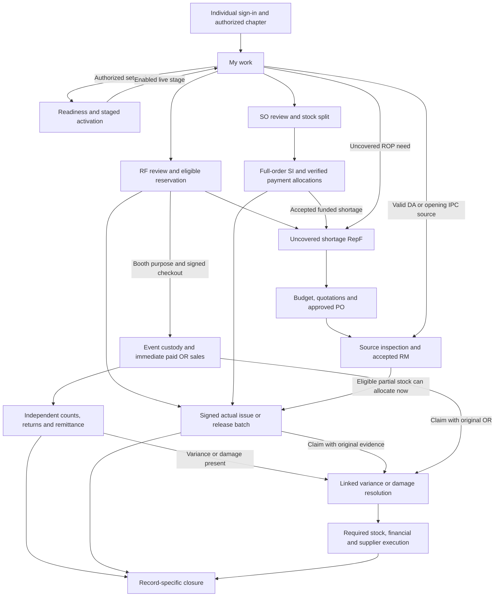
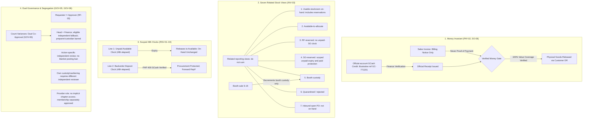

# YSP Chapter Operations — Application Flow

| Field | Value |
| --- | --- |
| Status | Reconciled flow review candidate; original flow Q1–Q19 retained; adopted additions UI-Q20–UI-Q26 recorded for review |
| Date | 19 October 2026 |
| Requirements baseline | PRD.md v1.2 review candidate; TRD.md v2.1 review candidate; PRD section 21 |
| Launch scope | One organization, Cebu pilot, four individual internal users |
| Delivery sequence | App flow → UI prototype if needed → implementation tickets → fresh context per ticket |

## Authority and scope

This review document translates the reconciled PRD/TRD into officer-facing screens, navigation and journeys. The candidate PRD defines product behavior and the candidate TRD specifies technical controls; both incorporate the dated decisions embedded in PRD section 21. Preserve its requirement IDs, glossary and explicit ambiguity resolutions; flow decision labels do not create or replace requirement IDs. The review PRD states product behavior; the review TRD states technical controls. PRD section 21 records this reconciliation, including the deliberate count-variance policy extension.

React/TypeScript, a modular Laravel API, MySQL and the approved low-cost single-host deployment remain settled (TR-01–TR-05; TR-25–TR-26). This phase does not implement the application, deploy it, create implementation tickets or choose final visual styling.

An interview answer may settle a screen or interaction choice. It does not alter a requirement, authorize a missing operational policy or invent a named officer assignment. Save agreed decisions here as the interview progresses. A completed flow requires a final shared-understanding check before any subsequent phase.

## Settled constraints from the TRD

| Area | Constraint shaping the flow | Requirement trace |
| --- | --- | --- |
| Identity and navigation | Four individual accounts may hold several chapter duties. Show active chapter; enforce membership and duty authority. Provisioning administration grants no automatic operational access. Buyers have no launch accounts. | GOV-01–GOV-04; SEC-01–SEC-03; SO-01; TR-16–TR-17 |
| Independence | Required independent acts use different individuals. Missing independent authority blocks the affected operation. Variances need Chapter Head and Finance plus independent fallback when those duties overlap. | GOV-05–GOV-07; GOV-09; TR-05; TR-10 |
| Setup and activation | Approved applicable inputs, opening/cutover evidence and recovery readiness gate live operations. Chapter Head explicitly activates the trial once for the enabled rollout stage. | GOV-08–GOV-12; MIG-01–MIG-08; SUB-01; TR-22; TR-24; TR-30 |
| Records and evidence | Expose related records, retained revisions, approval actors, source evidence and signed actual handovers. Printing or uploading a form alone is not a posting. Material changes require applicable reapproval; issued documents use linked corrections. | DOC-01–DOC-10; INV-07–INV-08; TR-09; TR-15 |
| Progress | Approval, stock readiness, payment, fulfillment and exceptions remain separate, including line and batch progress. Closure follows each record's rules. | TR-09; RF-08; SO-12; PAY-12; BTH-14; ADJ-10; TRD Appendix A.14 |
| Stock | Separate on-hand, availability, RF/SO reservations, booth custody, quarantine and inbound commitments. Preserve provenance, restrictions and approved allocation order. | INV-01–INV-14; TR-08; TR-14 |
| Internal requisition | Prepare/review/revise or cancel RF; reserve eligible quantities; procure shortages under chapter budget; allow accepted partial signed issues and repeat fulfillment. | RF-01–RF-08; PRC-01–PRC-09 |
| Track 1 | Staff records and reviews SO; retain partial/backorder acceptance; issue full-order SI; verify and allocate payments; release only covered actual quantities with signed customer DR. | SO-01–SO-12; PAY-01–PAY-12 |
| Clocks and funded demand | Available unpaid reservations and accepted-backorder deposit deadlines have separate 48-elapsed-hour clocks. Protection is scoped. Late payments require a fresh stock check. Funded cancellation needs authorized financial/procurement resolution. | RSV-01–RSV-10; PAY-11; TR-13 |
| Procurement and receiving | RepF uses uncovered net need and funding; budget/quotations/PO approval precede commitments. Inspect valid PO/DR, DA or IPC sources; post accepted RM quantities only. Partial accepted receipts can allocate immediately while discrepancies remain open. | PRC-01–PRC-09; RCV-01–RCV-13 |
| Booth | Signed checkout transfers custody. Immediate paid OR sales reduce booth stock once. Independent usable returns can post while damage, variance or remittance issues remain open. | BTH-01–BTH-10; BTH-13–BTH-14 |
| Adjustments | Claims/counts do not silently change balances. Inspect/recount before independent approvals; execute stock and financial treatment separately; preserve unresolved supplier/refund work. | ADJ-01–ADJ-10; PAY-10–PAY-12 |
| Outages and retries | Posting needs connectivity. Uncertain responses require operation lookup before retry; no full offline synchronization. Booth uses approved manual controls and later original-reference entry once. Recovery reconciles uncertain real-world activity before reopening. | DOC-11; UX-02–UX-03; BTH-11–BTH-12; SEC-05–SEC-06; TR-03–TR-04; TR-11–TR-12; TR-21; TR-23–TR-24 |
| Support and access | Role-scoped in-app alerts, recorded buyer contact, reports/PDF/CSV, responsive keyboard-usable forms and clear blockers are required. Read/export grace does not authorize new business postings or cancel obligations. | RPT-01–RPT-07; UX-01–UX-04; SEC-04; SUB-01–SUB-06; TR-18; TR-30 |

## Agreed interaction decisions

The user accepted all first-round recommendations (Q1–Q7) and all second-round recommendations (Q8–Q19) on 14 October 2026. These are presentation decisions within the unchanged TRD baseline. The two tables below form the agreed decision register.

| Decision | Agreed result | Requirement trace |
| --- | --- | --- |
| Q1 — Navigation across duties | One shared navigation menu exposes work authorized by the officer's assigned duties. No role-workspace switching is required. Each action identifies the duty being exercised; having multiple duties does not supply independent approval. | GOV-01–GOV-07; SEC-03; UX-01; TR-17 |
| Q2 — Starting screen | Login opens My work: approvals, payment verification, ready handovers, deadlines and unresolved exceptions. Reporting summaries have a separate overview screen. | RPT-01; UX-01 |
| Q3 — Connected documents | Use a connected transaction workspace with linked documents. Show approval, stock readiness, payment, fulfillment and exceptions separately. Individual documents remain directly accessible. | DOC-02; DOC-05; TR-09; UX-01 |
| Q4 — Booth selling | Provide a dedicated phone-friendly booth screen: select items, enter quantities, verify cash or actual official-account GCash credit, review total, then record the immediate sale and OR. Manual outage entry is visibly separate from new selling. | BTH-03–BTH-05; BTH-11–BTH-12; UX-01–UX-03 |
| Q5 — Signatures | Offer on-device signature capture and signed-paper upload within the same handover flow. Show recipient, actual quantities and acknowledgment time before completion. Both methods require valid evidence. | DOC-08; RF-04; SO-09; BTH-02; BTH-08; TR-15 |
| Q6 — Draft saving | Use explicit Save draft, an unsaved-change indicator and a navigation prompt. Preserve input after errors. Distinguish unsaved form, saved draft and committed operation. | DOC-04; GOV-02; UX-02–UX-03; TR-03 |
| Q7 — Readiness | Provide a shared readiness checklist linking to setup screens, showing missing approvals, responsible duties and blocked rollout stages. Chapter Head's live activation action remains explicit. | GOV-09; MIG-01–MIG-08; SUB-01; TR-30 |

### Agreed second-round decisions

| Decision | Agreed interaction package | Requirement trace |
| --- | --- | --- |
| Q8 — Menu grouping | My work; Requisitions; Sales; Inventory; Purchasing & receiving; Booths; Finance; Reports; Administration. Show authorized destinations only. Display Cebu in the shared header; chapter selection appears when multiple memberships exist. Separate provider/provisioning administration from chapter operations. | GOV-01–GOV-04; SO-01; SEC-03; UX-01; SUB-05; TR-17 |
| Q9 — Work queue | Group Needs my action, Waiting on others and Resolved/history. Put unresolved posting outcomes first, then overdue/deadline-sensitive work, then ordinary work. Show record, next action, due time and responsible authorized duty. Opening/reading an alert does not complete its business task. Independence blockers link to authorized alternate administration without granting authority. | RPT-01–RPT-02; GOV-04–GOV-07; DOC-11; UX-01–UX-03; RSV-01–RSV-10 |
| Q10 — Workspace presentation | Persistent reference/chapter and separate state summaries; tabs for Summary, Lines & progress, Documents, Activity. Show actual and remaining quantities per line/batch, scoped clocks, blockers with correction links and eligible next actions. Show blocked actions with a reason to authorized officers; omit actions/details outside their duties. | DOC-02–DOC-05; DOC-09–DOC-10; INV-03; RF-06; SO-07; SO-10; SEC-03; TR-09; UX-01–UX-04 |
| Q11 — Review and resolution | Review in the record workspace, showing evidence, actor/duty, material version and changes. Explicit Approve, Return for revision, or other record-specific hold/reject/cancel decisions with required reasons. No bulk approval. Material revision shows reapproval; cancellation previews affected stock, money and procurement. Separate approval from actual ADJ/refund/claim execution. | DOC-04–DOC-05; GOV-05–GOV-11; RF-03; SO-03; PRC-04; PRC-08; ADJ-01–ADJ-10; PAY-10–PAY-12; TR-09–TR-10 |
| Q12 — Allocation and partial handover | Review proposed eligible source allocation, restrictions, existing commitments and priority explanation before commitment. A handover batch selects actual quantities, shows allowed limits and remaining demand, records partial acceptance where needed and obtains signed evidence. Never default a partial batch to completing the entire order/request. | INV-02–INV-09; RF-04–RF-08; SO-04–SO-05; SO-08–SO-12; RCV-04; TR-10; TR-14 |
| Q13 — Payments and buyer follow-up | Separate panels for payment evidence/verification, procurement-funding designation and release coverage. Show amounts and remaining credit; prefill allocation suggestions but require Finance confirmation. Keep both clocks and actual verification/acceptance times visible. Record buyer acceptance/contact manually. Late or insufficient payments open linked resolution; approved refunds show a separate actual execution step. | PAY-01–PAY-12; RSV-01–RSV-10; SO-05–SO-08; RPT-02; TR-07; TR-13 |
| Q14 — Purchasing and inspection | RepF shows net-need components and funding blockers; quotation comparison and PO review stay linked. Receiving starts by selecting PO plus supplier DR, DA or opening IPC and shows delivered, accepted, rejected/held and missing quantities separately. Review accepted posting once and keep supplier follow-up/discrepancies visible alongside immediately allocatable stock. | PRC-01–PRC-09; RCV-01–RCV-13; INV-10–INV-14; DOC-02; TR-14 |
| Q15 — Booth trading and close-out | Use one review screen before the sale action, then an outcome/OR screen. Disable repeated submissions while checking an uncertain outcome; preserve the sale attempt. Separate Enter manual sale captures original OR/evidence and actual sale time; flag duplicates and missing ranges. Close-out uses independently verifiable stock returns/counts and a separate collections/remittance panel. Verified returns can complete while variance/remittance keeps the event open. | BTH-01–BTH-14; PAY-02; PAY-07; DOC-11; GOV-05–GOV-07; UX-02–UX-03; TR-11–TR-12 |
| Q16 — Evidence and physical handover | Prepare/print the handover document, verify actual goods and recipient, capture signature/upload signed paper, then confirm recording of actual handover. Preview evidence readiness and allow retry of failed upload. If handover physically occurred but recording is uncertain, show a reconciliation task; do not offer a second handover or imply a rollback recovered the goods. | DOC-06–DOC-08; INV-07–INV-08; UX-02–UX-03; TR-11; TR-15; SEC-06 |
| Q17 — Interrupted drafts and conflicts | Offer Save draft, Discard changes or Stay before leaving an unsaved form. Offline Save remains blocked and the open form remains visible; do not promise reload-safe offline storage. Session expiry offers reauthentication with access recheck. For stale records, show latest authorized values alongside entered changes and require review; never silently merge stock/payment/approval actions. For uncertain posting, check operation result before retry. | GOV-02; DOC-11; SEC-02–SEC-03; UX-02–UX-03; TR-03; TR-10; TR-12; TR-16 |
| Q18 — Readiness and service restrictions | Checklist sections: people/authority, policy/master data, opening/carried obligations, recovery/release evidence and commercial readiness. Link to scoped preparation/approval screens. Explain the enabled rollout stage and trial start in activation confirmation. Display trial/paid-through/grace status and scoped read/export access. Maintenance/recovery notices show affected operation blocks, next update and manual booth guidance when applicable; provider controls remain separate. | GOV-08–GOV-09; MIG-01–MIG-08; SEC-05–SEC-06; SUB-01–SUB-06; TR-21; TR-24; TR-30 |
| Q19 — Reports and background output | Report catalogue grouped by inventory, demand/procurement, finance/booths and controls. Filter/preview before PDF/CSV output. Show report time, actual versus entry date basis, units/currency and scope. A small output/job panel shows pending, ready or failed with responsible operator and authorized retry; regenerating output reuses issued document identity and never reposts business effects. | RPT-03–RPT-07; DOC-06–DOC-07; DOC-11; SEC-02–SEC-03; TR-04; TR-15; TR-18 |

### Adopted additions — UI-Q20–UI-Q26

The user authorized the recommended additions and corrections for this review package on 19 October 2026. These UI-prefixed labels replace the pulled document's colliding Q20–Q26 prototype labels; original product interview numbering remains unchanged. Design adoption does not establish a tested prototype or software. The referenced HTML prototype was not supplied in this checkout; no prototype verification is claimed.

| Decision | Adopted behavior | Requirement trace |
| --- | --- | --- |
| UI-Q20 — Operations map | Five scoped views: end-to-end workflow, money, seven stock views/custody, duty matrix, scenario tracer and node inspector linking S-01–S-22. Supporting view delivered after core workflows; accessible text alternative; illustrative data labeled. | ADD-01; ADD-08; GOV-01; SEC-03 |
| UI-Q21 — Queue filters | In-place action/waiting/history filters; uncertainty first, urgency preserved, scoped loading/error/empty states. | ADD-02; ADD-08; RPT-01; UX-01–UX-04 |
| UI-Q22 — Demand tabs | Summary, Lines & Clocks, Documents, History; preserve context, require explicit save/discard, no silent stale merge. | ADD-03; DOC-02–DOC-05; UX-02 |
| UI-Q23 — Signatures | Canvas with smoothing and Clear/Redo plus signed-paper upload fallback; recipient/batch preview; server-validated ready evidence and separate file/snapshot integrity. | ADD-04; DOC-08; TR-15 |
| UI-Q24 — Booth cart | Quantity buttons/input/reset with permitted precision, approved catalog and fresh stock/payment validation; uncertain-sale lookup; no posted-sale reversal from reset. | ADD-05; BTH-03–BTH-05; DOC-11 |
| UI-Q25 — Variance independence | No approval by the count preparer or affected custodian; Head/Finance approvals and independent fallback by eligible people. Ordinary claims retain configured approval. | ADD-06; GOV-05–GOV-06; ADJ-04 |
| UI-Q26 — Three-layer RBAC | Identity/chapter membership, canonical duty permissions and action-specific invariant checks. Provider membership requires separate approval. Staffing remains provisional. | ADD-07; GOV-01–GOV-07; TR-17 |

Detailed observable behavior and future acceptance scenarios are in PRD section 20; shared resolutions are in PRD section 21.

## Flow and screen notation

F-01–F-12 label journeys in this document; S-01–S-22 label screen families. These are local design references, not new requirement IDs or TRD source-node IDs. Source nodes retain their S1/S2/S3/S4 prefixes. Requirement ranges below are inclusive and preserve every original identifier.

Screen labels are officer-facing business language. Keep RF, SO, SI, OR, IS/AR, RepF, PO, RM, DA, IPC and ADJ alongside their TRD names. Use the Appendix B vocabulary, especially chapter, available-to-allocate stock, booth custody stock and funded backorder commitment. Supplier DR and customer DR always identify their context. No new domain term or changed definition was agreed, so the TRD glossary remains authoritative without a second glossary or ADR.

## Role-based navigation and screens

### Shared shell

After individual sign-in and required MFA, select an authorized chapter when necessary and open My work. A single Cebu membership opens Cebu directly while keeping the chapter visible. Show current identity, chapter, service/entitlement notice and access to permitted destinations. Multiple duties yield the union of authorized destinations; sensitive fields, evidence and actions retain their own checks. Changing an action's displayed duty does not change the person's identity or confer independence. Unauthorized document links return an access explanation without revealing protected record details (GOV-01–GOV-07; SEC-01–SEC-03; TR-16–TR-17).

Phone and desktop use the same destinations and business flows. Exact navigation positioning, typography and visual treatment can be evaluated in a later prototype without changing this flow. Phone views must preserve quantities, state text, next action, blockers and signatory review; keyboard and small-screen use cannot depend on hover or color alone (UX-01–UX-04; TR-28).

### Screen inventory

| Screen | Menu / surface | Content and actions | Authorized audience and trace |
| --- | --- | --- | --- |
| S-01 Identity & chapter | Entry/account | Sign-in, MFA enrollment/challenge/recovery, sign-out; authorized chapter selection; account/membership disabled feedback. Recovery restores existing authority only. | Individual users; approvers/admins require MFA. GOV-01–GOV-04; SEC-01–SEC-03; TR-16–TR-17 |
| S-02 My work | My work | Needs my action, Waiting on others, resolved/history with dynamic zero-reload tab filtering (`filterQueue`); current record, duty, deadline and actionable link; uncertain outcomes pinned first. Alerts cover approvals, deadlines, shortages, ready/overdue pickup, receiving, low stock and booth exceptions. | Scoped to chapter/duty; RPT-01–RPT-02; UX-01–UX-03; GOV-04–GOV-07 |
| S-03 RF list & editor | Requisitions | Draft/submit RF with requesting unit/person, items/variants, quantity, purpose, need date and justification; filters and own authorized committee scope; internal versus booth purpose. | Committee requester and assigned reviewers; RF-01–RF-03; DOC-01–DOC-05 |
| S-04 Demand workspace | Requisitions / Sales | Shared RF/SO layout with zero-flicker in-place tab switching (`switchDemandTab`) across Summary & Review, Lines & Clocks, Connected Documents (SI/OR/DR/RepF), and Version/Approval Audit History; review, revision, reservations, partial acceptance, shortages, signed batches and cancellation impact. | Respective requester/Sales/reviewer/Inventory/Dispatch duties; RF-01–RF-08; SO-01–SO-12; INV-05–INV-09; DOC-02–DOC-11 |
| S-05 SO list & editor | Sales | Buyer record entered by Sales; terms/prices/discounts, quantities, arrangement/date; review; acceptance and contact log. No buyer login screen. | Sales and authorized Sales/Finance reviewer; SO-01–SO-07; SO-11–SO-12; RPT-02 |
| S-06 Payment & coverage | Finance / linked SO | Evidence, actual receipt/verification times, channel/account/reference and actors; OR issue/registration; allocations, funding designation, release coverage, credit/balance and refunds/reversals. Sales Invoice is billing only; release gated 100% on verified OR payment coverage. | Authorized collectors, Finance and scoped Sales read access; PAY-01–PAY-12; RSV-02; RSV-05–RSV-09; SEC-03 |
| S-07 Allocation & handover batch | Inventory / linked demand | Eligible source quantities and restrictions; priority explanation; fresh limits, actual issue/release quantities and remaining demand; customer DR / IS-AR; dual-mode signature capture via interactive HTML5 Canvas pad (Bezier curves, Clear/Redo) or paper scan upload, generating verified SHA-256 evidence digests before posting. | Inventory/Dispatch, authorized recipients and applicable reviewers; INV-02–INV-09; RF-04–RF-08; SO-08–SO-10; DOC-08; TR-11; TR-15 |
| S-08 Inventory overview & item | Inventory | Items/variants/units, approved price/ROP/target history; source lots; seven separate related views: usable on-hand including reserved goods, available, RF-reserved, SO-reserved, booth custody, quarantine/rejected and inbound PO; movement drill-down. | Scoped authorized duties; INV-01–INV-14; RPT-03; TR-07–TR-08 |
| S-09 Reservations & shortages | Inventory / linked demand | Parent/line quantity, history, expiry/protection and consumed/released quantities; low stock/net need; existing RepF/PO coverage; overrides through approval. Two 48-hour elapsed clocks tracked separately. | Inventory with Sales/Purchasing views as authorized; INV-04–INV-12; RSV-01–RSV-10; PRC-01–PRC-03 |
| S-10 RepF workspace | Purchasing & receiving | Trigger/demand links, uncovered need components, urgency, estimates/funding, OR allocation gate; budget review, return/hold/cancel and revisions. | Inventory preparer, Purchasing and independent budget authority; PRC-01–PRC-04; PRC-08–PRC-09; GOV-05; RSV-05–RSV-06 |
| S-11 Quotations & PO | Purchasing & receiving | Like-for-like comparison; selection rationale, policy/emergency approvals; PO review/issue, acknowledgment, quantities, terms, date and changes; outstanding/disputed supply. | Purchasing and applicable independent budget/purchase authority; PRC-05–PRC-09; GOV-10–GOV-11 |
| S-12 Receiving & discrepancies | Purchasing & receiving | Select approved PO plus supplier DR, DA or IPC; actual inspection counts/specification; accepted/rejected/held/missing quantities; accepted RM posting and separate correction/follow-up. | Receiving, required representatives, Inventory and authorized source reviewers; RCV-01–RCV-07; RCV-09–RCV-13; INV-07; INV-14 |
| S-13 Donation & opening sources | Inventory / readiness links | DA acknowledgment/restrictions/valuation; IPC cutoff, independent counts, signatures, condition/location and one-baseline status; links to RM. | Authorized donation/count officers, Chapter Head, Finance, independent counter and Receiving; RCV-08–RCV-13; MIG-01–MIG-04 |
| S-14 Booth event & checkout | Booths | Event RF, approved configurable price list/float, custodian/cashier and schedule; signed checkout into event custody. Float is separate from revenue. | BTH-01–BTH-02; BTH-06; RF-01–RF-08 |
| S-15 Booth sale | Booths / selected event | Eligible event stock → items/quantities via increment/decrement steppers (`+`/`-`), numeric entry, and cart reset → cash/actual official GCash verification → review → sale/OR outcome. Includes approved event catalog lines; `YSP-KIT-STD` is an illustrative SKU, not required master data. Sale decrements Booth Custody Stock only. Out-of-stock/custom demand links to Sales for Track 1. | Authorized booth cashier; BTH-03–BTH-05; PAY-01–PAY-04; UX-01–UX-03 |
| S-16 Manual booth entry | Booths / selected event | Original manual OR, actual sale and entry times, payment verification evidence and sold items; receipt-range reconciliation, duplicates/missing references. Separate from new sales. | Authorized entry cashier and independent reconciliation duty; BTH-11–BTH-12; PAY-07; DOC-07; DOC-11 |
| S-17 Booth close-out | Booths / event | Independent usable/damaged/unexplained counts; signed usable returns; variance ADJ; separate float liability, cash sales/refunds, deposits/remittances and official-account GCash reconciliation; visible closure blockers. | Custodian/cashier plus different independent review, Finance and variance approvers; BTH-06–BTH-14; GOV-05–GOV-07 |
| S-18 Claims, counts & ADJ | Linked source / Inventory / Finance | Source-linked inspection/recount, cumulative limits, configured claim approvals, proposed stock/financial treatment and follow-up. Count preparer/affected custodian barred from variance approval; Head/Finance and independent fallback as GOV-06. | Scoped duties from TRD Appendix D; ADJ-01–ADJ-10; GOV-05–GOV-06 |
| S-19 Finance reconciliation | Finance | Track 1 SI/OR/DR match, booth collections/remittances, receipt sequences, cash/GCash matching and unresolved differences; independent overlap review. | Finance and authorized independent reviewer; PAY-09–PAY-12; GOV-07; RPT-05 |
| S-20 Reports & overview | Reports | Separate summaries; inventory, demand/procurement, finance/booth and control catalogue; date/item/event/status filters, date basis, scoped preview/PDF/CSV; retained history/count review. | Per-report and per-evidence authorized duties; RPT-03–RPT-07; SEC-03–SEC-04; TR-18 |
| S-21 Chapter administration & readiness | Administration | Memberships/roles/alternates and disable actions within authority; versioned operational/financial settings; sequences/templates; approved readiness evidence and staged activation; subscription status. | Chapter Head, Finance and other configured setup administrators within authority; GOV-04; GOV-08–GOV-12; SEC-02; MIG-01–MIG-08; SUB-01–SUB-03 |
| S-22 Provider & technical administration | Separate administration surface | Chapter/initial Head provisioning; provider subscription verification/extension; funded preservation plan; operator maintenance/recovery/job status and evidence. Provider authority gives no implicit operational chapter access; separately approved chapter membership is required. | Provisioning/provider/technical lead/backup with explicit authority; GOV-03; SUB-02–SUB-06; TR-04; TR-17–TR-25; TR-30 |
| **Perspective 4** | Operations Architecture Map | Supporting overview with five views: end-to-end workflow, money/OR, seven related stock views and custody, duties/independence, and scenario tracer with node inspector linking S-01–S-22. Scenario examples are labeled; live details and linked actions remain scoped. | Chapter/duty-authorized officers and reviewers; ADD-01; ADD-AC-12 |

Documents/evidence and pending/ready/failed operation/output panels are reusable parts of these screen families, not extra top-level destinations. Lists and connected records support direct authorized links. Role-scoped navigation and query enforcement apply equally to downloaded files and queued output (DOC-02; DOC-06–DOC-11; SEC-03; RPT-07; TR-04; TR-15–TR-18).

### Journey connections

Each arrow preserves the initiating record and leads to the next authorized officer's work. It does not bypass the approval, payment, source or signature gates described below.

### Four-person coverage and lightweight RBAC architecture

Check current identity and chapter membership, chapter duty grants, then transaction-specific independent controls. Use [embedded duty and permission matrix](TRD.md#appendix-d-shared-role-matrix-and-candidate-control) for the canonical fourteen chapter duties and provisional four-officer coverage example. Neither a user ID nor a displayed role bypasses runtime checks. Provider authority grants no implicit chapter access; separately approved membership can authorize scoped operations.

Actual assignments, requesting-unit scopes, limits and alternates remain approved setup inputs. Do not seed pseudonymous identities as actual officers. For booth close-out, a selling cashier's second role does not make them independent of their own sales; use an eligible different officer. A missing independent officer blocks the relevant action. Count-variance preparers/affected custodians cannot sign either approval step; Head/Finance overlap requires an eligible independent co-approver or approved alternate. Ordinary claim preparers cannot be sole approvers. No blanket preparer inequality applies to every posting.

Requester → independent RF approver → Inventory → recipient is the RF responsibility chain. Sales → authorized Sales/Finance reviewer → payment verification/allocation → Dispatch → recipient is Track 1. Inventory/need owner → independent budget/purchase authority → Purchasing → Receiving/Inventory is procurement. Custodian/cashier → independent counter/reconciler → Finance plus variance approval where needed is booth close-out. Each role can be covered by an existing account only where the specific independence controls allow it.

### Perspective 4 — Bird's-Eye Operations Architecture & Process Flow Map

Perspective 4 is the adopted supporting operations map design; implementation and prototype verification remain future work. It is delivered after core workflows and is not a dependency of stock/payment posting. It provides officers, auditors, and technical leads with an end-to-end mental model of how customer money, stockroom merchandise, booth event custody, purchasing restocks, and dual approvals flow across all 22 screens.

#### The 4 Core Operational Invariants

#### The 5 Interactive Operations Views

1. **View 1 — Full 5-Swimlane End-to-End System Map:**
   - **Swimlane 1 (Demand & Intake):** Requisition draft (S-03) and sales order entry (S-05) route to connected demand workspace (S-04) for independent review.
   - **Swimlane 2 (Financial Clearance & OR):** Billing via full-order SI, payment verification, OR registration, and release coverage (S-06), reconciling with bank/GCash statements (S-19).
   - **Swimlane 3 (Stock Allocation & Handover):** Eligible source reservation (S-07), stockroom overview (S-08), 48h clocks (S-09), and signed batch releases (S-07).
   - **Swimlane 4 (Event Booth Selling & Remittance):** Event RF checkout to booth custody (S-14), immediate cash/GCash sales via steppers (S-15), manual outage entries (S-16), and close-out with cash float return and remittance (S-17).
   - **Swimlane 5 (Purchasing, Restocks & Receiving):** Shortage/ROP RepF (S-10), quotation comparison and PO issue (S-11), physical inspection and RM posting (S-12), and donation/opening baseline (S-13).
   - **Cross-Lane Governance & Claims:** Source-linked ADJ (S-18) using configured return/replacement approval, Finance for refunds/unequal exchanges, and Head/Finance plus independent coverage for count variances; supplier discrepancies retain their authorized receiving/claim process.

2. **View 2 — Money, Collections & Official Receipts Flow:**
   - **Track 1 Order:** Sales Order $\rightarrow$ Full SI $\rightarrow$ GCash/Cash Collection $\rightarrow$ Finance Verification $\rightarrow$ Official Receipt (OR) $\rightarrow$ Release Coverage Consumption $\rightarrow$ Customer DR Handover $\rightarrow$ S-19 Finance Reconciliation.
   - **Track 2 Booth Event:** Approved configurable float → verified cash/GCash sales and OR → separate float return, sales remittance and GCash reconciliation. Use actual refunds, deposits and prior returns once; see BTH-06. Sample amounts and references are illustrative only.
   - **Replenishment Procurement:** RF/ROP shortage → chapter budget/purchasing approval → PO → accepted RM. Accepted SO shortage → verified OR funding at approved shortage cost → budget/purchasing approval → PO → accepted RM. An unpaid SO shortage cannot be relabeled RF/ROP to bypass funding.
   - **Defect Refund:** Source DR/OR Claim $\rightarrow$ ADJ Inspection $\rightarrow$ Finance Approval $\rightarrow$ Refund Execution $\rightarrow$ Negative Payment Entry.

3. **View 3 — Physical Stocks, Lots & Custody Flow:**
   - Separate presentation of the seven related balance views (`INV-03`).
   - Lot provenance maintained from PO delivery / DA donation through RM receipt into stock positions.
   - Booth custody stock completely decoupled from stockroom available stock during active selling.

4. **View 4 — Dual Governance & Segregation of Duties Matrix:**
   - Fourteen chapter duties from TRD Appendix D with provisional staffing and explicit alternate coverage; provider duties are separate.
   - Visual segregation identifies the actual count preparer/affected custodian and required independent approving people. Provider roles confer no implicit chapter authority.

5. **View 5 — Live Scenario Flow Tracer & Persistent Node Inspector:**
   - Interactive step-by-step trace of real-world scenarios: (A) Track 1 Sales Order with backorder and GCash deposit, (B) Track 2 Booth Event with float and close-out, and (C) Purchasing Replenishment.
   - Integrated Node Inspector providing screen metadata (ID, Actor, Duty, Invariants, Input/Output Documents, Next Actions) with 1-click jump links to all 22 screens (S-01 through S-22).

## End-to-end officer journeys

### F-01 — Identity, authority, readiness and activation

**Screens:** S-01, S-02, S-13, S-21, S-22. **Trace:** GOV-01–GOV-12; SEC-01–SEC-06; MIG-01–MIG-08; SUB-01–SUB-06; RCV-08–RCV-10; TR-16–TR-25; TR-30.

1. Provisioning administrator creates the chapter and initial Chapter Head through S-22. That action alone provides no transaction membership. Head authorizes the four named memberships, duties, limits and alternates through S-21; each individual signs in and completes required MFA.
2. Readiness sections link to people/authority, policy/master data, opening/carried obligations, recovery/release evidence and commercial terms. Every prerequisite shows its required approving duty, approved version/effective date, evidence and affected stage; missing input blocks only its affected operations.
3. Prepare reviewed unit precision, prices/discounts, ROP/target/priority, quotation/emergency rules, official GCash/channels, financial templates/sequences, return/refund rules, donation/valuation/restrictions, booth schedules, retention and count/report frequency. Approval follows TRD Appendix A.4.1; do not prefill invented policy amounts or windows as approved values.
4. Record cutoff and pause informal movements during independent opening count. At least two people, one independent of the regular custodian, count item/variant/location/condition. Chapter Head and Finance sign IPC; accepted inspected RM quantities post once. Damaged/held goods are separate, the baseline locks, and later discoveries go through ADJ.
5. Reconcile carried RF/SO, verified payments, POs and booth custody against original evidence. Show outstanding imported obligations separately. Included physical opening stock cannot be received again from its old delivery; carried payments are not new cash and inbound POs are not on-hand.
6. Record gate evidence and approval for setup/opening (Gate 1), internal/receiving (Gate 2), Track 1 (Gate 3), and booth (Gate 4). Enabled stage is explicit; staged activation never marks full scope complete. Technical lead and trained backup supply recovery rehearsal evidence; incomplete recovery readiness blocks live activation.
7. Chapter Head reviews activation: readiness for enabled stage, original chapter identity, provider terms/funding, exact trial start/end and 30 elapsed days. Confirm once. Later stage enablement never resets the original trial.
8. Provider verifies subscription payments separately and records paid-through/extension/reactivation history. At unpaid trial expiry, display read/export-only grace for 14 elapsed days; block new officer business postings, including queued ones. Preserve funded obligations and essential deadline/history/security/backup/reconciliation controls. Commercial post-grace terms govern later access, not an invented automatic delete/forfeit action.
9. Disable/reassign authority through authorized administration with retained attribution and active-session revocation. Recovery grants no additional chapter duties. A chapter change prompts Save/Discard/Stay for unsaved forms; saved drafts retain their original chapter and require explicit review rather than relabeling.

### F-02 — Internal requisition and repeated partial issue

**Screens:** S-03, S-04, S-07–S-12. **Trace:** RF-01–RF-08; INV-01–INV-12; DOC-01–DOC-11; GOV-05; PRC-01–PRC-09; RCV-04; AC-01–AC-02; AC-14–AC-16.

Requester saves/submits RF and chooses internal-use or booth purpose. Independent authorized department approver reviews completeness/necessity. Approval sends demand to Inventory; nonapproval returns the same reference with reason. Requester revises/resubmits under fresh review or cancels with history. Material changes invalidate the affected earlier approval.

Inventory reviews current eligible stock and source restrictions, commits available quantity and identifies shortage. If enough, prepare actual IS/AR batch; if short, preserve eligible reservation and follow F-05 for uncovered chapter-funded RepF. RF shortages require chapter budget authority, not buyer deposit. Recipient can accept a partial issue; remaining demand stays open. F-08 records signed actual quantities and posts only that batch. Accepted incoming goods allocate under the agreed priority for repeated signed batches. RF closes only when demand is issued/formally canceled; booth-purpose RF additionally waits for F-07 close-out.

### F-03 — Track 1 order, billing, backorder and fulfillment

**Screens:** S-04–S-07, S-09–S-12. **Trace:** SO-01–SO-12; PAY-01–PAY-12; RSV-01–RSV-10; DOC-01–DOC-11; INV-02–INV-12; PRC-01; RPT-01–RPT-02; AC-02–AC-03; AC-08–AC-11; AC-14; AC-20.

1. Sales records buyer, item/variant/quantity, approved price/discount/terms, requested date and pickup/delivery arrangement. Reviewer approves or returns for revision/cancellation with reasons. No unapproved reservation or funding commitment proceeds.
2. Inventory commits currently eligible available quantities and shows shortages separately. Each unpaid available quantity retains creation time and a 48-elapsed-hour expiry. Finance approves shortage cost before Sales requests a deposit. An estimate exceeding agreed sale amount opens pricing/budget review; no silent extra buyer charge.
3. Sales records shortage/lead-time communication and the buyer's actual partial/backorder acceptance or decline. Acceptance starts the independent 48-hour deposit clock. Declined quantities are canceled and unused reservations released without procuring them. Revised terms require relevant approval and new buyer acceptance.
4. Issue the full-approved-order SI promptly upon reservation/backorder acceptance, visibly distinguishing available/backordered quantities. Retain SI identity and adjustments when a remainder changes. SI alone and screenshots alone never prove payment.
5. F-04 verifies actual cash/official GCash, issues/registers OR and confirms Finance allocations. Fully paid available quantities are protected. A timely verified accepted deposit meeting the approved procurement cost protects only the designated funded backorder and its later eligible stock. Forward shortage RepF only after the allocated cost gate and OR evidence pass.
6. Expiry releases only unpaid/unprotected reservations; lapse cancels only unfunded backorder quantities. On-hand never increases because of expiry. A below-minimum partial payment remains visible for financial resolution. Sales receives a required contact task recording time/channel/outcome for payment holds and expired quantities. Neither unread alerts, pending screenshots nor staff delay extends the clocks.
7. Accepted incoming stock can allocate immediately even on an incomplete PO. Show ready stock separately from remaining payment due. Every release batch checks actual merchandise-value coverage, current eligibility, approvals and recipient evidence through F-08. Consume coverage only for actual quantities; preserve customer deposit credit without collecting it twice.
8. Late verified money checks current stock again. If fully paid eligible stock exists, create a fresh paid allocation with old expiry history and no unpaid timer. Otherwise obtain accepted backorder or Finance-approved refund resolution. Another officer's existing commitment cannot be displaced silently.
9. Show cumulative paid/released/outstanding/canceled quantities and linked supplier/financial work. Overdue paid pickup creates follow-up, never automatic forfeiture or release of protected stock. Funded cancellation/supplier failure checks PO commitments and runs F-09 authorized resolution. Fully fulfilled means all accepted quantities released; a formally canceled remainder is distinctly shown and overall closure waits for linked obligations.

### F-04 — Payment, allocation and finance reconciliation

**Screens:** S-06, S-19, linked S-04/S-17/S-18. **Trace:** PAY-01–PAY-12; GOV-07; RSV-02–RSV-09; SO-07–SO-08; DOC-06–DOC-11; TR-07; TR-12–TR-13; AC-03; AC-08–AC-11; AC-18; AC-20.

Collector records payer, amount/channel/official account, actual cash/credit receipt time, collector/verifier/reference and evidence. Unverified evidence remains pending with no OR or release authority. Authorized cash collector confirms actual cash; Finance/authorized booth cashier confirms actual credit in the designated GCash account. Screenshot attachment is evidence to inspect, not verification.

After verification, issue/register unique approved OR against SO/SI or booth event. External and generated copies identify the same payment. Duplicate reference detection uses appropriate account/series scope and reveals no other chapter's protected data. Legitimate installments use separate references.

Finance sees verified receipt, designated procurement funding, release coverage allocated/consumed and remaining net customer credit separately. Suggestions require confirmation; totals and concurrent refunds/releases remain authoritative. The PHP 400 deposit plus PHP 600 later receipt on a PHP 1,000 SO remains PHP 1,000 received even when the deposit enables procurement.

Reconcile SI/OR/customer DR and event OR/remittance, receipt sequences, cash deposits and GCash credits. Duty overlap retains all actors and requires independent sales-document and cash/bank review under policy. Financial adjustments and refunds retain original records; approved refund remains pending until actual verified execution is recorded. Unresolved money or supplier cost prevents resolution/closure even after some goods are delivered.

### F-05 — Shortage/ROP procurement and supplier commitments

**Screens:** S-08–S-12. **Trace:** PRC-01–PRC-09; INV-09–INV-12; RSV-05–RSV-06; GOV-05; GOV-09–GOV-11; DOC-02; DOC-04–DOC-05; AC-15–AC-16; AC-20.

Inventory proposes uncovered RF shortage, funded/accepted SO shortage or ROP need. RepF itemizes target, eligible usable stock, reservations/outstanding demand, relevant confirmed inbound and replenishment in progress; combine overlapping triggers once. Preserve active commitments/funded allocations, then approved priority, need date and approval time. Display late/disputed/ineligible supply with approved reasons for any additional procurement. Low stock is on-hand ≤ approved ROP; shortage may still exist above ROP.

For SO shortage, keep Finance-approved cost and allocated verified OR funding visible; unfunded demand cannot be relabeled as chapter ROP/RF need to bypass funding. Independent authorized budget reviewer approves need/funding/limits or holds/returns/cancels RepF with reasons. Denial makes no PO and leaves parent demand pending unless separately canceled; revision returns to review.

Purchasing records quotation policy compliance and comparable offers (specification, cost, lead time, quality/warranty, reliability and terms), selection rationale and any approved emergency justification. Prepare PO, obtain supplier-selection/purchase approval and issue. Notify affected Inventory/demand duties; Sales records required buyer communication. PO is inbound commitment only. Changes/substitution/cancellation require material review, linked funded-demand/supplier impact and notification. Shortage stays open until eligible acceptance/allocation or formal resolution.

### F-06 — Receiving, partial acceptance and restricted donations

**Screens:** S-12–S-13, S-08–S-09, linked S-11. **Trace:** RCV-01–RCV-13; INV-02; INV-07–INV-09; INV-14; PRC-07–PRC-09; DOC-01–DOC-11; AC-04; AC-07; AC-12; AC-21.

Select purchased approved PO plus supplier DR, donation DA, or approved opening IPC. Missing source keeps goods held outside usable inventory while documents are obtained or authorized rejection/return is resolved. Locked opening baseline cannot be replaced with a later IPC to legalize found goods.

For donations, record donor, valuation/basis, restrictions, authorized acknowledgment and condition. DA creates no cash payment or OR. Inspect actual descriptions/variants, packaging, quantities/quality with required technical/requesting representatives. Record delivered counts, accepted units, rejected/held units and missing quantities separately; disputed overdelivery/substitution waits for applicable amended authority rather than silently accepting it.

Review and post only accepted RM quantity once. On a PO for 100 accepting 40, stock increases by 40 and outstanding accepted need remains 60, subject to formal resolution; accepted eligible goods can allocate now. Rejected goods remain unavailable; replacement/return/decline/disposal follow-up persists. PO receiving completes only when accepted quantity is complete or remaining quantity formally resolved; independent discrepancies can still stay open. DA/IPC receipts skip the PO-outstanding comparison. Later deliveries repeat source/inspection/RM without reposting prior batches. Donor restrictions remain on sources and are enforced at allocation/handover; changing donor conditions requires documented authorized resolution, not an ordinary override.

### F-07 — Booth setup, immediate sale, manual entry and close-out

**Screens:** S-14–S-17, S-07, linked S-18/S-19. **Trace:** BTH-01–BTH-14; RF-01–RF-08; GOV-05–GOV-07; PAY-01–PAY-04; PAY-07; PAY-09; ADJ-01–ADJ-10; AC-05–AC-06; AC-17–AC-18.

1. Prepare approved booth RF/event setup with dates, item quantities, approved price list, custodian/cashier, approved configurable cash float (separate custody liability, excluded from revenue) and remittance schedule. Shortage follows chapter-funded F-05. Inventory prepares IS; custodian counts and signs actual IS/AR. Confirm checkout once into named event custody before trading; separate simultaneous events retain distinct custody.
2. Cashier selects eligible booth items/quantities via responsive increment/decrement steppers (`+`/`-`), direct numeric inputs, or 1-click cart reset on S-15. Complete event catalog is supported, including configured event-authorized merchandise kits (sample SKU `YSP-KIT-STD`). Cashier verifies actual cash in drawer or confirmed official-account GCash credit (illustrative reference GC-771201) and reviews total. Record the immediate paid sale with its actual handover and OR; outcome shows committed reference and event remaining stock. Do not add SO, SI, customer DR or a per-sale reservation. Sale reduces booth custody once, never stockroom again. Unverified credit, unavailable goods or unauthorized discount blocks sale; custom/out-of-stock demand becomes staff-recorded Track 1.
3. An uncertain sale response invokes F-11 operation lookup and prevents a second submission/receipt/handover. If physical money/goods already moved, preserve the real-world facts for reconciliation even when the database outcome is absent or unknown.
4. During connectivity loss, display approved manual receipt/count guidance. Manual cash or independently confirmed actual official GCash credit can support immediate handover under approved controls; inability to confirm GCash does not permit credit sale. Record original receipts/counts manually, not offline app synchronization.
5. On restoration, Enter manual sale records original OR/series, actual sale time, actual entered time, officer, items/payment and evidence. Post each original sale/payment once to event custody; do not issue another OR. Missing ranges, stock conflicts and duplicates remain reconciliation issues. If the restored state lacks checkout/custody or a prior uncertain sale may already exist, investigate before posting.
6. Close-out shows expected unsold by item/variant from actual signed checkouts minus sales and approved movements. Independent counter records actual usable, damaged and unexplained units with signed evidence. Verified usable returns post through F-08 while unexplained custody and damage remain visible. Damage blocks use immediately without an unapproved quantity write-off; variance routes to F-09 dual approval.
7. Finance separately reconciles actual float issued/returned, cash sales/refunds, cash deposits/prior remittances and GCash credits. Apply BTH-06 and show remaining cash due and actual differences. Amounts are configurable; a completed stock count does not resolve missing remittance.
8. Close booth RF/event only after checkout/sales/returns, damages/variances and collections/remittance have authorized resolution with evidence. The 100 checkout → 30 sale → 70 return example gives stockroom net −30 and booth zero; closing must not deduct another 30.

### F-08 — Signed physical handover and evidence lifecycle

**Screens:** S-07 plus reusable document/evidence panel in S-04/S-14/S-17/S-18. **Trace:** DOC-03; DOC-06–DOC-08; INV-05; INV-07–INV-08; RF-04–RF-07; SO-08–SO-10; BTH-02; BTH-08; ADJ-05–ADJ-07; TR-10–TR-11; TR-15; UX-02–UX-03.

Select actual permitted batch quantities, review current eligible source and applicable financial coverage, then prepare/print the handover form. Verify goods with named authorized recipient/custodian and retain actual acknowledgment time plus captured signature evidence. S-07 supports dual-mode signature evidence capture:
- **Method A (Interactive On-Device Signature Pad):** Captured directly on-screen using an HTML5 Canvas pad featuring touch/mouse event tracking, real-time quadratic Bezier curve stroke smoothing, Clear/Redo controls, and export to base64 image data.
- **Method B (Signed Paper Scan Upload):** Uploads physical signed paper delivery receipts with client-side file staging, MIME/size validation, and preview.

For both methods, the server validates stored evidence bytes and computes `evidence_objects.content_hash`, pinned by `evidence_bindings` to the file/version. The separate `acknowledged_snapshot_hash` identifies the exact recipient and batch acknowledged. A material quantity/recipient change requires new acknowledgment; hashes protect integrity and do not prove identity. Bind ready evidence before atomic customer DR or IS/AR posting. IS/AR supports RF/checkout/return as applicable; customer DR supports Track 1; replacement acknowledgment links ADJ/DR. Booth immediate sales remain F-07 without an added signature requirement.

Upload panel distinguishes staging/uploading, validation pending, ready and failed/quarantined; attachment readiness requires type/content/size checks and authorized immutable linkage. Failed upload preserves other input and provides correction/retry. Missing or suspect evidence blocks the posting needing it, not unrelated permitted drafts. Historical missing evidence produces a reconciliation issue, not silent replacement of signed history. Downloads remain private/duty-scoped.

Preparation, printing, uploading or signing alone does not post a movement. Confirm records only actual signed quantities once and returns committed operation/movement references, state and remaining demand. If actual handover occurred before a stale-version failure, lost response or outage, show unrecorded/uncertain physical activity and reconciliation rather than assuming goods returned. Resolve current stock/payment/authority safely before any authorized record correction; do not tell an officer to repeat the physical handover.

### F-09 — Claims, count variances, quarantine and funded exceptions

**Screens:** S-18, linked S-04/S-06/S-11/S-12/S-17/S-19. **Trace:** ADJ-01–ADJ-10; INV-13–INV-14; GOV-05–GOV-06; GOV-10; PAY-10–PAY-12; PRC-08; RCV-06; SO-12; AC-06; AC-13; AC-17; AC-20.

Start source-linked ADJ from Track 1 OR plus signed customer DR, booth original OR, or count/IPC/booth evidence. Preparation does not change stock; physically returned/damaged goods are held unavailable. Check genuine evidence, configured return window/eligibility and cumulative sold/issued/returned/replaced/refunded limits. Inventory inspects current/proposed condition before approval; count variance requires independent recount. Missing/contradictory evidence remains correction/investigation.

Configured ordinary return/exchange approval must include an authorized person independent of the preparer being sole approver. Refunds and unequal exchanges additionally require Finance. Count variances require Chapter Head and Finance approval by at least two distinct authorized people. The count preparer and the custodian whose stock is being checked cannot approve that variance. If one person holds both approving duties, retain both duty decisions and require an authorized independent co-approver, or use an approved alternate for a duty. No preparer/custodian may serve as that fallback. Missing independent coverage blocks approval; holding multiple roles does not bypass it. Provider/provisioning roles grant no automatic chapter operational authority. The same individual may receive separately approved chapter membership and duty grants; operational actions must use and audit that chapter authority and satisfy the same independence checks. Provider-role possession alone never satisfies an operational sign-off.

Show each required approving duty/actor, remaining approvals and material version. Rejection/return retains reason and posts no stock change. Investigation/revision loops return to inspection/review with retained original count/custody.

Approved inspected resalable return can enter usable stock; nondefective but unsalable remains unavailable. Even exchange releases actual eligible replacement with acknowledgment; defective return goes to quarantine/rejected and links supplier claim/RM/PO. Unequal exchange/refund additionally needs Finance and linked financial adjustment: show extra due/refundable, verify applicable extra money before higher-value replacement, distinguish approved refund from actually executed verified refund. Quarantine clearance, supplier return/replacement or disposal needs authorized evidence and supported movement.

Post approved variance quantity/location once; refresh reports/ROP without a second movement. Stock posting does not resolve outstanding refund or supplier claim. Funded cancellation/supplier failure/extra procurement cost/overdue paid goods starts linked Sales/Finance resolution, checks live POs, previews demand/reservation/payment/stock impact, and retains approvals and actual actions. Never automatically forfeit credit, cancel funded demand or conceal costs.

### F-10 — Reporting, review and retained history

**Screens:** S-20 with reusable output panel and authorized source workspaces. **Trace:** RPT-01–RPT-07; DOC-01–DOC-02; DOC-06–DOC-11; SEC-02–SEC-04; TR-04; TR-15; TR-18; AC-23.

Choose scoped report group and filters for chapter, date, item, event and state; distinguish actual occurrence from entry/verification/posting date basis. Preview quantities/categories, units, PHP amounts, report timestamp and open exceptions before printable/PDF/CSV output. Stock categories, inbound/demand commitments, donation restrictions, financial allocations/refunds, booth cash float/collections and source/actor history remain distinguishable.

Output panel shows pending, ready or failed, responsible operator and authorized retry. A print/PDF retry regenerates the same issued immutable snapshot and document number; a new report is a new scoped query, not a business posting. Recheck current access before generation/delivery/download. Disabled users cannot receive queued protected output. Voids/sequence gaps retain reasons; externally issued copies link the existing transaction. Approved archival preserves links and audit readability; disposal is only under approved retention policy, never an ordinary balance-correction action.

### F-11 — Drafts, conflicts, duplicate retries and failed jobs

**Screens:** Shared form/operation/evidence/output panels, S-02, S-22. **Trace:** DOC-03–DOC-05; DOC-11; GOV-02; SEC-02–SEC-03; UX-01–UX-04; TR-03–TR-04; TR-10–TR-12; TR-15–TR-16.

Explicit Save draft returns saved reference/version and time; pending save is distinct from success. Leaving unsaved input offers Save draft, Discard or Stay. Validation returns field errors/error summary with correct input retained. Offline commitment and offline save remain blocked; retain the currently open form without promising browser-reload recovery or local offline synchronization. Reauthentication rechecks membership/current state before saving or posting; protected data must not remain available to a different/disabled user.

Stale-version or changed availability returns current authorized state and reason, with entered changes available for comparison. Review and resubmit under current rules; no silent merge of stock, money, approvals or signatory facts. Last-unit competition shows remaining availability and permitted partial/revise path; failure does not imply a partial successful posting.

Mutation feedback identifies submitting, committed success, confirmed failure or outcome unknown. On timeout, keep the operation identity and entered payload, look up its existing authorized result and display success if already committed. Retry only once safe to do so, using the same identity/payload; a changed payload cannot reuse that identity. If lookup is unavailable, remain uncertain and block another copy. Changed authority/entitlement remains enforced. Duplicate manual OR/payment/source detection links only authorized existing results or a nonrevealing duplicate explanation.

Required follow-up survives commitment even if a worker/enqueue step fails. Responsible technical operator sees failed jobs/backlog and retry evidence in S-22; officers see waiting follow-up in the related record. Retrying a job never recreates a receipt, payment, movement or document identity. Evidence failures use F-08; output failures use F-10; physical facts after uncertain commitment use F-08/F-12 reconciliation.

### F-12 — Maintenance, outage, recovery and preservation

**Screens:** Shared service notice, S-02, S-16/S-17/S-19, S-21/S-22. **Trace:** SEC-05–SEC-06; BTH-11–BTH-12; UX-02–UX-03; SUB-03–SUB-06; TR-19–TR-26; TR-28–TR-30; AC-18; AC-22.

Technical lead announces planned maintenance outside booth trading; notice gives window, affected operations and next update. Block new commitments, safely finish/fence active work, verify backups, coordinate worker/scheduler/migration once and reopen only after health/queues/balances checks. Unknown outcomes still use operation lookup; maintenance is not a success message. Failed release keeps relevant business operations blocked.

Major outage shows a service-unavailable/recovery notice where delivery remains possible; no notice can be promised when hosting itself is unreachable. Officers use approved manual booth controls. Lead/backup use approved recovery procedure: identify uncertain interval, fence old writers, retrieve verified independent database/binlogs/evidence/keys, rebuild clean service, reconcile records/evidence/custody/actual money/issued forms/manual sales and replay durable follow-up without duplicate effects. Missing evidence never becomes verified by restoration.

Officer-facing recovery work lists affected records and unresolved money, physical custody, receipt ranges and operation outcomes. Relevant independent authorized duties verify resolution; technical recovery completion alone does not clear business discrepancies. Reopen affected operations only after authorized reconciliation. Demonstrated target is four-hour restoration and at most one hour committed-record loss including regional failure, with usable evidence/history.

Technical lead/backup retain maintenance/restore/readiness evidence and monitor host/queue/backup lag and gross credit consumption. Approved one-host/worker design remains unchanged. Provider grace/credit lapse preserves obligations/history; funded continuation or authorized notification/export/preservation/retention procedure is required. Neither trial date nor budget exhaustion authorizes automatic deletion. Cloud plan/prices are unchanged TRD inputs to verify at deployment, not new claims in this flow.

## State visibility, approval and closure

The workspace shows applicable independent axes, with line and batch details rather than one status replacing all progress (TR-09; TRD Appendix A.14).

| Record | Visible progress | Closure condition and trace |
| --- | --- | --- |
| RF | Draft/submitted/returned/approved; eligible reserved versus short; actual cumulative issue/outstanding/canceled remainder | Issued or formally canceled demand; booth conditions additionally satisfied. RF-01–RF-08 |
| SO | Draft/pending review/returned/approved; available/backordered; payment hold/paid/funded; two scoped deadlines/expiry; ready/released/outstanding; financial/procurement exceptions | Fulfilled label only for all accepted quantities released. Resolved cancellation remains distinct; reservations, money and supplier commitments must be resolved. SO-01–SO-12; PAY-12 |
| Reservation | Active unpaid, paid/funded protected, partly consumed, expired/released/canceled or fulfilled; own quantity and event times | No outstanding active committed quantity; expiration is not stock receipt. INV-04–INV-06; RSV-01–RSV-10 |
| RepF | Draft/awaiting funding/budget review/held/returned/rejected/approved; PO linkage and revised/canceled need | Need ordered/resolved with links; not equivalent to original demand fulfillment. PRC-01–PRC-04; PRC-08–PRC-09 |
| PO | Pending approval/issued/acknowledged; ordered/accepted/rejected/outstanding/disputed; authorized revisions/cancellation | Accepted completion or formal remainder resolution; independent discrepancies remain visible. PRC-06–PRC-09; RCV-05–RCV-07 |
| RM | Draft inspection; accepted/rejected/held/missing per line; accepted partial/full posting | Accepted posting/evidence complete; source discrepancies separately open. RCV-01–RCV-07 |
| Booth | Setup/checkout/trading; manual entry pending; counting; stock variance/damage and remittance axes; reconciled/closed | All stock and money close-out conditions satisfied. BTH-01–BTH-14 |
| ADJ | Prepared/inspection or recount/pending approvals/returned or rejected/approved/posted; financial/supplier follow-up/resolved | Stock action and all required linked actions actually executed/resolved. ADJ-01–ADJ-10 |
| Payment/refund | Evidence pending; verified/receipted; allocation/funding/coverage consumed; linked adjustment/reversal; approved versus executed refund | Actual money movement reconciled with retained evidence. PAY-01–PAY-12 |

Approvals are individual version-specific actions. Show preparer and approving actors/duties; required co-approvals cannot be satisfied by one person choosing multiple roles. Material quantity/price/purpose/terms/source/supplier changes retain prior version and invalidate affected approval before new commitments. Issued forms and posted actions use linked adjustments/reversals with history, not edited originals (GOV-05–GOV-10; DOC-04–DOC-05; DOC-09–DOC-10; TR-09–TR-10; TR-15).

## Blocking feedback and next actions

For an authorized officer, place the reason beside the affected action and the relevant state/line; link to an authorized correction or show the responsible duty. Preserve input and unrelated permitted work. For unauthorized access, avoid revealing private details (GOV-09; SEC-03; UX-01–UX-04; TR-03; TR-17).

| Condition | Officer feedback / permitted next step | Trace |
| --- | --- | --- |
| Missing policy/master data | Name required input/approval and link S-21; allow permitted drafts. | GOV-08–GOV-09; MIG-01 |
| Sole self-approval / unavailable independent officer | Show required independent duty; authorized Head can review alternate assignment, never automatic self-approval. | GOV-04–GOV-07 |
| Changed stock/demand/version | Show current eligible/remaining quantity and entered comparison; review partial allocation or revision. | INV-05; DOC-11; TR-10 |
| Restricted/quarantined/inbound/other-event goods | Explain eligibility category; choose eligible source or authorized source/condition resolution. No unrestricted override. | INV-02–INV-04; INV-14; RCV-12 |
| Payment evidence unverified or inadequate coverage | Pending verification/no OR; show amount uncovered and authorized Finance action; Sales logs contact. | PAY-02–PAY-08; SO-08 |
| SO shortage deposit below approved cost / deadline lapsed | Show minimum, designated verified amount, actual deadline and affected quantity; no Purchasing forwarding; retain money resolution. | RSV-04–RSV-08 |
| Missing buyer acceptance | Record actual accepted/declined terms and time; do not start acceptance clock from notification draft. | SO-05; RPT-02; RSV-04 |
| Covered net need / missing quote or purchase authority | Show existing RepF/PO coverage or required quotation/approval; no duplicate/unapproved PO. | INV-11–INV-12; PRC-02–PRC-06 |
| Missing/incompatible receiving source | Goods held; obtain valid/amended source or authorized rejection; later-found stock uses ADJ after locked IPC. | RCV-01; RCV-07; RCV-10 |
| Signature/evidence upload invalid/not ready | Preserve batch input; correct/retry evidence before posting; reconcile any actual handover. | DOC-08; TR-11; TR-15 |
| Claim exceeds actual/cumulative sold quantity | Show authorized original/previous claim limits; correct or investigate, no new replacement/refund posting. | ADJ-02–ADJ-04 |
| Approved action not executed / unresolved supplier/refund/remittance | Display stock completion separately from pending linked action; closure remains blocked. | ADJ-10; PAY-12; BTH-14 |
| Duplicate key/reference or unknown response | Show authorized existing outcome or nonrevealing duplicate reason; check operation before retry, do not create another attempt. | DOC-11; PAY-07; TR-12 |
| Connectivity/maintenance/recovery hold | Posting blocked/unconfirmed; preserve open input, show lookup/reconciliation/manual booth guidance as applicable. | UX-02–UX-03; SEC-06; TR-21; TR-24 |
| Disabled authority or unpaid entitlement | Reauthenticate/review authorized assignment or provider extension; scoped read/export only during grace; no posting override. | SEC-02; SUB-03; TR-16; TR-30 |

All displayed dates use Asia/Manila with explicit actual/verification/entry/posting meaning; stored authority remains UTC. Monetary labels are PHP with two-place posted precision and approved rounding/valuation. Quantity precision follows approved unit; pieces/kits are whole numbers. Displayed countdowns are aids; current authoritative deadline/payment/stock checks at commitment determine success (GOV-12; TR-07; TR-10; RSV-08).

## Requirement-to-flow coverage

The following maps all 179 Appendix A functional/acceptance identifiers and TR-01–TR-30 without renumbering. Architecture-only requirements constrain delivery and operator handoff rather than inventing new officer screens.

| Requirement set | Flow coverage |
| --- | --- |
| GOV-01–GOV-12 | F-01 authority/readiness; F-02/F-05/F-07/F-09 independent controls; F-11 scope/conflicts |
| DOC-01–DOC-11 | Shared workspaces; F-02–F-10 source links/forms/history; F-08 evidence; F-11 duplicate/conflict handling |
| INV-01–INV-14 | S-08–S-09; F-02/F-03 allocations, F-05 net need, F-06 source acceptance, F-07 custody, F-09 count/quarantine |
| RF-01–RF-08 | F-02; booth-purpose extension F-07; signed batches F-08 |
| SO-01–SO-12 | F-03, payment F-04, signed release F-08, funded resolution F-09 |
| PAY-01–PAY-12 | F-04, booth F-07, financial adjustment F-09, uncertain outcomes F-11/F-12 |
| RSV-01–RSV-10 | F-03 independent clocks/protection/lapse/late payment; F-04 allocation; F-05 procurement gate |
| PRC-01–PRC-09 | F-05, acceptance/follow-up F-06, funded cancellation F-09 |
| RCV-01–RCV-13 | F-06; opening count/baseline F-01; later discoveries/condition resolution F-09 |
| BTH-01–BTH-14 | F-07; signed custody F-08; variance F-09; uncertain/outage recovery F-11/F-12 |
| ADJ-01–ADJ-10 | F-09, actual acknowledgment F-08, payment/refund F-04 |
| RPT-01–RPT-07 | S-02 queue; F-03 buyer contact; F-10 catalogue/review/output; linked duty tasks throughout |
| SEC-01–SEC-06 | F-01 identity/authority; F-08 evidence access; F-10 archival/output; F-11 reauthentication; F-12 recovery |
| UX-01–UX-04 | Shared responsive shell/forms; F-08 evidence feedback; F-11 saved/pending/error/conflict/retry; F-12 notices |
| MIG-01–MIG-08 | F-01 readiness/opening/carryover/staged activation; corresponding F-02–F-09 pilot branches |
| SUB-01–SUB-06 | F-01 activation/entitlement/provider separation; F-12 funded preservation |
| AC-01–AC-23 | Scenario-specific mapping below |
| TR-01–TR-02 | Settled stack/modular single-host constraint; F-12 delivery handoff |
| TR-03–TR-04 | F-11 operation identity/results/durable jobs; F-10 output |
| TR-05–TR-08 | Four-person authority, F-01 ownership/setup, F-02–F-09 exact quantities/money/provenance |
| TR-09–TR-15 | Workspace state axes; F-02–F-09 current transaction gates, allocation, physical evidence; F-11 idempotency |
| TR-16–TR-19 | F-01 identity/security/admin; F-08/F-10 private evidence; F-12 operator monitoring |
| TR-20–TR-26 | F-01 readiness/cutover; F-12 planned delivery/maintenance/restore/funding/measured growth handoff |
| TR-27–TR-29 | Complete trace/acceptance tables, pilot/release evidence checklist; no documented flow counts as a passed test |
| TR-30 | F-01 trial/paid/grace boundary and queued restrictions; F-12 preservation |

### Acceptance-to-flow mapping

All are design coverage only; execution evidence remains outstanding.

| ID | Officer-observable route/result |
| --- | --- |
| AC-01 | F-02/F-03/F-11: competing last-unit commit returns current availability without over-reservation |
| AC-02 | F-02/F-03/F-04/F-08/F-10: source → review → reservation → actual signed issue/release → movement/report links |
| AC-03 | F-03/F-04/F-07/F-08: SI/screenshot/insufficient deposit blocked; covered signed release succeeds |
| AC-04 | F-01/F-06/F-11: independent IPC/accepted RM excludes damage and reposts once |
| AC-05 | F-07: checkout 100, sell 30, verified return 70 gives stockroom −30 and booth zero |
| AC-06 | F-07/F-09: usable return succeeds while damage/variance/remittance blocks closure |
| AC-07 | F-06: 40 accepted of 100 allocate now; outstanding 60 and rejected/missing evidence visible |
| AC-08 | F-03/F-04: unpaid available quantity expires while scoped funded backorder remains |
| AC-09 | F-03/F-05: below-minimum/missing timely deposit lapses unfunded quantity; no purchasing-forwarded RepF |
| AC-10 | F-03/F-11: late payment rechecks stock; accepted backorder or authorized refund when unavailable |
| AC-11 | F-03/F-04/F-08: repeated paid partial batches consume only actual coverage; deposit remains SO credit |
| AC-12 | F-06/F-02/F-03: donation source restrictions allow permitted internal use and block sale allocation |
| AC-13 | F-09/F-08/F-04: booth OR or Track 1 OR/DR claim, inspected approved condition, replacement and cumulative limits |
| AC-14 | F-02/F-03: review NO → revision/resubmission or cancel with reasons/reservation history |
| AC-15 | F-05: budget NO, quotation blocker and emergency review never create unauthorized PO |
| AC-16 | F-05/F-06/F-09: ROP/shortage refresh preserves existing supply coverage and avoids duplicated need |
| AC-17 | F-01/F-07/F-09: any count-preparer/affected-custodian variance approval blocked; Head/Finance and independent fallback recorded |
| AC-18 | F-07/F-11/F-12: original manual OR/payment entered twice posts once; dates/ranges/discrepancies retained |
| AC-19 | F-01/F-10/F-11: chapter switch, disabled session and provisioning-only record access enforce scope |
| AC-20 | F-03/F-04/F-05/F-09: funded cancellation previews and resolves PO/stock/payment instead of forfeiture |
| AC-21 | F-01/F-06: carried payment/inbound PO/physical IPC quantities enter once with source links |
| AC-22 | F-12/F-08/F-11: independently restored history/evidence and uncertain-interval reconciliation within targets |
| AC-23 | F-10: duty/chapter filters remain enforced on preview/PDF/CSV and source drill-down |

### Appendix C source continuity

These rows cover every source-node identifier; decision rows retain both listed branches and their loops. The TRD remains the detailed source release checklist.

| Source nodes | Design destination and branch behavior |
| --- | --- |
| S1-01–S1-06 | F-02: RF prepare → review YES reserve, NO return → revise YES fresh review, NO cancel |
| S1-07–S1-12 | F-03: SO prepare → review YES reserve, NO return → revise YES fresh review, NO cancel with obligations |
| S1-13–S1-20 | F-02/F-03: central eligible inventory re-entry; sufficient YES full reserve, NO available reserve + shortage/partial path; approved SO YES D, RF NO E |
| S1-21–S1-25 | F-03/F-05: SO shortage YES accepted funding gate, RF NO chapter budget; deposit YES linked RepF to B, NO hold/lapse/contact |
| S2-01–S2-07 | F-03/F-04/F-08: D → full SI; verified payment YES OR + coverage gate, NO hold/scoped expiry → A |
| S2-08–S2-09 | F-09: after-sale claim with real original evidence → F |
| S2-10–S2-17 | F-02/F-07/F-08/F-09: E → signed issue; booth YES custody/sales, NO normal issue; count YES usable return/remittance, NO variance G while verified returns can post |
| S2-18–S2-23 | F-02/F-03/F-07/F-05/F-10: actual movement once; on-hand ≤ ROP YES uncovered need → C, NO no ROP procurement but independent shortage remains; record-specific closure |
| S3-01–S3-08 | F-05: B/C → net need/RepF; budget YES quotation/approved PO, NO hold/revise/cancel → no-PO stop; parent demand remains |
| S3-09–S3-15 | F-01/F-06: PO/supplier DR, DA or IPC; valid source YES inspect, NO unavailable hold/source correction; one IPC baseline |
| S3-16–S3-23 | F-06: inspection acceptable YES accepted RM, NO held/rejected correction; mixed units use both; PO outstanding YES repeat delivery, NO receiving complete/formal remainder; DA/IPC skip PO check; accepted allocation → A |
| S4-01–S4-04 | F-09: claim F, booth variance G or periodic count → source-linked ADJ and inspection/recount |
| S4-05–S4-11 | F-09/F-04/F-08: claim YES configured authority, variance NO dual route; claim approved YES execute, NO decline/return; defective YES quarantine, NO inspect resalability; replacement evidence/extra payment |
| S4-12–S4-16 | F-09/F-05/F-10: dual approval YES one authorized variance post, NO investigate/revise without ledger change; refresh/report/ROP → A without second posting |

| Connector | Preserved continuity |
| --- | --- |
| A | S2-07/S3-23/S4-16 → S1-13: F-02/F-03 allocations after expiry/accepted receipt/ADJ; no new physical receipt from availability refresh |
| B | S1-25 → S3-01: F-05 receives RF or funded SO shortage with original evidence |
| C | S2-21 → S3-02: F-05 receives uncovered ROP need under same budget rules |
| D | S1-18 → S2-01: F-03/F-04/F-08 SO billing and quantity-value payment-gated release |
| E | S1-19 → S2-10: F-02/F-07/F-08 RF signed issue or custody checkout |
| F | S2-09 → S4-01: F-09 real claim with Track 1 OR/DR or booth OR |
| G | S2-17 → S4-02: F-07/F-09 booth variance stays open through independent dual approval |

RF/SO revision loops, RepF revision, missing-source correction, later delivery inspection/RM, supplier correction, repeated booth sales and repeated partial signed batches retain the same parent history and recheck current authority. Terminal cancellation/no-PO/declined-claim paths stop unsupported new commitments while keeping unresolved physical/financial/procurement work visible (DOC-05; DOC-09; DOC-11; PAY-12; TRD Appendix C Loops and terminal behavior).

| Narrative controls | Flow coverage |
| --- | --- |
| T-01–T-03 | F-02/F-08 RF fields, eligible commitments, priority/partial signed batches |
| T-04–T-09 | F-03/F-04/F-08 acceptance, cost/deposit clocks, SI/verification, expiry/contact, late recheck and actual signed release |
| T-10–T-15 | F-07/F-09 event setup, custody, immediate sale/SO conversion, collections, independent counts and stock/money closure |
| T-16–T-20 | F-01/F-02/F-06/F-08/F-09 actual movement evidence, one opening IPC, restricted DA and separate quantity classes |
| T-21–T-25 | F-05/F-03 ROP/net need, no overlap, funding/budget denial, quotations/PO and supplier/buyer communication |
| T-26–T-28 | F-06 accepted/rejected inspection, PO-specific outstanding follow-up, immediate eligible allocation and refresh |
| T-29–T-30 | F-01/F-07/F-08/F-10 independence, source/actor/reason/access/retention history |
| T-31–T-34 | F-09/F-04/F-08 inspection/cumulative limits, dual approval, resalable versus defective, replacements/refund/unequal exchange |
| T-35 | F-01 approved roles/policies/settings and staged readiness |

| Ambiguity resolutions | Applied design interpretation |
| --- | --- |
| A-01–A-03 | F-03/F-04: deposit is not release authority; protection scoped; full-order SI |
| A-04–A-05 | F-07: checkout posts custody immediately; booth sale never deducts stockroom again |
| A-06–A-08 | F-06/F-02/F-03: accepted partial allocation now; DA/IPC skip PO check; partial demand fulfillment retained |
| A-09–A-12 | F-09/F-03/F-07: booth OR claim evidence; expiry no receipt; reservation before checkout only; late fully paid allocation no unpaid timer |
| A-13–A-15 | F-05/F-09/F-04: approved net need/priority; explicit refund/unequal exchange; variance posted once |
| A-16–A-19 | F-09/F-01/F-07: inspect before approval; nondefective is not automatically resalable; locked IPC/later ADJ; damage hold before authorized quantity treatment |
| A-20–A-21 | F-02–F-09/F-11: correction/retry and repeated batch loops; closure cannot hide pending obligations |

## Interview closure and validation boundary

| Branch | Resolved decisions |
| --- | --- |
| Navigation/duties → grouped destinations/chapter/admin scope | Q1 → Q8; screen matrix and F-01 |
| Starting work → urgency/responsibility/alert completion | Q2 → Q9; S-02 and linked journeys |
| Connected documents → state/lines/review/partial allocation/money/inspection/output | Q3 → Q10–Q14, Q19; F-02–F-06/F-09/F-10 |
| Booth surface → sale result/manual entry/independent stock and money close-out | Q4 → Q15; F-07/F-11/F-12 |
| Signature methods → ready evidence/actual handover/uncertain physical activity | Q5 → Q16; F-08/F-09 |
| Explicit drafts → navigation/offline/session/stale/unknown outcomes | Q6 → Q17; F-11 |
| Readiness → staged setup/activation/restrictions/service recovery | Q7 → Q18; F-01/F-12 |

Original flow choices Q1–Q19 are retained. The user authorized the UI-Q20–UI-Q26 additions and consistency resolutions for review on 19 October 2026. The user authorized publication of this reconciled documentation candidate. Visual styling, prototype demonstration and implementation acceptance are future work. Named assignments, actual chapter policy values, provider commercial terms and recovery/funding approvals remain deliberate TRD pre-live inputs, not unanswered screen-design questions.

Requirements, acceptance scenarios and source release checks remain unimplemented and unverified. This document specifies officer-observable behavior and traceability; it is not executed test, security, restore or production acceptance evidence (TR-27–TR-29; MIG-08; TRD Appendix C).

Design-document verification on 14 October 2026: identifier/range checks found all 179 Appendix A requirement/acceptance IDs plus TR-01–TR-30, all 87 source nodes, all 35 narrative controls and all 21 ambiguity resolutions, with no unknown requirement IDs. Read-only semantic comparison against the TRD found no concrete contradiction or missing required journey; it checked independent acts, both clocks, partial receipts/releases, booth custody/closure, unpaid grace/queued restrictions and uncertain physical-money/stock reconciliation. These checks certify document trace coverage only, not implemented behavior or passed product acceptance.

## Later implementation handoff

Each implementation ticket must reference both [TRD.md](./TRD.md) and this file, the relevant unchanged requirement IDs, applicable repository instructions and existing code. Begin each ticket with fresh context. Consider a UI prototype only after the flow is agreed, where it resolves a remaining design question. This package changes review documents only; no implementation tickets or application code are created.
