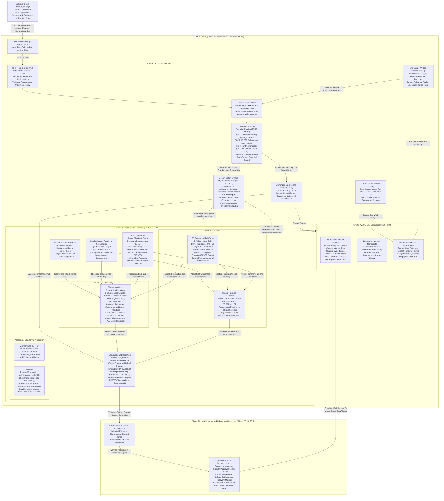
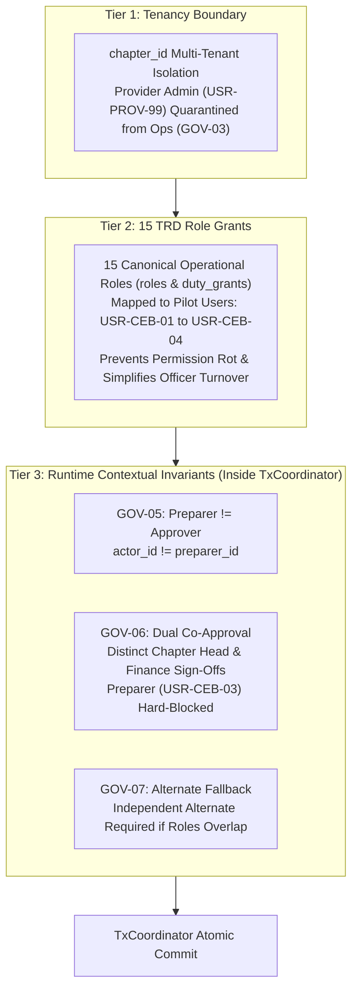

# YSP Chapter Operations — Backend Architecture

| Field | Value |
| --- | --- |
| Status | Architecture overview aligned to agreed requirements and verified prototype; implementation and verification remain separate |
| Updated | 15 October 2026 |
| Requirements authority | [TRD.md](./TRD.md), version 2.0; [PRODUCT.md](./PRODUCT.md), version 1.1; [APP-FLOW.md](./APP-FLOW.md) (including Perspective 4 Operations Architecture Map, S-01–S-22) |
| Launch | One organization, Cebu pilot, four individual internal users |
| Deployment | React/TypeScript; modular Laravel; private MySQL; Docker Compose on one 4 GB Lightsail host |

This diagram describes deployment, module ownership and control paths. The TRD governs mandatory rules, configuration approvals, acceptance and recovery readiness. Boxes inside Laravel are application responsibilities within the same versioned codebase. API, worker and scheduler use the same Laravel image (TR-01–TR-02).

## Deployment and operation paths

## Transaction ownership and retry rules

An application operation owns the outer MySQL transaction. Participating inventory, financial, workflow and document operations share that transaction and commit once. Each operation rechecks current authority, distinct-person approval, policy, material version, remaining demand, stock eligibility, payment/funding and ready evidence under appropriate locks. An HTTP middleware pass or a queued job's original actor snapshot cannot replace these checks (TR-10–TR-11; TR-17).

| Operation | Changes committed together |
| --- | --- |
| RF/SO reservation | Eligible availability, reservation/deadline/protection, operation result and audit |
| Customer release | Actual signed batch, applicable coverage consumption, demand/reservation progress, inventory movement and audit |
| Booth sale | Eligible event custody decrement, verified sale/payment and OR, actual quantities, result and audit |
| Accepted RM | Valid source and cumulative checks, accepted source lot/movement/balance, PO progress and allocation eligibility |
| ADJ/refund recording | Authorized source/cumulative checks, approved applicable stock/financial entries and actual execution status |
| Opening/cutover | Approved IPC/accepted RM baseline, carried outstanding obligations and exactly-once source links |

All business mutations persist the chapter/action/idempotency key, payload fingerprint and committed result with their writes. Required follow-up intent is committed alongside the initiating operation and dispatched after commitment. Same-payload retries return the existing authorized result; changed payloads cannot reuse the key. A lost response requires operation-result lookup before retry. Source-action, original OR and payment-account reference uniqueness prevents duplicate money or stock (TR-03–TR-04; TR-12).

Actual cash, GCash credit and physical handover remain real-world facts even if a database action fails. Uncertain outcomes require reconciliation; neither rollback nor retry permits a second physical handover or receipt (TR-11; SEC-06).

## Three-Tier RBAC & Segregation of Duties Engine

To balance developer ergonomics, audit enforceability, and operational flexibility across small chapter officer teams, the backend implements a **Three-Tier Lightweight RBAC Engine** (TR-17) rather than brittle account-level permission checkboxes or flat 50+ permission enums per user:

1. **Tier 1 — Tenancy Boundary (`chapter_id` Isolation):**
   - Every operational query, command, and transaction is strictly scoped by `chapter_id`.
   - Provider/provisioning administration is strictly segregated from chapter operations: Provider Admin (`USR-PROV-99`) is hard-blocked from operational sign-offs, releasing inventory, or modifying chapter collections (`GOV-03`).

2. **Tier 2 — 15 TRD Role Grants (`duty_grants` Mapping):**
   - Instead of assigning 50+ granular checkboxes directly to individual users (which causes permission rot when volunteer officers transition), the system defines 15 canonical operational roles derived from TRD duties:
     `CH_HEAD`, `CH_FIN`, `CH_OPS`, `CH_REQ`, `CH_AUD`, `INV_MGR`, `BOOTH_CUST`, `BOOTH_CASH`, `PURCH_OFF`, `REC_OFF`, `SALES_OFF`, `DON_OFF`, `DISP_OFF`, `MEMBER`, `SYS_ADMIN`.
   - For the Cebu 4-officer pilot, duties are mapped explicitly:
     - `USR-CEB-01` (Chapter Head): Executive approvals, IPC opening baseline, final variance resolution.
     - `USR-CEB-02` (Finance Officer/Treasurer): Payment verification, OR issuance, disbursement approvals, variance co-approval.
     - `USR-CEB-03` (Operations/Logistics Officer): Receiving inspection (RM), stockroom custody, booth checkout/close-out, count preparation.
     - `USR-CEB-04` (Requisitioner/Auditor): Internal RF creation, independent physical recounts, audit reviews.

3. **Tier 3 — Runtime Contextual Invariants (Transaction-Enforced):**
   - Role possession is necessary but not sufficient; business invariants are evaluated dynamically inside the operation transaction under consistent locks:
     - **Strict Segregation of Duties (`GOV-05`):** The transaction rejects any operation where `actor_id == preparer_id`. A preparer cannot approve their own requisition, receiving report, or adjustment.
     - **Dual Co-Approval on Count Variances (`GOV-06`):** Material adjustments and count discrepancies require two distinct authorized approvals: Chapter Head (`USR-CEB-01`) AND Finance (`USR-CEB-02`). The count preparer (`USR-CEB-03`) is hard-blocked from acting as approver (`actor_id != preparer_id`).
     - **Alternate & Fallback Segregation (`GOV-07`):** When volunteer officers hold combined roles, dual-approval workflows mandate co-signature by an independent alternate officer; one physical user cannot satisfy both required approval steps.

## Ownership of inventory, finance and adjustments

The shared inventory operations belong to **Inventory and custody**. The shared financial operations belong to **Sales and finance**. They are module-owned operations in the same Laravel application. Controllers, report jobs and scheduled work use authorized application operations and cannot write stock or money around them (TR-02).

### The Six Stock Balance Silos (INV-03, TR-08)

Inventory balances are projected into six distinct, strictly tracked silos:
1. **Usable Stockroom:** Uncommitted physical inventory in primary storage available for general allocation.
2. **Available-to-Allocate:** Usable stockroom balance minus active reservations (`RSV-01`) and active holds.
3. **Active Reservations:** Quantities allocated to confirmed orders under active 48-hour clocks (`RSV-01`–`04`).
4. **Booth Custody Stock:** Inventory checked out to a specific event/booth location (`stock_locations.location_kind = 'booth'`). **Crucial Invariant:** Live booth sales (`ModBooth`) decrement **Booth Custody Stock ONLY**; primary stockroom positions are never touched during live selling.
5. **Quarantined / Damaged:** Physically isolated non-usable inventory awaiting inspection, supplier claim, or disposal (`stock_conditions.usable = 0`).
6. **Inbound Open PO:** Supplier purchase quantities confirmed and ordered, but not yet accepted via Receiving Report (`RM`).

### Custody and Cash Float Accounting Formula (BTH-06)

Booth operations enforce strict segregation between operational revenue and custodial liabilities:
- **Custodial Cash Float Liability:** The opening cash float of **PHP 2,000.00** issued to the cashier is a custody liability, strictly excluded from sales revenue.
- **Remittance Formula:**
  $$\text{Remittance Due} = \text{Opening Float (PHP 2,000.00)} + \text{Cash Sales (PHP 4,500.00)} = \text{PHP 6,500.00 Physical Cash}$$
- Close-out reconciles physical cash, GCash digital collections, and unsold merchandise returned to the stockroom via dual-signature count.

| Responsibility | Owning/coordinating modules and controls |
| --- | --- |
| Claim intake and original evidence | Sales and finance coordinates buyer claims; Inventory and custody coordinates count variances; Booth operations links event discrepancies. Track 1 links original OR plus signed customer DR; booth claims use original OR. |
| Inspection/recount and eligibility | Inventory and custody records inspection, condition and independent recount; preserves cumulative original-sale/issue limits and unavailable returned/damaged stock. |
| Approval | Application operations enforce configured claim authority, preparer independence (`GOV-05`), and material-version approval. Variance requires strict dual co-approval by Chapter Head and Finance (`GOV-06`), hard-blocking count preparer (`actor_id != preparer_id`). |
| Stock execution | Inventory and custody posts approved resalable returns, eligible signed replacements, variance corrections and supported quarantine treatment once. |
| Financial execution | Sales and finance coordinates invoice/payment adjustments and Finance approvals; extra payment coverage gates unequal exchanges. Approved refund and actual verified refund remain distinct. |
| Supplier follow-up | Purchasing and receiving coordination retains RM/PO links, supplier claims, correction/replacement/return and outstanding commitments. Stock posting cannot conceal an unresolved claim. |

These responsibilities preserve ADJ-01–ADJ-10, PAY-10–PAY-12 and GOV-05–GOV-07. They do not require another independently deployed service.

## Authority, subscription and background execution

Provider/provisioning administration is a controlled authority surface within Access and chapter administration. Creating a chapter, appointing its initial Head or verifying a subscription does not grant operational membership. Provider subscription money is separate from buyer SO/SI/OR and official chapter GCash collections (GOV-03; SUB-05; TR-17; TR-30).

HTTP requests, jobs, operations, queries, downloads and output delivery enforce current chapter/duty authority. Disabled identities cannot post, approve, export or receive queued protected output. MFA is required for approvers and administrators; independent approval counts distinct individual identities (SEC-01–SEC-03; GOV-05–GOV-07; TR-16–TR-17).

Execution policy distinguishes:

- **Officer business postings:** require active applicable stage/entitlement; queued business execution rechecks before commitment.
- **Authorized reads/exports:** remain available within the 14-elapsed-day unpaid grace period, under the same chapter/duty restrictions.
- **Essential controls:** deadline/history, security, backup and reconciliation controls remain supported after trial expiry; this does not grant officers a posting bypass.

Chapter Head explicitly activates live operations once after applicable readiness; the original activation starts the 30-elapsed-day trial. Provider payment verification/extensions/reactivation are audited. Expiry does not automatically cancel funded orders, payment, stock, reservations or supplier obligations. Post-grace access and retention follow approved commercial terms (SUB-01–SUB-06; TR-30).

The worker calls the same application operations as HTTP. Output generation and delivery use current scoped authorization. Scheduler deadline discovery feeds durable work; resulting expiry/lapse operations recheck authoritative stored deadlines, actual verification/acceptance times and scoped protection. Separate available-stock and backorder-deposit clocks remain 48 elapsed hours; unrelated unpaid quantities can expire while paid/funded commitments stay protected (RSV-01–RSV-10; TR-04; TR-13).

## Evidence, independent state and live gates

Uploads use validated staging and immutable hash/version binding to the authorized record. The database transaction references ready evidence; MySQL and object storage do not share an atomic transaction. Reconcile missing evidence and clean unattached staging only under policy. Issued forms use committed immutable data/template snapshots; regeneration and external copies never create a second document, payment or movement. Downloads require scoped server authorization before issuing a short-lived link (TR-15; TR-18; DOC-06–DOC-11).

### Dual-Mode Signature Capture Architecture (DOC-08, TR-15)

Customer release (`S-07`), requisition issue (`S-05`), and stock count acknowledgments support two distinct verification capture modes:
- **Method A — Live Digital Signature Pad:**
  - Client-side HTML5 Canvas capturing pen/touch vector coordinates.
  - Dynamically smoothed with quadratic Bezier curves (`smoothSignatures`) to eliminate jagged volunteer signatures.
  - Interactive Clear and Redo actions; exports dual formats (PNG base64 raster and vector path array).
- **Method B — Signed Paper Form Scan / Upload:**
  - File upload (`image/*`, `application/pdf`) for physical wet-signed delivery receipts or counter sheets.
  - Pre-upload validation for MIME-type, size boundaries (bounded to 10 MB), and malware/integrity checks.
- **Cryptographic Binding Invariant:**
  - Both Method A and Method B produce a canonical SHA-256 evidence digest (`content_hash`) in `evidence_objects`.
  - Immutable binding links the hash, signee name, title/capacity, and capture timestamp to the target record (`acknowledgments`, `evidence_bindings`) before the MySQL transaction commits.

### Financial and Goods Release Gates (PAY-02, SO-08)

The system enforces strict financial invariants on order fulfillment:
- **Sales Invoice (SI) as Billing Notice Only:** An SI is a billing statement requesting settlement. It never acts as proof of payment and cannot authorize stock release.
- **Official Receipt (OR) Gating:** OR issuance strictly requires verified payment credit (e.g., GCash Ref `GC-771201` verified against chapter collection account).
- **Physical Goods Release Gate:** Customer release (`CUSTOMER_DR`, `handovers`) is hard-gated on 100% verified OR payment coverage for the released batch (`handover_receipts`). Goods are never physically released against unverified payments or open invoices.

Approval, stock readiness, payment, fulfillment and exception progress remain separate at line/batch level. Material changes invalidate affected prior approvals with history. Each record uses its own closure rules: partial fulfillment is visible, accepted partial receipts may allocate immediately, and posted ADJ/receiving completion does not hide an unexecuted refund, supplier discrepancy or unresolved booth remittance (TR-09; RF-08; SO-12; PAY-12; RCV-04–RCV-05; BTH-14; ADJ-10).

Before applicable live actions, enforce approved roles/alternates, configuration/master data, document controls, official payment setup, recovery readiness and opening/cutover evidence. Opening IPC includes independent count and Chapter Head/Finance signatures; accepted RM posts one locked baseline. Carried payments, stock, POs and booth custody retain original references without duplicate receipt or commitment. Later-found stock uses approved ADJ (GOV-08–GOV-09; RCV-08–RCV-10; MIG-01–MIG-03; TR-22).

Gate 1 is approved setup/opening; Gate 2 pilots internal requisition/procurement/receiving; Gate 3 pilots Track 1/payment/donations/ADJ; Gate 4 pilots booth/outage/reconciliation. Enabling a stage does not restart the trial or declare complete release. Complete acceptance requires all MIG gates, AC-01–AC-23 and Appendix C evidence (MIG-04–MIG-08; TR-27–TR-30).

## Recovery and operating constraints

The recovery location must be verified independently accessible and sufficient for regional failure. A same-region-only copy is insufficient. This architecture does not preapprove another AWS region or imply account eligibility, permitted data location or funding. Select and approve the topology before live use (TRD section 11; TR-23–TR-24).

The five-minute binlog-copy cadence is an engineering target, monitored through destination acknowledgment and lag. Recovery copies include consistent database state, evidence/signatures, audit/idempotency results, issued sequences, release/configuration and independently accessible encryption/recovery material. Demonstrate service plus usable evidence/history restoration within four hours and at most one hour committed-record loss, including regional failure. Reconcile uncertain physical custody, documents, payments and manual booth records before authorized reopening (TR-23–TR-24; SEC-05–SEC-06; AC-22).

Keep MySQL private, use least-privilege credentials, bound worker/container/log resources, monitor backup lag and host capacity, and rehearse maintenance/failed-release recovery. Pin supported runtime versions during implementation. Preserve the approved single-host deployment and USD 35/month infrastructure planning target with USD 100 total credit and funding/preservation controls; measured growth and new spending require an updated plan (TR-19–TR-21; TR-25–TR-26).

This overview records the approved review corrections. It does not constitute implemented behavior, passed concurrency/security/recovery tests or authorized production acceptance.
