# YSP Chapter Operations — MySQL Database Schema

| Field | Value |
| --- | --- |
| Version | 0.1 — reviewable design |
| Date | 14 October 2026 |
| Status | Complete schema proposal; final shared-understanding confirmation pending; no migrations or live database changes |
| Requirements authority | [TRD.md](./TRD.md) v2.0, including Appendices A–C |
| Supporting sources | [PRODUCT.md](./PRODUCT.md) v1.1; [BACKEND-ARCHITECTURE.MD](./BACKEND-ARCHITECTURE.MD); [APP-FLOW.md](./APP-FLOW.md); [CONTEXT.md](../../CONTEXT.md); [ADRs 0001](../../docs/adr/0001-chapter-owned-operational-records.md), [0002](../../docs/adr/0002-track-booth-custody-separately.md), [0003](../../docs/adr/0003-start-with-a-modular-laravel-backend.md) |
| Flow boundary | APP-FLOW Q1–Q19 remain agreed; confirmation of the complete flow document remains pending. This schema does not supply that confirmation. |
| Architecture | One private MySQL database, seven modules in one Laravel application; one application operation owns each cross-module transaction |

## 1. Decisions and limits

The design covers all fifteen TR-06 record groups. It preserves existing requirement IDs; `DB-Q1` is an interview label, not a new requirement. No applicable repository AGENTS.md or CLAUDE.md was found. There is no application or migration implementation in the repository to preserve beyond the documented architecture and domain decisions.

| Design branch | Resolution |
| --- | --- |
| Organization → identity → authority | Chapter-owned operational rows and chapter-consistent foreign keys; global individual identities; explicit memberships and duties. ADR 0001 governs. |
| Demand → partial quantities → stock and money | Separate demand portions, reservations, backorders, handover batches, payment credits, funding designations and release coverage. No single transaction status replaces these facts. |
| Provenance → custody → restriction eligibility | Accepted receipt lots, approved positive-ADJ gain lots, ledger transfers and source-specific balance projections. ADR 0002 governs booth custody. |
| Donor conditions → supported predicates | **DB-Q1 accepted:** bounded allowed uses, named events/requesting units and effective dates. An unsupported or uninterpreted condition blocks allocation until documented authorized interpretation/resolution. See [ADR 0004](../../docs/adr/0004-use-bounded-donor-restrictions.md). |
| Approval → revisions → issued history | Approval pins a material version and policy version; changes retain old decisions and require affected reapproval. Issued financial documents and posted physical facts receive linked corrections. |
| Concurrency → retries → background delivery | Row locks, unique source effects, durable operation results and transactional follow-up intent. ADR 0003 governs modular Laravel coordination. |

The unresolved schema interview frontier is empty. Chapter policy values, named officers, thresholds, return windows, rounding/valuation settings, provider commercial terms, evidence retention and recovery-location approval remain TRD pre-live inputs. Tables accommodate them without assigning unapproved values. Missing applicable approved settings block operations. No automatic unit conversion, customer portal, full offline synchronization, cross-chapter transfer, general donor rule language or accounting general ledger is introduced.

## 2. Physical conventions and enforceable relationships

### 2.1 Engine, types and notation

Design target: MySQL 8.4 with InnoDB. Pin and verify the actual supported runtime/image during implementation under TR-20. The local XAMPP distribution is not the deployment contract. Use strict SQL mode, UTC connections and exact decimal arithmetic in PHP. No server or database was contacted for this design.

The catalogue below is an exact column specification using these type aliases and common profiles. Expand them literally when writing migrations; profiles are not extra runtime tables.

| Alias | Exact MySQL type and meaning |
| --- | --- |
| `ID` | `BIGINT UNSIGNED` |
| `V` | `INT UNSIGNED` version/counter |
| `Q` | `DECIMAL(20,6)` quantity; fourteen integral digits; unit precision 0–6 |
| `M` | `DECIMAL(20,2)` posted PHP money; eighteen integral digits |
| `P` | `DECIMAL(20,6)` unit price/cost or intermediate valuation; final postings round to `M` under approved policy |
| `T` | `DATETIME(6)` in UTC |
| `D` | `DATE` local business date, never an expiry timestamp |
| `B` | `TINYINT UNSIGNED`, `CHECK (value IN (0,1))` |
| `S(n)` | `VARCHAR(n)` with `utf8mb4_0900_ai_ci` for human-readable text |
| `K(n)` | `VARCHAR(n) CHARACTER SET ascii COLLATE ascii_bin` for normalized codes/keys/states |
| `J` | `JSON`; validated application schema/version, not a substitute for FK-bearing financial/stock relations |
| `HASH` | `BINARY(32)` SHA-256 bytes |
| `TXT` | `TEXT` with `utf8mb4_0900_ai_ci` |
| `?` | Nullable; columns without `?` are `NOT NULL` |

`id` on standalone entities is `AUTO_INCREMENT`. No business number is an auto-increment ID. No monetary/quantity column has a silent zero default except the explicitly initialized projections. No deadline has an automatic SQL timestamp default. Application-generated timestamps use one database UTC timestamp per operation where ordering matters. Inline domain lists are CHECK sets; where a row introduces two state columns together, its stated set applies to each. `→global table.code` references that exact declared unique code, not its ID.

| Profile | Columns and constraints expanded onto each listed table |
| --- | --- |
| `G` global entity | `id ID PRIMARY KEY AUTO_INCREMENT`, `created_at T`. |
| `C` chapter entity | `G` plus `chapter_id ID` FK → `chapters.id`, `UNIQUE(chapter_id,id)`. |
| `R(kind)` typed record header | `id ID PRIMARY KEY` (not auto increment), `chapter_id ID`, `record_kind K(32) DEFAULT '<kind>' CHECK(record_kind='<kind>')`; `UNIQUE(chapter_id,id)`, `UNIQUE(chapter_id,id,record_kind)`; FK `(chapter_id,id,record_kind)` → `records(chapter_id,id,record_kind)`. Creation/actor/version live in `records`, not duplicated. `R-set` uses a CHECK IN over its named kinds with no implicit default. |
| `L(kind)` typed record line | `id ID PRIMARY KEY` (not auto increment), `chapter_id ID`, `record_id ID`, `line_kind K(32) DEFAULT '<kind>' CHECK(line_kind='<kind>')`; `UNIQUE(chapter_id,id)`, `UNIQUE(chapter_id,record_id,id)`; FK `(chapter_id,record_id,id,line_kind)` → `record_lines(chapter_id,record_id,id,line_kind)`; additionally `(chapter_id,record_id)` FK → the typed header named in the table row. `L-set` uses a CHECK IN over its named kinds with no default and an additional `(chapter_id,record_id,line_kind)` FK to the header kind tuple. |
| `CQ` database queue row | Same as C except created_at is INT UNSIGNED UTC epoch seconds, matching queue transport time fields. All chapter/PK/UNIQUE/FK rules remain. |
| `A` append event extension | `operation_id ID` FK → `operations`, `actor_attribution_id ID` FK → `actor_attributions`, `occurred_at T`, `entered_at T`, `reason TXT?`. Added only where `+A` is shown. Both FKs include `chapter_id`. |

All additional columns appear in their table row. `U(...)` means a declared UNIQUE index, `I(...)` a nonunique index and `CK(...)` a CHECK. Primary keys and profile constraints apply even if not repeated. Every FK gets an explicit child index with FK columns as its leading columns; do not rely on an implicit index. Tables containing business state, nonnegative money or quantities additionally use section 2.3 checks.

**Relationship notation:** a column `buyer_id ID → buyers` expands to FK `(chapter_id,buyer_id)` → `buyers(chapter_id,id)`. A `→global users` reference uses `users(id)`. A nullable FK follows the same rule. More specific multicolumn relationships are listed under constraints and replace weaker single-reference links. All references use the default restrictive `NO ACTION` behavior with action clauses omitted; no operational cascaded deletion. Omit explicit referential-action clauses on FK columns also used in CHECKs, and verify CHECK/FK compatibility on the pinned engine. Codes and IDs are stable.

### 2.2 Parent, line, variant and account integrity

Every chapter parent exposes `UNIQUE(chapter_id,id)`. Chapter consistency alone is insufficient to prevent connecting a line to the wrong order. Whenever a row stores both a parent ID and its line ID, enforce FK `(chapter_id,parent_id,line_id)` → that parent's lines `(chapter_id,record_id,id)`. For reservation/stock and sale/source links that store a variant, add the target UNIQUE tuple and FK including `variant_id`. This rule applies to every such column pair in the catalogue, including nullable pairs (all-or-none CHECK).

Concrete required tuples:

- `record_versions`: `U(chapter_id,record_id,material_version)`; every version-pinned child FK uses this triple.
- `record_lines`: `U(chapter_id,record_id,id,line_kind)`, `U(chapter_id,id)`. Typed lines must belong to the typed header through profile `L`.
- `demand_lines`: `U(chapter_id,record_id,id,variant_id)`. `sales_invoice_lines` and `handover_lines` carry the corresponding demand parent and line pair.
- `receipt_lines`: `U(chapter_id,record_id,id,variant_id)`; `stock_lots` carries RM parent/line/variant with this FK.
- `stock_lots`: `U(chapter_id,id,variant_id)`; `stock_positions`: `U(chapter_id,id,variant_id)`; both enforce lot/variant identity. Reservation and movement lines cannot name an unrelated variant.
- `payment_credits`: `U(chapter_id,id,payment_id,invoice_id,invoice_line_id)`. Funding and release coverage carry these dimensions with the full FK, keeping money on the correct payment and invoiced line.
- `financial_accounts` have a global `account_id`; payment references point to the actual `payment_accounts.id`, not a chapter label. `payment_accounts` exposes `U(id,channel_code)` for reference verification.

No Laravel `morph_type/morph_id` pair is an integrity boundary. Cross-workflow audit/evidence links point to `records`/`record_lines`, whose chapter membership is database-enforced; transactional domain links use typed tables. Registry subtype completeness and permitted business source kinds are checked by the owning operation and reconciliation; a registry row by itself never grants posting eligibility.

### 2.3 CHECKs, state domains and cross-row rules

CHECK all ordinary `Q`, `M`, `P` values ≥ 0; signed delta columns explicitly say `signed` and are exempt. Positive posting quantity/amount must be > 0. `V` material/row versions and line numbers start at 1. Required reasons are nonempty on returns/rejections/cancellations/voids/overrides; service validates meaningful text. Check start < end where both timestamps exist, precision ≤ 6, currency `CHAR(3) CHARACTER SET ascii COLLATE ascii_bin DEFAULT 'PHP' CHECK(currency='PHP')`, and paired-null/exactly-one alternatives described below. All state `K` columns use CHECK lists, not mutable free-text statuses or native ENUMs.

Common approval states: `draft,submitted,returned,held,approved,rejected,canceled`; exception: `none,open,resolving,resolved`; execution: `pending,partial,complete,blocked`. Domains that differ are declared in the relevant section. These fields are projections, not approval authority. Historical truth comes from versions, decisions and effect/event rows. Any domain not explicitly enumerated in a table row uses a named catalogue FK or these common domains.

Unit-specific quantity precision is validated against the immutable variant/unit before binding SQL parameters, then rechecked under the variant guard at commitment. SQL decimal scale is storage capacity, not permission to use six fractional places for every unit. Database `BEFORE INSERT/UPDATE` precision triggers for quantity-bearing domain rows resolve the declared variant or source line/unit and reject `qty <> TRUNCATE(qty, units.quantity_scale)` for every applicable quantity/delta. A missing/ambiguous unit rejects posting. Pieces/kits require scale 0. This is a cross-row trigger/operation rule, not a CHECK falsely claimed to look up another table; aggregate imports containing multiple units must use separate source-line import rows or leave the unused quantity at zero. Signed variance quantities use the same unit precision. Financial rows validate approved rounding before posting two-place money.

Policy JSON uses validated versioned contracts: monetary thresholds/limits are decimal strings with two posted places, unit prices/intermediate valuations decimal strings with up to six places, quotation counts are unsigned integers, duration/grace/retention settings are integer seconds or explicitly named day/month terms, dates are UTC ISO strings, rounding/valuation modes are approved named codes, and authority/template/channel references are stable IDs. Required fields are not inferred from missing keys. ID and decimal values in API/snapshot JSON are strings where numeric serialization could lose precision; database ID/decimal columns remain their exact types. Policy JSON carries approved configuration, not unconstrained executable rules. Configuration references are resolved under current chapter scope and policy authority before use.

Cross-row aggregate inequalities, independence, current authorization, object readiness and donor predicate evaluation require locked application operations. MySQL CHECKs cannot inspect other rows. Unique and composite foreign keys protect existence/ownership, including when application validation is bypassed. Implementation must use insert-only grants and rejection triggers for immutable tables under section 8. [MySQL CHECK constraints](https://dev.mysql.com/doc/refman/8.4/en/create-table-check-constraints.html), [MySQL foreign keys](https://dev.mysql.com/doc/refman/8.4/en/create-table-foreign-keys.html).

## 3. Shared records, identity, configuration and documents

Owning modules: Access and chapter administration; Documents and reporting. Shared record identities are bookkeeping seams, not a generic service allowed to change stock or money.

### 3.1 Individual authority

| Table / profile | Additional columns | Keys, indexes and controls |
| --- | --- | --- |
| `chapters` / G | `code K(32)`, `name S(160)`, `status K(16)` (`setup,live,suspended,archived`), `row_version V`, `provisioned_by_user_id ID →global users`, `updated_at T` | U(code); FK to users added after global users are created. Chapter status does not replace entitlement/readiness. |
| `chapter_control_guards` / C | `authority_version V`, `block_version V`, `readiness_version V`, `updated_at T` | U(chapter_id); provision one before business setup; shared commit-time reads conflict with authority/block/readiness change exclusive lock. |
| `users` / G | `public_id CHAR(26) CHARACTER SET ascii COLLATE ascii_bin`, `name S(160)`, `email S(254)`, `email_key VARBINARY(254)`, `password_hash VARBINARY(255)`, `status K(16)` (`active,disabled`), `auth_version V`, `mfa_secret_ciphertext BLOB?`, `mfa_confirmed_at T?`, `remember_token VARBINARY(100)?`, `disabled_at T?`, `updated_at T` | U(public_id), U(email_key). Immutable identity ID; normalize email deterministically. Encrypted MFA secret; keys outside DB. |
| `user_recovery_codes` / G | `user_id ID →global users`, `code_hash BINARY(32)`, `used_at T?` | U(user_id,code_hash); no plaintext recovery code. |
| `provider_role_grants` / G | `user_id ID →global users`, `role_code K(32)` (`provisioner,billing_admin,recovery_operator`), `granted_by_user_id ID →global users`, `starts_at T`, `ends_at T?`, `revoked_at T?`, `reason TXT` | I(user_id,role_code,starts_at,ends_at); grant events in global security audit; no implicit membership. |
| `memberships` / C | `user_id ID →global users`, `status K(16)` (`active,disabled`), `authority_version V`, `authorized_by_user_id ID →global users`, `authorized_at T`, `disabled_at T?` | U(chapter_id,user_id); U(chapter_id,id,user_id); I(user_id,status). |
| `roles` / G | `code K(40)`, `name S(120)` | U(code); documented TRD duties, no actor identity in role. |
| `duty_grants` / C | `membership_id ID → memberships`, `role_id ID →global roles`, `requesting_unit_id ID? → requesting_units`, `scope_kind K(16)` (`chapter,unit`), `monetary_limit M?`, `starts_at T`, `ends_at T?`, `is_alternate B`, `replaces_grant_id ID? → duty_grants`, `authorized_by_attribution_id ID → actor_attributions`, `revoked_at T?`, `policy_version_id ID? → policy_versions` | I(chapter_id,membership_id,role_id,starts_at,ends_at); CK unit only with unit scope. No UNIQUE treating nullable scope as singleton; membership lock enforces nonoverlapping active intervals. All changes audited. |
| `duty_grant_events` / C+A | `grant_id ID → duty_grants`, `event_code K(24)` (`grant,revoke,substitute,end,change_limit`), `effective_at T`, `approval_record_id ID? → records`, `previous_snapshot J?`, `new_snapshot J` | U(chapter_id,operation_id,grant_id,event_code); immutable grant/revoke/change actor, reason and effective time; membership authority_version increments atomically. |
| `actor_attributions` / C | `user_id ID? →global users`, `membership_id ID? → memberships`, `duty_grant_id ID? → duty_grants`, `actor_name S(160)`, `chapter_name S(160)`, `duty_code K(40)`, `authority_snapshot J`, `captured_at T`, `execution_kind K(16)` (`officer,provider,system`), `system_principal_code K(64)?` | Append-only; optional membership FK strengthened to `(chapter_id,membership_id,user_id)`. Provider/system context does not pretend to have membership. CHECK system execution has NULL user/membership/grant and non-NULL system_principal_code; officer/provider execution has individual user ID and NULL system principal. System principals cannot satisfy human approval/signature independence. |
| `requesting_units` / C | `code K(32)`, `name S(160)`, `active B` | U(chapter_id,code); departments/committees, not user roles. |
| `events` / C | `code K(48)`, `name S(160)`, `starts_at T`, `ends_at T`, `active B` | U(chapter_id,code); named chapter occasion used by restriction eligibility; booth_events is its approved operational booth context. |
| `buyers` / C | `name S(160)`, `buyer_kind K(16)` (`member,external`), `member_reference S(100)?`, `phone S(40)?`, `email S(254)?`, `address TXT?`, `active B`, `updated_at T` | I(chapter_id,name); contact data not unique identity; snapshots on orders retain historical recipient/payer facts. |

### 3.2 Registry and material approvals

| Table / profile | Additional columns | Keys, indexes and controls |
| --- | --- | --- |
| `records` / C | `record_kind K(32)`, `reference K(100)?`, `prepared_by_attribution_id ID → actor_attributions`, `row_version V`, `current_material_version V?`, `approval_state K(16)`, `exception_state K(16)`, `submitted_at T?`, `closed_at T?`, `updated_at T`, `archived_at T?` | U(chapter_id,id,record_kind); U(chapter_id,record_kind,reference); I(chapter_id,record_kind,approval_state,updated_at). Optional current version FK → record_versions; create registry before first snapshot, then set pointer in same transaction. |
| `draft_payloads` / C | `record_id ID → records`, `schema_version V`, `payload J`, `saved_by_user_id ID →global users`, `saved_at T`, `row_version V` | U(chapter_id,record_id); incomplete draft input only, no approved/payment/stock flags are trusted. Returned revisions can stage here until complete resubmission. |
| `record_lines` / C | `record_id ID → records`, `line_kind K(32)`, `line_no V`, `retired_at T?` | U(chapter_id,record_id,line_no); U(chapter_id,record_id,id,line_kind). Submitted line IDs retained; removed line marked retired and version snapshot records its cancellation. |
| `record_versions` / C | `record_id ID → records`, `material_version V`, `schema_version V`, `material_snapshot J`, `material_hash HASH`, `prepared_by_attribution_id ID → actor_attributions`, `changed_at T`, `change_reason TXT`, `previous_version V?` | U(chapter_id,record_id,material_version); previous triple FK to same record. Append-only canonical full header/line/price/term/source snapshot, including stable line IDs, policy IDs and evidence IDs. |
| `approval_requirements` / C | `record_id ID → records`, `material_version V`, `step_code K(40)`, `required_role_id ID →global roles`, `policy_version_id ID → policy_versions`, `independence_rule K(32)` (`none,not_preparer,not_requester,not_custodian,distinct_coapprover`), `minimum_distinct_users TINYINT UNSIGNED` | U(chapter_id,record_id,material_version,step_code); version triple FK. Steps captured at submission; no policy change rewrites them. |
| `approval_decisions` / C+A | `requirement_id ID → approval_requirements`, `record_id ID → records`, `material_version V`, `decision K(16)` (`approve,return,hold,reject,cancel`), `duty_grant_id ID → duty_grants`, `approver_user_id ID →global users`, `policy_version_id ID → policy_versions`, `decision_snapshot J` | I(chapter_id,record_id,material_version); U(chapter_id,operation_id,requirement_id,approver_user_id); requirement tuple FK includes record/version. Append-only decisions. |
| `record_events` / C+A | `record_id ID → records`, `record_line_id ID? → record_lines`, `event_code K(48)`, `from_state J?`, `to_state J`, `material_version V?` | I(chapter_id,record_id,entered_at,id); parent/line FK; append-only invalidation, cancellation, deadline, closure, revision and override history. |
| `record_links` / C | `from_record_id ID → records`, `to_record_id ID → records`, `relation_code K(40)`, `operation_id ID → operations` | U(chapter_id,from_record_id,to_record_id,relation_code); I(chapter_id,to_record_id). Navigation links supplement typed domain links; not eligibility authority. |

`record_kind` CHECK domain: `RF,SO,SI,OR,IS_AR,CUSTOMER_DR,REPF,PO,SUPPLIER_DR,RM,DA,IPC,ADJ,COUNT,BOOTH,BOOTH_SALE,QUOTE,INVOICE_ADJ,REFUND,RECONCILIATION,CUTOVER,RESTRICTION_RESOLUTION,CONFIG`. Registry line kinds use the corresponding kind, except RF/SO share `DEMAND` for typed `demand_lines`. Subtype rows and registry rows are created atomically.

Draft edits increment records.row_version and use draft_payloads for incomplete fields. Typed header/line projections are materialized only when their required fields are available; submission validates and atomically creates the complete typed rows and immutable material snapshot. Registry-only/incomplete drafts have no commitment authority. Draft edits increment `row_version`. Every submitted/revised material content creates a new immutable `record_versions` row; approvals are never copied across versions. Typed header/line tables contain the current material projection; snapshots preserve exact prior content. Further commitments verify that typed content hashes to the approved snapshot and that applicable steps are satisfied. Released/received quantities, money and custody history are never rewritten by a new snapshot. Changes to existing obligations need their specific resolution operation.

### 3.3 Policies, evidence, signatures and number issuance

| Table / profile | Additional columns | Keys, indexes and controls |
| --- | --- | --- |
| `policies` / C | `policy_code K(48)`, `name S(160)` | U(chapter_id,policy_code). |
| `policy_versions` / C | `policy_id ID → policies`, `version_no V`, `approval_record_id ID → records`, `effective_from T`, `effective_until T?`, `schema_version V`, `settings J`, `settings_hash HASH`, `supersedes_id ID? → policy_versions` | U(chapter_id,policy_id,version_no); I(chapter_id,policy_id,effective_from,effective_until); approved payload and effective_from immutable; supersession/end-of-validity metadata changes only with authorized history. Effective intervals serialize on policy parent. |
| `evidence_objects` / C | `staging_owner_user_id ID →global users`, `intended_record_id ID? → records`, `store_code K(32)`, `object_key VARBINARY(512)`, `object_version VARBINARY(255)`, `content_hash HASH`, `byte_size BIGINT UNSIGNED`, `mime_type K(100)`, `original_filename S(255)`, `lifecycle K(24)` (`staged,validating,ready,quarantined,missing,archived`), `validated_at T?`, `validator_version K(64)?`, `staging_expires_at T?` | U(store_code,object_key,object_version); U(chapter_id,id,content_hash,object_version); I(chapter_id,lifecycle,staging_expires_at). Hash/key/version immutable once ready; lifecycle health transitions audited. |
| `evidence_bindings` / C | `record_id ID → records`, `record_line_id ID? → record_lines`, `evidence_object_id ID → evidence_objects`, `purpose_code K(40)`, `bound_hash HASH`, `bound_object_version VARBINARY(255)`, `operation_id ID → operations`, `bound_by_attribution_id ID → actor_attributions` | U(chapter_id,record_id,evidence_object_id,purpose_code); parent/line FK; append-only. Bind expected hash/version to actual object tuple using the declared evidence_objects identity tuple. |
| `acknowledgments` / C | `record_id ID → records`, `recipient_name S(160)`, `recipient_user_id ID? →global users`, `recipient_capacity S(100)`, `method K(16)` (`device,paper`), `signed_at T`, `evidence_binding_id ID → evidence_bindings`, `acknowledged_snapshot_hash HASH`, `captured_by_attribution_id ID → actor_attributions` | U(chapter_id,id,record_id); binding FK strengthened by record_id. Immutable recipient/actual-batch signature facts. |
| `document_templates` / C | `document_kind K(32)`, `version_no V`, `policy_version_id ID → policy_versions`, `template_source TXT`, `template_hash HASH` | U(chapter_id,document_kind,version_no); append-only. |
| `document_series` / C | `document_kind K(32)`, `context_key K(64)`, `series_code K(40)`, `prefix K(64)`, `next_number BIGINT UNSIGNED`, `template_id ID → document_templates`, `mode K(16)` (`generated,external,manual`), `active B` | U(chapter_id,document_kind,context_key,series_code); U(chapter_id,id,document_kind); row locked for number issuance. Template kind checked by FK including kind. |
| `document_number_claims` / C | `series_id ID → document_series`, `number BIGINT UNSIGNED`, `record_id ID? → records`, `claim_kind K(16)` (`generated,external,manual`), `state K(16)` (`reserved,issued,void,missing`), `claimed_at T`, `operation_id ID → operations` | U(chapter_id,series_id,number); U(chapter_id,record_id); U(chapter_id,series_id,number,record_id); reserve identity before a numbered draft print/manual entry. Binding an unbound manual number occurs once; number is never reused. issued_documents carries number/record FK to this fence. |
| `issued_documents` / C | `record_id ID → records`, `record_kind K(32)`, `series_id ID → document_series`, `number BIGINT UNSIGNED`, `display_reference K(100)`, `external_reference S(160)?`, `template_id ID → document_templates`, `template_snapshot TXT`, `data_snapshot J`, `snapshot_hash HASH`, `issued_at T`, `issued_by_attribution_id ID → actor_attributions`, `origin K(16)` (`generated,external,manual,carried`) | U(chapter_id,series_id,number); U(chapter_id,record_id); U(chapter_id,record_kind,display_reference); typed record/series/template kind FKs. Append-only; no second issued identity for a regenerated PDF. |
| `document_number_events` / C+A | `series_id ID → document_series`, `number BIGINT UNSIGNED`, `issued_document_id ID? → issued_documents`, `event_code K(16)` (`reserved,issued,void,gap,missing,resolved`), `evidence_binding_id ID? → evidence_bindings` | I(chapter_id,series_id,number); append-only reasons, range reconciliation; no reuse of a voided number. |

Policy `settings` contains approved quotation thresholds/counts, emergency authority, financial rounding/valuation, return windows, cash/GCash duty scope, retention and reporting schedules. Schema version and validation are mandatory; approval steps expose the financial/operational approver distinction. Item prices, ROP/target and event terms are typed separately below. Historical transactions store policy references and final approved values. Closing a previously open-ended effective_until does not rewrite settings/price payload or prior transaction snapshots: the approving supersession operation appends a validity event with old/new interval metadata, and immutable triggers allow only that controlled interval closure. An effective interval cannot be reopened/repriced by ordinary editing.

## 4. Inventory, sources, custody and demand

Owning module: Inventory and custody. Purchasing coordinates receiving sources; Inventory alone posts the shared movement ledger.

### 4.1 Item and custody dimensions

| Table / profile | Additional columns | Keys, indexes and controls |
| --- | --- | --- |
| `units` / C | `code K(24)`, `name S(80)`, `quantity_scale TINYINT UNSIGNED`, `active B` | U(chapter_id,code); CK scale ≤ 6. Pieces/kits scale 0. Freeze scale after transactions; replacement unit requires controlled correction. |
| `items` / C | `code K(48)`, `description S(255)`, `active B` | U(chapter_id,code). |
| `item_variants` / C | `item_id ID → items`, `sku K(64)`, `variant_key K(100)`, `size S(40)?`, `color S(40)?`, `specification TXT?`, `unit_id ID → units`, `active B` | U(chapter_id,sku); U(chapter_id,item_id,variant_key); U(chapter_id,id,unit_id). |
| `item_policy_versions` / C | `variant_id ID → item_variants`, `version_no V`, `approval_record_id ID → records`, `policy_version_id ID → policy_versions`, `effective_from T`, `effective_until T?`, `selling_price P`, `rop_qty Q`, `target_qty Q`, `valuation_basis K(40)`, `priority_category_id ID → priority_categories` | U(chapter_id,variant_id,version_no); I(chapter_id,variant_id,effective_from); Target/ROP relationship validated under approved policy; no invented chapter values. Historical values/effective_from immutable; closing effective_until is an authorized audited validity-metadata change under variant lock. |
| `priority_categories` / C | `code K(32)`, `label S(100)`, `rank SMALLINT UNSIGNED`, `policy_version_id ID → policy_versions`, `active B` | U(chapter_id,policy_version_id,code); immutable rank within approved policy version. |
| `stock_locations` / C | `code K(48)`, `name S(160)`, `location_kind K(16)` (`stockroom,booth,holding`), `booth_event_id ID? → booth_events`, `active B` | U(chapter_id,code); U(chapter_id,id,location_kind); booth kind iff event present. A booth may have multiple custody positions but one event attribution per location. |
| `custody_assignments` / C | `location_id ID → stock_locations`, `custodian_user_id ID? →global users`, `custodian_name S(160)`, `starts_at T`, `ends_at T?`, `authorized_by_attribution_id ID → actor_attributions` | U(chapter_id,id,location_id); I(chapter_id,location_id,starts_at,ends_at). Named external custodian allowed; independent checks use identity where available and signed participant evidence. |
| `stock_conditions` / G | `code K(24)`, `usable B` | U(code); CHECK code IN (usable,quarantine,damaged,rejected,held) and usable=(code='usable'); fixed catalogue flags cannot make quarantine saleable. Eligibility additionally requires no active hold. |

### 4.2 Source documents, opening and accepted receipts

| Table / profile | Additional columns | Keys, indexes and controls |
| --- | --- | --- |
| `donation_acknowledgments` / R(DA) | `donor_name S(160)`, `donor_contact TXT?`, `acknowledged_at T?`, `valuation_policy_version_id ID → policy_versions`, `conditions_text TXT`, `authorized_signer_attribution_id ID? → actor_attributions` | Header approval/version and donor evidence required before accepted RM. No payment/OR relation. |
| `donation_lines` / L(DA) → donation_acknowledgments | `variant_id ID → item_variants`, `offered_qty Q`, `declared_value M?`, `estimated_value M?`, `valuation_basis TXT`, `condition_code K(24) →global stock_conditions.code`, `restriction_version_id ID → restriction_versions` | CK valuation evidence present before acceptance; restriction retained per source line. |
| `initial_physical_counts` / R(IPC) | `cutoff_at T`, `valuation_policy_version_id ID → policy_versions`, `count_started_at T?`, `count_completed_at T?`, `regular_custodian_user_id ID? →global users` | One posted baseline via chapter_openings, not by deleting extra draft IPCs. |
| `ipc_lines` / L(IPC) → initial_physical_counts | `variant_id ID → item_variants`, `location_id ID → stock_locations`, `custody_assignment_id ID → custody_assignments`, `condition_code K(24) →global stock_conditions.code`, `counted_qty Q`, `unit_valuation P`, `valuation_basis TXT`, `restriction_version_id ID → restriction_versions`, `original_source_reference S(160)?`, `source_evidence_binding_id ID? → evidence_bindings` | Full source/custody/condition split; assignment/location FK. Opening lot may preserve historical provenance as evidence without creating another PO receipt. |
| `count_participants` / C | `count_record_id ID → records`, `user_id ID? →global users`, `participant_name S(160)`, `duty_code K(40)`, `is_regular_custodian B`, `signed_at T`, `evidence_binding_id ID → evidence_bindings` | I(chapter_id,count_record_id); signature binding by count record; distinct identities verified, at least two opening counters with independent person. |
| `chapter_openings` / C | `ipc_id ID → initial_physical_counts`, `cutover_id ID → cutovers`, `posted_at T`, `operation_id ID → operations`, `snapshot_hash HASH` | **U(chapter_id)**; U(chapter_id,ipc_id); immutable one baseline fence. Posted atomically with all opening receipts/movements; later corrections ADJ. |
| `supplier_deliveries` / R(SUPPLIER_DR) | `po_id ID → purchase_orders`, `supplier_reference S(160)`, `supplier_reference_key VARBINARY(160)`, `actual_delivered_at T`, `entered_at T`, `delivery_location_id ID → stock_locations` | U(chapter_id,po_id,supplier_reference_key); external series exceptions flagged, not guessed globally unique. |
| `supplier_delivery_lines` / L(SUPPLIER_DR) → supplier_deliveries | `po_id ID → purchase_orders`, `po_line_id ID → purchase_order_lines`, `variant_id ID → item_variants`, `documented_qty Q`, `actual_count_qty Q`, `condition_notes TXT?` | PO parent/line/variant tuple FKs; incompatible substitution held pending amendment. |
| `receiving_reports` / R(RM) | `source_kind K(16)` (`purchase,donation,opening`), `po_id ID? → purchase_orders`, `supplier_delivery_id ID? → supplier_deliveries`, `da_id ID? → donation_acknowledgments`, `ipc_id ID? → initial_physical_counts`, `inspection_at T`, `inspector_attribution_id ID → actor_attributions`, `posting_state K(16)` (`draft,partial,posted,held`), `posted_at T?`, `source_record_id ID → records` | CK exactly purchase PO+delivery OR DA OR IPC; purchase delivery must belong to PO via FK. U(chapter_id,id,source_kind,source_record_id); CK source_record_id equals supplier_delivery_id for purchase, da_id for donation, ipc_id for opening. Source material approval checked at posting. |
| `receipt_lines` / L(RM) → receiving_reports | `variant_id ID → item_variants`, `source_line_id ID → record_lines`, `expected_qty Q`, `delivered_qty Q`, `accepted_qty Q`, `rejected_qty Q`, `held_qty Q`, `missing_qty Q`, `condition_notes TXT?`, `restriction_version_id ID → restriction_versions`, `unit_valuation P`, `valuation_basis TXT`, `nonusable_recorded_qty Q DEFAULT 0`, `source_kind K(16)` (`purchase,donation,opening`), `source_record_id ID → records`, `supplier_delivery_line_id ID? → supplier_delivery_lines`, `po_line_id ID? → purchase_order_lines`, `donation_line_id ID? → donation_lines`, `ipc_line_id ID? → ipc_lines`, `existing_nonusable_lot_id ID? → stock_lots`, `po_id ID? → purchase_orders`, `da_id ID? → donation_acknowledgments`, `ipc_id ID? → initial_physical_counts` | U(chapter_id,record_id,id,variant_id); CK delivered = accepted+rejected+held; missing is undelivered against expected; nonusable_recorded_qty≤rejected+held. Exactly one typed source line (purchase also includes PO line), with source_line_id equal to selected line and header source identity matched. Use separate purchase (chapter_id,record_id,po_id,source_record_id) and DA/IPC (chapter_id,record_id,da_id/ipc_id) header FKs; each selected alternative has only non-NULL tuple components, preventing a NULL-containing composite from skipping the context check. Typed source/variant and cumulative approved source limits rechecked under source lock. |
| `receiving_discrepancies` / C | `rm_id ID → receiving_reports`, `receipt_line_id ID → receipt_lines`, `discrepancy_kind K(24)` (`missing,damaged,wrong,overdelivery,quality,restriction`), `qty Q`, `description TXT`, `supplier_claim_id ID? → supplier_claims`, `exception_state K(16)`, `expected_resolution_at T?` | I(chapter_id,exception_state,expected_resolution_at); RM/line FK. Outstanding PO quantity derived from accepted+authorized canceled quantity, not from rejected quantity. |

Each RM is one immutable inspection/posting batch. Every accepted/nonusable receipt line posts at most once per lot kind; partial/full describes acceptance against the source, not permission to increase an already posted line. Later delivery or later approved acceptance of held goods creates a new linked RM/source batch and retains discrepancy-resolution links, with cumulative PO/DA/IPC checks. No accepted lot quantity is edited.

### 4.3 Bounded restrictions

| Table / profile | Additional columns | Keys, indexes and controls |
| --- | --- | --- |
| `restrictions` / C | `source_da_id ID? → donation_acknowledgments`, `name S(160)`, `original_terms TXT`, `source_evidence_binding_id ID? → evidence_bindings` | Immutable original donor terms; unrestricted purchased stock also gets an explicit approved unrestricted version. |
| `restriction_versions` / C | `restriction_id ID → restrictions`, `version_no V`, `allow_internal B`, `allow_sale B`, `allow_booth B`, `event_scope K(16)` (`any,listed`), `unit_scope K(16)` (`any,listed`), `effective_from T?`, `effective_until T?`, `interpretation_state K(16)` (`ready,blocked`), `unsupported_terms TXT?`, `resolution_record_id ID? → restriction_resolutions`, `terms_hash HASH` | U(chapter_id,restriction_id,version_no); append-only; blocked if unsupported terms have no approved interpretation. Empty listed scope permits nothing. |
| `restriction_event_scopes` / C | `restriction_version_id ID → restriction_versions`, `event_id ID → events` | U(chapter_id,restriction_version_id,event_id). |
| `restriction_unit_scopes` / C | `restriction_version_id ID → restriction_versions`, `requesting_unit_id ID → requesting_units` | U(chapter_id,restriction_version_id,requesting_unit_id). |
| `restriction_resolutions` / R(RESTRICTION_RESOLUTION) | `restriction_id ID → restrictions`, `old_version_id ID → restriction_versions`, `new_version_no V`, `donor_authorization_binding_id ID → evidence_bindings`, `resolution_text TXT`, `effective_at T` | Approved donor-authorized interpretation/change; ordinary override cannot create one. Old/new terms remain readable. |

Predicate conjunction: use permission AND applicable listed-event permission AND listed-requesting-unit permission AND effective interval AND ready interpretation AND usable condition/no hold. Booth sale requires both sale and booth permission. Checkout checks booth destination as well as intended permitted use; movement preserves the lot. Lack of an event/unit in demand fails a required listed scope. Named events use events, including program occasions; booth setup references its named event, and RF/SO may carry event context without a booth. RF booth event_id must match its booth setup event_id. A donor interpretation that remains outside this bounded model stays blocked. A version change cannot retroactively make prior handover eligible; active outstanding lots/reservations must be reviewed and blocked or resolved where required.

### 4.4 Ledger and stock projections

| Table / profile | Additional columns | Keys, indexes and controls |
| --- | --- | --- |
| `stock_lots` / C | `rm_id ID? → receiving_reports`, `receipt_line_id ID? → receipt_lines`, `variant_id ID → item_variants`, `accepted_qty Q`, `accepted_at T`, `original_restriction_version_id ID → restriction_versions`, `unit_valuation P`, `valuation_policy_version_id ID → policy_versions`, `source_snapshot J`, `origin_kind K(16)` (`rm,adj_gain`), `lot_kind K(16)` (`accepted,nonusable`), `documented_qty Q`, `gain_adj_id ID? → adjustments`, `gain_adj_line_id ID? → adjustment_lines` | U(chapter_id,rm_id,receipt_line_id,lot_kind); U(chapter_id,gain_adj_id,gain_adj_line_id,lot_kind); exactly RM parent/line OR approved positive-gain ADJ parent/line, with origin kind matching; source/variant tuple FK. CK accepted_qty=documented_qty for accepted lots, accepted_qty=0 for nonusable lots. Immutable source-lot facts; gain requires approved count/source/valuation/restriction evidence. Replacements/new deliveries create new accepted lots; booth/buyer returns preserve original lot. |
| `lot_restriction_assignments` / C+A | `lot_id ID → stock_lots`, `restriction_version_id ID → restriction_versions`, `resolution_record_id ID? → restriction_resolutions`, `effective_at T` | I(chapter_id,lot_id,effective_at,id); append-only, latest applicable approved assignment read under lot guard lock; initial assignment matches original version. |
| `stock_positions` / C | `lot_id ID → stock_lots`, `variant_id ID → item_variants`, `location_id ID → stock_locations`, `custody_assignment_id ID → custody_assignments`, `condition_code K(24) →global stock_conditions.code`, `on_hand_qty Q DEFAULT 0`, `reserved_rf_qty Q DEFAULT 0`, `reserved_so_qty Q DEFAULT 0`, `blocked_qty Q DEFAULT 0`, `row_version V`, `blocked_reserved_rf_qty Q DEFAULT 0`, `blocked_reserved_so_qty Q DEFAULT 0` | U(chapter_id,lot_id,location_id,custody_assignment_id,condition_code); CK reserved_rf+reserved_so≤on_hand; blocked≤on_hand; blocked_reserved_rf≤reserved_rf; blocked_reserved_so≤reserved_so; blocked_reserved_rf+blocked_reserved_so≤blocked. Availability subtracts the union of commitments and holds, not their sum. Lot/variant and custody/location FKs; no nullable component in unique balance dimensions. I(chapter_id,variant_id,location_id,condition_code). |
| `stock_holds` / C | `position_id ID → stock_positions`, `record_id ID → records`, `held_qty Q`, `opened_at T`, `released_at T?`, `release_record_id ID? → records`, `reason TXT` | I(chapter_id,position_id,released_at); immediate eligibility block without physical write-off. Holds may overlap reserved quantity; block use immediately while keeping paid/funded commitments. Intersection quantities are recorded by hold_reservation_links. New allocation cannot use a held unit. |
| `hold_reservation_links` / C | `hold_id ID → stock_holds`, `reservation_id ID → reservations`, `position_id ID → stock_positions`, `overlap_qty Q`, `released_overlap_qty Q DEFAULT 0`, `operation_id ID → operations` | U(chapter_id,hold_id,reservation_id); hold/position and reservation/position FKs; CK released_overlap≤overlap. Intersections reconcile blocked-reserved projections under locks; hold quantity remains unchanged by reservation lapse. |
| `inventory_postings` / C+A | `source_record_id ID → records`, `source_material_version V`, `source_batch_key K(64)`, `action_code K(40)`, `posted_at T`, `reversal_of_posting_id ID? → inventory_postings`, `reference K(100)`, `single_effect_source_id ID GENERATED ALWAYS AS (CASE WHEN action_code IN ('rm_accept','rm_nonusable_intake','rf_issue','customer_release','booth_checkout','booth_sale','booth_return','replacement_handover') THEN source_record_id ELSE NULL END) STORED` | U(chapter_id,source_record_id,action_code,source_batch_key); U(chapter_id,reference); U(chapter_id,single_effect_source_id,action_code); source version FK; append-only atomic business posting identity. action_code CHECK IN (rm_accept,rm_nonusable_intake,rf_issue,customer_release,booth_checkout,booth_sale,booth_return,replacement_handover,adj_return,adj_variance,adj_condition,adj_supplier_return,adj_disposal). source_batch_key is server-derived from the immutable actual batch/line identity, never an arbitrary client key. Partial reversals are separate supported actions, bounded cumulatively. |
| `inventory_movements` / C | `posting_id ID → inventory_postings`, `source_record_id ID → records`, `source_line_id ID → record_lines`, `line_no V`, `variant_id ID → item_variants`, `lot_id ID → stock_lots`, `from_position_id ID? → stock_positions`, `to_position_id ID? → stock_positions`, `qty Q`, `movement_kind K(24)` (`receipt,internal_issue,customer_sale,booth_checkout,booth_sale,booth_return,customer_return,replacement,condition_transfer,supplier_return,disposal,variance_gain,variance_loss`), `evidence_binding_id ID → evidence_bindings` | U(chapter_id,posting_id,line_no); CK qty>0, at least one endpoint, endpoints differ. I(chapter_id,lot_id,id), I(chapter_id,variant_id,id); endpoint FKs include variant and lot. Append-only. |
| `allocation_groups` / C | `variant_id ID → item_variants`, `eligibility_key K(128)`, `row_version V` | U(chapter_id,variant_id,eligibility_key); permanent guard row serializes stock/demand/supply proposals including empty sets. |

Each movement is positive quantity with explicit from/to positions; balances derive as inbound minus outbound for that position. Receipts and approved gains have no source position; issues/sales/disposal/loss have no destination. Transfers have both, within the same chapter and lot/variant. Source/destination lot checks use added `U(chapter_id,id,variant_id,lot_id)` on positions. Movement source_record_id must equal inventory_postings.source_record_id through the posting tuple FK; source_line_id belongs to that actual RM/handover/booth-sale/ADJ record, not an unrelated initiating demand. Evidence binding belongs to that same actual posting record; RF/SO provenance is reached through its typed source lines. No negative operational stock. For usable stockroom positions, available-to-allocate is on_hand minus RF/SO reserved minus blocked plus the documented blocked-reserved intersections. Unusable conditions contribute zero availability; their quantity and protected demand remain visible. Posting eligibility also checks permitted endpoint kinds and evidence: a booth sale cannot debit a stockroom position. Rejected/held physical arrivals remain nonusable documented custody; acceptance creates usable lot quantity only. If rejected goods need warehouse tracking, a receipt acceptance of their nonusable custody creates an explicitly nonusable lot/position and never increments accepted usable PO progress; this requires a separate source batch and discrepancy evidence.

An already recorded held/rejected quantity later accepted must not be physically received twice. Record a new approved RM acceptance against its original valid source, link the existing nonusable lot, and move that same lot's quantity from its nonusable position to usable condition. Post source acceptance/progress and lot acceptance evidence together with that condition transfer; do not create another lot or a second external-to-stock movement for goods already held. Original lot_kind/accepted_qty describe initial intake and stay immutable; current accepted eligibility is established by retained lot acceptance facts and condition. If the rejected goods left custody and a genuinely new supplier replacement arrived, that new delivery creates a new lot/receipt instead. Source correction versus new replacement is explicit.

| Table / profile | Additional columns | Keys, indexes and controls |
| --- | --- | --- |
| `lot_acceptances` / C+A | `lot_id ID → stock_lots`, `rm_id ID? → receiving_reports`, `receipt_line_id ID? → receipt_lines`, `adj_id ID? → adjustments`, `adj_line_id ID? → adjustment_lines`, `acceptance_kind K(24)` (`initial,source_acceptance,adj_clearance`), `qty Q`, `evidence_binding_id ID → evidence_bindings`, `source_batch_key K(64)` | U(chapter_id,lot_id,operation_id,source_batch_key); U(chapter_id,id,receipt_line_id,lot_id); exactly RM parent/line or approved ADJ parent/line. Initial accepted lot quantity is mirrored by its initial fact, not added twice. Later source acceptance is capped by original documented nonusable quantity and approved source remainder; ADJ clearance cannot silently satisfy additional PO quantity. |

These columns are included in the catalogue: receipt_lines.existing_nonusable_lot_id and received_supply_allocations.lot_acceptance_id, with FK `(chapter_id,lot_acceptance_id,receipt_line_id,lot_id)` → the declared acceptance tuple. New accepted receipts create both the source lot and initial lot_acceptances fact. Previously held quantity creates only a new acceptance fact and condition transfer. A lot originating from a positive ADJ gain uses its approved ADJ initial fact. Stock condition/holds still block use even when source acceptance exists.

At opening, IPC/RM can establish usable and nonusable positions (and carried booth custody) once. Quarantine transfers preserve lot/quantity; any affected reservation rebinds to the unavailable position with a retained relocated event, keeping its paid/funded demand protection and blocking fulfillment. A hold immediately blocks eligibility without declaring a unit physically lost. Restoring saleability needs approved resolution and supported condition movement; changing a display state is insufficient.

### 4.5 RF/SO demand, portions, reservations and the two clocks

| Table / profile | Additional columns | Keys, indexes and controls |
| --- | --- | --- |
| `requisitions` / R(RF) | `requesting_unit_id ID → requesting_units`, `requester_user_id ID →global users`, `purpose_kind K(16)` (`internal,booth`), `purpose TXT`, `required_at T`, `booth_event_id ID? → booth_events`, `recipient_name S(160)`, `fulfillment_state K(16)` (`unissued,partial,complete`), `exception_state K(16)`, `event_id ID? → events | Booth purpose iff event ID present; independent reviewer, not requester. |
| `sales_orders` / R(SO) | `buyer_id ID → buyers`, `buyer_snapshot J`, `requested_at T`, `required_at T`, `fulfillment_method K(16)` (`pickup,delivery`), `fulfillment_address TXT?`, `pickup_due_at T?`, `terms TXT`, `currency CHAR(3)`, `payment_state K(16)` (`unpaid,partial,paid,hold,resolution`), `fulfillment_state K(16)` (`unreleased,partial,complete`), `exception_state K(16)`, `event_id ID? → events | Buyer/terms history in material version; pickup overdue is follow-up, not expiry. |
| `demand_lines` / L(DEMAND) → records | `demand_kind K(2)` (`RF,SO`), `rf_id ID? → requisitions`, `so_id ID? → sales_orders`, `variant_id ID → item_variants`, `unit_id ID → units`, `requested_qty Q`, `approved_qty Q`, `accepted_qty Q`, `canceled_qty Q DEFAULT 0`, `fulfilled_qty Q DEFAULT 0`, `unit_price P?`, `discount_amount M?`, `line_total M?`, `item_policy_version_id ID → item_policy_versions`, `priority_category_id ID → priority_categories`, `required_at T`, `approved_at T?`, `stock_state K(16)` (`unchecked,short,partial,ready`), `payment_state K(16)` (`na,unpaid,partial,paid,hold,resolution`), `exception_state K(16)` | Exactly RF or SO, matching record_id; variant/unit tuple FK. CK fulfilled+canceled≤accepted≤approved≤requested; SO price fields required, RF price fields NULL. I(chapter_id,variant_id,priority_category_id,required_at,approved_at). |
| `buyer_acceptances` / C | `so_id ID → sales_orders`, `material_version V`, `acceptance_kind K(24)` (`terms,partial,backorder,revised_terms`), `accepted B`, `actual_accepted_at T`, `entered_at T`, `recorded_by_attribution_id ID → actor_attributions`, `channel_code K(24)` (`in_person,phone,message,paper`), `evidence_binding_id ID? → evidence_bindings`, `terms_snapshot J` | Version triple FK; append-only, contemporaneous trusted event/entry history; does not automatically accept all lines. |
| `acceptance_lines` / C | `acceptance_id ID → buyer_acceptances`, `so_id ID → sales_orders`, `demand_line_id ID → demand_lines`, `qty Q`, `portion_kind K(16)` (`available,backorder`) | U(chapter_id,acceptance_id,demand_line_id,portion_kind); acceptance/order and SO/line FK. |
| `demand_portions` / C | `demand_record_id ID → records`, `demand_line_id ID → demand_lines`, `variant_id ID → item_variants`, `material_version V`, `portion_kind K(16)` (`available,backorder`), `accepted_qty Q`, `fulfilled_qty Q DEFAULT 0`, `canceled_qty Q DEFAULT 0`, `acceptance_id ID? → buyer_acceptances`, `exception_state K(16)` | U(chapter_id,id,demand_record_id,demand_line_id); parent/line/variant FK; CK fulfilled+canceled≤accepted; sum portions reconciles accepted line demand. Portions split in retained events, not reclassified to evade funding. |
| `backorder_commitments` / C | `portion_id ID → demand_portions`, `so_id ID → sales_orders`, `demand_line_id ID → demand_lines`, `acceptance_id ID → buyer_acceptances`, `accepted_at T`, `deposit_due_at T`, `required_procurement_cost M`, `cost_approval_record_id ID → records`, `cost_material_version V`, `qty Q`, `funding_state K(16)` (`awaiting,partial,funded,lapsed,resolution`), `funded_at T?`, `lapsed_at T?`, `pickup_due_at T?` | U(chapter_id,portion_id); I(chapter_id,funding_state,deposit_due_at,id); CK deposit_due_at=accepted_at+INTERVAL 48 HOUR. Estimate approval and allocation scope immutable once funded; changes need revised approved terms. |
| `reservations` / C | `portion_id ID → demand_portions`, `demand_record_id ID → records`, `demand_line_id ID → demand_lines`, `variant_id ID → item_variants`, `position_id ID → stock_positions`, `qty Q`, `consumed_qty Q DEFAULT 0`, `released_qty Q DEFAULT 0`, `protected_qty Q DEFAULT 0`, `created_operation_id ID → operations`, `reserved_at T`, `unpaid_expires_at T?`, `status K(16)` (`active,partial,fulfilled,expired,released`), `protection_kind K(16)` (`none,paid,funded,mixed`), `backorder_id ID? → backorder_commitments`, `supersedes_reservation_id ID? → reservations`, `lot_id ID → stock_lots` | CK consumed+released≤qty; protected≤qty-consumed-released. I(chapter_id,status,unpaid_expires_at,id); I(chapter_id,demand_record_id,demand_line_id); tuple FKs ensure portion/demand and position/variant. CHECK unpaid_expires_at IS NULL OR unpaid_expires_at=reserved_at+INTERVAL 48 HOUR; RF deadline NULL. |
| `reservation_events` / C+A | `reservation_id ID → reservations`, `event_code K(24)` (`created,protected,consumed,released,expired,reprotected,relocated`), `qty Q`, `coverage_id ID? → release_coverages`, `funding_designation_id ID? → funding_designations`, `effective_at T`, `from_position_id ID? → stock_positions`, `to_position_id ID? → stock_positions` | U(chapter_id,operation_id,reservation_id,event_code); append-only quantity/protection history, batch identity included in operation action. |
| `buyer_communications` / C | `so_id ID → sales_orders`, `demand_line_id ID? → demand_lines`, `backorder_id ID? → backorder_commitments`, `reservation_id ID? → reservations`, `purpose K(24)` (`shortage,payment_hold,expiry,pickup,revision,resolution`), `attempted_at T`, `entered_at T`, `channel_code K(24)` (`in_person,phone,message,paper`), `outcome K(24)` (`reached,no_response,failed,declined`), `notes TXT`, `actor_attribution_id ID → actor_attributions`, `evidence_binding_id ID? → evidence_bindings` | I(chapter_id,so_id,attempted_at); all linked lines/commitments must belong to SO; append-only. No external send integration implied. |

Reservations may be split across lots and across quantity-specific clocks. New online reserved_at is server-stamped transaction time; client input cannot move it. Carried commitments keep validated original creation/deadlines and catch up expired quantities before affected live work opens. A partial payment protects only a quantified fully covered portion. Keep original `reserved_at/unpaid_expires_at` even after it becomes paid; wholly paid new reservations may have NULL unpaid expiry. A funded backorder's later received allocation carries funded protection and no new unpaid clock. Expiring a reservation updates released quantity/projections and history, never inventory movements or on-hand. Backorder lapse operates on its demand portion and retains insufficient payment as unresolved customer money.

The original acceptance and recorded verification events must be credible; entering an old claimed event time cannot manufacture timely verification or an issued OR. Clock facts are not editable to accommodate staff delay. Verify with database time for online verification; imported manual actual facts require outage/cutover evidence and authorized reconciliation, with their original actual and entry times preserved. Deadline processing is an essential control even when chapter postings are blocked. RF accepted demand is its approved quantity; recipient acceptance of an actual partial batch is captured at handover. SO accepted portions are explicitly tied to buyer acceptance; a declined portion cannot become accepted by default.

## 5. Sales, money, funding and signed handovers

Owning modules: Sales and finance; Requisitions and fulfillment; Inventory supplies the physical transaction operations. Financial accounts are real account identities, distinct from duty assignments and buyers.

### 5.1 Billing and actual verified money

| Table / profile | Additional columns | Keys, indexes and controls |
| --- | --- | --- |
| `sales_invoices` / R(SI) | `so_id ID → sales_orders`, `so_material_version V`, `currency CHAR(3)`, `subtotal M`, `discount_total M`, `total_due M`, `financial_policy_version_id ID → policy_versions`, `issued_at T`, `buyer_snapshot J` | **U(chapter_id,so_id)**; one full-order SI, corrections through invoice_adjustments. SO version FK; CK total_due=subtotal-discount_total. |
| `sales_invoice_lines` / L(SI) → sales_invoices | `so_id ID → sales_orders`, `demand_line_id ID → demand_lines`, `variant_id ID → item_variants`, `ordered_qty Q`, `available_qty Q`, `backorder_qty Q`, `unit_price P`, `discount_amount M`, `line_total M`, `rounding_snapshot J` | U(chapter_id,record_id,demand_line_id); CK available+backorder=ordered; SO/line/variant FK. Immutable issued approved price/discount and split. |
| `payment_channels` / G | `code K(24)`, `name S(80)`, `requires_reference B` | U(code); launch `cash,gcash`; later channels require approved configuration. |
| `payment_accounts` / G | `channel_code K(24) →global payment_channels.code`, `canonical_identity VARBINARY(191)`, `display_name S(160)`, `masked_details S(160)`, `active B` | **U(channel_code,canonical_identity)**; U(id,channel_code). Same real account cannot be recreated per chapter to defeat reference uniqueness. Registry contains no credential/QR secret. |
| `financial_accounts` / C | `account_id ID →global payment_accounts`, `policy_version_id ID → policy_versions`, `official B`, `effective_from T`, `effective_until T?`, `qr_evidence_object_id ID? → evidence_objects` | U(chapter_id,id,account_id); I(chapter_id,account_id,effective_from); approved actual chapter cash/GCash accounts and QR versions. |
| `payments` / C | `so_id ID? → sales_orders`, `invoice_id ID? → sales_invoices`, `booth_sale_id ID? → booth_sales`, `financial_account_id ID → financial_accounts`, `actual_account_id ID →global payment_accounts`, `channel_code K(24) →global payment_channels.code`, `channel_reference_key VARBINARY(191)?`, `raw_reference S(255)?`, `amount M`, `currency CHAR(3)`, `payer_name S(160)`, `actually_received_at T?`, `entered_at T`, `collected_by_attribution_id ID → actor_attributions`, `verification_state K(16)` (`pending,verified,rejected,resolution`), `origin K(16)` (`online,manual,carried`), `adjustment_context_id ID? → financial_adjustment_contexts`, `claimed_received_at T?` | CK exactly SO+SI or booth_sale or approved adjustment_context; financial-account/actual-account and actual-account/channel composite FKs. Pending submissions can share references until confirmed; use verified reference fence below. U(chapter_id,id,actual_account_id,channel_code,channel_reference_key); U(chapter_id,id,amount,actual_account_id); I(chapter_id,verification_state,entered_at). |
| `payment_verifications` / C+A | `payment_id ID → payments`, `decision K(16)` (`verified,rejected,disputed`), `verified_at T`, `evidence_binding_id ID → evidence_bindings`, `actual_account_id ID →global payment_accounts`, `verified_amount M`, `verification_basis K(24)` (`cash_received,account_credit,carried_reconciled`), `verified_payment_id ID GENERATED ALWAYS AS (CASE WHEN decision='verified' THEN payment_id ELSE NULL END) STORED` | I(chapter_id,payment_id,id); U(chapter_id,verified_payment_id); U(chapter_id,id,verified_payment_id,verified_amount); U(chapter_id,operation_id,payment_id,decision); FK (chapter_id,payment_id,verified_amount,actual_account_id) references payments (chapter_id,id,amount,actual_account_id) for each context; verified_amount stores the canonical payment context amount, with disputed observed values retained in evidence/record events. A verified decision confirms that exact amount. retained decisions; a later dispute uses financial adjustment, never edits original verification. Duplicate verified receipt check is serialized on payment. |
| `verified_payment_references` / C | `actual_account_id ID →global payment_accounts`, `channel_reference_key VARBINARY(191)`, `payment_id ID → payments`, `verification_id ID → payment_verifications`, `channel_code K(24) →global payment_channels.code` | **U(actual_account_id,channel_reference_key)** globally across chapters; U(chapter_id,payment_id). Insert only for verified noncash money; payment/account and verification/payment tuple FK references the generated verified_payment_id, not an arbitrary rejected decision. Real account/channel/reference tuple also matches payments. Same reference is never new money in another chapter. |
| `official_receipts` / R(OR) | `payment_id ID → payments`, `verification_id ID → payment_verifications`, `so_id ID? → sales_orders`, `invoice_id ID? → sales_invoices`, `booth_sale_id ID? → booth_sales`, `amount M`, `receipt_kind K(16)` (`deposit,installment,settlement,booth`), `actual_issued_at T`, `entered_at T`, `origin K(16)` (`online,manual,external,carried`), `adjustment_context_id ID? → financial_adjustment_contexts`, `booth_event_id ID? → booth_events` | U(chapter_id,payment_id); exactly SO+SI or booth or approved adjustment_context; FK (chapter_id,verification_id,payment_id,amount) references payment_verifications (chapter_id,id,verified_payment_id,verified_amount), so only a verified decision with that exact amount can support OR. U(chapter_id,id,payment_id,amount). References/series live in issued_documents. Original manual OR identity is reused, never reissued. |
| `payment_entries` / C+A | `payment_id ID → payments`, `entry_kind K(24)` (`verified_receipt,refund,reversal,correction`), `signed_amount M` (signed), `source_record_id ID → records`, `source_batch_key K(64)`, `verified_at T`, `evidence_binding_id ID → evidence_bindings`, `reverses_entry_id ID? → payment_entries`, `receipt_payment_id ID GENERATED ALWAYS AS (CASE WHEN entry_kind='verified_receipt' THEN payment_id ELSE NULL END) STORED`, `receipt_or_id ID? → official_receipts`, `verified_receipt_amount M GENERATED ALWAYS AS (CASE WHEN entry_kind='verified_receipt' THEN signed_amount ELSE NULL END) STORED` | U(chapter_id,payment_id,entry_kind,source_record_id,source_batch_key); U(chapter_id,receipt_payment_id); append-only exact verified net credit journal, not a general ledger. CHECK verified_receipt requires receipt_or_id and source_record_id=receipt_or_id; all other entry kinds have receipt_or_id NULL. FK (chapter_id,receipt_or_id,payment_id,verified_receipt_amount) references official_receipts (chapter_id,id,payment_id,amount), enforcing exact verified receipted money. Receipt positive, actual refund/reversal negative; corrections require approved linked source. |

Cash has no invented channel reference; original OR and source posting uniqueness supply its duplicate protection. Evidence retries remain attached to one pending payment attempt. Normalization of electronic references is channel-defined and versioned; never strip meaningful characters to fit a key. Reject overlength reference keys. Duplicate-reference errors reveal no unauthorized chapter data.

### 5.2 Attribution, procurement funding and release coverage

| Table / profile | Additional columns | Keys, indexes and controls |
| --- | --- | --- |
| `payment_credits` / C | `payment_id ID → payments`, `invoice_id ID → sales_invoices`, `invoice_line_id ID → sales_invoice_lines`, `allocated_amount M`, `released_amount M DEFAULT 0`, `refunded_amount M DEFAULT 0`, `allocation_state K(16)` (`active,closed,resolution`), `allocated_by_attribution_id ID → actor_attributions`, `row_version V`, `so_id ID → sales_orders` | U(chapter_id,payment_id,invoice_id,invoice_line_id); CK refunded_amount+released_amount≤allocated_amount; full tuple key in section 2.2; locked projection of verified customer credit attributed to a specific line. Sum effective credits≤net applicable verified payment. |
| `credit_events` / C+A | `credit_id ID → payment_credits`, `event_code K(24)` (`allocate,deallocate,consume,refund,correct`), `signed_amount M` (signed), `source_record_id ID → records`, `source_batch_key K(64)` | U(chapter_id,credit_id,source_record_id,event_code,source_batch_key); append-only allocation and consumption history. |
| `funding_designations` / C | `backorder_id ID → backorder_commitments`, `credit_id ID → payment_credits`, `payment_id ID → payments`, `invoice_id ID → sales_invoices`, `invoice_line_id ID → sales_invoice_lines`, `or_id ID → official_receipts`, `designated_amount M`, `released_designation_amount M DEFAULT 0`, `designated_at T`, `finance_attribution_id ID → actor_attributions`, `status K(16)` (`active,resolved`), `so_id ID → sales_orders`, `demand_line_id ID → demand_lines` | U(chapter_id,backorder_id,credit_id); credit tuple FK; OR/payment FK; backorder/SO/invoice-line match checked using domain tuples. Sum active designations across unrelated commitments≤attributed credit. |
| `funding_events` / C+A | `designation_id ID → funding_designations`, `event_code K(24)` (`designated,committed,resolved,reduced`), `amount M`, `source_record_id ID → records`, `evidence_binding_id ID? → evidence_bindings` | I(chapter_id,designation_id,id); append-only. Reduction after PO commitment needs funded exception resolution, not free money reallocation. |
| `release_coverages` / C | `credit_id ID → payment_credits`, `payment_id ID → payments`, `invoice_id ID → sales_invoices`, `invoice_line_id ID → sales_invoice_lines`, `portion_id ID → demand_portions`, `reservation_id ID? → reservations`, `covered_qty Q`, `allocated_amount M`, `consumed_qty Q DEFAULT 0`, `consumed_amount M DEFAULT 0`, `released_amount M DEFAULT 0`, `allocated_at T`, `finance_attribution_id ID → actor_attributions`, `row_version V`, `demand_record_id ID → records`, `demand_line_id ID → demand_lines` | CK consumed_qty≤covered_qty; consumed_amount+released_amount≤allocated_amount. Full credit tuple FK; portion/line and reservation/portion match. I(chapter_id,credit_id,id). |
| `coverage_consumptions` / C | `coverage_id ID → release_coverages`, `handover_id ID → handovers`, `handover_line_id ID → handover_lines`, `qty Q`, `amount M`, `operation_id ID → operations` | U(chapter_id,coverage_id,handover_line_id); handover/line FK; append-only. Multiple credits may cover one actual batch line; their amounts sum exactly to its approved merchandise value. |
| `invoice_adjustments` / R(INVOICE_ADJ) | `invoice_id ID → sales_invoices`, `adj_id ID → adjustments`, `currency CHAR(3)`, `signed_total M` (signed), `financial_policy_version_id ID → policy_versions`, `posted_at T?` | Issued immutable correction after approved ADJ/Finance review. |
| `invoice_adjustment_lines` / L(INVOICE_ADJ) → invoice_adjustments | `invoice_id ID → sales_invoices`, `invoice_line_id ID → sales_invoice_lines`, `signed_qty Q` (signed), `signed_amount M` (signed), `reason TXT` | Invoice/line FK; adjustment totals match posted lines; original SI untouched. |
| `financial_adjustment_contexts` / C | `adj_id ID → adjustments`, `invoice_adjustment_id ID? → invoice_adjustments`, `so_id ID? → sales_orders`, `invoice_id ID? → sales_invoices`, `booth_sale_id ID? → booth_sales`, `additional_due M`, `refundable_amount M`, `policy_version_id ID → policy_versions`, `approved_material_version V`, `return_credit_amount M`, `replacement_total_value M`, `signed_net_difference M` (signed) | U(chapter_id,adj_id); either SO+SI (invoice adjustment required when billing value changes) or original booth sale. CHECK signed_net_difference=replacement_total_value-return_credit_amount, additional_due=GREATEST(signed_net_difference,0), refundable_amount=GREATEST(-signed_net_difference,0). Approved pricing, original source and ADJ/version required. |
| `adjustment_payment_allocations` / C | `context_id ID → financial_adjustment_contexts`, `payment_id ID → payments`, `amount M`, `consumed_amount M DEFAULT 0`, `handover_id ID? → handovers`, `handover_line_id ID? → handover_lines`, `operation_id ID → operations`, `allocation_key K(64)`, `refunded_amount M DEFAULT 0` | U(chapter_id,context_id,payment_id,allocation_key). U(chapter_id,id,payment_id); CK consumed+refunded≤amount; locked replacement coverage including transferred original credit and additional money, actual replacement value limit. Append immutable adjustment_credit_events for allocations/consumption/refunds; no mutable-only money history. |
| `adjustment_credit_events` / C+A | `context_id ID → financial_adjustment_contexts`, `allocation_id ID? → adjustment_payment_allocations`, `payment_id ID → payments`, `event_code K(24)` (`allocate,deallocate,consume,refund,correct`), `signed_amount M` (signed), `source_record_id ID → records`, `source_batch_key K(64)` | U(chapter_id,context_id,payment_id,event_code,source_record_id,source_batch_key); append-only financial-adjustment credit/coverage history; amount cannot be reused for original or unrelated obligation. |
| `refunds` / R(REFUND) | `adj_id ID → adjustments`, `so_id ID? → sales_orders`, `booth_sale_id ID? → booth_sales`, `approved_amount M`, `execution_state K(16)` (`pending,partial,complete,blocked`), `actually_refunded_amount M DEFAULT 0`, `financial_policy_version_id ID → policy_versions` | Exactly original SO or booth; CK actually_refunded≤approved; approval itself creates no payment debit. |
| `refund_holds` / C | `refund_id ID → refunds`, `payment_id ID → payments`, `credit_id ID? → payment_credits`, `amount M`, `consumed_amount M DEFAULT 0`, `released_amount M DEFAULT 0`, `state K(16)` (`active,resolved`), `operation_id ID → operations`, `scope_key K(64)`, `scope_kind K(16)` (`credit,adjustment,unallocated`), `adjustment_allocation_id ID? → adjustment_payment_allocations` | U(chapter_id,refund_id,payment_id,scope_key); with scope_key derived/validated as `credit:<id>`, `adjustment:<id>` or `unallocated`; exactly the matching nullable credit/adjustment-allocation source; CHECK consumed+released≤amount. Lock payment/credit roots. |
| `refund_executions` / C+A | `refund_id ID → refunds`, `payment_id ID → payments`, `credit_id ID? → payment_credits`, `amount M`, `actual_account_id ID →global payment_accounts`, `transfer_reference_key VARBINARY(191)?`, `actually_paid_at T`, `verified_at T`, `evidence_binding_id ID → evidence_bindings`, `payment_entry_id ID → payment_entries`, `source_batch_key K(64)`, `adjustment_allocation_id ID? → adjustment_payment_allocations` | U(chapter_id,refund_id,source_batch_key); U(actual_account_id,transfer_reference_key); append-only actual verified execution; global reference nullable for cash. Account/evidence not permission by themselves. |

Money equations under locks:

1. `net_verified_payment = SUM(payment_entries.signed_amount)`. Pending evidence contributes zero. claimed_received_at is an assertion; actually_received_at is populated as a verified actual fact and cannot be used for deadline protection without verification/OR. An approved but unexecuted refund reserves a refundable amount in resolution/coverage availability but does not become an actual negative payment entry.
2. allocated_amount is gross current attribution before actual refunds; refunded_amount is actual refunded money attributable to that credit; released_amount is actual merchandise coverage already consumed. Effective attributed credit is allocated_amount-refunded_amount. SUM(effective attributed credit) plus pending **unallocated-credit** refund holds cannot exceed net_verified_payment. A hold against an already attributed credit is inside that credit, not added to it again. Reattribution appends signed events and cannot move consumed coverage or committed funding without authorized resolution. Unallocated verified money stays visible customer credit. Adjustment-context money follows the same invariant using amount-refunded_amount on adjustment_payment_allocations; credit-scoped and adjustment-scoped holds stay inside their existing attribution, while only unallocated holds count outside. All share the same locked payment root.
3. For a credit, released_amount plus outstanding unconsumed release coverage plus active credit-scoped refund holds must not exceed allocated_amount-refunded_amount. PHP 500 credit can support PHP 400 coverage and PHP 100 refund hold. Executing that refund increments refunded_amount by 100, consumes the hold by 100 and posts a -100 payment entry; both net payment and effective attributed credit become PHP 400, with no second subtraction. Gross attribution remains PHP 500 for history. A financial correction follows the same effective-credit invariant through signed credit events. Released goods require approved return/invoice resolution before a refund releases their consumed coverage. Transferring freed original credit to replacement coverage deallocates its former attribution and allocates the new context in the same transaction; it creates no receipt and cannot leave the same money attributed to both contexts.
4. Procurement designation is a **non-debit annotation of that same credit**. It is counted once when checking a shortage's approved procurement cost, not again as customer receipt or subtraction from remaining invoice payment. It cannot be designated to unrelated demand twice. It can also cover the same line's released goods when received, without doubling received money.
5. `SUM(active shortage designations with verified OR evidence) >= approved shortage procurement cost` is required before forwarding SO-shortage RepF. Applicable verification/OR completion must satisfy the backorder deadline. A designation on line A cannot protect unrelated line B's reservation.
6. Release coverage follows invoice/adjustment price and allocated discount, not supplier procurement cost. Each partial batch consumes a Finance-confirmed exact amount. Approved rounding distributes final cents across invoice lines/batches; the final batch consumes the residual so total consumption exactly matches adjusted invoice values. No independently rounded batches may accumulate extra coverage.

Example: SI PHP 1,000; deposit PHP 400 and later PHP 600 create total verified receipts PHP 1,000. A PHP 400 procurement designation does not make receipts PHP 1,400 or reduce SO credit to PHP 600. Each release still needs enough coverage for the actual goods; a PHP 400 deposit cannot authorize a PHP 1,000 release.

For a return/refund after release, retain the original coverage_consumptions and actual handover. Append a source-linked coverage_adjustments row to reduce net applied coverage for the returned merchandise. `payment_credits.released_amount` and `release_coverages.consumed_amount` are **net applied monetary projections after approved adjustments**; original released quantities and consumption events remain unchanged. For PHP 500 released then PHP 100 returned/refunded, original release is still PHP 500 in history, net applied merchandise coverage becomes PHP 400, refunded_amount becomes PHP 100, and net verified payment becomes PHP 400. Neither past physical fulfillment nor the refund is silently erased.

| Table / profile | Additional columns | Keys, indexes and controls |
| --- | --- | --- |
| `coverage_adjustments` / C+A | `credit_id ID → payment_credits`, `coverage_id ID → release_coverages`, `original_consumption_id ID → coverage_consumptions`, `adj_id ID → adjustments`, `adj_line_id ID → adjustment_lines`, `invoice_adjustment_id ID? → invoice_adjustments`, `qty Q`, `signed_amount M` (signed), `source_batch_key K(64)` | U(chapter_id,adj_line_id,original_consumption_id,source_batch_key); CHECK signed_amount<0. Credit/coverage/original batch and original claim source must match; cumulative reversed value/quantity cannot exceed original applicable consumption. Creates credit_events correction and net projection changes atomically; release/deallocate the same freed amount from the old coverage so its unconsumed allocation does not remain counted twice. |

### 5.3 Actual signed batches

| Table / profile | Additional columns | Keys, indexes and controls |
| --- | --- | --- |
| `handovers` / R-set(IS_AR,CUSTOMER_DR) | `handover_kind K(24)` (`internal_issue,booth_checkout,customer_release,replacement,booth_return`), `demand_record_id ID? → records`, `rf_id ID? → requisitions`, `so_id ID? → sales_orders`, `invoice_id ID? → sales_invoices`, `adj_id ID? → adjustments`, `booth_event_id ID? → booth_events`, `actual_handover_at T`, `entered_at T`, `recipient_name S(160)`, `acknowledgment_id ID → acknowledgments`, `partial_acceptance_binding_id ID? → evidence_bindings`, `released_by_attribution_id ID → actor_attributions`, `posting_id ID → inventory_postings` | R profile permits exactly record kinds IS_AR,CUSTOMER_DR with kind-to-handover CHECK. U(chapter_id,posting_id); acknowledgment record FK. Source requirements depend on kind; replacement/return can use IS_AR without creating new demand. |
| `handover_lines` / L-set(IS_AR,CUSTOMER_DR) → handovers | `demand_record_id ID? → records`, `demand_line_id ID? → demand_lines`, `portion_id ID? → demand_portions`, `variant_id ID → item_variants`, `reservation_id ID? → reservations`, `from_position_id ID → stock_positions`, `to_position_id ID? → stock_positions`, `qty Q`, `merchandise_value M?`, `adj_line_id ID? → adjustment_lines` | Parent/line/portion, position/variant, reservation/portion tuple FKs. One line per actual source/lot split; derived totals never imply full demand completion. |
| `handover_receipts` / C | `handover_id ID → handovers`, `or_id ID → official_receipts`, `payment_id ID → payments` | U(chapter_id,handover_id,or_id); OR/payment FK; Track 1 DR exposes all supporting ORs, not one arbitrarily selected receipt. |

A prepared/printed form can exist in the registry with a reserved number claim, but a completed `handovers` row represents an actual signed posting only. A draft print is clearly marked as prepared and comes from a versioned preview, not a posted issued snapshot. On actual posting, issue the immutable actual data snapshot using that reserved identity; if signed quantities changed, obtain correct evidence for the revised batch before posting. Voids preserve unused identities. Create it with acknowledgment, coverage consumption, reservation/demand progress and movement atomically. Actual physical handover preceding a failed/uncertain recording creates a reconciliation task; a retry records the original fact under the same operation/batch and must never initiate another physical handover.

## 6. Purchasing, receiving coordination and booth operations

### 6.1 Net need, supply coverage, quotations and PO

Owning module: Purchasing and receiving coordination. Each need calculation preserves its approved inputs; it does not become authoritative stock or an independently editable computed balance.

| Table / profile | Additional columns | Keys, indexes and controls |
| --- | --- | --- |
| `suppliers` / C | `code K(40)`, `name S(160)`, `contact TXT?`, `address TXT?`, `active B`, `updated_at T` | U(chapter_id,code). Historical selected supplier/terms copied into approved PO snapshot. |
| `replenishment_requests` / R(REPF) | `calculated_at T`, `calculated_by_attribution_id ID → actor_attributions`, `funding_source K(24)` (`chapter,buyer,mixed`), `urgency K(16)` (`normal,urgent,emergency`), `emergency_reason TXT?`, `estimated_total M`, `budget_state K(16)` (`pending,approved,held,rejected`), `procurement_state K(16)` (`uncovered,partial,ordered,resolved`), `policy_version_id ID → policy_versions` | I(chapter_id,budget_state); urgency cannot bypass required approval or buyer funding. |
| `replenishment_lines` / L(REPF) → replenishment_requests | `variant_id ID → item_variants`, `allocation_group_id ID → allocation_groups`, `proposed_qty Q`, `approved_qty Q`, `target_qty Q`, `eligible_on_hand_qty Q`, `reserved_qty Q`, `outstanding_demand_qty Q`, `confirmed_inbound_qty Q`, `covered_repf_qty Q`, `overlap_qty Q`, `uncovered_demand_qty Q`, `uncovered_target_qty Q`, `unit_cost_estimate P`, `calculation_version V`, `calculation_snapshot J`, `additional_purchase_reason TXT?` | Every component frozen in material snapshot at approval; recompute under guard locks before authorization. Nonoverlap between demand/target components required. |
| `replenishment_triggers` / C | `repf_id ID → replenishment_requests`, `repf_line_id ID → replenishment_lines`, `trigger_kind K(16)` (`rf,so,rop`), `demand_record_id ID? → records`, `demand_line_id ID? → demand_lines`, `portion_id ID? → demand_portions`, `backorder_id ID? → backorder_commitments`, `qty Q`, `item_policy_version_id ID → item_policy_versions` | CK ROP has no demand, RF has RF demand/no backorder, SO has accepted funded backorder. RepF/line and demand/line/portion FKs. No unpaid SO trigger may be relabeled ROP. |
| `trigger_funding_links` / C | `trigger_id ID → replenishment_triggers`, `funding_designation_id ID → funding_designations`, `amount M` | U(chapter_id,trigger_id,funding_designation_id); funded backorder match and totals checked under credit/backorder locks. Navigation to original OR evidence retained. |
| `supply_claims` / C | `allocation_group_id ID → allocation_groups`, `repf_id ID → replenishment_requests`, `repf_line_id ID → replenishment_lines`, `demand_record_id ID? → records`, `demand_line_id ID? → demand_lines`, `portion_id ID? → demand_portions`, `claim_kind K(16)` (`demand,target`), `qty Q`, `released_qty Q DEFAULT 0`, `received_allocated_qty Q DEFAULT 0`, `state K(16)` (`active,partial,resolved`), `created_operation_id ID → operations`, `row_version V` | I(chapter_id,allocation_group_id,state); CK released+received_allocated≤qty; target no demand, demand has parent/line/portion. Claim remains covered while moved from RepF to PO: do not count both as new uncovered supply. |
| `supply_claim_events` / C+A | `claim_id ID → supply_claims`, `event_code K(24)` (`claimed,ordered,received,allocated,released,disputed,revised`), `qty Q`, `source_record_id ID → records` | I(chapter_id,claim_id,id); append-only explanation and authorized exceptions. |
| `quotations` / R(QUOTE) | `repf_id ID → replenishment_requests`, `supplier_id ID → suppliers`, `supplier_offer_reference S(160)?`, `offer_at T`, `valid_until T?`, `total_cost M`, `lead_time_days SMALLINT UNSIGNED?`, `availability_notes TXT`, `quality_warranty TXT`, `reliability_notes TXT`, `commercial_terms TXT`, `evidence_binding_id ID → evidence_bindings` | I(chapter_id,repf_id,supplier_id); dated offer, no unapproved supplier substitution. |
| `quotation_lines` / L(QUOTE) → quotations | `repf_id ID → replenishment_requests`, `repf_line_id ID → replenishment_lines`, `variant_id ID → item_variants`, `specification TXT`, `offered_qty Q`, `unit_price P`, `discount M`, `freight_share M`, `line_total M`, `expected_at T?` | RepF/line/variant tuple FK; like-for-like comparison, rejected incompatible offers retain evidence. |
| `supplier_selections` / C | `repf_id ID → replenishment_requests`, `material_version V`, `selected_quote_id ID → quotations`, `selection_rationale TXT`, `comparison_snapshot J`, `policy_version_id ID → policy_versions`, `approval_record_id ID → records`, `approved_at T` | U(chapter_id,repf_id,material_version); quote/RepF FK; approved quotation count/threshold/emergency justification enforced. |
| `purchase_orders` / R(PO) | `repf_id ID → replenishment_requests`, `supplier_id ID → suppliers`, `selection_id ID → supplier_selections`, `supplier_snapshot J`, `terms TXT`, `destination_location_id ID → stock_locations`, `expected_at T`, `issued_at T?`, `supplier_acknowledged_at T?`, `acknowledgment_binding_id ID? → evidence_bindings`, `currency CHAR(3)`, `total M`, `receiving_state K(24)` (`unreceived,partial,complete,resolved`), `exception_state K(16)`, `policy_version_id ID → policy_versions` | I(chapter_id,supplier_id,expected_at); selection/RepF/supplier scope checked; inventory preparer cannot authorize own purchase commitment. |
| `purchase_order_lines` / L(PO) → purchase_orders | `repf_id ID → replenishment_requests`, `repf_line_id ID → replenishment_lines`, `variant_id ID → item_variants`, `specification TXT`, `ordered_qty Q`, `accepted_qty Q DEFAULT 0`, `canceled_qty Q DEFAULT 0`, `disputed_qty Q DEFAULT 0`, `unit_price P`, `line_total M`, `expected_at T` | CK accepted+canceled≤ordered; disputed is separately visible, not a reduction of outstanding. U(chapter_id,record_id,id,variant_id); RepF/line/variant FK. |
| `po_supply_allocations` / C | `po_id ID → purchase_orders`, `po_line_id ID → purchase_order_lines`, `claim_id ID → supply_claims`, `allocated_qty Q`, `accepted_allocated_qty Q DEFAULT 0`, `canceled_qty Q DEFAULT 0`, `eligibility_snapshot J`, `state K(16)` (`planned,confirmed,disputed,resolved`), `confirmed_at T?`, `repf_id ID → replenishment_requests`, `repf_line_id ID → replenishment_lines`, `variant_id ID → item_variants` | U(chapter_id,po_line_id,claim_id); CK accepted_allocated+canceled≤allocated; claim allocation sum≤claim outstanding, PO allocation sum≤ordered outstanding; confirmed eligibility determines relevant inbound. |
| `received_supply_allocations` / C | `po_supply_allocation_id ID → po_supply_allocations`, `receipt_line_id ID → receipt_lines`, `lot_id ID → stock_lots`, `portion_id ID? → demand_portions`, `reservation_id ID? → reservations`, `qty Q`, `operation_id ID → operations`, `lot_acceptance_id ID → lot_acceptances` | U(chapter_id,po_supply_allocation_id,receipt_line_id,lot_id); source/demand/lot matching checked and strengthened with target tuples. Append-only accepted allocation; target-stock claim need not create reservation. |

For each eligibility group, preserve existing stock reservations and designated funded supply. Remove covered demand exactly once, then compute uncovered demand and target need without overlapping quantities. A calculation snapshot lists exact considered reservation, RepF, PO, receipt and claim IDs, their versions, eligibility/late/disputed treatment and authorized exception. No universal arithmetic shortcut may treat an ineligible or disputed PO as guaranteed usable stock. Procurement authorization reruns the calculation under variant/group/claim locks; an earlier screen suggestion is not a commitment.

Accepted 40 of PO 100 posts 40 and may allocate immediately. Outstanding remains `100 - 40 - authorized canceled quantity`. A rejected delivery does not satisfy that outstanding amount. PO receiving-complete and discrepancy-resolved are different facts. A purchase-order revision preserves committed prices/quantities and requires approved supplier/demand/funding resolution before changing obligations.

### 6.2 Booth custody, on-the-spot sales and close-out

Owning module: Booth operations, coordinating Inventory and Sales/finance in the same transaction.

| Table / profile | Additional columns | Keys, indexes and controls |
| --- | --- | --- |
| `booth_events` / R(BOOTH) | `name S(160)`, `venue S(255)`, `starts_at T`, `ends_at T`, `custodian_user_id ID →global users`, `cashier_user_id ID →global users`, `setup_policy_version_id ID → policy_versions`, `remittance_due_at T`, `trading_state K(16)` (`setup,ready,trading,ended`), `stock_close_state K(16)` (`pending,partial,reconciled`), `money_close_state K(16)` (`pending,partial,reconciled`), `exception_state K(16)`, `closed_at T?`, `event_id ID → events | Multiple event locations/lot positions remain distinct. Roles and approved setup rechecked; closure requires both close axes and no unresolved exceptions. |
| `booth_price_lines` / C | `booth_event_id ID → booth_events`, `variant_id ID → item_variants`, `version_no V`, `unit_price P`, `discount_amount M`, `approval_record_id ID → records`, `effective_from T`, `effective_until T?` | U(chapter_id,booth_event_id,variant_id,version_no); immutable price version used by sale; no unapproved discount. |
| `booth_checkouts` / C | `booth_event_id ID → booth_events`, `rf_id ID → requisitions`, `handover_id ID → handovers`, `opening_count_id ID → stock_counts`, `custody_assignment_id ID → custody_assignments` | U(chapter_id,handover_id); RF/event and handover/RF/event tuples; checkout is transfer, not sale. Multiple signed checkout batches allowed. |
| `booth_sales` / R(BOOTH_SALE) | `booth_event_id ID → booth_events`, `actual_sold_at T`, `entered_at T`, `cashier_attribution_id ID → actor_attributions`, `buyer_name S(160)?`, `currency CHAR(3)`, `total M`, `origin K(16)` (`online,manual,carried`), `manual_range_id ID? → manual_receipt_ranges`, `original_receipt_number BIGINT UNSIGNED?`, `posting_id ID → inventory_postings` | U(chapter_id,posting_id); U(chapter_id,manual_range_id,original_receipt_number); manual pair all-or-none, manual/carried evidence required. No SO/SI/customer DR required. Actual/entry times independent. |
| `booth_sale_lines` / L(BOOTH_SALE) → booth_sales | `variant_id ID → item_variants`, `position_id ID → stock_positions`, `price_line_id ID → booth_price_lines`, `qty Q`, `unit_price P`, `discount_amount M`, `line_total M`, `booth_event_id ID → booth_events`, `location_id ID → stock_locations` | U(chapter_id,record_id,id,variant_id); eligible booth position/event and price/event/variant FKs. Split sources if multiple lots; receipt displays grouped items. |
| `manual_receipt_ranges` / C | `booth_event_id ID → booth_events`, `series_id ID → document_series`, `first_number BIGINT UNSIGNED`, `last_number BIGINT UNSIGNED`, `assigned_cashier_user_id ID →global users`, `assigned_at T`, `issued_evidence_binding_id ID → evidence_bindings`, `reconciled_at T?` | CK first≤last; I(chapter_id,series_id,first_number,last_number); serialize series lock to prevent overlapping ranges. U(chapter_id,id,series_id); reserve next_number beyond assigned range. |
| `stock_counts` / R(COUNT) | `count_kind K(16)` (`routine,booth_open,booth_close,recount`), `booth_event_id ID? → booth_events`, `location_id ID → stock_locations`, `counted_at T`, `snapshot_at T`, `cutoff_posting_id ID? → inventory_postings`, `recount_of_id ID? → stock_counts`, `exception_state K(16)` | Counts compare a fenced/snapshotted movement interval, not a moving live balance. Recount preserves prior signed count. |
| `stock_count_lines` / L(COUNT) → stock_counts | `position_id ID? → stock_positions`, `variant_id ID → item_variants`, `expected_qty Q`, `actual_usable_qty Q`, `actual_damaged_qty Q`, `actual_other_held_qty Q`, `signed_variance_qty Q` (signed), `evidence_binding_id ID → evidence_bindings`, `location_id ID → stock_locations`, `custody_assignment_id ID → custody_assignments`, `condition_code K(24) →global stock_conditions.code`, `dimension_hash HASH`, `unrecorded_source_key K(64)?` | U(chapter_id,record_id,dimension_hash); U(chapter_id,record_id,position_id); position/variant and record/location matching; CHECK signed_variance_qty=actual_usable_qty+actual_damaged_qty+actual_other_held_qty-expected_qty. Missing quantity remains recorded against custody until approved variance ADJ; positive variance never becomes stock merely through count entry. NULL position is allowed only for explicitly unrecorded counted goods with expected_qty=0 and exact variant/location/custody/condition dimensions; approved ADJ gain creates their lot. dimension_hash deterministically hashes these dimensions plus recorded lot/position identity or an unrecorded-source key. |
| `booth_closeouts` / C | `booth_event_id ID → booth_events`, `closing_count_id ID → stock_counts`, `verified_by_attribution_id ID → actor_attributions`, `verified_at T`, `expected_stock_snapshot J`, `money_reconciliation_id ID → financial_reconciliations`, `stock_state K(16)` (`pending,partial,reconciled`), `money_state K(16)` (`pending,partial,reconciled`), `operation_id ID → operations` | U(chapter_id,booth_event_id,closing_count_id); verifier cannot be sole custodian; usable-return batches link handovers via typed event/count links in closeout_return_links. |
| `closeout_return_links` / C | `closeout_id ID → booth_closeouts`, `handover_id ID → handovers`, `count_line_id ID → stock_count_lines`, `qty Q`, `closing_count_id ID → stock_counts` | U(chapter_id,closeout_id,handover_id,count_line_id); verified returned quantities≤counted usable and remaining booth custody; preserves original lots. |
| `booth_cash_floats` / C+A | `booth_event_id ID → booth_events`, `signed_amount M` (signed), `direction K(16)` (`issued,returned`), `evidence_binding_id ID → evidence_bindings`, `actual_at T` | Append-only float movements; not payment/OR or revenue. |
| `booth_remittances` / C+A | `booth_event_id ID → booth_events`, `actual_account_id ID →global payment_accounts`, `remittance_kind K(24)` (`cash_handover,cash_deposit,gcash_reconciled`), `amount M`, `actual_remitted_at T`, `verified_at T?`, `verified_by_attribution_id ID? → actor_attributions`, `reference_key VARBINARY(191)?`, `evidence_binding_id ID → evidence_bindings`, `state K(16)` (`pending,verified,disputed`) | U(actual_account_id,reference_key); I(chapter_id,booth_event_id,state); GCash already credited to official account is reconciled, not collected/received a second time. Float return distinguished. |
| `remittance_payment_links` / C | `remittance_id ID → booth_remittances`, `payment_id ID → payments`, `allocated_amount M` | U(chapter_id,remittance_id,payment_id); event/payment match; sum linked remittance allocations≤verified payment after authorized refunds. |

Sale, actual verified payment, original OR, movement and operation result commit once. Sale of 30 after checkout 100 debits booth by 30 only. Return 70 transfers booth → stockroom: booth zero, stockroom net −30. Close-out must never post another sale quantity from a net-sales summary.

Manual range assignment reserves document identity before outage. Later entry uses the same series/number, actual sale/receipt/verification times and evidence, records entry time, and posts the original sale once. Missing/void numbers receive document_number_events. A manual sale outside approved range, lacking payment verification, or exceeding reconcilable custody becomes an exception; do not invent negative stock or issue another OR. Preserve the real-world fact in reconciliation intake while authorized treatment is pending. Verified usable returns can post while missing/damaged custody or remittance stays unresolved.

## 7. Adjustments, claims, financial review and cutover

### 7.1 Claims, inspection, independent approvals and separate execution

Inventory owns stock treatment; Sales/finance owns financial treatment; Purchasing owns supplier follow-up. Shared ADJ identity coordinates these responsibilities without a new deployed service.

| Table / profile | Additional columns | Keys, indexes and controls |
| --- | --- | --- |
| `adjustments` / R(ADJ) | `adj_kind K(24)` (`return,exchange,replacement,refund,count_variance,quarantine_clear,supplier_return,disposal`), `so_id ID? → sales_orders`, `booth_sale_id ID? → booth_sales`, `original_handover_id ID? → handovers`, `count_id ID? → stock_counts`, `ipc_id ID? → initial_physical_counts`, `booth_event_id ID? → booth_events`, `claim_received_at T`, `policy_version_id ID → policy_versions`, `eligibility_state K(16)` (`pending,eligible,ineligible,held`), `inspection_state K(16)` (`pending,complete,held`), `stock_execution_state K(16)` (`pending,partial,complete,blocked`), `finance_execution_state K(16)` (`pending,partial,complete,blocked`), `supplier_state K(16)` (`none,open,resolved`), `reason TXT` | Source pattern depends on adj_kind; Track 1 claim requires OR and original signed DR; booth claim requires original OR. Count variance source may be COUNT or IPC with independent recount. |
| `adjustment_lines` / L(ADJ) → adjustments | `variant_id ID → item_variants`, `original_handover_id ID? → handovers`, `original_handover_line_id ID? → handover_lines`, `original_booth_sale_id ID? → booth_sales`, `original_booth_sale_line_id ID? → booth_sale_lines`, `original_count_id ID? → stock_counts`, `original_count_line_id ID? → stock_count_lines`, `original_lot_id ID? → stock_lots`, `current_position_id ID? → stock_positions`, `claimed_qty Q`, `approved_return_qty Q`, `approved_replacement_qty Q`, `approved_signed_variance_qty Q` (signed), `proposed_condition_code K(24) →global stock_conditions.code`, `approved_financial_amount M`, `stock_action K(24)` (`none,resalable_return,quarantine_return,replace,variance_gain,variance_loss,clear,return_supplier,dispose`) | Source parent/line/variant tuples; source claims exact original actual transaction. New replacement variant/price is in adjustment_replacements, not overwritten original variant. |
| `claim_evidence_links` / C | `adj_id ID → adjustments`, `or_id ID? → official_receipts`, `original_handover_id ID? → handovers`, `count_record_id ID? → records`, `evidence_binding_id ID → evidence_bindings`, `role_code K(24)` (`original_or,signed_dr,count,inspection,donor,supplier`) | I(chapter_id,adj_id); required source-specific combinations validated; no duplicate reused claim authority. |
| `claim_inspections` / C+A | `adj_id ID → adjustments`, `adj_line_id ID → adjustment_lines`, `inspection_kind K(16)` (`return,defect,recount`), `inspected_qty Q`, `condition_code K(24) →global stock_conditions.code`, `resalable B`, `findings TXT`, `evidence_binding_id ID → evidence_bindings`, `recount_id ID? → stock_counts` | ADJ/line FK; inspector distinct where recount independence required; nondefective does not automatically mean resalable. |
| `claim_source_limits` / C | `source_record_id ID → records`, `source_line_id ID → record_lines`, `actual_original_qty Q`, `active_claim_qty Q DEFAULT 0`, `resolved_return_qty Q DEFAULT 0`, `resolved_replacement_qty Q DEFAULT 0`, `refunded_qty Q DEFAULT 0`, `row_version V`, `resolved_claim_qty Q DEFAULT 0` | U(chapter_id,source_record_id,source_line_id); locked projection; CHECK active_claim_qty+resolved_claim_qty<=actual_original_qty; resolved_claim_qty counts exclusive original units consumed by resolved claims once. Return/replacement/refund action counters each track their own treatment and are not summed as new claim rights. Return+replacement on the same resolved claim is one claimed unit, not two independent rights. |
| `claim_quantities` / C+A | `source_limit_id ID → claim_source_limits`, `adj_id ID → adjustments`, `adj_line_id ID → adjustment_lines`, `claim_batch_key K(64)`, `qty Q`, `action_code K(24)` (`claim,release_claim,return,replace,refund,resolve`) | U(chapter_id,adj_line_id,claim_batch_key,action_code); append-only. Exclusive claimed original units allocated once; resolved claim cannot grant another replacement. |
| `adjustment_replacements` / C | `adj_id ID → adjustments`, `adj_line_id ID → adjustment_lines`, `replacement_variant_id ID → item_variants`, `position_id ID → stock_positions`, `qty Q`, `unit_price P`, `merchandise_value M`, `additional_due M`, `handover_id ID? → handovers`, `handover_line_id ID? → handover_lines`, `approved_material_version V` | Position/replacement variant FK; ADJ/version and handover/line FK. Signed handover required for actual release; unequal price needs approved financial adjustment and verified additional coverage. |
| `adjustment_executions` / C+A | `adj_id ID → adjustments`, `adj_line_id ID → adjustment_lines`, `execution_kind K(24)` (`stock,invoice,refund,replacement,supplier`), `source_batch_key K(64)`, `posting_id ID? → inventory_postings`, `invoice_adjustment_id ID? → invoice_adjustments`, `refund_execution_id ID? → refund_executions`, `handover_id ID? → handovers`, `supplier_claim_event_id ID? → supplier_claim_events`, `qty Q`, `amount M` | U(chapter_id,adj_line_id,execution_kind,source_batch_key); CHECK required applicable effect reference; append-only separates approval from execution. |
| `supplier_claims` / C | `supplier_id ID → suppliers`, `po_id ID? → purchase_orders`, `rm_id ID? → receiving_reports`, `receipt_line_id ID? → receipt_lines`, `adj_id ID? → adjustments`, `qty Q`, `claim_reason TXT`, `state K(16)` (`open,resolving,resolved`), `expected_at T?` | I(chapter_id,state,expected_at); original RM/PO provenance remains visible after replacement/return. |
| `supplier_claim_events` / C+A | `supplier_claim_id ID → supplier_claims`, `event_code K(24)` (`notified,accepted,rejected,replaced,returned,credited,resolved`), `qty Q`, `amount M`, `replacement_rm_id ID? → receiving_reports`, `posting_id ID? → inventory_postings`, `evidence_binding_id ID → evidence_bindings` | I(chapter_id,supplier_claim_id,id); append-only supplier corrections, replacements and return/disposal evidence. |
| `financial_reconciliations` / R(RECONCILIATION) | `scope_kind K(16)` (`sales,booth,account,cutover`), `booth_event_id ID? → booth_events`, `financial_account_id ID? → financial_accounts`, `period_from T`, `period_until T`, `prepared_by_attribution_id ID → actor_attributions`, `reviewed_by_attribution_id ID? → actor_attributions`, `reviewed_at T?`, `expected_amount M`, `actual_amount M`, `signed_difference M` (signed), `state K(16)` (`pending,disputed,reconciled`) | Independent review required when duties overlap; CK difference=actual-expected. |
| `financial_reconciliation_lines` / L(RECONCILIATION) → financial_reconciliations | `payment_id ID? → payments`, `or_id ID? → official_receipts`, `handover_id ID? → handovers`, `refund_execution_id ID? → refund_executions`, `remittance_id ID? → booth_remittances`, `expected_amount M`, `actual_amount M`, `exception_text TXT?`, `resolution_record_id ID? → records` | Finance review links SO/SI/OR/DR or event/remittance and original references; unexplained differences remain exception work. |

Variance approval requires both Chapter Head and Finance steps. If the same individual satisfies both role duties, a second authorized distinct person co-approves. The preparer cannot be the sole approver; role count never satisfies person count. Distinct-person checks use immutable `users.id` and current duty grants, not names or selected role labels. When regular custodians are not application users, signed participant identification and designated accountable officer must establish the independent count; a free-text name cannot override an identity conflict.

Return intake records actual goods held outside usable stock and inspection evidence without prematurely increasing usable inventory or declaring an approved adjustment. Existing recorded goods receive an eligibility hold; buyer-returned goods remain custody intake evidence until approved source-linked stock treatment posts. If physical intake must be tracked numerically before approval, use the intake quantity on the claim/inspection record, distinct from movement-ledger on-hand. Pending claims never create saleable stock. Approved resalable returns use the original sale's lot/provenance; defective returns go to unavailable condition. Replacement stock can come from a different eligible lot and retains that separate source.

An unequal exchange does not require a second SO/SI solely to collect additional money: extend `payments` with the approved invoice_adjustment context through financial_adjustment_contexts. Original OR/DR history stays intact. Booth unequal exchange uses original booth sale plus its approved ADJ financial context, not a fabricated SO. Refund approval/stock posting/supplier resolution are independently visible; ADJ closure waits for the applicable executed facts and outstanding resolution.

### 7.2 Readiness, carried obligations, recovery and record preservation

| Table / profile | Additional columns | Keys, indexes and controls |
| --- | --- | --- |
| `cutovers` / R(CUTOVER) | `cutoff_at T`, `plan_snapshot J`, `approved_at T?`, `committed_at T?`, `state K(16)` (`draft,approved,posted,held`) | Opening/carry reconciliation coordinated by one operation; posted source identities retained. |
| `cutover_imports` / C | `cutover_id ID → cutovers`, `source_system K(48)`, `external_kind K(32)`, `external_reference_key VARBINARY(191)`, `source_fingerprint HASH`, `record_id ID? → records`, `payment_id ID? → payments`, `lot_id ID? → stock_lots`, `obligation_kind K(24)` (`rf,so,payment,po,custody,source_history`), `outstanding_qty Q`, `outstanding_amount M`, `included_in_ipc B`, `source_evidence_binding_id ID → evidence_bindings`, `operation_id ID → operations`, `historical_fulfilled_qty Q`, `historical_paid_amount M`, `historical_snapshot J` | U(chapter_id,source_system,external_kind,external_reference_key); same key/different fingerprint rejected; source_history included in IPC cannot post another receipt. Only actual outstanding obligations enter current tracking. |
| `readiness_gates` / C | `gate_code K(24)` (`SETUP,MIG-01,MIG-02,MIG-03,MIG-04,MIG-05,MIG-06,MIG-07,MIG-08,RECOVERY,COMMERCIAL`), `state K(16)` (`pending,blocked,ready,activated`), `responsible_role_id ID →global roles`, `row_version V` | U(chapter_id,gate_code); projections backed by gate events/evidence, no automatically passing gates by document publication. |
| `readiness_gate_events` / C+A | `gate_id ID → readiness_gates`, `event_code K(24)` (`submitted,approved,blocked,activated,reopened`), `evidence_binding_id ID? → evidence_bindings`, `approval_record_id ID? → records`, `readiness_snapshot J` | I(chapter_id,gate_id,id); immutable actual gate evidence. |
| `rollout_activations` / C | `stage_no TINYINT UNSIGNED`, `activated_at T`, `activated_by_attribution_id ID → actor_attributions`, `gate_snapshot J`, `operation_id ID → operations` | U(chapter_id,stage_no); stage 1–4; first live activation also creates once-only trial activation. Later stages do not restart trial. |
| `operational_blocks` / C | `scope_kind K(16)` (`chapter,event,record`), `booth_event_id ID? → booth_events`, `record_id ID? → records`, `block_kind K(24)` (`maintenance,recovery,uncertain,evidence,authority`), `starts_at T`, `ends_at T?`, `opened_by_attribution_id ID → actor_attributions`, `resolution_record_id ID? → records`, `reason TXT` | I(chapter_id,scope_kind,starts_at,ends_at); scope/context CHECK; essential controls scoped separately, never blanket officer bypass. |
| `real_world_attempts` / C | `client_attempt_id CHAR(26) CHARACTER SET ascii COLLATE ascii_bin`, `action_code K(48)`, `record_id ID? → records`, `expected_operation_key K(128)`, `actual_occurrence_at T?`, `reported_at T`, `reported_by_attribution_id ID → actor_attributions`, `facts J`, `evidence_binding_id ID? → evidence_bindings`, `state K(16)` (`uncertain,recorded,resolving,resolved`), `resolved_operation_id ID? → operations` | U(chapter_id,client_attempt_id); I(chapter_id,state,reported_at); preserves receipt/handover/manual facts when commitment cannot yet be established. |
| `recovery_incidents` / C | `incident_key K(64)`, `failure_at T`, `uncertain_from T`, `uncertain_until T?`, `restored_to T?`, `reopened_at T?`, `lead_user_id ID →global users`, `backup_user_id ID →global users`, `state K(16)` (`open,restoring,reconciling,closed`), `recovery_snapshot J` | U(chapter_id,incident_key); restore/reconciliation tests are evidence, not implied by row creation. |
| `recovery_checks` / C+A | `incident_id ID → recovery_incidents`, `check_code K(48)`, `state K(16)` (`passed,failed,pending`), `record_id ID? → records`, `evidence_binding_id ID? → evidence_bindings`, `result_snapshot J` | I(chapter_id,incident_id,check_code); physical custody, receipt series, money, objects, projections, jobs and old-writer fence all reviewed before reopening. |
| `retention_actions` / C+A | `policy_version_id ID → policy_versions`, `record_id ID? → records`, `evidence_object_id ID? → evidence_objects`, `action_code K(24)` (`archive,restore_archive,preserve,authorized_dispose`), `legal_hold B`, `authorization_binding_id ID → evidence_bindings`, `manifest_hash HASH`, `result_snapshot J` | Append-only custody/retention evidence; no scheduled deletion solely due to trial/credit expiry. Posted dependencies/history remain recoverable through approved retention. |

Every carried payment is one verified imported fact with original evidence and original OR; every carried PO is only outstanding inbound, not on-hand. Goods physically counted in IPC have opening movements once; attaching old supplier DR/RM only supplies provenance. Carry booth quantities into named booth custody positions, not stockroom availability. Original fulfilled/historical quantities can remain in snapshots without reposting them; imported demand projections track genuine outstanding quantities and a separately labeled historical fulfilled baseline.

## 8. Entitlements, durable operations, jobs and reporting

### 8.1 Provider money and chapter entitlement history

Provider administration belongs to Access and chapter administration but uses separate authority and financial tables. A billing operator has no automatic access to chapter buyer money/evidence.

| Table / profile | Additional columns | Keys, indexes and controls |
| --- | --- | --- |
| `provider_collection_accounts` / G | `channel_code K(24)`, `canonical_identity VARBINARY(191)`, `display_name S(160)`, `active B` | U(channel_code,canonical_identity); separate from chapter financial_accounts. |
| `provider_evidence_objects` / G | `chapter_id ID →global chapters`, `store_code K(32)`, `object_key VARBINARY(512)`, `object_version VARBINARY(255)`, `content_hash HASH`, `byte_size BIGINT UNSIGNED`, `mime_type K(100)`, `lifecycle K(16)` (`staged,ready,quarantined,missing,archived`), `uploaded_by_user_id ID →global users`, `validated_at T?` | U(store_code,object_key,object_version); U(chapter_id,id); provider-only authorization; no operational evidence morph link. |
| `chapter_subscriptions` / C | `first_live_activation_at T?`, `trial_ends_at T?`, `paid_through_at T?`, `unpaid_grace_ends_at T?`, `commercial_terms_version V?`, `row_version V` | **U(chapter_id)**; CK activation/trial pair both NULL or trial=activation+INTERVAL 30 DAY. Once-only origin immutable; paid/grace fields projections of verified events. |
| `provider_subscription_payments` / C | `provider_account_id ID →global provider_collection_accounts`, `reference_key VARBINARY(191)?`, `amount M`, `currency CHAR(3)`, `actual_received_at T`, `entered_at T`, `verified_at T?`, `verified_by_user_id ID? →global users`, `evidence_object_id ID → provider_evidence_objects`, `state K(16)` (`pending,verified,rejected,resolution`) | Global U(provider_account_id,reference_key); evidence chapter FK; no SO/SI/OR/payment_credits relations. Cash original provider reference also recorded where approved. |
| `commercial_terms_versions` / G | `version_no V`, `terms_snapshot J`, `terms_hash HASH`, `effective_from T`, `approved_by_user_id ID →global users`, `approved_at T` | U(version_no); rates, collection rules, post-grace access/preservation policy explicitly approved before offer/activation. |
| `entitlement_events` / C | `event_code K(24)` (`activate_trial,verify_payment,extend,expire,reactivate,grace_end,preserve`), `provider_payment_id ID? → provider_subscription_payments`, `terms_version V →global commercial_terms_versions.version_no`, `effective_at T`, `entered_at T`, `actor_user_id ID? →global users`, `execution_kind K(16)` (`head,provider,system`), `old_paid_through_at T?`, `new_paid_through_at T?`, `reason TXT`, `operation_id ID → operations` | U(chapter_id,operation_id,event_code); I(chapter_id,effective_at,id); append-only. One trial event additionally fenced by subscription immutable origin; one payment extension fenced by U(chapter_id,provider_payment_id,event_code). |

Subscription windows are half-open: posting allowed before the applicable trial/paid-through boundary; unpaid grace allows scoped read/export before boundary+14 elapsed days. Store original trial expiry; derive applicable access expiry from approved trial/payment/extension history. Do not hard-code a monthly extension as thirty days; provider-approved monthly terms determine the new UTC paid-through instant. An entitlement change cannot change customer payment/order/reservation facts. Essential deadline/history/security/reconciliation tasks continue under system policy after posting access stops. Post-grace delivery uses approved commercial terms and current authority.

### 8.2 Idempotency and immutable audit

| Table / profile | Additional columns | Keys, indexes and controls |
| --- | --- | --- |
| `operations` / C | `public_id CHAR(26) CHARACTER SET ascii COLLATE ascii_bin`, `action_code K(64)`, `idempotency_key K(128)`, `payload_hash HASH`, `request_schema_version V`, `requested_by_user_id ID? →global users`, `execution_kind K(16)` (`officer,provider,system`), `actor_attribution_id ID → actor_attributions`, `record_id ID? → records`, `expected_row_version V?`, `outcome K(16)` (`committed,rejected`), `result_schema_version V`, `result_snapshot J`, `committed_at T` | **U(chapter_id,action_code,idempotency_key)**; U(public_id); I(chapter_id,record_id,committed_at). Terminal durable result; no committed in-progress row pretending effects succeeded. |
| `audit_events` / C | `operation_id ID → operations`, `record_id ID? → records`, `record_line_id ID? → record_lines`, `actor_attribution_id ID → actor_attributions`, `event_code K(64)`, `occurred_at T`, `entered_at T`, `before_snapshot J?`, `after_snapshot J`, `reason TXT?` | I(chapter_id,record_id,entered_at,id); I(chapter_id,actor_attribution_id,entered_at); append-only. Exclude raw secrets/full unrestricted payloads. |
| `global_security_events` / G | `user_id ID? →global users`, `actor_user_id ID? →global users`, `event_code K(64)`, `occurred_at T`, `details J`, `reason TXT?` | I(user_id,occurred_at); append-only provider-role/auth/session/MFA/reset/operator-access history. No operational chapter authority implied. |

Canonical payload fingerprints include chapter/action, input schema, stable record/line IDs, expected versions, intended actual quantities/money and immutable evidence hashes/versions. Exclude transient signed URLs and transport metadata. Same chapter/action/key + same hash returns the original outcome after current authorization recheck; different hash rejects. The original result snapshot remains retained, but response rendering filters/redacts data no longer authorized. Permission is not inherited from the original requester; authorized operation lookup is separately scoped. Duplicate cross-chapter reference responses reveal no confidential other-chapter details.

`operations` is inserted and completed with domain/audit/outbox writes in one transaction. Concurrent same-key insertion waits or conflicts on the UNIQUE fence; after winner commit, read and compare hash under current authority. Rolled-back attempts leave no committed success and may retry the same identity. Definitive authorized rejections can be persisted in a small separate transaction with no domain effects; version-conflict corrections use a new reviewed operation key. External real-world uncertainty belongs in real_world_attempts and investigation, not a false successful result. System tasks use stable domain identities, e.g. reservation ID + original deadline + scoped expiry action, rather than queue ID.

Insert-only history: `actor_attributions`, `record_versions`, `approval_requirements`, `approval_decisions`, `record_events`, `record_links`, ready evidence identity/bindings, `acknowledgments`, issued snapshots, number events, immutable approved policy/item/restriction/price versions, receipt lot facts, lot assignment events, inventory postings/movements, reservation/credit/funding/claim/supply events, actual coverage consumptions, payment entries/verifications, coverage_adjustments, lot_acceptances, adjustment_credit_events, posted invoices/ORs, executed handovers/sales/adjustments, refund execution, supplier claim events, completed operation results, audit/security/entitlement/gate/recovery/retention history.

At implementation, grant the runtime account only SELECT/INSERT on wholly append-only tables and install `BEFORE UPDATE/DELETE` rejection triggers as a second guard. For mixed lifecycle tables, use triggers to reject changes to immutable ready/issued/posted columns while allowing only documented projections/lifecycle transitions. A separate restricted maintenance identity handles rehearsed migrations and explicitly approved retention; ordinary Laravel operations cannot disable these guards. Revisions/reversals append links and new effects. Projection rebuild writes only projection columns under maintenance fencing, records its evidence, and must reconcile to retained history; it cannot repair a discrepancy by inventing ledger entries.

### 8.3 Transactional follow-up, shared sessions and MySQL queues

| Table / profile | Additional columns | Keys, indexes and controls |
| --- | --- | --- |
| `durable_tasks` / C | `operation_id ID → operations`, `task_kind K(48)`, `effect_key K(128)`, `execution_policy K(24)` (`business_posting,scoped_output,essential_control`), `requested_by_user_id ID? →global users`, `responsible_operator_user_id ID? →global users`, `record_id ID? → records`, `payload_schema_version V`, `payload J`, `due_at T`, `state K(16)` (`pending,leased,done,failed,blocked`), `attempts V DEFAULT 0`, `lease_token CHAR(26) CHARACTER SET ascii COLLATE ascii_bin?`, `lease_until T?`, `completed_at T?`, `last_error_code K(64)?`, `last_error_text TXT?` | U(chapter_id,task_kind,effect_key); I(state,due_at,id); I(state,lease_until,id); follow-up intent inserted in initiating transaction. Terminal effects separately idempotent. |
| `task_attempts` / C | `task_id ID → durable_tasks`, `attempt_no V`, `started_at T`, `finished_at T?`, `worker_identity K(64)`, `outcome K(16)` (`running,succeeded,failed,blocked,abandoned`), `error_code K(64)?`, `error_text TXT?`, `retry_by_user_id ID? →global users`, `retry_reason TXT?` | U(chapter_id,task_id,attempt_no); responsible operator/retry evidence retained; task-attempt terminal facts immutable. |
| `jobs` / CQ | `queue K(64)`, `durable_task_id ID → durable_tasks`, `payload LONGTEXT`, `attempts TINYINT UNSIGNED DEFAULT 0`, `reserved_at INT UNSIGNED?`, `available_at INT UNSIGNED` | I(queue,reserved_at,available_at,id); U(chapter_id,durable_task_id). Epoch UTC seconds for Laravel database queue adapter. Enqueue adapter supplies chapter_id and durable_task_id with the framework fields. This row is disposable transport, not effect identity. |
| `failed_jobs` / C | `uuid CHAR(36) CHARACTER SET ascii COLLATE ascii_bin`, `durable_task_id ID → durable_tasks`, `connection K(64)`, `queue K(64)`, `payload LONGTEXT`, `exception LONGTEXT`, `failed_at T`, `responsible_operator_user_id ID? →global users` | U(uuid); I(chapter_id,durable_task_id,failed_at); bounded/sanitized exception content; failure remains visible via durable task after transport retry/deletion. |
| `scheduler_leases` / G | `lease_name K(100)`, `owner_token CHAR(26) CHARACTER SET ascii COLLATE ascii_bin`, `lease_until T`, `fencing_version BIGINT UNSIGNED` | U(lease_name); conditional renewal; losing lease blocks discovery ownership. Correctness still relies on due-row locks/idempotent effects, not lease alone. |
| `sessions` / no G/C | `id VARBINARY(255) PRIMARY KEY`, `user_id ID? →global users`, `ip_address VARCHAR(45)?`, `user_agent TXT?`, `payload LONGTEXT`, `last_activity INT UNSIGNED`, `auth_version V?`, `mfa_authenticated_at T?` | I(user_id), I(last_activity); framework-compatible shared sessions plus revocation/version fields. Selected chapter in payload grants no authority. |
| `password_reset_tokens` / no G/C | `email VARBINARY(254) PRIMARY KEY`, `token VARBINARY(255)`, `created_at T` | Normalized email key and server-only hashed token with bounded validity; identity recovery grants no new duties. |

Persisted task intent is the source of truth. Dispatch after commit; a crashed dispatcher is recovered by scanning pending due tasks or expired leases. Workers claim a bounded batch with row locks and fencing tokens; retries use the same effect key and business operation identity. Do not assume queue delivery is exactly once. A crash after business commit but before task completion is safe because the retry finds the committed operation/effect.

Store future deadline tasks when reservations/backorders are created and also run indexed due-deadline discovery for catch-up. Recheck original deadline, actual verification/acceptance, unconsumed quantity and scoped protection inside expiry/lapse operation. Do not lock an entire deadline result set while rendering PDFs. `SKIP LOCKED` is acceptable for task claiming, not for obtaining a complete eligible inventory/payment view. [MySQL locking reads](https://dev.mysql.com/doc/refman/8.4/en/innodb-locking-reads.html).

Laravel framework tables require the pinned version's queue/session adapter validation in implementation. These definitions deliberately add chapter/task integrity; never run an unmodified default queue insert that omits chapter_id or durable_task_id. No job batches/cache tables are required by this design. Long-running workers use the same authorized application operations and current account/membership/stage/entitlement checks. Essential system jobs use explicit bounded authority, not a retained disabled officer session.

### 8.4 Work queues, reports and output health

| Table / profile | Additional columns | Keys, indexes and controls |
| --- | --- | --- |
| `work_items` / C | `effect_key K(128)`, `record_id ID? → records`, `task_kind K(48)`, `responsible_role_id ID? →global roles`, `assigned_user_id ID? →global users`, `due_at T?`, `state K(16)` (`open,waiting,resolved`), `blocking_reason_code K(48)?`, `priority SMALLINT UNSIGNED`, `resolved_operation_id ID? → operations` | U(chapter_id,task_kind,effect_key); I(chapter_id,state,due_at,id); derived/rebuildable actionable queue; reading an alert does not resolve business task. |
| `notifications` / C | `work_item_id ID → work_items`, `recipient_user_id ID →global users`, `event_key K(128)`, `message S(500)`, `read_at T?` | U(chapter_id,recipient_user_id,event_key); I(chapter_id,recipient_user_id,read_at,id); recipient access checked at delivery/view. |
| `report_review_schedules` / C | `report_code K(48)`, `policy_version_id ID → policy_versions`, `responsible_role_id ID →global roles`, `schedule_spec J`, `next_due_at T`, `active B` | U(chapter_id,report_code,policy_version_id); I(active,next_due_at); configured report/count review and escalation. |
| `report_reviews` / C+A | `schedule_id ID → report_review_schedules`, `output_id ID? → output_requests`, `reviewed_as_of T`, `findings TXT`, `exception_record_id ID? → records` | I(chapter_id,schedule_id,reviewed_as_of); retained actual review evidence. |
| `output_requests` / C | `requested_by_user_id ID →global users`, `record_id ID? → records`, `issued_document_id ID? → issued_documents`, `output_kind K(16)` (`pdf,csv,form`), `report_code K(48)?`, `filters J`, `date_basis K(16)` (`actual,entered,posted`), `report_as_of T`, `authorization_snapshot J`, `task_id ID → durable_tasks`, `state K(16)` (`pending,ready,failed,blocked`), `responsible_operator_user_id ID? →global users`, `result_evidence_object_id ID? → evidence_objects`, `completed_at T?`, `last_error_code K(64)?` | I(chapter_id,requested_by_user_id,state,created_at); I(chapter_id,issued_document_id); report/form source pattern checked. Reauthorization before generation and delivery. |
| `evidence_health_checks` / C | `evidence_object_id ID → evidence_objects`, `checked_at T`, `result K(16)` (`present,missing,hash_mismatch,quarantined`), `task_id ID? → durable_tasks`, `details J` | I(chapter_id,evidence_object_id,checked_at); append-only object reconciliation. No missing object becomes ready merely after database restore. |

Report queries read authorized committed facts and controlled projections. Usable stockroom on-hand sums usable accepted positions minus active held/blocked quantity, includes eligible reserved quantity, and excludes booth and nonusable custody. Availability subtracts only the eligible commitment/hold union as specified above; a paid reservation against damaged stock remains protected outstanding demand but is not release-ready stock. They cannot write stock/payment tables. Label chapter, units, PHP, report instant and actual/entry/posting date basis. PDF regeneration uses retained issued data/template; report reruns may use a new report-as-of snapshot while preserving business identity. Private output objects and short-lived download URLs require current authorization. CSV generation escapes formula-sensitive content. Filters cannot widen chapter/duty scope.

## 9. Entity relationships

The diagram shows principal typed relationships; the table catalogue governs omitted audit/configuration/queue children. Every operational edge carries chapter_id through a composite FK. Nullable alternatives in receiving and claims are checked, not unconstrained polymorphic links.

```mermaid
erDiagram
    users ||--o{ memberships : joins
    chapters ||--o{ memberships : authorizes
    memberships ||--o{ duty_grants : assigns
    chapters ||--o{ records : owns
    records ||--o{ record_versions : retains
    records ||--o{ record_lines : identifies
    record_versions ||--o{ approval_requirements : requires
    approval_requirements ||--o{ approval_decisions : records
    records ||--o{ evidence_bindings : binds
    evidence_objects ||--o{ evidence_bindings : proves
    records ||--o| issued_documents : issues
    document_series ||--o{ issued_documents : numbers
    requisitions ||--o{ demand_lines : requests
    sales_orders ||--o{ demand_lines : orders
    sales_orders ||--o{ buyer_acceptances : accepts
    demand_lines ||--o{ demand_portions : splits
    demand_portions ||--o| backorder_commitments : funds
    demand_portions ||--o{ reservations : commits
    item_variants ||--o{ stock_lots : identifies
    donation_acknowledgments ||--o{ receiving_reports : documents
    initial_physical_counts ||--o{ receiving_reports : establishes
    chapters ||--o| chapter_openings : fences
    purchase_orders ||--o{ supplier_deliveries : delivers
    supplier_deliveries ||--o{ receiving_reports : inspects
    receiving_reports ||--o{ receipt_lines : accepts
    receipt_lines |o--o{ stock_lots : traces
    restriction_versions ||--o{ lot_restriction_assignments : restricts
    stock_lots ||--o{ stock_positions : locates
    stock_positions ||--o{ reservations : reserves
    inventory_postings ||--|{ inventory_movements : posts
    stock_positions |o--o{ inventory_movements : from_or_to
    sales_orders ||--o| sales_invoices : bills
    sales_invoices ||--|{ sales_invoice_lines : prices
    payment_accounts ||--o{ financial_accounts : authorizes
    payments ||--o{ payment_verifications : verifies
    payments ||--o| official_receipts : receipts
    payments ||--o{ payment_entries : journals
    payments ||--o{ payment_credits : attributes
    sales_invoice_lines ||--o{ payment_credits : credits
    payment_credits ||--o{ funding_designations : designates
    backorder_commitments ||--o{ funding_designations : protects
    payment_credits ||--o{ release_coverages : covers
    release_coverages ||--o{ coverage_consumptions : consumes
    handovers ||--|{ handover_lines : hands_over
    handover_lines ||--o{ coverage_consumptions : costs
    replenishment_requests ||--|{ replenishment_lines : proposes
    replenishment_lines ||--o{ supply_claims : covers
    replenishment_requests ||--o{ quotations : compares
    replenishment_requests ||--o{ purchase_orders : procures
    purchase_orders ||--|{ purchase_order_lines : commits
    purchase_order_lines ||--o{ po_supply_allocations : earmarks
    supply_claims ||--o{ po_supply_allocations : claims
    booth_events ||--o{ booth_checkouts : entrusts
    booth_events ||--o{ booth_sales : sells
    booth_sales ||--|{ booth_sale_lines : hands_over
    booth_events ||--o{ stock_counts : counts
    booth_events ||--o{ booth_remittances : reconciles
    adjustments ||--|{ adjustment_lines : claims
    adjustment_lines |o--o{ stock_lots : approved_gain
    adjustments ||--o{ adjustment_executions : executes
    adjustments ||--o{ refunds : approves
    refunds ||--o{ refund_executions : actually_pays
    receiving_reports ||--o{ supplier_claims : follows_up
    chapters ||--o| chapter_subscriptions : entitles
    chapters ||--o{ provider_subscription_payments : subscribes
    operations ||--o{ audit_events : records
    operations ||--o{ durable_tasks : schedules
    durable_tasks ||--o{ task_attempts : retries
    durable_tasks ||--o| jobs : transports
```

## 10. Transactions, locking and closure

### 10.1 One operation-owned transaction and lock order

Before first_live_activation_at exists, allow only authorized setup/master-data/approval/opening/carry operations needed by the readiness gates. They do not start the trial and cannot issue/sell live goods. After activation, a setup label cannot bypass expiry or enabled-stage restrictions; the opening baseline fence and historical activation prevent another setup trial. Essential security/recovery controls use their explicit policy.

Use explicit transactions with locking current reads, not a stale availability snapshot. InnoDB `READ COMMITTED` is the proposed operation isolation level; correctness comes from row/guard locks and conditional updates, not gap-lock assumptions. Pin and test the actual isolation setting. Operations that need a stable report snapshot can use a separate read-only consistent snapshot; they never confer commitment authority.

Acquire only needed rows, in this order, ascending ID within each category:

1. Global user/auth state and applicable provider grant; chapter membership/duty authority rows. Use shared locks for fresh checks, with disable/revoke operations taking conflicting exclusive locks. Actor snapshot is attribution, not the check.
2. Chapter entitlement, rollout/readiness and applicable block/control rows; policy parent/effective-version guards. Control-changing operations take conflicting locks, including discovery of absent active blocks through a chapter control guard.
3. Chapter/action operation identity; records and current material versions/approval requirements, demand lines/portions/backorders/count/source limits. For cross-record actions, compute full record set and sort before locking.
4. Item variant guard rows, then allocation-group/supply-claim/PO-source guards. Variant guard prevents different eligibility keys from concurrently claiming overlapping supply; known guard rows exist even if stock/supply sets are empty.
5. Payment roots/credits/funding/coverage/refund holds and original claim limit rows in ascending stable ID; serialize release, allocation, procurement designation and refund against the same roots.
6. Lot/restriction/stock-position/hold/reservation rows and affected projections. Insert missing destination position under its unique dimensional key and variant guard; reread locked row after duplicate insert race.
7. Evidence binding/readiness rows, document-series/manual-range fence rows, then append effect/history and outbox/task rows. Signature and exact batch hashes are checked before effects.

Approval/disable/restriction/refund/admin operations must use the same ordering for their overlapping rows. Where a needed dependency is discovered after locks have been taken, abort and restart with the complete ordered set. No job claims queue rows and then holds that transaction while obtaining business locks: claim/lease commits first; business operation starts separately. Keep object upload, PDF rendering, external communication and physical exchange outside long-running lock scopes.

Chapter guard/control rows are `chapter_subscriptions` plus the singleton `chapter_control_guards`. `users.auth_version`, `memberships.authority_version`, policy/variant guards and expected `records.row_version` provide fresh authorization/stale-write boundaries. Shared control reads allow independent work, while conflicting stock/money changes lock the affected roots.

Use conditional updates with sufficient outstanding quantities and expected versions and assert the affected row count. After acquiring locks, reread all eligibility/progress; reject unsupported changes with authorized current state. Bounded deadlock retry uses the same operation identity and fingerprint. Business uniqueness and retained result make lost responses safe. No retry authorizes a second physical handover, money collection or issued document.

### 10.2 Atomic posting matrix

| Operation | Commit together; recheck under locks |
| --- | --- |
| RF/SO reserve | Approved version, current eligible lot availability and demand; reservation/portion, RF/SO reserved projection, scoped deadline/protection, result/audit and durable follow-up. No physical movement. |
| Available expiry | Original due time and unpaid/unprotected outstanding quantity; reservation release/event, availability projection, line blocker and required buyer-notification work. No on-hand change. |
| Backorder fund/lapse | Credible actual acceptance/verification/OR time, approved shortage cost and designated credits; funding/protection or canceled unfunded portion, residual money resolution and procurement/communication work. |
| Accepted RM | Valid approved source/version, delivery and cumulative limits, ready evidence, accepted lot/restriction, movements/projections, PO accepted progress, eligible allocation and follow-up intent. |
| RF issue / customer DR | Actual signed batch hash, remaining demand, eligible position/reservation, Finance coverage for customer release; handover/lines/OR links, coverage consumption, demand/reservation progress, movement/projections and audit. |
| Booth checkout/sale/return | Correct event source/destination, approved price and independently verified evidence where required; custody transfer or sale debit, payment/verification/OR for sale, actual batches, result/audit. |
| ADJ/replacement/variance | Original actual/cumulative claim rights, current approved version and distinct-person approvals, ready inspection/signature; authorized stock action and claim progress, linked financial entries/extra coverage, independently open supplier/refund work. |
| Actual refund | Approved refund/Finance authority, original verified money and current allocations/claim limits; refund execution, negative payment entry, coverage/credit adjustment, execution progress and retained evidence. Approval alone makes no negative entry. |
| Opening/carry | One baseline fence, independent IPC/Head/Finance signature approval, all RM/lot/custody source splits, outstanding imports and exactly-once identities; no duplicate old receipts/payments. |
| Entitlement change | Authorized Head/provider identity, approved readiness/terms or actual provider verification, once-only activation or payment extension, entitlement projections/history, result/audit and follow-up. No customer obligations changed. |

An RM receipt that immediately reserves funded demand can perform both effects in one coordinated transaction, or commit receipt and durable allocation follow-up. Until a later allocation commits, the source-specific funded earmark must remain protected through supply/lot eligibility rather than exposed as uncommitted stock. Report/ROP refresh jobs never repost the receipt or create overlapping need.

### 10.3 Separate axes and record-specific closure

Approval truth: current material version + required independent decisions. Stock readiness: eligible lots/reservations/inbound progress. Payment truth: verified net receipt + line credit + remaining coverage/refund resolution. Fulfillment truth: actual signed batches. Exception truth: outstanding receiving, claims, supplier commitments, refund execution, custody/remittance and uncertain facts. Header/line state columns summarize these axes and can be rebuilt; no `status='complete'` bypasses their facts.

| Record | Closure predicate |
| --- | --- |
| RF | All accepted approved demand issued or explicitly canceled; booth RF additionally satisfies event custody/stock/money closure. |
| SO | Fully fulfilled means all accepted quantities actually released. A resolved closure with canceled remainder retains that separate result and requires reservations, money and funded procurement obligations resolved. |
| Reservation | `qty=consumed_qty+released_qty`; original expiry/protection history retained. |
| Backorder | Quantity fulfilled or authorized lapse/cancellation/resolution; funded/partial money and POs separately reconciled. |
| RepF | Covered need ordered or formally resolved; linked shortage may still remain outstanding. |
| PO | Ordered quantity accepted or authorized remainder canceled/resolved; independent discrepancy/supplier claims remain visible even after receiving-complete. |
| RM | Accepted/nonusable posting and required evidence completed; rejected/held/missing resolution remains independently open. |
| Booth | Checkout/sales/verified returns/authorized ADJ reconcile all event custody; all damage/variance and collections/float/remittance reconciled; no pending manual range or uncertain facts. |
| ADJ | Applicable approved stock action executed, signed replacement/refund actually recorded, required invoice/payment and supplier/variance resolution complete. |
| Payment/refund | Actual verified money matches retained entries and allocations; an approved refund is pending until actual verified execution. |

### 10.4 Evidence, retention, restore and durable discovery

Upload is staged, validated and ready before binding to a posting. A transaction references exact object version/hash and scoped ready binding. Database commit and object storage upload are not atomic: retain lifecycle and health checks, reconcile missing objects, and clean only unattached staging under approved policy. Bound evidence never gets replaced in place. Regenerating a PDF appends output, using the original issued snapshot/number.

Backups include the entire relational state: ledger/projections, versions, approvals, sequence/manual-range fences, global accounts/reference uniqueness, operation results, tasks, sessions/revocations, subscriptions and private evidence references. Copy actual object versions, usable keys and independent recovery material under TR-23–TR-24. Restore to one consistent point, fence old writers, expire unsafe sessions/leases and rebuild/reconcile projections. Replay discoverable durable intent with original effect keys. Reconcile uncertain real-world movement/money/manual forms before reopening. Four-hour recovery and at most one-hour committed loss need measured evidence; this document does not certify them.

## 11. Mandatory relationship expansions

The following target keys and child relationships supplement the canonical table catalogue.

For every strengthening FK stated in sections 2–8, declare a matching target UNIQUE key, in the identical order/types/collations. The following high-risk combinations are mandatory in addition to ordinary chapter-ID FKs:

| Child linkage | Target tuple(s) |
| --- | --- |
| Membership actor/grant attribution | memberships `(chapter_id,id,user_id)`; duty_grants `(chapter_id,id,membership_id)`; actor snapshot user matches grant membership. |
| Version-specific requirements/decisions | approval_requirements `(chapter_id,id,record_id,material_version)`; record_versions `(chapter_id,record_id,material_version)`; decision requirement+version FK. |
| Evidence/acknowledgment belonging to record | evidence_bindings `(chapter_id,id,record_id)`; acknowledgments `(chapter_id,id,record_id)`; handover.id = signed record.id. |
| Typed header/line belonging | Each `L` target `(chapter_id,record_id,id)`; all pairs on children use that triple. Demand line additionally `(chapter_id,record_id,id,variant_id)`. |
| PO delivery/receipt source | receiving_reports `(chapter_id,id,po_id,supplier_delivery_id)`, `(chapter_id,id,da_id)`, `(chapter_id,id,ipc_id)`; supplier_deliveries `(chapter_id,id,po_id)`; supplier_delivery_lines `(chapter_id,record_id,id,po_id,po_line_id,variant_id)`; purchase_order_lines `(chapter_id,record_id,id,variant_id)`; receipt source_line_id additionally checked against the selected typed source table. |
| Donation/opening source | donation_lines/ipc_lines `(chapter_id,record_id,id,variant_id)`; receipt source tuple is selected with exactly-one source kind. Use the typed source columns added immediately below. |
| Position source identity | stock_lots `(chapter_id,id,variant_id)`; stock_positions `(chapter_id,id,variant_id,lot_id)`; custody_assignments `(chapter_id,id,location_id)`. Movement endpoints and reservation/variant links use these keys. |
| Invoice belongs to SO; billed demand | sales_invoices `(chapter_id,id,so_id)`; sales_invoice_lines `(chapter_id,record_id,id,so_id,demand_line_id)`; SO demand tuple and price variant match. |
| Payment belongs to money context | payments `(chapter_id,id,so_id,invoice_id)`, `(chapter_id,id,booth_sale_id)`, `(chapter_id,id,adjustment_context_id)`, `(chapter_id,id,actual_account_id)`; verifications `(chapter_id,id,payment_id)`, `(chapter_id,id,verified_payment_id)`, `(chapter_id,id,verified_payment_id,verified_amount)`; OR `(chapter_id,id,payment_id)`, `(chapter_id,id,payment_id,amount)`; record exact-one context CHECK on child too. |
| Credit and shortage scope | payment_credits `(chapter_id,id,payment_id,invoice_id,invoice_line_id)`; backorder_commitments `(chapter_id,id,so_id,demand_line_id)`; demand_portions `(chapter_id,id,demand_record_id,demand_line_id)`; reservations `(chapter_id,id,portion_id)`; these tuples bind funding and coverage consistently. |
| Booth event and source | requisitions `(chapter_id,id,booth_event_id)`; handovers `(chapter_id,id,rf_id,booth_event_id)`; booth_sales `(chapter_id,id,booth_event_id)`; booth_price_lines `(chapter_id,id,booth_event_id,variant_id)`; stock_locations `(chapter_id,id,booth_event_id)`; payments/OR links enforce original event sale. |
| Supply and quotation identity | replenishment_lines `(chapter_id,record_id,id,variant_id)`; quotations `(chapter_id,id,repf_id,supplier_id)`; supplier_selections `(chapter_id,id,repf_id,selected_quote_id)`; po_supply_allocations `(chapter_id,id,po_id,po_line_id,claim_id)`; source/demand claiming context must match. |
| Claim original actual batch | handover_lines/booth_sale_lines/stock_count_lines `(chapter_id,record_id,id,variant_id)`; adjustment lines use the matching triple/variant and original-source limit. |
| Movement posting/evidence | inventory_postings `(chapter_id,id,source_record_id)`; movement source_record/source_line matches actual posted record; evidence_bindings `(chapter_id,id,record_id)` with record_id equal to posting source. |
| Damage hold/reservation intersection | stock_holds `(chapter_id,id,position_id)` and reservations `(chapter_id,id,position_id)`; hold_reservation_links carries the same position for both. |
| Source lot acceptance/coverage correction | lot_acceptances `(chapter_id,id,receipt_line_id,lot_id)`; coverage_consumptions `(chapter_id,id,coverage_id)`; release_coverages `(chapter_id,id,credit_id)`; coverage_adjustments binds both original consumption and credit. |
| Exchange/refund context | adjustment_payment_allocations `(chapter_id,id,context_id,payment_id)`, `(chapter_id,id,payment_id)`; payment_credits `(chapter_id,id,payment_id)`; refund holds/executions bind their selected attribution to the same original payment. |

The corresponding scope columns are explicitly present in the catalogue. Receipt lines carry typed PO/delivery, DA or IPC source IDs; reservations carry lot identity; credit/funding/coverage rows carry order and billed-line scope; booth lines carry event/location; supply allocations carry RepF origin. Add target UNIQUE keys as listed above when expanding the profiles; do not replace them with JSON-only matching.

These tuples express same-parent/chapter consistency at database level. More elaborate business predicates (current effective policy, custom source conditions, cumulative limits) remain named locked-operation responsibilities. Migration review must expand and validate every pair; a plain parent-ID FK with a chapter column elsewhere is insufficient.

## 12. Requirement traceability and verification design

### 12.1 Fifteen required record groups and module ownership

| TR-06 group | Principal tables / owning module |
| --- | --- |
| Chapters/users/memberships/roles | chapters, users, memberships, duty_grants, actor_attributions, provider_role_grants; Access and chapter administration |
| Configuration/approvals | policies/versions, item_policy_versions, record_versions, approval_requirements/decisions; Access plus applicable domain owner |
| Items/variants/units/locations | items, item_variants, units, stock_locations, custody_assignments; Inventory and custody |
| Sources/receipt lots | DA/IPC/PO/supplier DR/RM typed tables, receipt_lines, stock_lots, restriction_versions; Purchasing coordination and Inventory |
| Inventory movements/balances | inventory_postings/movements, stock_positions/holds, lot_restriction_assignments; Inventory |
| RF/SO lines/reservations | requisitions, sales_orders, demand_lines/portions, reservations/events, backorder_commitments; Requisitions, Sales and Inventory |
| Buyer acceptance/communications | buyers, buyer_acceptances/acceptance_lines, buyer_communications; Sales |
| SI/payments/OR/allocations | sales_invoices/lines, payments/verifications/entries, official_receipts, payment_credits, funding_designations, release_coverages, refunds; Sales and finance |
| IS/AR/customer DR | handovers/lines/receipts, acknowledgments, coverage_consumptions; Requisitions or Sales coordinator plus Inventory |
| RepF/quotes/suppliers/PO | replenishment_requests/lines/triggers, supply_claims, quotations/lines/selections, suppliers, purchase_orders/lines/allocations; Purchasing |
| Receiving/discrepancies | receiving_reports/receipt_lines, receiving_discrepancies, supplier_claims/events; Purchasing and Inventory |
| Booth events/sales/counts/remittances | booth_events/checkouts/sales/lines, stock_counts/lines, closeouts, manual_receipt_ranges, cash_floats/remittances; Booths plus Inventory/Finance |
| ADJ/claims/resolution | adjustments/lines/inspections/source limits/executions, replacements, financial contexts, refunds, supplier claims; Inventory/Sales/Purchasing coordinated |
| Evidence/issued forms/results/audit | registry, evidence_objects/bindings, templates/series/issued_documents, operations/audit_events, output_requests; Documents and reporting |
| Chapter subscriptions | chapter_subscriptions, provider_subscription_payments/evidence/accounts, entitlement_events/commercial terms; Access/provider administration |

### 12.2 Stable requirement mappings

Ranges below include every ID in the stated range. Requirements concerned with browser/runtime/deployment behavior retain their implementation validation boundary; a storage design does not claim to implement them.

| Existing requirements | Storage and integrity coverage | Verification focus |
| --- | --- | --- |
| TR-01–TR-05 | Single MySQL, seven owning modules, operations, tasks/jobs/sessions; section 10 transaction coordinator | Four-user last-stock/coverage race; worker crash/lost response; actual resource sizing remains implementation evidence |
| TR-06–TR-09 | All fifteen groups; composite FK profiles; Q/M/P/T; snapshots, separate axes; lot/custody ledger | Cross-chapter/same-parent failures, unit precision, exact money, immutable history/projection rebuild |
| TR-10–TR-15 | Locks/guards, source uniqueness, operation results, credits/funding/coverage, supply claims, evidence/issued snapshots | Reserve/release/expiry/refund races, source duplicate effects, partial RM, object readiness, numbering |
| TR-16–TR-19 | Individual users/MFA/recovery/session revocation, duty scope, provider separation, evidence lifecycle | Disabled/stale authority/queued output, MFA misuse, restricted downloads; host/secrets controls separate |
| TR-20–TR-22 | Runtime design target, additive implementation plan, cutover imports, gate history and source fences | Rehearsed migration/adapter constraints; opening/carry without duplicate effects; compatibility/recovery |
| TR-23–TR-26 | Recoverable ledger/evidence references, operation/task/sequence history, retention/recovery rows, stable keys | Independent consistent restore and usable objects; replay; capacity/cost validation outside schema |
| TR-27–TR-29 | Concurrency/acceptance cases below, preserved AC IDs and source coverage | Intended MySQL integration tests; complete Appendix C executed evidence |
| TR-30; SUB-01–SUB-06 | Subscription once-only origin, provider payments/terms/events, stage gates, current access checks, preservation | Exact 30-/14-day boundaries, duplicate activation/extensions, posting versus read/export/essential controls |
| GOV-01–GOV-04 | Chapter FK ownership; memberships/grants/alternates; provider grants; actor snapshots | Provisioning cannot access transactions; disable/revoke preserves history |
| GOV-05–GOV-07 | Approval requirements/decisions and identity checks; independent counts/recounts/reconciliations | Self-approval, two-role same-user variance, custodian sole reconciliation, overlapping collection duties |
| GOV-08–GOV-12 | Approved versioned policies, typed item/event prices, override/material history, emergency authority and PHP CHECK | Missing/unapproved config blocks affected action; no override of donor/source/payment/independence |
| DOC-01–DOC-03 | Typed registry/lines/references, numbered issued documents, source links and required header/line fields | Correct source chains and chapter/document context uniqueness |
| DOC-04–DOC-05 | Material versions, approval requirements/decisions/events; issued adjustments | Return/revise/cancel branches; stale/revised approval rejected |
| DOC-06–DOC-08 | Templates/snapshot/series, external/manual origin, evidence/signatures, actual signed batches | Print/upload is not fulfillment; regeneration/external copy not duplicate posting |
| DOC-09–DOC-11 | Append-only events, reversed/adjusted source effects, durable keys/results/audit | Retain canceled/rejected/voided/expired/disputed facts and prevent duplicate effects |
| INV-01–INV-04 | Variants/units/policies; lot restrictions and condition/custody; separate RF/SO reservation projections | Eligible on-hand minus active reservations; inbound/booth/quarantine not stockroom available |
| INV-05–INV-09 | Guard/position/source/demand locks, signed movements, reservation events, priority/supply allocation | Last units; actual-only movement; preservation of funded commitments and approved priority order |
| INV-10–INV-14 | ROP/target policy, net-need claims/components, counts/ADJ, holds/nonusable positions | ≤ ROP alert; no duplicate procurement, no direct count correction, quarantine blocks use |
| RF-01–RF-08 | Requisitions/demand/portions/reservations, shortages/RepF, partial signed IS/AR and closure predicates | Approval/return/revision/cancellation; chapter-funded shortage; repeated partial issues |
| SO-01–SO-07 | Staff buyer/SO/line records, acceptance scope, full SI/lines, verified OR and line credit | Full-order invoice with available/backorder split; partial payment/progress remains visible |
| SO-08–SO-12 | Actual DR/coverage consumption, signature, batches, pickup follow-up and obligation closure | Sufficient actual merchandise coverage per batch; overdue paid stock remains protected |
| PAY-01–PAY-04 | Official actual account/channel configuration, verification/evidence, OR source identity | Screenshot not verification; unapproved channel blocked; deposit labeled accurately |
| PAY-05–PAY-07 | Credit/funding/coverage separation, immutable entries and global account-reference fences | Deposit credit once; unrelated double designation/coverage reuse blocked; legitimate installments distinct |
| PAY-08–PAY-12 | Payment hold/communications, reconciliation, approved refunds versus executions, funded exception/closure | Required buyer-notification attempt; unresolved money/supplier claims visible after partial fulfillment |
| RSV-01–RSV-05 | Reservation timestamps/events, quantified protection, acceptance-based backorder deadline/cost/OR gate | Two separate 48-hour clocks; only designated funded or fully paid quantities protected |
| RSV-06–RSV-10 | Cost/terms approval/version/acceptance, lapse/late reservation history, residual money resolution, pickup alerts | No silent price increase/backdating/extension/forfeit; fresh late availability check |
| PRC-01–PRC-04 | Typed triggers, funding links, net-need snapshots/supply claims, budget decisions | No unfunded SO relabel, overlapping demand/ROP or duplicate covered supply |
| PRC-05–PRC-09 | Quote comparison/selection, approved PO and source allocations, material change events/closure | Quote/emergency policy; inbound separate; PO issue does not fulfill demand |
| RCV-01–RCV-07 | Exact PO+DR/DA/IPC source alternatives, inspector/receipt categories, accepted/nonusable lots, discrepancies/claims | Mixed partial receipt immediate allocation; missing/rejected never accepted; no unapproved substitution |
| RCV-08–RCV-10 | IPC count team/condition/valuation, Head/Finance steps, singleton chapter_openings | Independent signed opening; one baseline; later-found quantity needs approved ADJ |
| RCV-11–RCV-13 | DA source/valuation/restriction predicates/resolution and accepted RM | Distribution-only unsaleable; donor authorization required for change; DA creates no money/OR |
| BTH-01–BTH-05 | Event/RF/setup/price/checkout/lot custody and immediate paid OR sale | Booth custody transfer, correct event debit, no per-sale SO/SI/DR or unapproved credit |
| BTH-06–BTH-10 | Float, collections/remittance/reconciliation, independent counts/returns and damage/variance ADJ | Float not revenue; usable returns can post with variance open; no unrecorded damage loss |
| BTH-11–BTH-14 | Manual ranges/original identity/time/evidence, later-entry uniqueness, closeout axes/closure | Original OR reused once; no offline credit; unresolved manual range/remittance prevents closure |
| ADJ-01–ADJ-04 | Original-source evidence/limits/intake/inspection/recount and independent material approvals | No intake stock change; claim window/cumulative eligibility and required approvals |
| ADJ-05–ADJ-10 | Resalable/nonusable lot returns, eligible replacements/signatures, extra-money context, refund/supplier execution | Approved source-linked actual actions once; original claim cannot be reused; separate financial/supplier closure |
| RPT-01–RPT-02 | Work items/alerts and manual buyer communication/acceptance | Alert read not task completion; actual notification/acceptance time retained |
| RPT-03–RPT-07 | Scoped committed queries, projections/history, report review schedule/output requests/date basis | Inventory/demand/finance/control filters and PDF/CSV authorization, correct labels/revenue |
| SEC-01–SEC-04 | Individual identity/MFA/duty checks, revocation/history, private evidence and retention actions | No shared approvals/implicit provider access/deletion to hide discrepancy |
| SEC-05–SEC-06 | Recovery incidents/checks, preserved objects/keys/history and uncertain attempts | Timed independent restore and reconcile physical/money/manual intervals before reopen |
| UX-01–UX-04 | Independent state/next action, draft row version, durable result lookup, uncertainty/blocks | Supports responsive accessible flows; keyboard/mobile/UI validation remains frontend work |
| MIG-01–MIG-03 | Setup gates, approved source opening, cutover_imports/history, stock/payment fences | Carried PO inbound only; historical source not duplicate receipt; original payment/custody once |
| MIG-04–MIG-08 | Evidence-backed readiness gates and stage activation rows | All stages/workflows and executed acceptance evidence required; stages do not reduce scope |

### 12.3 Acceptance cases retained

| Existing ID | Required schema-driven check |
| --- | --- |
| AC-01 | Concurrent last-unit reservations: no combined active commitment beyond eligible stock. |
| AC-02 | Source → approval → demand/reservation → signed handover/payment → movement/report trace. |
| AC-03 | SI/screenshot/insufficient coverage cannot release; verified scoped signed release succeeds. |
| AC-04 | Independent IPC separates damage, posts exact accepted baseline once. |
| AC-05 | Booth 100 checkout / 30 sales / 70 return yields stockroom −30, booth zero. |
| AC-06 | Verified good returns allowed while damage/missing/remittance hold closure; independent variance approvals. |
| AC-07 | PO 100/RM accepted 40 permits immediate allocation; outstanding 60 and discrepancies visible. |
| AC-08 | Unpaid available portion expires independently of funded shortage. |
| AC-09 | Insufficient deposit lapse cancels only unfunded portion; money remains resolution credit. |
| AC-10 | Late payment cannot reclaim stock allocated elsewhere; fresh reservation/backorder/refund resolution. |
| AC-11 | Multiple partial DRs consume only actual merchandise coverage; deposit credited once. |
| AC-12 | Same SKU restricted donation excludes sale but permits authorized internal use. |
| AC-13 | Booth OR and Track 1 OR+DR source claims; original quantity limits and separate replacement provenance. |
| AC-14 | Rejected/returned RF/SO → revision or reasoned cancellation; material approval history retained. |
| AC-15 | Failed budget/quotation/emergency authority blocks PO; no unauthorized purchase effect. |
| AC-16 | ROP/shortage net need excludes existing claimed RepF/PO coverage exactly once. |
| AC-17 | Preparer sole variance approval blocked; two-role single identity needs independent coapproval. |
| AC-18 | Original manual series/number and account reference posted once; actual/entry times and missing ranges visible. |
| AC-19 | Cross-chapter parent/line/evidence reads/writes, disabled officers and provider-only access blocked. |
| AC-20 | Funded cancellation inspects open supplier/credit/reservation obligations and preserves authorized resolution. |
| AC-21 | Imported payment/PO/counted stock carries only outstanding facts; no duplicate money/receipt. |
| AC-22 | Consistent independent restore includes usable evidence/history, keys, sequences and durable replay; measured recovery targets. |
| AC-23 | Reports/outputs preserve chapter/duty scope, filters, totals, categories and time basis. |

TRD Appendix C remains the detailed release checklist for all 87 source nodes, 40 decision branches, seven connectors, loops, T-01–T-35 and A-01–A-21. The corrected branches map to the unchanged IDs above. A schema or diagram does not check off those implementation/acceptance rows. APP-FLOW Q1–Q19 are represented through work_items, connected records/lines/history, independent axes, explicit review, scoped allocation/money/evidence, manual-sale identity, readiness and output status; complete-flow confirmation is still pending.

### 12.4 Implementation validation to perform later

Before migration implementation is accepted, expand the profiles and relationship constraints into reviewed DDL and validate on the intended MySQL engine:

- Every chapter-owned table has chapter_id and every operational FK includes it; every repeated parent+line+variant combination has its full target UNIQUE and child composite FK. Test direct SQL cross-chapter and wrong-parent inserts, not only application requests.
- CHECK exact-one sources, precision and conservation; reject piece fractions, negative physical balances, invalid state values, incompatible source variants and invalid reference reuse. Decimal posting/rounding tests use approved Finance settings, including residual cents across batches.
- Immutable-table grants/triggers reject direct mutation; controlled projections reconcile to immutable ledger/events. Material revision cannot reuse affected approvals or edit issued documents/handover facts.
- Race last stock, same source batch, same idempotency key, concurrent release/refund/expiry/verification/funding, competing net-need claims and number issuance/manual ranges. Test both winning orderings and deadlock retry with unchanged operation identity.
- Inject crashes before/after domain commit, before dispatch and after job effect/before acknowledgment; discover/replay once. Recheck disabled access and unpaid entitlement for queued posting and protected output delivery.
- Test evidence staged/ready/missing/hash mismatch, signature binding to exact actual batch, due-deadline outage catch-up, two clocks at boundaries, late verification without backdating, once-only trial and 14-day grace boundaries.
- Rehearse opening/import, partial receipts/issues/releases, original source claims/unequal exchanges/refund execution, booth damage/manual/remittance closure, retention and consistent independent restore. Adapter/runtime validation includes queue/session extra fields and migrations applied once.

Only this document and supporting domain decision/glossary notes were authored. No migrations, application code, seed opening balances, live database connection or acceptance execution is authorized or represented by this design.

