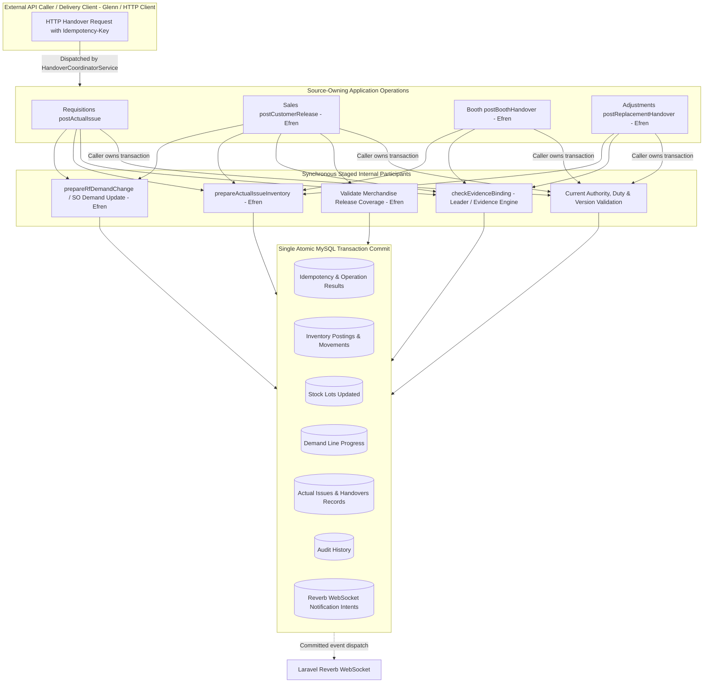

# YSP Delivery & Handover Integration Domain: Efren's 7-Day Backend Implementation Checklist

## Authority, Baseline & Review Gate Note
- **Authority**: Grounded in [MVP-DELIVERY-SCOPE.md](MVP-DELIVERY-SCOPE.md), [MVP-IMPLEMENTATION-PLAN.md](MVP-IMPLEMENTATION-PLAN.md), [DELIVERY-INTEGRATION-CONTRACT.md](DELIVERY-INTEGRATION-CONTRACT.md), [TRD.md](TRD.md) (Appendix A, C, D), [APP-FLOW.md](APP-FLOW.md), and [CONTEXT.md](../CONTEXT.md).
- **Baseline Truth & Commit Anchors**: Fresh scaffold baseline verified at `7287aa4` (scaffold reset). Remote `master` HEAD is verified at `c861fa4` (PR #20 `stage1-contracts-integration`).
- **Contract Baseline**: Stage 1 contracts in `contracts/stage1/` (`openapi.yaml`, `handoff.md`, `handoff.yaml`, `agreement.md`, `events.yaml`, `notifications.md`) specify the `issue` profile operations (`prepareActualIssue`, `reviseActualIssue`, `printActualIssue`, `matchActualIssueAcknowledgment`, `postActualIssue`, `listActualIssueMovements`, `readIssueReconciliation`, `recordIssueReconciliation`) as `specified_only`, pending combined human review. Track 1 Customer DR release (Stage 3), Booth checkouts/returns (Stage 4), and ADJ replacements (Stage 4) must have their formal specification and contract review completed before code implementation starts.
- **Scaffold Ground Truth**: Backend: PHP ^8.3 (platform 8.4.0), Laravel ^13.17, PHPUnit 12, Pint. Private MySQL 8.4 InnoDB. `backend/database/migrations/` is empty; `backend/routes/api.php` contains solely `GET /api/health`.
- **Domain Authority & Ownership Mapping**:
  - **Efren (Document Owner & Sole Implementer)**: Sole backend owner for Delivery & Handover Integration: Handover Coordinator dispatcher, physical stock posting participant `prepareActualIssueInventory`, source transaction integration, Customer DR release coverage gate, booth checkout/return handovers, accountable reconciliation architecture, uncertain-outcome recovery, and concurrency stress testing.
  - **Glenn (External Frontend Client Caller)**: External consumer calling handover endpoints (`S-07`, `S-04`, `deliveryClient.ts`). All UI screens, forms, client adapters, and client-side validations are external callers and upstream contracts.
  - **Leader (Architecture & Shared Services)**: Upstream provider of protected signed-paper evidence infrastructure (`evidence` profile endpoints, `checkEvidenceBinding` participant) and Reverb WebSocket notification gateway.

---

## Scope & Cross-System Dependency Contract

### In Scope (Functional Backend MVP Demonstration)
1. **Architectural Boundary Enforcement**: Handover Coordinator dispatches requests based on `source.kind` to the source-owning operations (`RequisitionIssueService` for RF, `SalesReleaseService` for SO, `BoothHandoverService` for Booth, `AdjustmentHandoverService` for Replacement). **Delivery is NEVER a separate backend persistence module or direct table writer**; the outer database transaction is strictly owned by the source operation per [DELIVERY-INTEGRATION-CONTRACT.md](DELIVERY-INTEGRATION-CONTRACT.md).
2. **Whole-Flow Functional Handover Traceability**: Complete backend coverage of all Appendix C handover, issue, release, and return nodes:
   - Sheet 2: `S2-05` (Customer DR release gate), `S2-10` (Connector E input), `S2-11` (IS/AR actual handover), `S2-12` (Event booth? YES $\to$ custody / NO $\to$ complete issue), `S2-16` (Return unsold handover), `S2-18` (Actual deduction/report).
   - Sheet 4: `S4-10` (Replacement handover & unequal-exchange payment gate).
   - Cross-Sheet Connectors: D (`S1-18` $\to$ `S2-01`), E (`S1-19` $\to$ `S2-10`), F (`S2-09` $\to$ `S4-01`).
   - Narrative Controls: `T-03` (partial RF & repeated signatures), `T-09` (signed partial DR/closure), `T-15` (booth stock & remittance closure), `T-16` (authorized movement evidence), `T-30` (references/actors/retention), `T-33` (replacement signature/claim).
   - Ambiguity Resolutions: `A-01` (merchandise release coverage gate), `A-04` (booth checkout/return custody without double stockroom debit), `A-05` (signed checkout posts immediately), `A-08` (partial demand fulfillment), `A-09` (booth claim uses booth OR; Track 1 uses OR + signed DR).
3. **Protected Signed-Paper Evidence Integration**: Real JPEG, PNG, and PDF byte and MIME validation; authoritative SHA-256 digest hashing computed by server; private filesystem storage; strict batch/recipient/source matching via `checkEvidenceBinding`; mutation rejection (modifying lines, quantities, recipient, or source invalidates prior match and mandates fresh physical paper acknowledgment).
4. **Handover Flow 1: Signed Actual Internal Issue (RF Handover)**: Stage 1 `issue` profile operations (`prepareActualIssue`, `reviseActualIssue`, `printActualIssue`, `matchActualIssueAcknowledgment`, `postActualIssue`, `listActualIssueMovements`); repeated partial batches (`4 + 2 + 4 = 10` units); single atomic commit joining source demand, evidence binding, and physical inventory posting.
5. **Handover Flow 2: Track 1 Customer DR Release (SO Handover)**: Buyer or authorized representative pickup (`S2-05`, `SO-08`–`SO-10`); commit-time 100% verified OR merchandise release coverage gate using integer minor units / `bcmath`; SO-reserved stock consumption; repeated partial customer DRs; overdue paid pickup tracking (`SO-11`).
6. **Handover Flow 3: Booth Custody Checkout & Return Handovers**: Stockroom-to-booth checkout (`S2-11`, `S2-12`, `BTH-02`) moving stock into unified event custody (`custody = 'BOOTH'`); booth-to-stockroom return (`S2-16`, `BTH-08`) restoring usable stockroom stock once.
7. **Handover Flow 4: ADJ Replacement Handover**: Signed replacement release bound to original approved claim and inspection record (`S4-10`, `ADJ-05`–`ADJ-07`); unequal-exchange payment gate.
8. **Uncertain-Outcome Recovery & Reconciliation Backend**: Operation lookup by key (`findActualIssueOperation` via `GET /api/v1/chapters/{chapter_id}/actual-issue-operations/by-key` for Stage 1, and proposed `GET /api/v1/operations/by-idempotency-key/{key}` for Stage 3/4); timeout/dropped-response recovery that NEVER instructs a second physical handover; accountable reconciliation backend (`readIssueReconciliation`, `recordIssueReconciliation`) using exact OpenAPI finding enum: `no_handover`, `handed_over_unposted`, `committed`, `disputed`.
9. **End-to-End Backend Delivery Integration Verification, Idempotency & Fault Injection Hardening**.

### Explicitly Deferred / Out of Scope (Never Schedule in MVP)
- **All Frontend UI Screens & Workspaces**: React components, TypeScript handover workspaces (`S-07`), client adapters (`deliveryClient.ts`), UI modal drawers, and client build pipelines (`npm run lint`, `npm run typecheck`, Vite) are completely stripped from this backend implementation plan.
- **On-Device HTML5 Signature Canvas**: (`DOC-08`, `ADD-04`, `TR-15` dual-mode deferred to paper scan/photo upload only).
- **Interactive Operations Map & Scenario Tracer**: (`ADD-01`, `ADD-AC-12`).
- **Provider Subscription & Commercial Lifecycle**: (`SUB-01`–`SUB-06`, `TR-30`).
- **Full PDF/CSV Reporting Suite**: (`RPT-07`, `AC-23` deferred to printable HTML endpoints).
- **Complete Administration UI**: (`S-21`/`S-22` setup UI deferred to the 8 controlled CLI procedures).
- **Production Deployment & Off-Host DR**: (`SEC-05`, `SEC-06`, `AC-22` deferred to local multi-client demonstration host + tunnel).

### Cross-System Dependency Contract

- **Architectural Boundary Rules ([DELIVERY-INTEGRATION-CONTRACT.md](DELIVERY-INTEGRATION-CONTRACT.md))**:
  - Delivery has no dedicated database tables for stock or money. It records actual handovers via shared `actual_issues`, `actual_issue_lines`, `issue_reconciliations` (Stage 1), and `handovers`, `handover_lines`, `handover_receipts` (Stage 3/4) records owned by the source transactions.
  - The API adapter dispatches requests by `source.kind` (`requisition`, `sales_order`, `booth_checkout`, `booth_return`, `adjustment_claim`) to the source-owning operation.
  - The source operation owns the database transaction, lock acquisition, and rollback boundaries.
  - No client-supplied status, approval, coverage, or stock balance is authoritative.
- **Handoff Seam: Delivery <-> Inventory**:
  - Delivery submits actual batch quantities and source references.
  - Inventory participates synchronously via `prepareActualIssueInventory`: selects specific lot allocations from reserved stock, validates material versions, and posts physical stock movements (`condition = USABLE`, decrementing usable/reserved on-hand).
- **Handoff Seam: Delivery <-> Sales**:
  - Delivery receives customer recipient identity and actual quantities.
  - Sales verifies commit-time 100% verified OR merchandise release coverage (`A-01`, `PAY-05`, `SO-08`) using `bcmath` integer minor units. If coverage is insufficient, Sales aborts the transaction with 422 Unprocessable Content.
- **Handoff Seam: Delivery <-> Evidence / Documents**:
  - Delivery accepts uploaded paper scan/photo (JPEG/PNG/PDF).
  - Leader's `checkEvidenceBinding` validates that the evidence is immutable, stored securely, and bound to the exact source reference, recipient name, item variants, and batch quantities `(source_type, source_id, recipient_name, sorted [variant_id, unit_id, lot/batch, quantity])`.

---

## 7-Day Atomic Implementation Checklist

### Day 1: Architectural Boundary, Shared Handover Schema & Handover Coordinator Dispatcher (Efren)
- [ ] **1.1 Shared Handover & Stage 1 Actual Issue Schema (Efren)**
  - Create migration `2026_11_02_000004_create_handovers_tables.php` defining:
    - `actual_issues` (`contracts/stage1/openapi.yaml#/components/schemas/ActualIssue`): `id` (UUID), `chapter_id`, `requisition_id`, `issue_number`, `status` (`prepared`, `acknowledged`, `invalidated`, `posted`), `recipient_name`, `prepared_by_user_id`, `actual_handover_at` (TIMESTAMP nullable), `evidence_binding_id` (nullable), `material_version`, `created_at`, `updated_at`.
    - `actual_issue_lines`: `id`, `actual_issue_id`, `requisition_line_id`, `variant_id`, `unit_id`, `lot_id`, `allocated_quantity` (DECIMAL 12,4), `issued_quantity` (DECIMAL 12,4).
    - `issue_reconciliations`: `id` (UUID), `chapter_id`, `actual_issue_id`, `officer_user_id`, `finding` (`no_handover`, `handed_over_unposted`, `committed`, `disputed`), `notes`, `reconciled_at`.
    - `handovers` (for Stage 3/4 Customer DR, Booth, ADJ): `id`, `chapter_id`, `handover_reference`, `source_type` (`SALES_ORDER`, `BOOTH_CHECKOUT`, `BOOTH_RETURN`, `ADJUSTMENT`), `source_id`, `recipient_name`, `actual_handover_at`, `handover_officer_id`, `evidence_binding_id`, `status` (`DRAFT`, `COMMITTED`, `DISPUTED`), `created_at`.
    - `handover_lines`: `id`, `handover_id`, `source_line_id`, `variant_id`, `unit_id`, `actual_quantity` (DECIMAL 12,4), `inventory_movement_id`.
    - `handover_receipts`: `id`, `handover_id`, `receipt_type` (`IS_AR`, `CUSTOMER_DR`, `BOOTH_CHECKOUT_RECEIPT`), `receipt_number`, `printed_at`, `printed_by`.
  - Configure routes in `backend/routes/api.php` under exact resource prefixes:
    - `/api/v1/chapters/{chapter_id}/evidence`
    - `/api/v1/chapters/{chapter_id}/internal-rfs/{rf_id}/actual-issues`
    - `/api/v1/chapters/{chapter_id}/actual-issues/...`
    - `/api/v1/chapters/{chapter_id}/actual-issue-operations/...`
    - Stage 3/4 dispatch route `POST /api/v1/chapters/{chapter_id}/handovers` dispatching to source-owning transaction coordinator per `DELIVERY-INTEGRATION-CONTRACT.md §2`.
- [ ] **1.2 Handover Coordinator & Transaction Dispatcher (Efren)**
  - Implement `App\Services\Delivery\HandoverCoordinatorService`:
    - Dispatches incoming handover payload based on `source.kind`:
      - `requisition` $\to$ `RequisitionIssueService::postActualIssue`
      - `sales_order` $\to$ `SalesReleaseService::postCustomerRelease`
      - `booth_checkout` / `booth_return` $\to$ `BoothHandoverService::postBoothCustodyHandover`
      - `adjustment` $\to$ `AdjustmentHandoverService::postReplacementHandover`
    - Invariant: The coordinator does NOT begin or commit an outer transaction; transaction management is strictly owned by the dispatched service.
- [ ] **1.3 Idempotency Enforcement & Operation Key Recovery Backend (Efren)**
  - Implement idempotency middleware and cache layer handling `Idempotency-Key` headers:
    - Stores request payload SHA-256 hash alongside cached response for committed operations.
    - If identical key arrives with identical payload: returns cached response with original status code (e.g., 201 Created) without re-executing business logic.
    - If identical key arrives with altered payload: aborts immediately with 409 Conflict (`DELIVERY-INTEGRATION-CONTRACT.md §3`).
- [ ] **Day 1 Exit Gate & Verification Command**:
  - Run: `docker compose exec -T backend php artisan test tests/Feature/Stage1A/HandoverInfrastructureTest.php`
  - Run: `python contracts/stage1/validate.py` AND `python contracts/stage1/validate.py --invalid-example` (expecting exit 1), followed by re-running valid `python contracts/stage1/validate.py`.
  - Idempotency Key Replay Test: Submit handover request with key `TEST-KEY-001`. Re-send identical request with same key; verify response returns exact original cached result with status 201 Created and zero duplicate records.
  - Altered Payload Conflict Test: Re-send request with same key `TEST-KEY-001` but altered line quantity; verify system returns 409 Conflict (`DELIVERY-INTEGRATION-CONTRACT.md §3`).

---

### Day 2: Evidence Binding Integration & Handover Validation Enforcement (Efren - integrating checkEvidenceBinding participant into handover transactions)
- [x] **2.1 Backend Evidence Controller & Secure Storage Integration (Efren)**
  - Integrate evidence storage disk in `backend/config/filesystems.php`: files stored in non-public storage directory; access gated through authenticated streaming controller (`DOC-06`, `SEC-03`).
  - Implement all 6 exact `openapi.yaml` evidence operations in `App\Http\Controllers\PaperEvidenceController`:
    1. `uploadPaperEvidence` (`POST /api/v1/chapters/{chapter_id}/evidence` — server computes SHA-256; rejects client hashes/URLs/readiness flags)
    2. `readPaperEvidence` (`GET /api/v1/chapters/{chapter_id}/evidence/{evidence_id}`)
    3. `listPaperEvidenceVersions` (`GET /api/v1/chapters/{chapter_id}/evidence/{evidence_id}/versions`)
    4. `replacePaperEvidence` (`POST /api/v1/chapters/{chapter_id}/evidence/{evidence_id}/versions`)
    5. `readPaperEvidenceVersion` (`GET /api/v1/chapters/{chapter_id}/evidence/{evidence_id}/versions/{version_id}`)
    6. `retrievePaperEvidenceAttachment` (`GET /api/v1/chapters/{chapter_id}/evidence/{evidence_id}/versions/{version_id}/attachments/{attachment_id}/content`)
  - Validates file MIME type: strictly restricts to `image/jpeg`, `image/png`, `application/pdf`; rejects uploads $> 10\text{MB}$ or empty files ($0\text{ bytes}$).
- [x] **2.2 Integration of checkEvidenceBinding Participant into Handover Flow (Efren)**
  - Integrate `App\Services\Evidence\Participants\CheckEvidenceBindingParticipant` (`contracts/stage1/handoff.yaml#/internal_participants/checkEvidenceBinding`, `agreement.md#ticket-04`) into all handover execution paths:
    - Synchronously called inside caller's database transaction.
    - Validates that `evidence_id` exists, is marked valid, and matches active chapter context.
    - Validates that `bound_recipient_name` strictly matches the handover recipient name.
    - Validates `bound_batch_fingerprint`: computes SHA-256 of sorted tuple: `(source_type, source_id, recipient_name, sorted [variant_id, unit_id, lot/batch, quantity])`.
- [x] **2.3 Handover Mutation Rejection & Stale Evidence Invalidation Engine (Efren)**
  - **CRITICAL INVARIANT (Mutation Rejection)**: If a user modifies any quantity, replaces an item variant, or changes the recipient, the prior evidence binding is invalidated immediately; system blocks commit until new matching paper evidence is uploaded and bound (`DOC-08`, `T-16`).
  - Upload or printing alone NEVER alters stock balances or updates demand progress (`MVP-DELIVERY-SCOPE.md §2`).
- [x] **Day 2 Exit Gate & Verification Command**:
  - Run: `docker compose exec -T backend php artisan test tests/Feature/Stage1B/EvidenceValidationTest.php`
  - MIME Validation Test: Attempt upload of `.exe` or `.txt` file disguised as JPEG; assert 422 Unprocessable Content.
  - Changed-Batch Invalidation Test: Match signed paper to batch of 4 units. Update batch quantity to 5 units; attempt `postActualIssue`; assert `checkEvidenceBinding` throws exception rejecting the mismatch (`DOC-08`).
  - Private Storage Test: Attempt unauthenticated HTTP GET to evidence storage path; verify file is inaccessible and returns 401/403.

---

### Day 3: Handover Flow 1 — Exact Stage 1 Issue Profile Endpoints, Atomic Issue Transaction (prepareActualIssueInventory) & Repeated Partial Issue Batches (Efren)
- [ ] **3.1 Exact Stage 1 Issue Profile Endpoints (Efren)**
  - Implement controllers in `App\Http\Controllers\ActualIssueController` matching exact Stage 1 OpenAPI paths and HTTP methods:
    1. `prepareActualIssue` (`POST /api/v1/chapters/{chapter_id}/internal-rfs/{rf_id}/actual-issues`): generates immutable issue draft with allocated lot coordinates from active RF reservation.
    2. `listActualIssues` (`GET /api/v1/chapters/{chapter_id}/internal-rfs/{rf_id}/actual-issues`): lists issue batches for the RF.
    3. `readActualIssue` (`GET /api/v1/chapters/{chapter_id}/actual-issues/{issue_id}`): reads issue record.
    4. `reviseActualIssue` (`PUT /api/v1/chapters/{chapter_id}/actual-issues/{issue_id}`): modifies draft lines prior to printing.
    5. `printActualIssue` (**`GET`** `/api/v1/chapters/{chapter_id}/actual-issues/{issue_id}/print`): marks draft printed and returns printable IS-AR HTML data (`DOC-08`, `DOC-11`).
    6. `matchActualIssueAcknowledgment` (`POST /api/v1/chapters/{chapter_id}/actual-issues/{issue_id}/acknowledgments`): links uploaded signed paper evidence to the draft batch.
    7. `postActualIssue` (`POST /api/v1/chapters/{chapter_id}/actual-issues/{issue_id}/post`): commits atomic physical movement and updates demand progress.
    8. `listActualIssueHistory` (`GET /api/v1/chapters/{chapter_id}/actual-issues/{issue_id}/history`)
    9. `listActualIssueMovements` (`GET /api/v1/chapters/{chapter_id}/actual-issues/{issue_id}/movements`)
    10. `listActualIssueRelatedRecords` (`GET /api/v1/chapters/{chapter_id}/actual-issues/{issue_id}/related`)
    11. `readIssueReconciliation` (`GET /api/v1/chapters/{chapter_id}/actual-issues/{issue_id}/reconciliation`)
    12. `recordIssueReconciliation` (`POST /api/v1/chapters/{chapter_id}/actual-issues/{issue_id}/reconciliations`)
    13. `findActualIssueOperation` (`GET /api/v1/chapters/{chapter_id}/actual-issue-operations/by-key`)
    14. `readActualIssueOperation` (`GET /api/v1/chapters/{chapter_id}/actual-issue-operations/{operation_id}`)
- [ ] **3.2 Atomic Issue Transaction Execution & prepareActualIssueInventory (Efren)**
  - Implement atomic commit in `App\Services\Requisitions\RequisitionIssueService::postActualIssue`:
    - Begins single MySQL transaction with `SELECT ... FOR UPDATE` row locks on affected `stock_reservations` and `inventory_lots`.
    - Participant 1 (Validation): Rechecks caller duty authority (`DISPATCH`, `INVENTORY`), RF status (`APPROVED`), and unfulfilled demand remaining.
    - Participant 2 (Demand): Calls `prepareRfDemandChange` to consume reserved interval and increment `issued_quantity` on `requisition_lines`.
    - Participant 3 (Evidence): Calls `checkEvidenceBinding` to verify immutable signed IS-AR paper binding.
    - Participant 4 (Efren / Inventory): Calls `prepareActualIssueInventory` (`contracts/stage1/handoff.yaml#/internal_participants/prepareActualIssueInventory`) to post immutable physical stock movements (`condition = USABLE`, decrementing usable stockroom stock).
    - Participant 5 (Outcome & Audit): Transitions `actual_issues.status` $\to$ `posted`, saves `idempotency_records`, and buffers Reverb notification intent matching `stage1.actual-issue.changed.v1` and `stage1.stock-lot.changed.v1`.
    - Commits transaction atomically. Any participant failure rolls back all database modifications completely.
- [ ] **3.3 Repeated Partial Issue Batches Handling (Efren)**
  - Implement repeated fulfillment logic (`RF-06`, `RF-07`, `T-03`, `A-08`, `contracts/stage1/handoff.md §Fixture A`):
    - Example Fixture A: Approved RF for 10 units.
      - Batch 1: Issues 4 units from reservation interval `[0,4)` $\to$ generates Issue 1, IS-AR 1 $\to$ remaining demand = 6 units.
      - Batch 2: Issues 2 units from reservation interval `[4,6)` $\to$ generates Issue 2, IS-AR 2 $\to$ remaining demand = 4 units.
      - Batch 3: Issues 4 units from subsequent reservation `[6,10)` $\to$ generates Issue 3, IS-AR 3 $\to$ remaining demand = 0 units.
    - On Batch 3 completion: RF status automatically transitions to `CLOSED` (`RF-08`, `A-21`).
    - Invariant: Each partial batch requires its own distinct physical paper IS-AR, unique receipt number, and separate posting.
- [ ] **Day 3 Exit Gate & Verification Command**:
  - Run: `docker compose exec -T backend php artisan test tests/Feature/Stage1B/ActualIssueTest.php`
  - Atomicity Fault Injection Test: Inject exception right before transaction commit in `postActualIssue`; verify 0 stock movements are written, reservation remains unconsumed, and RF issued quantity remains 0.
  - Repeated Partials Test: Execute 3 consecutive partial issues (4, 2, 4 units) against 10-unit RF; assert 3 separate handover records exist, total issued = 10, remaining demand = 0, and RF status = `CLOSED`.
  - Print-Only Stock Test: Generate and print IS-AR via `GET .../print`; verify stockroom physical inventory is unchanged (`MVP-DELIVERY-SCOPE.md §2`).

---

### Day 4: Handover Flow 2 — Track 1 Customer DR Release Coordinator, Exact Minor-Unit Payment Gate & SO-Reserved Stock Consumption (Efren)
- [ ] **4.1 Track 1 Customer Release Coordinator & Exact Minor-Unit Payment Gate (Efren)**
  - Implement `App\Services\Sales\SalesReleaseService::postCustomerRelease` (`SO-08`–`SO-10`, `PAY-05`, `S2-05`, `T-09`, `A-01`):
    - **COMMIT-TIME 100% PAYMENT COVERAGE GATE WITH INTEGER MINOR UNITS**:
      - Calculates monetary value of actual release batch in integer minor units (cents) using `bcmath` = $\sum (\text{actual\_quantity} \times \text{unit\_price\_cents})$.
      - Executes `SELECT ... FOR UPDATE` on `or_allocations` for the sales order where `allocation_type = 'MERCHANDISE_RELEASE_COVERAGE'` to prevent concurrent partial releases from double-spending coverage.
      - Computes unconsumed release coverage = `allocated_amount_cents - consumed_amount_cents`.
      - If unconsumed coverage $<$ batch value: strictly aborts transaction with 422 Unprocessable Content and machine-readable error `INSUFFICIENT_PAYMENT_COVERAGE` (`A-01`, `PAY-05`).
      - Invariant: Procurement deposits, unverified screenshots, or Sales Invoices (SI) alone NEVER satisfy release coverage (`T-07`).
- [ ] **4.2 SO-Reserved Stock Consumption & Delivery Receipt Handover Transaction (Efren)**
  - In same atomic transaction:
    - Decrements `stock_reservations` allocated to the SO line.
    - Decrements physical stockroom usable on-hand inventory via `PhysicalPostingService` (`inventory_postings` with `source_type = SO_DR`).
    - Increments `consumed_amount` on `or_allocations`.
    - Increments `delivered_quantity` on `sales_order_lines`.
    - Validates paper Customer DR upload via `checkEvidenceBinding` (matching buyer/authorized recipient signature).
    - If delivered quantity equals total ordered quantity: transitions SO status to `COMPLETED` (`SO-12`).
  - Implement printable HTML endpoint `GET /api/v1/chapters/{chapter_id}/customer-releases/{id}/print` returning server-rendered Customer DR (`DOC-08`, `DOC-11`).
- [ ] **4.3 Overdue Paid Stock Pickup Tracking & Protection Invariant (Efren)**
  - Implement overdue pickup monitor backend (`SO-11`, `RPT-02`):
    - When 100% payment coverage exists but physical customer handover has not occurred within chapter threshold (e.g., 7 days):
      - Flags SO in work queue under `Ready/Overdue Pickup`.
      - Logs customer follow-up contact attempts in `customer_contact_logs`.
      - Invariant: Overdue paid stock is protected; it is NEVER silently returned to available stock or resold (`T-08`).
- [ ] **Day 4 Exit Gate & Verification Command**:
  - Run: `docker compose exec -T backend php artisan test tests/Feature/Stage3/CustomerReleaseTest.php`
  - Zero Coverage Blocking Test: Attempt customer release when SO is approved and reserved, but payment verification is pending; assert release is BLOCKED with 422 `INSUFFICIENT_PAYMENT_COVERAGE` (`A-01`).
  - Partial Coverage Consumption Test: SO total 1,000 PHP (10 shirts @ 100 PHP). Buyer pays 600 PHP verified OR. Attempt release of 6 shirts; assert release commits, coverage consumed = 600 PHP, remaining coverage = 0 PHP. Attempt release of 7th shirt; assert 7th shirt is blocked.
  - Overdue Paid Stock Invariant Test: Advance clock past pickup deadline on fully paid SO; verify stock remains locked in `SO-reserved` view and is NOT released to general availability.

---

### Day 5: Handover Flows 3 & 4 — Event Booth Custody Checkout Handover, Usable Return Handover & ADJ Replacement Handover Gate (Efren)
- [ ] **5.1 Handover Flow 3: Booth Custody Checkout Handover (Efren)**
  - Implement `App\Services\Booths\BoothHandoverService::postBoothCheckoutHandover` (`BTH-02`, `S2-11`, `S2-12`, `T-11`, `A-05`):
    - Validates approved booth-purpose RF.
    - Requires signed paper checkout receipt between stockroom custodian (`INVENTORY`) and booth custodian (`BOOTH_CUSTODIAN`).
    - Validates paper binding via `checkEvidenceBinding`.
    - Atomic physical transfer via `PhysicalPostingService`: decrements stockroom usable on-hand (`custody = 'STOCKROOM'`) and increments booth custody (`custody = 'BOOTH'`).
    - Generates handover record with `source_type = BOOTH_CHECKOUT`.
    - Invariant: Checkout posts custody immediately; does NOT wait for booth sales (`A-05`).
- [ ] **5.2 Handover Flow 3: Booth Usable Return Handover (Efren)**
  - Implement `BoothHandoverService::postBoothReturnHandover` (`BTH-08`, `BTH-13`, `S2-16`, `A-04`):
    - Requires signed paper return acknowledgment between booth custodian and stockroom custodian.
    - Validates paper binding via `checkEvidenceBinding`.
    - Atomic physical transfer via `PhysicalPostingService`: decrements `inventory_lots` (`custody = 'BOOTH'`) and restores stockroom usable on-hand stock once.
    - Generates handover record with `source_type = BOOTH_RETURN`.
- [ ] **5.3 Handover Flow 4: ADJ Replacement Handover & Extra Payment Gate (Efren)**
  - Implement `App\Services\Inventory\AdjustmentHandoverService::postReplacementHandover` (`ADJ-05`–`ADJ-07`, `S4-10`, `T-33`, `A-14`):
    - Validates approved claim ADJ record with inspection finding `REPLACEMENT_AUTHORIZED`.
    - Enforces unequal-exchange payment gate:
      - If replacement item has higher price than original returned item: verifies that additional cash/GCash payment was verified and OR issued (`ADJ-07`, `PAY-10`).
      - If additional payment is unverified: blocks replacement release.
    - Requires signed customer acknowledgment bound via `checkEvidenceBinding`.
    - Atomic physical transfer: decrements stockroom usable on-hand for replacement variant once (`S4-10`).
- [ ] **Day 5 Exit Gate & Verification Command**:
  - Run: `docker compose exec -T backend php artisan test tests/Feature/Stage4/BoothAndReplacementHandoverTest.php`
  - Booth Checkout Handover Test: Execute booth checkout of 50 units with signed paper; assert stockroom decrements by 50 and booth custody increments by 50.
  - Unequal Exchange Extra Payment Test: Process claim replacing a 300 PHP shirt with a 400 PHP jacket. Attempt handover without verifying 100 PHP payment; assert BLOCKED. Verify 100 PHP payment; assert handover commits successfully (`ADJ-07`).
  - Double Deduction Prevention Test: Perform booth checkout 100, sell 30 at booth, return 70 with signed handover. Verify stockroom net deduction is exactly 30, booth custody is 0, and no double deduction occurs (`A-04`).

---

### Day 6: Accountable Handover Reconciliation Architecture, Uncertain-Outcome Recovery & Concurrency Stress Suite (Efren)
- [ ] **6.1 Operation Lookup by Key Engine (Efren)**
  - Implement Stage 1 operation lookup: `findActualIssueOperation` (`GET /api/v1/chapters/{chapter_id}/actual-issue-operations/by-key?action_key={key}`) and `readActualIssueOperation` (`GET /api/v1/chapters/{chapter_id}/actual-issue-operations/{operation_id}`).
  - Provide fallback to Stage 3/4 Delivery endpoint `GET /api/v1/operations/by-idempotency-key/{key}` (`DELIVERY-INTEGRATION-CONTRACT.md §2`).
  - Scoped strictly to active chapter and authenticated actor.
  - Returns cached committed operation response, operation ID, timestamp, and entity references.
  - If key does not exist: returns 404 with reason `OPERATION_KEY_NOT_FOUND`.
  - If operation is currently inflight in another transaction: returns 409/423 with reason `OPERATION_IN_FLIGHT`.
- [ ] **6.2 Accountable Handover Reconciliation Backend (Efren)**
  - Implement endpoints matching exact Stage 1 OpenAPI specifications:
    - `readIssueReconciliation` (`GET /api/v1/chapters/{chapter_id}/actual-issues/{issue_id}/reconciliation`)
    - `recordIssueReconciliation` (`POST /api/v1/chapters/{chapter_id}/actual-issues/{issue_id}/reconciliations`)
  - Implement exact `IssueReconciliation.finding` enum from `openapi.yaml`:
    1. `no_handover`: network failed before physical handover; user cancelled; stock remains untouched.
    2. `handed_over_unposted`: goods were physically handed over but network/DB dropped before commit; records audited reconciliation event linking real-world fact without double posting.
    3. `committed`: transaction actually committed in DB; returns committed record.
    4. `disputed`: recipient disputes receiving goods or quantity mismatch; opens formal investigation.
  - **CRITICAL INVARIANT**: A timeout or network failure must NEVER instruct the operator to repeat the physical handover (`DELIVERY-INTEGRATION-CONTRACT.md §4`, `MVP-DELIVERY-SCOPE.md §2`).
- [ ] **6.3 Concurrency, Lock-Ordering & Fault Injection Stress Suite (Efren)**
  - Create test suite `tests/Feature/Stage5/HandoverConcurrencyTest.php`:
    - Lock Ordering Test (`held-first` vs `issue-first`): Force MySQL InnoDB transaction ordering:
      - Thread A places hold on reserved units, then Thread B attempts issue $\to$ Thread B blocked/denied.
      - Thread B commits issue, then Thread A attempts hold $\to$ Thread A rejected (already consumed).
      - Assert zero deadlocks and zero corrupted intervals (`agreement.md#ticket-08`).
    - Last-Demand Competition: Two dispatch officers attempting to issue the final 4 units of remaining demand for different partial batches; assert exactly one commits 4 units, second rejected (demand satisfied).
    - Dropped Connection Simulation: Commit transaction in DB, simulate HTTP client timeout, call `findActualIssueOperation` or `by-idempotency-key` endpoint; assert client recovers original committed handover ID and movement IDs.
- [ ] **Day 6 Exit Gate & Verification Command**:
  - Run: `docker compose exec -T backend php artisan test tests/Feature/Stage5/HandoverConcurrencyTest.php`
  - Dropped Response Recovery Test: Execute handover; drop HTTP response artificially; call `GET /actual-issue-operations/by-key`; verify client recovers exact original handover ID and stock movement IDs.
  - Lock Ordering Deadlock Test: Run 20 concurrent iterations of competing hold vs issue requests; verify 0 MySQL deadlock exceptions occur.
  - Non-Duplication Test: Submit reconciliation with `handed_over_unposted`; assert system logs audited reconciliation record without issuing a second physical stock deduction.

---

### Day 7: End-to-End Backend Delivery Integration Verification, Idempotency & Fault Injection Hardening (Efren)
- [ ] **7.1 Backend Notification Outbox & Event Emission Pipeline (Efren)**
  - Configure backend event dispatching strictly AFTER MySQL transaction commits matching exact `events.yaml` names:
    - `stage1.actual-issue.changed.v1`
    - `stage1.stock-lot.changed.v1`
    - (Stage 3/4 `customer_release`, `booth_checkout`, and `booth_return` hints follow the same `.changed.v1` post-commit hint pattern).
  - Outbox pattern ensures that notifications are never dispatched if the database transaction rolls back.
- [ ] **7.2 Permission Revocation & Session Authority Guarding (Efren)**
  - Implement tests verifying mid-session duty revocation:
    - Revoke `DISPATCH` duty from active session; assert subsequent handover submission fails with 403 Forbidden.
    - Verify that unauthorized attempts to trigger handovers without active duty are blocked before transaction opens.
- [ ] **7.3 End-to-End Backend Integration & Stress Verification (Efren)**
  - Implement automated backend test suite executing the complete lifecycle:
    1. RF issue batch 1 (4 units) $\to$ IS-AR print $\to$ signed paper upload $\to$ atomic issue commit.
    2. Repeated RF issue batch 2 (6 units) $\to$ completion $\to$ RF status closed.
    3. SO Customer DR release $\to$ 100% payment coverage validation $\to$ signed paper matching $\to$ stockroom debit.
    4. Booth checkout $\to$ custody transfer to booth $\to$ booth return $\to$ usable stock restored to stockroom.
    5. Claim ADJ unequal exchange $\to$ extra payment gate enforcement $\to$ replacement release.
    6. Network timeout simulation $\to$ idempotency key recovery $\to$ reconciliation without duplicate deduction.
- [ ] **Day 7 Exit Gate & Verification Command**:
  - Run: `docker compose exec -T backend php artisan test tests/Feature/Stage1A/ tests/Feature/Stage1B/ tests/Feature/Stage3/ tests/Feature/Stage4/ tests/Feature/Stage5/`
  - Run: `docker compose exec -T backend ./vendor/bin/pint --test`
  - Run: `python contracts/stage1/validate.py` AND `python contracts/stage1/validate.py --invalid-example` (expecting exit 1), followed by re-running valid `python contracts/stage1/validate.py`.
  - Integration verification: All 4 handover flows, evidence binding invariants, minor-unit coverage gates, and recovery mechanics pass automated backend verification.

---

## End-to-End Acceptance & Verification Matrix

| AC / Source ID | Description & Invariant | Expected Test / Observable Result | Owner & Stage |
| --- | --- | --- | --- |
| `AC-02` / `S2-11`, `S2-12` | Signed Actual Internal Issue (RF Handover) | Approved RF $\to$ ready matching signed IS-AR paper $\to$ atomic stock deduction & demand consumption. Repeated partials (4+2+4) supported. | Efren (Stage 1B) |
| `AC-03` / `S2-05` | Track 1 Customer DR Release & 100% Coverage Gate | 100% verified OR merchandise release coverage required before customer handover (`bcmath` minor units). Blocked if payment missing. | Efren (Stage 3) |
| `AC-05` / `S2-11`, `S2-16` | Booth Custody Checkout & Return Handovers | Signed checkout immediately transfers stockroom stock to booth custody. Signed return restores usable stock to stockroom once (`A-04`, `A-05`). | Efren (Stage 4) |
| `AC-11` / `S2-05`, `T-09` | Repeated Partial Customer Releases | Partial customer release consumes coverage for delivered units only. Remaining demand and unconsumed coverage preserved. | Efren (Stage 3) |
| `AC-13` / `S4-10` | ADJ Replacement Handover & Unequal Exchange Gate | Replacement release bound to approved claim. Extra payment verified before releasing higher-value replacement (`ADJ-07`). | Efren (Stage 4) |
| `ADD-AC-05` / `DOC-08` | Protected Signed-Paper Evidence Binding | Paper upload (JPEG/PNG/PDF) with server SHA-256 digest. Exactly matches source, recipient, and batch. Modifying batch invalidates match. | Efren (Stage 1B) |
| `ADD-AC-06` / `TR-15` | Handover Idempotency & Uncertain-Outcome Recovery | Timeout recovers committed handover via `by-key` lookup. Reconciliation tracks 4 exact findings (`no_handover`, `handed_over_unposted`, `committed`, `disputed`). Never instructs second physical handover. | Efren (Stage 1B/5) |
| `CONC-05` / `agreement.md` | Lock Ordering: Held-First vs Issue-First | Concurrent hold vs issue requests resolve without deadlock. Held interval cannot be issued; issued interval cannot be held. | Efren (Stage 1B/5) |
| `CONC-06` / `agreement.md` | Last-Demand Handover Competition | Concurrent partial handovers competing for final remaining demand units; exactly one commits, second rejected without overissuance. | Efren (Stage 1B/5) |
| `EVT-01` / `MVP-DELIVERY-SCOPE.md §7` | Backend Notification Outbox & Post-Commit Emission | Committed handover buffers notification hints; emitted strictly after database transaction commits; zero emission on rollback. | Efren (Stage 5) |
