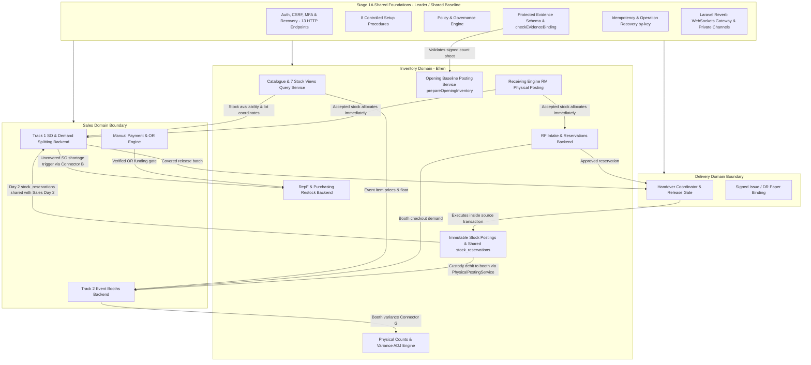

# YSP Inventory Domain: Efren's 7-Day Backend Implementation Checklist

## Authority, Baseline & Review Gate Note
- **Authority**: Grounded in [MVP-DELIVERY-SCOPE.md](MVP-DELIVERY-SCOPE.md), [MVP-IMPLEMENTATION-PLAN.md](MVP-IMPLEMENTATION-PLAN.md), [TRD.md](TRD.md) (Appendix A, C, D), [APP-FLOW.md](APP-FLOW.md), and [CONTEXT.md](../CONTEXT.md).
- **Baseline Truth & Commit Anchors**: Fresh scaffold baseline verified at `7287aa4` (scaffold reset). Remote `master` HEAD is verified at `c861fa4` (PR #20 `stage1-contracts-integration`).
- **Contract Baseline**: All Stage 1 contracts in `contracts/stage1/` (`openapi.yaml`, `handoff.md`, `handoff.yaml`, `agreement.md`, `events.yaml`, `notifications.md`) are `specified_only` and subject to pending combined human review. All Stage 2–4 routes, procedures, and payload schemas noted herein must have their formal specification and contract review completed before code implementation starts.
- **Scaffold Ground Truth**: Backend: PHP ^8.3 (platform 8.4.0), Laravel ^13.17, PHPUnit 12, Pint. Private MySQL 8.4 InnoDB. `backend/database/migrations/` is empty; `backend/routes/api.php` contains solely `GET /api/health`.
- **Domain Authority & Ownership Mapping**:
  - **Efren (Document Owner & Sole Implementer)**: Sole backend owner for Inventory Domain Implementation: database baselines, stock coordinates, immutable physical stock ledger `PhysicalPostingService`, seven non-additive stock views, opening inventory baseline posting `prepareOpeningInventory`, actual issue movements `prepareActualIssueInventory`, restock allocation backend, receiving engine `RM physical posting`, physical count adjustments & recount logic, resalable vs defective quarantine classification, cross-domain inventory reconciliation, and high-contention locking suite.
  - **Glenn (External Frontend Client Caller)**: External consumer of Inventory API endpoints (`S-02`, `S-03`, `S-04`, `S-08`, `S-09`, `S-10`, `S-11`, `S-12`, `S-13`, `S-18`). All UI screens, forms, client state, and client-side tab switching are documented strictly as external callers and upstream contracts.
  - **Leader (Architecture & Shared Services)**: Upstream provider of Shared Foundations (Auth, CSRF, MFA endpoints, 8 CLI procedures, evidence storage endpoints, purchasing integration contract, and Reverb WebSocket notification gateway).

---

## Scope & Cross-System Dependency Contract

### In Scope (Functional Backend MVP Demonstration)
1. **Whole-Flow Functional Traceability**: Complete backend coverage of all Appendix C Inventory, Requisition, Purchasing, Receiving, and Stock Adjustment flowchart nodes:
   - Sheet 1: `S1-01` (RF start), `S1-02` (RF prepare/correction), `S1-03` (RF approved? YES/NO), `S1-04` (Return RF), `S1-05` (RF Revise? YES/NO), `S1-06` (RF cancel stop), `S1-13` (Connector A input), `S1-14` (Central inventory check), `S1-15` (Sufficient stock? YES/NO), `S1-16` (Full reservation), `S1-19` (Connector E output), `S1-20` (Available reserve/shortage split), `S1-24` (RepF net need).
   - Sheet 2: `S2-18` (Actual deduction/report), `S2-19` (Usable $\le$ ROP? YES/NO), `S2-20` (Low-stock RepF), `S2-21` (Connector C output), `S2-22` (Refresh report).
   - Sheet 3: `S3-01` (Connector B input), `S3-02` (Connector C input), `S3-03` (RepF reconfirmation), `S3-04` (Budget/purchase approved? YES/NO), `S3-05` (Quotation comparison), `S3-06` (Approved PO), `S3-07` (Hold/revise/cancel RepF), `S3-08` (No-PO stop), `S3-09` (Supplier delivery PO/DR), `S3-10` (Donation start), `S3-11` (DA record), `S3-12` (Opening-stock start), `S3-13` (IPC count), `S3-14` (Valid source? YES/NO), `S3-15` (Missing-source hold), `S3-16` (Inspect delivered goods), `S3-17` (Acceptable? YES/NO), `S3-18` (Discrepancy/quarantine), `S3-19` (RM post), `S3-20` (PO still outstanding? YES/NO), `S3-21` (PO follow-up/balance loop), `S3-22` (Accepted-stock allocation), `S3-23` (Connector A output).
   - Sheet 4: `S4-02` (Connector G input from booth), `S4-03` (Physical-count start), `S4-04` (ADJ record/recount), `S4-05` (Claim or variance? YES/NO), `S4-06` (Claim ADJ approved? YES/NO), `S4-07` (Returned item defective? YES/NO), `S4-08` (Resalable return), `S4-09` (Defective quarantine), `S4-10` (Replacement handover), `S4-11` (Declined-claim stop), `S4-12` (Dual variance approval? YES/NO), `S4-13` (Post variance), `S4-14` (Investigate/no change), `S4-15` (Linked ADJ/report/ROP), `S4-16` (Connector A output).
   - Cross-Sheet Connectors: A (`S2-07`/`S3-23`/`S4-16` $\to$ `S1-13`), B (`S1-25` $\to$ `S3-01`), C (`S2-21` $\to$ `S3-02`), E (`S1-19` $\to$ `S2-10`), G (`S2-17` $\to$ `S4-02`).
   - Narrative Controls: `T-01`, `T-02`, `T-03`, `T-10`, `T-16`, `T-17`, `T-18`, `T-19`, `T-20`, `T-21`, `T-22`, `T-23`, `T-24`, `T-25`, `T-26`, `T-27`, `T-28`, `T-29`, `T-31`, `T-32`, `T-33`, `T-35`.
   - Ambiguity Resolutions: `A-06`, `A-07`, `A-08`, `A-10`, `A-13`, `A-15`, `A-16`, `A-17`, `A-18`, `A-20`, `A-21`.
2. **Catalogue & Stock Coordinates**: Chapter-scoped units with explicit quantity kinds (`piece`, `kit`, `measured`), scales (`0..6`), immutable identity locking (`quantity_identity_locked`), multi-variant, location catalogue with immutable `material_version` tracking (`INV-01`, `TR-07`).
3. **Seven Non-Additive Stock Views**: Real-time queries for `usable on-hand`, `available-to-allocate`, `RF-reserved`, `SO-reserved`, `booth custody`, `quarantine/rejected`, and `inbound PO` (`INV-02`–`INV-06`, `T-20`).
4. **Unified Booth Custody Source of Truth**: Single canonical inventory-owned representation matching `contracts/stage1/openapi.yaml` (`StockLot` with `custody = 'BOOTH'`, `location_id`, `custodian_id`, projection updated strictly ONLY by `PhysicalPostingService` and read by `StockViewQueryService`).
5. **Immutable Physical Stock Postings**: Source-backed postings only; zero arbitrary balance setters or negative-stock workarounds (`INV-07`, `INV-08`, `T-16`).
6. **Opening Inventory Baseline**: Independent 2-person count (`IPC`) $\to$ Head + Finance dual signatures $\to$ singleton `opening-rms` chapter fence (`RCV-08`–`RCV-10`, `MIG-01`, `MIG-04`, `T-18`, `A-18`).
7. **Requisitions & Reservations**: Committee RF lifecycle (draft, submit, review, return, revise, cancel) for internal vs booth purpose; reservations with overlapping holds (`[0,4) ∪ [2,6) = 6`), all-hold clearance, explicit reallocations, and 409 conflict handling with `failed_intent_committed: false`.
8. **Purchasing Restock**: Net-shortage / ROP replenishment triggers without duplicate coverage; RepF budget review; quotation comparison; approved PO tracking (inbound only).
9. **3-Source Receiving**: Inspection and partial RM acceptance against PO+DR, DA (in-kind donations with bounded restrictions), and IPC baseline; discrepancy/quarantine isolation; PO balance follow-up loop (`RCV-01`–`RCV-13`).
10. **Physical Counts & ADJ**: Inventory physical count variances with dual independent Head + Finance approvals (barring preparer & custodian); resalable return vs defective quarantine; ROP alerts.
11. **Cross-Domain Inventory Reconciliation Engine & High-Contention Locking Suite**: Automated lock ordering stress tests, race conditions, and fault-injection rollback verification.

### Explicitly Deferred / Out of Scope (Never Schedule in MVP)
- **All Frontend UI Screens & Workspaces**: React components, TypeScript inventory screens (e.g., S-02, S-03, S-04, S-08, S-09, S-10, S-11, S-12, S-13, S-18), UI modal drawers, and client build pipelines (`npm run lint`, `npm run typecheck`, Vite) are completely stripped from this backend implementation plan.
- **On-Device HTML5 Signature Canvas**: (`DOC-08`, `ADD-04`, `TR-15` dual-mode deferred to paper scan/photo upload only).
- **Interactive Operations Map & Scenario Tracer**: (`ADD-01`, `ADD-AC-12`).
- **Provider Subscription & Commercial Lifecycle**: (`SUB-01`–`SUB-06`, `TR-30`).
- **Full PDF/CSV Reporting Suite**: (`RPT-07`, `AC-23` deferred to printable HTML endpoints).
- **Complete Administration UI**: (`S-21`/`S-22` setup UI deferred to the 8 controlled CLI procedures).
- **Production Deployment & Off-Host DR**: (`SEC-05`, `SEC-06`, `AC-22` deferred to local multi-client demonstration host + tunnel).

### Cross-System Dependency Contract

- **Prerequisites provided by Shared Foundation (Leader / Upstream Contract)**:
  - 13 `access`/`authority` HTTP endpoints implemented, verified CSRF cookie, and completed MFA challenge.
  - 8 controlled CLI procedures (`prepareAccount`, `setAccountStatus`, `prepareChapter`, `setMembership`, `setDuty`, `setAlternate`, `recordPolicy`, `resetMfa`).
  - Protected evidence storage & validation participant `checkEvidenceBinding`.
  - Shared `stock_reservations` schema created on Day 2 to eliminate circular dependency with Sales Day 2 demand splitting.
  - Reverb WebSocket channel infrastructure.
- **Handoff Seam: Inventory $\to$ Sales**:
  - Inventory provides real-time stock availability via 7-view queries (`usable on-hand`, `available-to-allocate`, `SO-reserved`).
  - Sales consumes Inventory Day 2 `stock_reservations` with `source_type = 'SO'`.
  - Sales forwards verified OR-funded backorders to Purchasing (`Connector B`); Inventory ensures no duplicate `RepF` is created.
  - Inventory transfers custody to Event Booths on signed checkout and restores usable stock on verified returns using the unified `StockLot` custody coordinate.
- **Handoff Seam: Inventory $\to$ Delivery**:
  - Delivery submits actual batch quantities and source references.
  - Inventory participates via `prepareActualIssueInventory` inside the caller's atomic transaction to verify stock coordinates and post physical movement. Delivery never writes directly to inventory ledger tables.

---

## 7-Day Atomic Implementation Checklist

### Day 1: Stage 1A Shared Inventory Prerequisites, Database Baseline & Stock Coordinate Foundations (Efren)
- [ ] **1.1 Database Baseline & Infrastructure Configuration (Efren)**
  - Create migration `2026_11_02_000001_create_chapters_and_users_tables.php` defining `chapters`, `users`, `user_accounts`, `chapter_memberships`, `duty_grants`, `user_mfa_credentials`, `policy_records`, `idempotency_records`, and `audit_logs` matching Stage 1 specifications.
  - Configure `backend/config/database.php` for strict MySQL 8.4 InnoDB, UTF8mb4, repeatable-read transaction isolation, and foreign key enforcement.
  - Implement base models: `App\Models\Chapter`, `App\Models\User`, `App\Models\DutyGrant`, `App\Models\PolicyRecord`.
  - Implement middleware: `EnforceChapterContext`, `EnforceDutyAuthority`, and `IdempotentOperation` (`GOV-01`, `GOV-02`, `SEC-01`, `SEC-02`).
- [ ] **1.2 Catalogue Schema, Unit Coordinate Locking & Historical Versioning (Efren)**
  - Create migration `2026_11_02_000003_create_catalogue_tables.php` defining:
    - `catalogue_items`: `id` (UUID), `chapter_id`, `code`, `name`, `description`, `category`, `material_version` (INT UNSIGNED), `is_active`, `created_at`, `updated_at`.
    - `catalogue_variants`: `id`, `chapter_id`, `item_id`, `sku`, `name`, `attributes_json`, `material_version`, `is_active`.
    - `catalogue_units`: `id`, `chapter_id`, `code`, `name`, `quantity_kind` (`piece`, `kit`, `measured`), `quantity_scale` (INT, `0..6`, const `0` for `piece`|`kit`), `reason`, `quantity_identity_locked` (BOOLEAN default false), `state` (`active`, `retired`), `material_version`.
    - `catalogue_locations`: `id`, `chapter_id`, `code`, `name`, `zone`, `shelf`, `is_active`, `material_version`.
    - `catalogue_version_history`: audit snapshot of all structural changes (`DOC-04`, `DOC-09`, `INV-01`, `TR-07`).
  - Implement models: `App\Models\CatalogueItem`, `App\Models\CatalogueVariant`, `App\Models\CatalogueUnit`, `App\Models\CatalogueLocation`.
  - Enforce unit coordinate locking: once a unit is linked to a stock lot or transaction, `quantity_identity_locked` is set to true and mutating `quantity_kind` or `quantity_scale` is strictly rejected (`INV-01`).
- [ ] **1.3 Catalogue Access Endpoints & Coordinate Validation Rules (Efren)**
  - Implement controllers & routes in `backend/routes/api.php` matching exact Stage 1 paths:
    - `listCatalogueItems` (`GET /api/v1/chapters/{chapter_id}/catalogue/items`), `createCatalogueItem` (`POST .../items`), `readCatalogueItem` (`GET .../items/{item_id}`), `replaceCatalogueItem` (`PUT .../items/{item_id}`).
    - `listCatalogueVariants` (`GET /api/v1/chapters/{chapter_id}/catalogue/variants`), `createCatalogueVariant` (`POST .../variants`), `readCatalogueVariant` (`GET .../variants/{variant_id}`), `replaceCatalogueVariant` (`PUT .../variants/{variant_id}`).
    - `listCatalogueUnits` (`GET /api/v1/chapters/{chapter_id}/catalogue/units`), `createCatalogueUnit` (`POST .../units`), `readCatalogueUnit` (`GET .../units/{unit_id}`), `replaceCatalogueUnit` (`PUT .../units/{unit_id}`).
    - `listCatalogueLocations` (`GET /api/v1/chapters/{chapter_id}/catalogue/locations`), `createCatalogueLocation` (`POST .../locations`), `readCatalogueLocation` (`GET .../locations/{location_id}`), `replaceCatalogueLocation` (`PUT .../locations/{location_id}`).
    - History & Version endpoints: `listCatalogueItemHistory`, `readCatalogueItemVersion`, `listCatalogueVariantHistory`, `readCatalogueVariantVersion`, `listCatalogueUnitHistory`, `readCatalogueUnitVersion`, `listCatalogueLocationHistory`, `readCatalogueLocationVersion`.
    - Operations by-key: `findCatalogueOperation` (`GET /api/v1/chapters/{chapter_id}/catalogue/operations/by-key`), `readCatalogueOperation` (`GET /api/v1/chapters/{chapter_id}/catalogue/operations/{operation_id}`).
- [ ] **Day 1 Exit Gate & Verification Command**:
  - Run: `docker compose exec -T backend php artisan test tests/Feature/Stage1A/`
  - Run: `python contracts/stage1/validate.py` (with `validation-requirements.txt` dependencies)
  - Run Negative Contract Check: `python contracts/stage1/validate.py --invalid-example` (assert exit code 1), followed by re-running valid `python contracts/stage1/validate.py`.
  - Unit Coordinate Locking Test: Attempt mutation of `quantity_scale` on locked unit; verify 422 Unprocessable Content is returned.
  - Role Authorization Test: Attempt catalogue creation without `INVENTORY` duty; assert 403 Forbidden.

---

### Day 2: Stage 1B Physical Stock Ledger Schema, Coordinate Locking, Seven Non-Additive Stock Views & Opening Baseline Movement Posting (prepareOpeningInventory) (Efren)
- [ ] **2.1 Physical Stock Ledger Schema, Coordinate Locking & Shared Reservations (Efren)**
  - Create migration `2026_11_03_000001_create_inventory_ledger_tables.php` defining:
    - `inventory_postings`: `id` (UUID), `chapter_id`, `posting_reference`, `source_type` (`IPC`, `PO_DR`, `DA`, `RF_ISSUE`, `SO_DR`, `BOOTH_CHECKOUT`, `BOOTH_RETURN`, `ADJ`), `source_id`, `actor_id`, `notes`, `created_at`.
    - `inventory_movements`: `id`, `posting_id`, `chapter_id`, `variant_id`, `unit_id`, `location_id`, `condition` (`USABLE`, `QUARANTINE`, `REJECTED`), `quantity` (DECIMAL 12,4, signed), `balance_after` (DECIMAL 12,4).
    - `inventory_lots`: `id`, `chapter_id`, `variant_id`, `unit_id`, `location_id`, `lot_code`, `condition`, `custody` (`STOCKROOM`, `BOOTH`), `custodian_user_id` (nullable), `quantity_on_hand` (DECIMAL 12,4), `quantity_scale` (INT), `segments` (JSON), `stock_version` (INT), `historical_variant_label` (STRING), `material_version`.
    - `lot_restriction_assignments`: `id`, `lot_id`, `policy_id`, `restriction_code` (VARCHAR 64), `assigned_at`.
    - Unique coordinate constraint on `(chapter_id, variant_id, unit_id, location_id, condition, custody, lot_code)`.
    - `stock_reservations`: `id`, `chapter_id`, `source_type` (`RF`, `SO`), `source_id`, `source_line_id`, `lot_id`, `quantity`, `status` (`ACTIVE`, `CONSUMED`, `RELEASED`), `expires_at` (nullable for SO, null for RF). Created on Day 2 to provide unblocked shared access for Sales Day 2!
  - Implement posting service `App\Services\Inventory\PhysicalPostingService` (`INV-05`, `INV-07`, `INV-08`, `T-16`). Enforce invariant: zero arbitrary balance setters; all stock updates occur via signed movements within caller-owned DB transactions.
- [ ] **2.2 Seven Non-Additive Stock Views & Query Service (Efren)**
  - Implement query service `App\Services\Inventory\StockViewQueryService` computing the seven non-additive stock views (`usable on-hand`, `available-to-allocate`, `RF-reserved`, `SO-reserved`, `booth custody`, `quarantine/rejected`, and `inbound PO`).
  - Implement exact Stage 1 Stock endpoints in `App\Http\Controllers\StockQueryController`:
    - `listStockSummaries` (`GET /api/v1/chapters/{chapter_id}/stock`)
    - `readVariantStock` (`GET /api/v1/chapters/{chapter_id}/stock/variants/{variant_id}`)
    - `listStockLots` (`GET /api/v1/chapters/{chapter_id}/stock/lots`)
    - `readStockLot` (`GET /api/v1/chapters/{chapter_id}/stock/lots/{stock_lot_id}`)
    - `readStockEligibility` (`GET /api/v1/chapters/{chapter_id}/stock/lots/{stock_lot_id}/eligibility`)
    - `listStockLotHistory` (`GET /api/v1/chapters/{chapter_id}/stock/lots/{stock_lot_id}/history`)
- [ ] **2.3 Opening Baseline Physical Movement Posting (prepareOpeningInventory) & Singleton RM Fence (Efren)**
  - Create migration `2026_11_03_000002_create_opening_inventory_tables.php` defining `opening_counts` (IPC) and `opening_rms` (`RCV-08`–`RCV-10`, `MIG-01`, `MIG-04`, `S3-12`, `S3-13`).
  - Enforce singleton constraint: `UNIQUE KEY unique_chapter_opening (chapter_id)` on `opening_rms` to guarantee exactly one opening baseline per chapter (`T-18`, `A-18`).
  - Implement internal participant `prepareOpeningInventory` (`App\Services\Inventory\Participants\PrepareOpeningInventoryParticipant`, `contracts/stage1/handoff.yaml#/internal_participants/prepareOpeningInventory`): prepares initial lot coordinates and staging movements.
  - Implement exact Stage 1 OpenAPI operations in `App\Http\Controllers\OpeningInventoryController`:
    - IPC endpoints: `listIpcs`, `createIpc`, `readIpc`, `replaceIpc`, `listIpcHistory`, `readIpcRevision`, `readIpcRelated`, `printIpc`, `saveMyIpcCount`, `submitIpc`, `authorizeIpc`.
    - Opening RM endpoints: `listOpeningRms`, `createOpeningRm`, `readOpeningRm`, `replaceOpeningRm`, `listOpeningRmHistory`, `readOpeningRmRevision`, `readOpeningRmRelated`, `printOpeningRm`, `inspectOpeningRm`, `matchOpeningRmEvidence`, `postOpeningRm`, `listOpeningRmMovements`, `listOpeningRmFindings`, `readChapterOpeningBaseline`, `findOpeningActionByKey`, `readOpeningAction`.
    - `postOpeningRm`: atomic commit of `prepareOpeningInventory` + `checkEvidenceBinding` $\to$ writes `inventory_postings`, creates initial `inventory_lots`, and locks opening baseline fence (`RCV-10`, `S3-19`).
- [ ] **Day 2 Exit Gate & Verification Command**:
  - Run: `docker compose exec -T backend php artisan test tests/Feature/Stage1B/OpeningInventoryTest.php`
  - Concurrency Test: Race two concurrent `postOpeningRm` requests for the same chapter; assert exactly one commits (201 Created) and second fails with 409 Conflict (`RCV-10`, `T-18`, `A-18`).
  - Negative Test: Attempt IPC sign-off where Chapter Head and Finance are the same person without authorized alternate; assert 422 Unprocessable Content (`GOV-05`, `GOV-06`).
  - Seven Stock Views Reconciliation Test: assert sum of non-additive components equals physical inventory balance.

---

### Day 3: Stage 1B Physical Actual Issue Movements (prepareActualIssueInventory), Lot Decrements & Atomic Issue Invariants (Efren)
- [ ] **3.1 Physical Actual Issue Movement Posting Service (prepareActualIssueInventory) (Efren)**
  - Implement internal participant `prepareActualIssueInventory` (`App\Services\Inventory\Participants\PrepareActualIssueInventoryParticipant`, `contracts/stage1/handoff.yaml#/internal_participants/prepareActualIssueInventory`):
    - Executes synchronously inside caller's database transaction (`postActualIssue`).
    - Selects specific lot allocations from reserved stock coordinates under `SELECT ... FOR UPDATE` row locks.
    - Decrements `inventory_lots` (`custody = 'STOCKROOM'`, `condition = 'USABLE'`).
    - Writes immutable `inventory_postings` (`source_type = 'RF_ISSUE'`) and `inventory_movements` with signed negative quantity and audited `balance_after`.
    - Validates material version: verifies item/variant material version has not changed between draft and issue commit.
- [ ] **3.2 Reservation Lot Decrements & Overlapping Hold Union Math (Efren)**
  - Implement reservation interval tracking and hold evaluation in `App\Services\Inventory\ReservationService`:
    - Evaluates overlapping holds using union math: holds covering `[0,4)` and `[2,6)` have union length 6; total blocked units = 6. Blocked-reserved is a subset of reserved, NOT an extra deduction from available stock (`agreement.md#ticket-07`).
    - Reallocation logic: reallocates reserved commitments from lot A to lot B of equal variant/unit without altering net usable physical stock.
    - Concurrency protection: detects competing allocation; returns 409 Conflict with `failed_intent_committed: false` if insufficient available stock exists.
- [ ] **3.3 Atomic Issue Invariants & Negative Stock Prevention (Efren)**
  - Enforce zero arbitrary balance setters: all stock alterations must proceed through source-backed movement records (`INV-07`).
  - Enforce strict non-negative inventory constraint at the database layer (unsigned lot balances or check constraints) and application layer.
  - Implement rollback verification: any failure in downstream issue participants rolls back lot deductions completely.
- [ ] **Day 3 Exit Gate & Verification Command**:
  - Run: `docker compose exec -T backend php artisan test tests/Feature/Stage1B/ActualIssueTest.php`
  - Atomicity Fault Injection Test: Inject exception right before transaction commit in `postActualIssue`; verify 0 stock movements are written, reservation remains unconsumed, and usable on-hand is untouched.
  - Overlapping Hold Math Test: Create reservation of 6 units; apply hold 1 `[0,4)` and hold 2 `[2,6)`. Assert total blocked-reserved = 6 units, available stock remains unchanged. Release hold 1; assert 4 units remain blocked. Release hold 2; assert 0 units blocked.
  - Zero Negative Stock Test: Concurrent attempts to issue beyond available reserved stock return 409/422 and prevent negative balance.

---

### Day 4: Stage 2 Restock Allocation Backend & Inventory Replenishment Invariants (Efren)
- [ ] **4.1 Net-Shortage & ROP Calculation Engine (Efren)**
  - Implement `App\Services\Purchasing\NetNeedCalculator`:
    - Recomputes net replenishment need = `(Target Stock + Uncovered Shortage Demand) - (Usable Stock + Inbound Open POs + Active Replenishment Requests)`.
    - Distinguishes Chapter-funded need (RF shortage, ROP replenishment) from Buyer-funded shortage (SO backorder) (`PRC-01`–`PRC-03`, `INV-10`–`INV-12`, `T-21`, `T-22`, `S1-20`, `S1-24`, `S2-19`, `S2-20`, `S3-01`, `S3-02`, `S3-03`).
    - Prevents duplicate procurement coverage: checks open `RepF` and pending PO lines before allowing new replenishment demand (`A-13`).
- [ ] **4.2 Inbound PO Stock View Integration & Non-Additive Tracking (Efren)**
  - Create migration `2026_11_05_000001_create_purchasing_tables.php` defining `replenishment_requests` (`RepF`), `replenishment_lines`, `suppliers`, `quotations`, `purchase_orders` (`PO`), `purchase_order_lines`.
  - Implement `App\Services\Purchasing\PurchaseOrderService` (`PRC-05`–`PRC-09`, `GOV-10`, `S3-05`, `S3-06`, `T-24`, `T-25`):
    - Records approved PO issuance.
    - **CRITICAL INVARIANT**: Issuing a PO increments `inbound PO` stock view only; does NOT alter `usable on-hand` stock (`T-25`).
    - PO cancellation releases inbound commitment without corrupting underlying demand.
- [ ] **4.3 Replenishment Allocation Trigger Backend (Efren)**
  - Implement automated triggers:
    - ROP breach trigger: when physical stock updates drive usable on-hand $\le$ ROP threshold, creates pending replenishment trigger (`S2-19`, `S2-20`).
    - SO backorder linkage: receives funded shortage trigger via `Connector B`; verifies terms version and prevents duplicate `RepF` issuance (`A-13`).
- [ ] **Day 4 Exit Gate & Verification Command**:
  - Run: `docker compose exec -T backend php artisan test tests/Feature/Stage2/PurchasingTest.php`
  - Inbound View Invariant Test: Issue PO for 100 units; verify `inbound PO` stock view = 100, `usable on-hand` = 0, `available-to-allocate` = 0.
  - Duplicate Coverage Prevention Test: Trigger ROP recalculation twice; assert system blocks generation of a second RepF for already-covered items (`A-13`).
  - PO Cancellation Inbound Release Test: Cancel PO for 100 units; assert `inbound PO` decrements to 0 without affecting physical stock.

---

### Day 5: Stage 2 Receiving Engine (RM Physical Posting), Singleton RM Fence & Accepted Stock Immediate Allocation (Efren)
- [ ] **5.1 Receiving Engine & Physical Movement Posting (RM Physical Posting) (Efren)**
  - Create migration `2026_11_06_000001_create_receiving_tables.php` defining:
    - `receiving_reports` (`RM`): `id` (UUID), `chapter_id`, `rm_number`, `source_type` (`PO_DR`, `DA`, `IPC`), `source_id`, `inspector_id`, `inspection_date`, `supplier_dr_number` (nullable), `notes`, `status` (`DRAFT`, `ACCEPTED`, `REJECTED`, `DISCREPANCY_HELD`).
    - `receiving_report_lines`: `id`, `rm_id`, `variant_id`, `unit_id`, `delivered_quantity`, `accepted_quantity`, `quarantine_quantity`, `rejected_quantity`, `storage_location_id`, `condition` (`USABLE`, `DAMAGED`), `restriction`.
    - `receiving_discrepancies`: `id`, `rm_id`, `po_line_id` (nullable), `discrepancy_type` (`SHORTAGE`, `DAMAGE`, `WRONG_SPEC`), `quantity`, `supplier_claim_reference`, `resolution_status`.
  - Implement `App\Services\Receiving\ReceivingService` (`RCV-01`–`RCV-07`, `S3-09`, `S3-14`–`S3-22`, `T-26`):
    - Validates source: approved PO + supplier DR, DA, or IPC (`S3-14`). Missing-source delivery held in holding bay without stock receipt (`S3-15`).
    - Inspection breakdown (`S3-16`): delivered quantity partitioned into `accepted` (`S3-17 YES`), `quarantine` (needs test/cleaning, `S3-18`), and `rejected` (vendor return).
    - Atomic physical posting: calls `PhysicalPostingService` to post ONLY accepted quantities into usable stock lots (`INV-07`, `RCV-03`, `S3-19`).
- [ ] **5.2 Outstanding PO Balance Loop & Inbound PO Reduction (Efren)**
  - Implement PO delivery tracker (`S3-20`, `S3-21`, `RCV-04`, `RCV-05`, `T-27`):
    - Example: PO ordered 100 units, RM accepts 40 units $\to$ PO status transitions to `PARTIALLY_RECEIVED`; remaining outstanding balance = 60 units.
    - Inbound PO view updates: 100 $\to$ 60 units; usable on-hand increases by 40 units.
    - Balance delivery loop: later delivery repeats inspection against same PO; does NOT duplicate earlier accepted 40 units (`DOC-11`).
    - Invariant: DA and IPC sources skip PO balance comparison entirely (`A-07`).
- [ ] **5.3 Accepted Stock Immediate Allocation Service (Efren)**
  - Implement `App\Services\Inventory\AcceptedStockAllocationService` (`INV-09`, `RCV-04`, `RF-07`, `S3-22`, Connector A `S3-23` $\to$ `S1-13`, `A-06`):
    - Immediately allocates accepted partial stock to pending commitments by need-date and priority (`T-28`, `A-06`).
    - Unblocks waiting RF lines and funded SO backorders.
- [ ] **Day 5 Exit Gate & Verification Command**:
  - Run: `docker compose exec -T backend php artisan test tests/Feature/Stage2/ReceivingTest.php`
  - PO Partial Receipt Test: Order 100 units on PO; receive RM accepting 40 units and placing 10 in quarantine. Assert usable on-hand = 40, quarantine = 10, outstanding PO = 50. Verify accepted 40 units immediately allocate to waiting RF (`A-06`).
  - DA Restriction Enforcement Test: Receive DA tagged `YSP_PROGRAM_USE_ONLY`. Verify lot is visible in usable stock but blocked from Track 1 customer sale allocation.
  - IPC Baseline Rejection Test: Attempt to post RM with source IPC after opening baseline is locked; assert request is rejected with 409 Conflict (`RCV-10`, `A-18`).

---

### Day 6: Stage 4 Inventory Physical Counts, Recount Logic, Count Variances & Inspected Returns (Resalable Return vs Defective Quarantine ADJ) (Efren)
- [ ] **6.1 Physical Counts Schema, Variance Tracking & Recount Logic (Efren)**
  - Create migration `2026_11_07_000001_create_stock_adjustment_tables.php` defining:
    - `physical_counts`: `id` (UUID), `chapter_id`, `count_reference`, `scheduled_date`, `status` (`OPEN`, `IN_PROGRESS`, `RECOUNT_REQUESTED`, `COMPLETED`), `preparer_id`.
    - `physical_count_lines`: `id`, `physical_count_id`, `variant_id`, `unit_id`, `location_id`, `system_quantity`, `counted_quantity`, `variance_quantity`, `notes`.
    - `stock_adjustments` (`ADJ`): `id`, `chapter_id`, `adj_number`, `adj_type` (`COUNT_VARIANCE`, `AFTER_SALE_RETURN`, `BOOTH_VARIANCE`, `DAMAGE_WRITE_OFF`), `source_reference_id`, `preparer_id`, `status` (`DRAFT`, `SUBMITTED`, `DUAL_APPROVED`, `DECLINED`, `EXECUTED`), `dual_approval_head_id`, `dual_approval_finance_id`, `notes`.
    - `stock_adjustment_lines`: `id`, `adj_id`, `variant_id`, `unit_id`, `location_id`, `quantity` (signed), `condition_to` (`USABLE`, `QUARANTINE`, `REJECTED`), `action` (`RESTORE_USABLE`, `QUARANTINE_DEFECT`, `WRITE_OFF`).
  - Implement `App\Services\Inventory\PhysicalCountService` (`INV-13`, `ADJ-01`–`ADJ-03`, `S4-02`, `S4-03`, `S4-04`): independent recount trigger; preserves variance visibility without immediate balance overwrite.
- [ ] **6.2 Dual Independent Approval Verification & Conflict Disqualification (Efren)**
  - Implement dual approval enforcement in `App\Services\Inventory\StockAdjustmentService` (`ADJ-04`, `ADJ-08`, `GOV-06`, `S4-12`, `S4-13`):
    - Mandatory approvals: Both Chapter Head duty AND Finance duty must approve (`S4-12 YES`).
    - Disqualification invariant: Neither the count preparer NOR the affected custodian may approve the variance, even if they hold Head/Finance credentials (`TRD Appendix D`, `GOV-06`, `T-32`).
    - Independent fallback: If Head and Finance are the same person, an explicitly authorized `INDEPENDENT_REVIEWER` must co-approve (`GOV-06`, `T-32`).
    - Single linked posting: Approved variance posts exactly one atomic adjustment movement (`S4-13`, `A-15`), followed by ROP recalculation (`S4-15`, `S4-16` $\to$ Connector A).
    - Investigation branch: If dual approval is denied (`S4-12 NO`), system routes to `S4-14 Investigate/no change`: retains visible discrepancy and custodian balance without ledger change.
- [ ] **6.3 Inspected Returns Classification: Resalable Return vs Defective Quarantine (Efren)**
  - Implement return classification logic (`ADJ-03`, `ADJ-05`, `ADJ-06`, `INV-14`, `T-33`, `A-16`, `A-17`, `S4-06`, `S4-07`–`S4-09`, `S4-11`):
    - Inspection & evidence check strictly precedes approval (`A-16`).
    - If claim is declined (`S4-06 NO` $\to$ `S4-11`): retain rejection reason and evidence, post ZERO stock movements.
    - If claim is approved (`S4-06 YES`):
      - Resalable return (`S4-07 NO` $\to$ `S4-08`): Inspected goods confirmed in pristine condition restore usable stockroom inventory once.
      - Defective return (`S4-07 YES` $\to$ `S4-09`): Damaged/defective goods route strictly to quarantine/rejected stock; NEVER returned to usable on-hand or resold (`INV-14`).
- [ ] **Day 6 Exit Gate & Verification Command**:
  - Run: `docker compose exec -T backend php artisan test tests/Feature/Stage4/InventoryAdjustmentTest.php`
  - Conflict Disqualification Test: Have Officer C (Inventory Custodian) prepare physical count with variance. Attempt approval by Officer C using Chapter Head duty; assert 403 Forbidden. Approve with independent Officer A (Head) and Officer B (Finance); assert 200 OK (`GOV-06`, `T-32`).
  - Defective Quarantine Test: Process ADJ return of 5 defective shirts; assert quarantine stock = 5, usable stock = 0, available = 0 (`A-17`).
  - Declined Claim Test: Decline after-sale claim; verify `S4-11` zero stock movement and preserved audit reason.

---

### Day 7: Stage 5 Cross-Domain Inventory Reconciliation Engine, Concurrency Stress & High-Contention Locking Suite (Efren)
- [ ] **7.1 Cross-Domain Inventory Reconciliation Engine (Efren)**
  - Implement `App\Services\Inventory\InventoryReconciliationService`:
    - Reconciles physical movement ledgers against source documents: IPC, PO_DR, DA, RF_ISSUE, SO_DR, BOOTH_CHECKOUT, BOOTH_RETURN, ADJ.
    - Audits lot balances against movement sums: $\sum(\text{movements}) == \text{quantity\_on\_hand}$ per coordinate.
    - Verifies seven non-additive stock views consistency: `usable` + `quarantine` + `rejected` == total physical stockroom items.
- [ ] **7.2 High-Contention Concurrency, Lock-Ordering & Fault Injection Stress Suite (Efren)**
  - Create integration test suite `tests/Feature/Stage5/InventoryConcurrencyTest.php`:
    - Last-Unit Competition: 10 concurrent requests competing for the final 5 available units; verify exactly 5 units are allocated and 0 negative stock occurs (`CONC-01`).
    - Lock Ordering Test: Concurrent reservation hold vs issue; verify both `held-first` and `issue-first` resolve safely without deadlocks (`CONC-02`).
    - Fault Injection: Throw exception after `PhysicalPostingService` executes but before transaction commit; verify all MySQL movements and lot updates rollback completely (zero orphaned records).
- [ ] **7.3 Post-Commit Event Outbox & Notification Integrity (Efren)**
  - Configure reliable outbox pattern:
    - Buffers notification intents during active transaction.
    - Dispatches notification hints strictly AFTER MySQL transaction commits matching exact `events.yaml` names: `stage1.stock-lot.changed.v1`, `stage1.rf-reservation.changed.v1`, `stage1.stock-hold.changed.v1`, etc.
    - Zero event leakage on transaction rollback.
- [ ] **Day 7 Exit Gate & Verification Command**:
  - Run: `docker compose exec -T backend php artisan test tests/Feature/Stage1A/ tests/Feature/Stage1B/ tests/Feature/Stage2/ tests/Feature/Stage4/ tests/Feature/Stage5/`
  - Run: `docker compose exec -T backend ./vendor/bin/pint --test`
  - Run: `python contracts/stage1/validate.py` AND `python contracts/stage1/validate.py --invalid-example` (expecting exit 1), followed by re-running valid `python contracts/stage1/validate.py`.
  - Integration verification: All 7 non-additive views, physical postings, singleton locks, and high-contention concurrency suites pass automated verification.

---

## End-to-End Acceptance & Verification Matrix

| AC / Source ID | Description & Invariant | Expected Test / Observable Result | Owner & Stage |
| --- | --- | --- | --- |
| `AC-01` / `S1-14`, `S1-15` | Central Inventory Seven Non-Additive Views | Usable on-hand, available, RF-reserved, SO-reserved, booth custody, quarantine, and inbound PO queries reflect exact lot math without double-counting. | Efren (Stage 1B) |
| `AC-04` / `S3-12`, `S3-13` | Opening Stock Cutoff & Singleton IPC Baseline | Independent 2-person count $\to$ Head/Finance signatures $\to$ accepted RM posts once. Duplicate baseline blocked by chapter singleton lock (`opening-rms`). | Efren (Stage 1B) |
| `AC-07` / `S3-09`–`S3-22` | PO Delivery, Inspection & Partial Acceptance | PO 100 / RM 40 accepted $\to$ 60 outstanding PO balance. Usable stock increments by 40; quarantine holds damaged units; accepted stock allocates immediately. | Efren (Stage 2) |
| `AC-12` / `S3-10`, `S3-11` | In-Kind Donation (DA) & Bounded Restrictions | DA recorded with fair-market valuation and approved restrictions (`YSP_PROGRAM_USE_ONLY`). Restrictions enforced in allocations; never creates buyer money. | Efren (Stage 2) |
| `AC-14` / `S1-01`–`S1-06` | Requisition (RF) Intake, Review & Return Invariants | Committee drafts RF; independent approver reviews; return/revise loop retains history; cancel releases held reservations. Requester cannot approve own RF. | Efren (Stage 1B) |
| `AC-16` / `S1-20`, `S2-19`–`S2-21` | Net-Shortage & ROP Replenishment Triggers | Recomputed net need avoids duplicate PO coverage. RepF budget approval required before PO issuance. | Efren (Stage 2) |
| `AC-17` / `S4-03`–`S4-16` | Inventory Physical Count Variance & Dual Approvals | Recount before approval. Dual Head + Finance approval barring preparer and custodian. Single linked posting updates inventory and refreshes ROP. | Efren (Stage 4) |
| `AC-19` / `DOC-01`–`DOC-11` | Document Immutability & Audit Retention | Preserves canceled, rejected, expired, and voided history; prevents silent edits; references remain once-only. | Efren (Stage 1A–5) |
| `ADD-AC-07` / `S-18` | Variance Discrepancy & Recount Logic | Count variance triggers mandatory independent recount prior to dual approval. | Efren (Stage 4) |
| `ADD-AC-08` / `S-18` | Preparer & Custodian Disqualification Gate | System strictly bars preparer and affected custodian from approving their own count variance. | Efren (Stage 4) |
| `ADD-AC-09` / `S-12` | 3-Way Receiving Inspection & Quarantine Isolation | Rejection/quarantine routes defective delivered goods to unusable hold without balance leak. | Efren (Stage 2) |
| `ADD-AC-10` / `S-17` | Booth Usable Return & Custody Reconciliation | Usable return restores stockroom once; booth custody cleared; damage routes to ADJ via Connector G. | Efren (Stage 4) |
| `ADD-AC-11` / `T-21` | Combined Demand & ROP Trigger Deduplication | Simultaneous ROP breach and RF shortage consolidate into unified RepF net need without duplicate ordering. | Efren (Stage 2) |
| `CONC-01` / `agreement.md` | Last-Unit Reservation Competition | Two concurrent RF reservations competing for remaining stock; loser gets 409 with `failed_intent_committed: false`; zero negative stock. | Efren (Stage 1B/5) |
| `CONC-02` / `agreement.md` | Hold vs Issue Lock Ordering | Both `held-first` and `issue-first` execution orders resolve without deadlock; held interval cannot be issued; issued interval cannot be held. | Efren (Stage 1B/5) |
