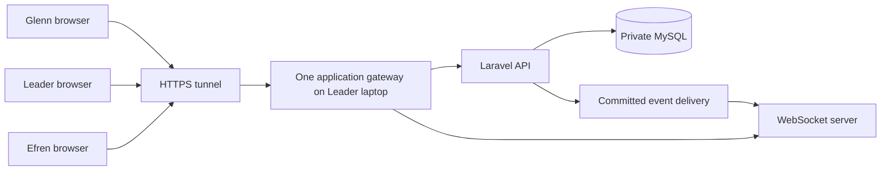

# YSP Whole Flow Demonstration Delivery Scope

| Field | Agreement |
| --- | --- |
| Status | Owner-authorized milestone planning record; no implementation or acceptance claimed |
| Recorded | 30 October 2026 |
| Revised | 31 October 2026: fresh scaffold, abandoned previous implementation/contracts/tooling, minimal Stage 0 gate and separate Stage 1 specification |
| Start | 1 November 2026; weekday development begins Monday, 2 November |
| Presentation window | 22–29 November 2026; plan toward readiness on Friday, 27 November |
| Outcome | Connected functional demonstration of the entire original four-sheet flowchart, including its branches, loops, exceptions and closure conditions |
| Delivery assessment | Four weeks is a high-risk stretch target; three weeks is not a dependable commitment |
| Latest transport decision | WebSockets, superseding the earlier polling proposal and its five-second criterion |

## 1. Authority and acceptance boundary

This document records the owner's delivery-scope interview and subsequent authorization to write it. It adds one milestone scope without rewriting the full-product specifications, domain glossary, ADRs, contracts or implementation plan. It does not authorize implementation, deployment, publication, live chapter operations or requirement-baseline promotion.

The acceptance target is the entire flowchart in [the original v2.0 proposal](../YSP_Cebu_Proposed_System_Workflow_Documentation_and_Proposal_v2.0.docx), interpreted through the existing authority and correction rules in [PRD sections 1.1, 3 and 21](PRD.md), [TRD Appendix C](TRD.md#appendix-c-source-flowchart-coverage), and [the implementation plan](IMPLEMENTATION-PLAN.md). A selected successful path through each sheet is insufficient.

The PRD and TRD retain their review-candidate status. [APP-FLOW](APP-FLOW.md), root [CONTEXT](../CONTEXT.md) and business [ADRs](adr/) supply workflow meaning and vocabulary. For this milestone, [MVP-IMPLEMENTATION-PLAN.md](MVP-IMPLEMENTATION-PLAN.md) supersedes the old technical architecture/schema and package-plan prescriptions; separate MVP stage specifications define the necessary replacement design. Chapter ownership, separate booth custody and bounded donor restrictions remain business requirements.

The implementation plan uses complete MVP to mean the complete product, AC/ADD-AC and technical/MIG acceptance boundary. This milestone deliberately has a narrower claim: **whole-flow academic functional demonstration**. The limitations in section 4 prevent a claim of complete PRD/TRD, P02, pilot or production acceptance.

| Acceptance level | Meaning |
| --- | --- |
| Functional demonstration — this milestone | Connected screens and real backend persistence using synthetic transactions; every original flowchart branch works, with traceable evidence and the controls below. |
| Controlled pilot — separate approval | Named real officers operate explicitly authorized workflows with approved policies, independence, applicable activation/readiness gates and evidence. Demonstration completion does not open this gate. |
| Production acceptance — separate approval | Full applicable product, technical, security, recovery and operational acceptance, approved funding and commercial terms, trained operation and authorized activation. |

## 2. Required whole-flow behavior

Use the existing source inventory rather than introducing replacement requirement IDs. The implementation plan's professor-demonstration section identifies the 87-node/40-branch inventory and connector/resolution evidence. Every source row must be mapped to implemented behavior and a reproducible result; none may silently disappear because it is inconvenient to present.

| Source area | Required connected behavior | Principal requirement families |
| --- | --- | --- |
| Sheet 1: demand, approval and allocation | RF/SO preparation, submission, independent review, return/revise/resubmit or cancel; eligible full/partial reservation, shortage and appropriate routing; progress and retained history. | RF-01–RF-08, SO-01–SO-12, INV-01–INV-14, GOV-05–GOV-10, DOC-04–DOC-05 |
| Sheet 2: internal issues and Track 1 | Signed actual internal handover; SO billing, verified payment/OR, accepted funded backorder, separate deadline treatment, payment hold, late-payment resolution and covered signed customer releases; repeated partials and valid closure. | PAY-01–PAY-12, RSV-01–RSV-10, RF-04–RF-08, SO-08–SO-12, DOC-08–DOC-11 |
| Sheet 2: Track 2 booths | Approved RF/setup and signed checkout; distinct booth custody; immediate verified sales/OR; unavailable-item handoff to Track 1; manual outage/later-entry controls; independent counts, usable returns, damage/variance, remittance and closure. | BTH-01–BTH-14, PAY-01–PAY-12, ADJ-08–ADJ-10, GOV-05–GOV-07 |
| Sheet 3: purchasing | RF/ROP chapter-funded need versus funded SO shortage; net need and duplicate coverage checks; budget rejection/hold/revision/cancellation; policy-compliant quotation evaluation, approved supplier/PO, outstanding commitments and authorized changes. | PRC-01–PRC-09, GOV-10–GOV-11, INV-09–INV-12 |
| Sheet 3: receiving | Exactly the supported PO plus supplier DR, DA or IPC sources; independent signed opening baseline, valuation/condition, donation restrictions, inspection, accepted-only RM postings, partial receipts, discrepancies, outstanding supply and reallocation. | RCV-01–RCV-13, INV-05–INV-14, MIG-01/MIG-04, DOC-01–DOC-11 |
| Sheet 4: claims and ADJ | Original transaction evidence, inspection/recount, eligibility and cumulative quantity limits; rejection without movement; independent approval; resalable/quarantine treatment, signed replacement, Finance-authorized financial treatment, dual count-variance approval and linked resolution. | ADJ-01–ADJ-10, PAY-10–PAY-12, GOV-05–GOV-07, DOC-08–DOC-11 |
| All sheets and connectors | Shared current inventory, required reports, ROP checks, source/approval links, actor/time/reason history, outstanding obligations, valid return loops and closure. | DOC-01–DOC-11, RPT-01–RPT-06, GOV-01–GOV-12, SEC-01–SEC-03, TR-06–TR-18 |

The existing PRD corrections remain essential. A procurement deposit is not automatically release coverage; an OR protects only the applicable quantities/commitments; expiry releases a reservation without creating stock. Booth checkout, sale and return are separate custody effects. Accepted partial receipts may serve eligible demand immediately. Track 1 claims use the required OR/signed DR evidence, while booth claims use the original booth OR. Unresolved custody or money cannot be hidden by closing a record.

### Controls that simplification cannot remove

- No unsupported receiving, arbitrary balance setter, negative-stock workaround or silent overwrite. Distinguish the seven related stock views and enforce provenance, restrictions, holds and usable condition.
- Recheck current authority, approved settings, material versions, quantities, stock eligibility and payment coverage when committing an action. Independent business approvals remain mandatory even with overlapping duties.
- A screenshot or SI alone is not verified money. SO-shortage funding and merchandise-release coverage are distinct uses of verified credit, not duplicate payments.
- Signed handovers require validated evidence bound to the exact recipient and actual batch. Changing that batch requires matching new acknowledgment; upload or printing alone does not post stock.
- Enforce durable duplicate prevention, concurrent last-unit protection and uncertain-outcome lookup. A timeout must not instruct a second payment, movement or physical handover.
- Preserve canceled, rejected, voided, expired and disputed history. Correct committed facts through linked authorized treatment.

These controls consume implementation and negative/concurrency-test time even when the screens are basic. Manual business verification changes how an officer establishes a fact; it does not permit the system to omit authorization, linkage, coverage, validation or history.

## 3. Simplifications agreed for the estimate

| Choice | Required retained behavior |
| --- | --- |
| Basic reusable lists, forms, record pages and actions | Real connected operations, visible state/blockers/history, usable validation, scoped access and preserved edits. Basic styling does not waive other unlisted interface/accessibility requirements. |
| Manual payment verification | Authorized officer records verified receipt against approved channels and references; OR, exact monetary allocation, duplicate detection, independence and release gates remain. Demonstration evidence is clearly synthetic, not actual chapter money. |
| Quotation attachments | Record comparable supplier terms, required quotation coverage, selection rationale and applicable approvals. Attachments alone cannot authorize a PO. |
| Signed-paper scan/photo upload | Validate and retain the exact acknowledgment and immutable binding. No on-device signature canvas in this milestone. |
| Printable HTML | Required references, chapter/status, quantities/totals, links and signature fields; authorized access; printing cannot repost or create another payment. |
| Prepared administrative setup | Prepare individual accounts, chapter memberships/duties, catalogue, suppliers and approved synthetic policies before the presentation. Retain setup authority/history. Actual opening stock still goes through IPC/RM. |

Prepared setup does not imply that missing runtime configuration controls are implemented. Required policy approval, current-authority and posting dependencies must be supplied and verified before their business action is enabled. Direct database fabrication of stock, payments or approvals is not acceptance evidence.

## 4. Temporary departures and acceptance consequences

The owner accepted these milestone boundaries in the interview. They do not waive or delete the full-product requirements, nor represent approval by real Chapter Head/Finance authorities for live use. Unlisted requirements are not implicitly deferred.

| Milestone boundary | Affected IDs | Approval and acceptance consequence |
| --- | --- | --- |
| Paper uploads only; on-device signing deferred | DOC-08, ADD-04, TR-15; on-device portion of ADD-AC-05 and applicable signature checks | Owner-selected demonstration limitation. Paper validation, changed-batch rejection and uncertain-outcome behavior remain required. Dual-mode acceptance stays incomplete. |
| Interactive operations map and scenario tracer deferred | ADD-01, ADD-AC-12 | Owner-selected presentation exclusion. Keep linked operational records and scoped access; complete map/tracer acceptance remains pending. |
| Provider subscription/trial lifecycle deferred | SUB-01–SUB-06, TR-30 | Owner-selected presentation exclusion. No live trial activation, subscription offer or commercial-readiness claim; required terms/funding and entitlement behavior remain pending. |
| Complete PDF/CSV reporting suite deferred | RPT-07, AC-23 | Owner-selected partial output acceptance. Required inventory/operational reports, authorized data and printable HTML remain. Full PDF/CSV and associated acceptance remain pending. |
| Complete administration UI omitted from presentation | Relevant setup surfaces under GOV-03–GOV-04/GOV-08–GOV-09 and APP-FLOW; GOV-01–GOV-09, SEC-01–SEC-03 and ADD-07 controls retained | Prepared setup is permitted, not a waiver of server authority or historical attribution. No claim that complete setup UI or all P02 operations are accepted. |
| Local demonstration host rather than production deployment; production activation/recovery acceptance deferred | Production deployment/operation portions of TR-01/TR-19–TR-26; SEC-05–SEC-06, AC-22, full MIG-08 | Owner-selected environment/acceptance boundary. Local host and tunnel still need working security and recovery from ordinary demo interruptions. Production restore targets, off-host recovery and activation require separate evidence/authorization. |

Before any controlled pilot, the relevant approving authorities must assess remaining limitations and authorize applicable staged gates; this delivery record does not override MIG requirements. Complete product acceptance still requires all outstanding features and evidence.

## 5. Fresh implementation baseline

The owner abandoned the unfinished P02 implementation and rejected carrying forward its architecture, OpenAPI/contracts, generated artifacts, migrations, tests and supporting machinery. Stage 0 generates fresh Laravel and React/TypeScript scaffolds with MySQL and minimal Docker configuration; it is not incremental cleanup of the previous application. Earlier preservation rules create no implementation or compatibility obligation.

Remote master was verified at `185adc9272b656f53f6b97e907e0712ac711b98a` on 31 October: it contains shared contracts and the earlier health scaffold, while the access runtime is branch-only. Retire the contracts on master without merging abandoned runtime branches. Remove obsolete active guidance as well as code. Historical Git commits are not a second implementation baseline; create no archive trees or compatibility layers.

Use a new empty scaffold database and leave existing volumes untouched. The minimum Stage 0 gate is Laravel-to-MySQL connectivity, React TypeScript/build, PHP syntax/dependency audits and a manual frontend-to-backend browser check. Record cold installation/build separately from warm verification. Old completion records and test totals establish nothing about this scaffold.

Stage 1 specification/contracts are entirely separate work after Stage 0, before Stage 1 implementation. Introduce necessary behavior, schema and focused tests with the actual MVP workflow. Section 2 business controls still apply without prescribing the abandoned technical solution. See [the implementation plan](MVP-IMPLEMENTATION-PLAN.md) and [fresh-scaffold decision](adr/0005-start-the-demonstration-from-fresh-scaffolds.md).

## 6. Team, capacity and review

| Developer | Preserved responsibility | Interview capacity/experience |
| --- | --- | --- |
| Leader | Purchasing, receiving, donations, opening stock, shared architecture/contracts, CI/CD, integration and default review | Understands concepts and reviews AI-generated code, starting from tests; implementation understanding takes time. Two ChatGPT Plus subscriptions and one Google AI Pro subscription reported. |
| Glenn | Demand intake, approvals, inventory queries/reservations and primary UI implementation across all workflows | Little implementation/review experience; primarily agent-assisted using Antigravity/paid Google AI Pro. No weekend availability assumed. |
| Efren | Shared physical stock postings, fulfillment, payments, internal issues, booths, reconciliation, returns/exchanges and ADJ | Laravel experience and reported React/TypeScript and review ability; Antigravity and other tools not fully specified. |

Glenn continues to supply UI for Leader's and Efren's workflows; backend ownership does not redistribute UI. Leader owns shared backend/WebSocket infrastructure integration, Glenn owns frontend subscriptions, and each workflow owner supplies its committed domain events. Efren reviews Leader-authored consequential changes; Leader reviews Glenn and Efren. Focus reviews on contracts, migrations, stock, money, authority and evidence; reversible presentation-only changes can receive lighter review. AI-generated tests and implementation both require human scrutiny.

Development roles are not operational permissions. Use the implementation plan's four individually authenticated synthetic personas and reviewed duty/alternate matrix, plus another synthetic chapter for isolation tests. Developers may present the test personas across three laptops; real operational independence requires actual authorized people and cannot be established by one person changing accounts.

| Duration | Weekdays | Team capacity at 5–6 hours/person/day |
| --- | --- | --- |
| Three weeks, ending 22 November | 15 | 225–270 hours |
| Four weeks, ending 29 November | 20 | 300–360 hours |

Leader reserves 2–3 hours each weekday for review/integration within the stated working hours. Over four weeks that is 40–60 hours out of Leader's 100–120, leaving approximately 40–80 for implementation. Do not add review hours to the team total or assume weekend overtime. AI assistance is a potential gain, not an effort estimate or guarantee.

## 7. Three-laptop environment and WebSockets

Leader's laptop is the agreed demonstration host. Its reported i7 14th-generation CPU and RTX 4080 laptop GPU do not replace validation of Docker memory, disk, internet, power and sleep settings. All laptops use the same HTTPS address and shared application/database; they may use different internet connections.

WebSockets are confirmed; polling is superseded. Laravel Reverb is the recommended implementation, pending dependency/security integration checks. Cloudflare Quick Tunnel is a proposed transport, not a confirmed/rehearsed provider. Any alternative must preserve the same-origin frontend/API and authenticated WebSocket arrangement without exposing MySQL or broad administrative access.

The current Compose gateway is loopback-bound and session configuration distinguishes local HTTP from secure non-loopback access. A tunnel is not a reason to weaken cookies or CSRF. Configure the public origin, trusted forwarding, HTTPS/WSS routing, allowed origins, channel authorization and application credentials deliberately. Keep secrets out of browser configuration and source control.

Required behavior:

1. Normal authenticated HTTP commands validate and commit business actions. Notifications refer only to committed changes; use the existing durable follow-up requirements where applicable.
2. Authorized private subscriptions notify affected screens, which fetch current authorized data. Do not broadcast unrestricted chapter-wide financial/evidence payloads.
3. Near-immediate automatic appearance requires no Refresh. Measure end-to-end delivery during Week 1 and agree the numeric timing criterion then; the earlier polling-specific five-second criterion is withdrawn, not silently reused.
4. Reconnect, missed-event recovery, chapter changes and permission revocation preserve current access boundaries. Resynchronize from authorized reads; do not assume a previously connected client remains authorized.
5. Preserve unsaved edits and indicate stale/disconnected state. Notification failure does not undo a committed transaction or permit reposting; use normal operation lookup and recovery.

Rehearse with all three laptops in Week 1, including actual proxy/tunnel upgrades, concurrent logins, MFA, an authorized record transition, denied subscription/read, disconnect/reconnect and restarting the tunnel. Internet connectivity and an approved fallback remain unresolved readiness items; no router is currently available. A single-laptop recording can support diagnosis but does not replace the required connected three-device assessment.

Technical references: [Laravel 13 Reverb](https://laravel.com/docs/13.x/reverb), [broadcasting and transaction/channel controls](https://laravel.com/docs/13.x/broadcasting), [Cloudflare Quick Tunnel limitations](https://developers.cloudflare.com/tunnel/get-started/quick-tunnels/), and [Cloudflare WebSocket support](https://developers.cloudflare.com/network/websockets/). General provider support does not prove this application/tunnel path works.

## 8. Connected weekly milestones

These are owner-agreed checkpoints, not completed work or guaranteed package durations. Reuse the implementation plan's package dependencies; running three agents/developers does not remove shared prerequisites or migration coordination.

| Week | Connected result | Minimum reviewable evidence |
| --- | --- | --- |
| 2–6 November | Three-device tunnel/WebSocket rehearsal; authority → signed IPC → accepted RM → stock → approved RF reservation → signed actual issue | Same committed record visible across laptops; eligible actors and real source/evidence links; opening count/projection reconciliation; duplicate baseline, self-approval and unsupported posting rejected. |
| 9–13 November | RF shortage → budget review → quotations/PO → accepted partial receipt → remaining fulfillment; DA receiving/restrictions | Return/revise/cancel and denial paths; PO 100/RM 40 leaves 60 outstanding; accepted stock serves demand; source/condition/restriction checks; ROP/open commitments prevent duplicate procurement. |
| 16–20 November | Track 1 billing, verified credit/funding/deadlines and covered releases; booth checkout/sales/counts; ADJ and financial resolution connected | Scoped expiry/funding evidence, blocked unsupported payment/release, repeated partials; checkout 100/sell 30/return 70 gives zero booth custody and stockroom net minus 30; independent variance and actual financial treatment. |
| 23–27 November | Close coverage gaps, run applicable compatibility and connected acceptance, reconcile, fix and rehearse | Source/branch dossier, signed-batch and authorization checks, concurrency/retry/deadline results, tested revision and three-laptop rehearsal; unresolved failures explicitly listed. |

Domain owners provide contracts/rules and acceptance cases early enough for Glenn's UI work to connect continuously. Final week is not the first integration point. A package with mocked stock, payment, evidence or authority remains incomplete.

## 9. Acceptance evidence and verification

Demonstrate principal connected journeys live, then supply reproducible UI steps and linked evidence for alternate paths too lengthy to repeat. Every branch must have working UI/backend behavior; tests or screenshots cannot stand in for an absent operation. Use controlled test time for deadline boundaries without weakening production rules or adding public bypass endpoints. Integration tests supplement UI evidence for actual database concurrency, retries and lost responses.

The acceptance dossier should map each existing source/requirement ID to the scenario, actors, initiating/linked references, expected and actual result, tested revision, evidence and any unresolved limitation. Distinguish core accepted behavior from the partial/deferred requirement rows in section 4. Do not mark an entire AC passed when only a subset was exercised.

Required control examples include last-unit competition; payment screenshot/SI-only rejection; exact partial coverage consumption; signed-batch mutation rejection; source-free/duplicate receipt rejection; restricted donation eligibility; independent count-variance approval; duplicate manual OR entry; uncertain-outcome lookup without reposting; cross-chapter/provider separation; and record/stock/money reconciliation after WebSocket reconnection.

Use [scripts/README.md](../scripts/README.md) as verification authority. During implementation use meaningful focused tests and valid owned environments, then affected compatibility checks. Shared environment, orchestration, prerequisite or CI changes require no-argument full verification under the repository rules. For backend static checks use the documented zero-rebuild helper. Retain failures and targeted reruns separately; a partial pass does not establish a full pass. The existing verifier's baseline also does not automatically cover new domain or WebSocket behavior: add the required meaningful checks to their owning suites during authorized implementation.

## 10. Estimate, risks and outstanding decisions

The available 300–360 four-week hours are capacity, not a validated estimate of remaining effort. Discovery shows reusable access foundations but largely unimplemented business workflows/UI, missing configuration/provider dependencies and new WebSocket work. Glenn's UI learning curve and Leader's limited implementation time after reviews are critical constraints. Efren's broad physical/financial scope also needs integration time.

**Do not promise complete whole-flow acceptance in three weeks. Four weeks remains a high-risk stretch forecast, with a re-estimate after Week 1's connected stock-to-issue result and transport rehearsal.** Preserving controls reduces room for feature coding; basic screens cannot eliminate that cost. No specific longer duration is evidence-backed yet.

If Week 1 fails, report the actual missing dependencies and revise the remaining estimate. Alternatives are extending the presentation/delivery date, or presenting accurately labeled partial progress while retaining whole-flow acceptance as unmet. Do not reduce source coverage, skip independent approvals, weaken concurrency assertions or suppress audits to manufacture completion.

Outstanding items are the exact presentation appointment within the window, tunnel provider and connectivity fallback, measured WebSocket timing criterion, validated host resources, reviewed synthetic policy/duty values and current implementation/verification status. These are explicit follow-up inputs, not assumed approvals. The fixed weekly capacity and existing assignments remain the planning baseline.

## 11. Before live operation

No demonstration result authorizes real stock, money or subscriptions. Before a controlled pilot, confirm the enabled scope against the unchanged full requirements and applicable MIG gates, actual officers/alternates and independent approval coverage, financial/purchasing/return/donation settings, official accounts and numbering, signed opening/carryover treatment and obligations. Missing required settings block their actions.

Before production acceptance, supply current security/compatibility evidence, dependency remediation where required, private evidence storage/retention, funded reproducible deployment and monitoring, measured off-host recovery meeting SEC-05/SEC-06, trained technical backup and reconciliation procedures, outstanding feature acceptance and commercial approvals where applicable. Developer reviews and synthetic demonstration personas cannot sign real operational activation gates.
