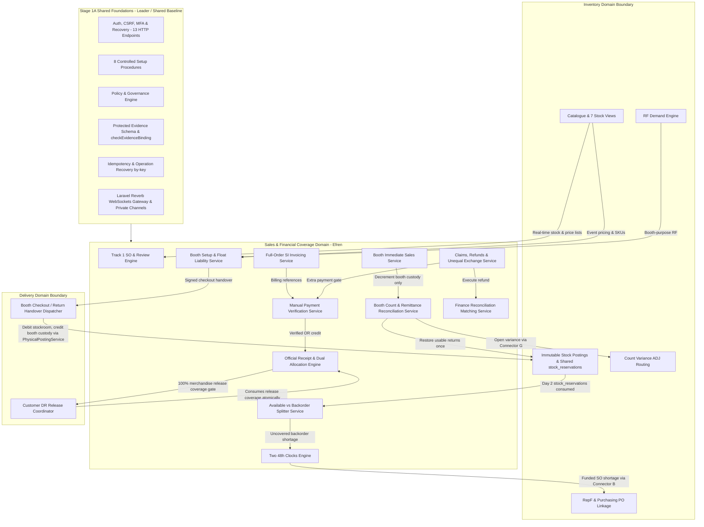

# YSP Sales & Financial Coverage Domain: Efren's 7-Day Backend Implementation Checklist

## Authority, Baseline & Review Gate Note
- **Authority**: Grounded in [MVP-DELIVERY-SCOPE.md](MVP-DELIVERY-SCOPE.md), [MVP-IMPLEMENTATION-PLAN.md](MVP-IMPLEMENTATION-PLAN.md), [TRD.md](TRD.md) (Appendix A, C, D), [APP-FLOW.md](APP-FLOW.md), and [CONTEXT.md](../CONTEXT.md).
- **Baseline Truth & Commit Anchors**: Fresh scaffold baseline verified at `7287aa4` (scaffold reset). Remote `master` HEAD is verified at `c861fa4` (PR #20 `stage1-contracts-integration`).
- **Contract Baseline**: Track 1 Sales (Stage 3), Event Booths (Stage 4), and Finance/Reconciliation routes and event models must have their formal specification and contract review completed before code implementation starts. Stage 1 contracts in `contracts/stage1/` are `specified_only` and pending combined human review.
- **Scaffold Ground Truth**: Backend: PHP ^8.3 (platform 8.4.0), Laravel ^13.17, PHPUnit 12, Pint. Private MySQL 8.4 InnoDB. `backend/database/migrations/` is empty; `backend/routes/api.php` contains solely `GET /api/health`.
- **Domain Authority & Ownership Mapping**:
  - **Efren (Document Owner & Sole Implementer)**: Sole backend owner for financial coverage, Sales Invoicing (`SI`), payment verification, Official Receipts (`OR`), dual allocation, two 48-hour clocks, event booth custody/sales/close-out, and financial adjustment reconciliation (`ADJ`).
  - **Glenn (External Frontend Client Caller)**: External consumer of Sales API endpoints (`S-04`, `S-05`, `S-06`, `S-15`, `S-16`, `S-17`, etc.). Frontend screens, UI modal/drawer descriptions, and client-side state handling are documented solely as external callers and upstream contracts.
  - **Leader (Architecture & Shared Services)**: Upstream provider of Shared Foundations (Auth, CSRF, MFA endpoints, CLI procedures, `checkEvidenceBinding` participant, purchasing integration contract for `RepF`, Reverb WebSocket channel infrastructure).

---

## Scope & Cross-System Dependency Contract

### In Scope (Functional Backend MVP Demonstration)
1. **Whole-Flow Functional Traceability**: Complete coverage of all Appendix C Track 1 Sales, Payment/OR, Backorders, Event Booth, and Financial Reconciliation backend nodes:
   - Sheet 1: `S1-07` (Buyer-order start), `S1-08` (SO prepare/lines), `S1-09` (SO/price/terms approved? YES/NO), `S1-10` (Return SO), `S1-11` (SO Revise? YES/NO), `S1-12` (SO cancel stop / retain commitments), `S1-17` (Approved SO? YES $\to$ D / NO $\to$ E), `S1-18` (Connector D output), `S1-21` (SO shortage? YES/NO), `S1-22` (Deposit verified/OR? YES/NO), `S1-23` (Hold backorder / 48h funding clock).
   - Sheet 2: `S2-01` (Connector D input), `S2-02` (SI full-order billing split), `S2-03` (Payment verified? YES/NO), `S2-04` (OR issue/allocation), `S2-05` (Customer DR release gate), `S2-06` (Payment hold/expiry), `S2-07` (Connector A output), `S2-08` (After-sale claim start), `S2-09` (Connector F output), `S2-11` (IS/AR checkout), `S2-12` (Event booth? YES $\to$ custody), `S2-13` (Booth OR/sale), `S2-14` (Unsold count), `S2-15` (Count reconciles? YES $\to$ S2-16 / NO $\to$ S2-17), `S2-16` (Return unsold/net sold), `S2-17` (Connector G output), `S2-23` (End / valid closure).
   - Sheet 4: `S4-01` (Connector F input), `S4-05` (Claim or variance? YES/NO), `S4-06` (Claim ADJ approved? YES/NO), `S4-07` (Returned item defective? YES/NO), `S4-10` (Replacement/handover & extra payment gate).
   - Cross-Sheet Connectors: A (`S2-07` $\to$ `S1-13`), B (`S1-25` $\to$ `S3-01`), D (`S1-18` $\to$ `S2-01`), F (`S2-09` $\to$ `S4-01`), G (`S2-17` $\to$ `S4-02`).
   - Narrative Controls: `T-04`, `T-05`, `T-06`, `T-07`, `T-08`, `T-09`, `T-11`, `T-12`, `T-13`, `T-14`, `T-15`, `T-34`.
   - Ambiguity Resolutions: `A-01`, `A-02`, `A-03`, `A-04`, `A-05`, `A-09`, `A-11`, `A-12`, `A-14`, `A-19`, `A-21`.
2. **Track 1 Sales Orders (SO)**: Staff-entered buyer record backend (NO buyer login portal); order lines, prices, terms, and delivery arrangement; approval, return, revise, and cancel lifecycle (`SO-01`–`SO-03`, `DOC-03`, `DOC-05`, `DOC-09`).
3. **Demand Workspace & Stock Splitting Backend**: Full/partial/backorder buyer acceptance logging; customer contact log backend; splitting demand into immediate reservation vs backorder shortage (`SO-04`, `SO-05`, `INV-06`).
4. **Billing & Manual Payment Verification Engine**: Full-order Sales Invoice (`SI`) billing available and backordered split (`A-03`); SI is strictly billing, NEVER payment proof (`T-07`); manual payment verification against approved chapter accounts/channels; global duplicate reference fence (`SEC-03`, `PAY-03`).
5. **Official Receipts (OR) & Dual Allocation Engine**: Strict separation of `procurement-funding designation` (authorizes PO restock) vs `merchandise release coverage` (authorizes physical handover, `A-01`); installment tracking (`PAY-04`); payment hold (`PAY-08`).
6. **Two Independent 48-Hour Clocks & Clean Partial Expiry Engine**:
   - Clock 1: Unpaid SO reservation 48h expiry (`RSV-01`–`RSV-03`). Clean partial expiry handling: expiring unpaid lines releases their reservation to central availability without corrupting or cancelling paid/funded lines on the same SO (`A-02`).
   - Clock 2: Accepted backorder 48h funding deadline (`RSV-04`, `RSV-07`) canceling unfunded backorder demand while retaining partial money and funded demand.
   - Late payment recovery: fresh stock availability check creating a paid reservation without resetting an unpaid timer (`A-12`).
   - Approved cost/terms version check: prevents silent price increases or backdating (`RSV-06`, `RSV-08`).
   - Funded cancellation: canceling a funded SO retains underlying supplier obligations (`AC-20`, `SO-12`, `PAY-11`, `S1-12`).
7. **Track 2 Event Booths & Unified Custody**: Event setup schema, configurable event price lists, separate cash float liability (`BTH-01`, `BTH-06`); booth-purpose RF checkout into unified Inventory `StockLot` custody (`custody = BOOTH`, signed IS-AR checkout, `A-05`); immediate verified cash/official GCash sales decrementing booth custody only (NO per-sale SO/SI/DR, `A-04`); out-of-stock handoff to Track 1; manual outage receipt ranges and delayed entry with original vs entry timestamps (`BTH-11`, `BTH-12`).
8. **Booth Close-Out & Remittance Arithmetic Backend**: Independent 2-person count verification (`T-14`); per-variant `booth_closeout_lines`; verified usable returns restored to stockroom (`100 checkout - 30 sold - 70 returned = 0 booth, -30 stockroom`, `A-04`); good returns post immediately while damage/missing/unpaid remittance blocks event closure (`AC-06`, `A-19`); formal remittance formula: `float + cash sales - refunds - prior deposits = remaining cash due` (`ADD-AC-10`).
9. **Sales Adjustments & Financial Reconciliation Engine**: Source-linked after-sale claims (Track 1 requires OR + signed DR; Booth requires original booth OR, `A-09`); Finance-authorized refunds distinct from execution (`ADJ-07`, `PAY-10`, `A-14`); unequal exchanges with mandatory extra-payment gate prior to replacement; Track 1 SI/OR/DR and booth remittance reconciliation backend engine.

### Explicitly Deferred / Out of Scope (Never Schedule in MVP)
- **All Frontend UI Screens & Workspaces**: React components, TypeScript UI client screens (e.g., S-01, S-04, S-05, S-06, S-15, S-16, S-17, S-19), UI drawers, client modals, and client build pipelines (`npm run lint`, `npm run typecheck`, Vite) are completely stripped from this backend implementation plan.
- **On-Device HTML5 Signature Canvas**: (`DOC-08`, `ADD-04`, `TR-15` dual-mode deferred to paper scan/photo upload only).
- **Interactive Operations Map & Scenario Tracer**: (`ADD-01`, `ADD-AC-12`).
- **Provider Subscription & Commercial Lifecycle**: (`SUB-01`–`SUB-06`, `TR-30`).
- **Full PDF/CSV Reporting Suite**: (`RPT-07`, `AC-23` deferred to printable HTML endpoints).
- **Complete Administration UI**: (`S-21`/`S-22` setup UI deferred to the 8 controlled CLI procedures).
- **Production Deployment & Off-Host DR**: (`SEC-05`, `SEC-06`, `AC-22` deferred to local multi-client demonstration host + tunnel).

### Cross-System Dependency Contract

- **Prerequisites provided by Shared Foundation (Leader / Upstream Contract)**:
  - 13 `access`/`authority` HTTP endpoints implemented, verified CSRF cookie, and completed MFA challenge.
  - Active duty grants: `SALES_OFFICER`, `SALES_REVIEWER`, `FINANCE`, `BOOTH_CUSTODIAN`, `BOOTH_CASHIER`, `INDEPENDENT_REVIEWER`, `CHAPTER_HEAD`.
  - Approved financial settings: payment channels (cash, bank, GCash account details), official OR receipt number series.
  - Evidence validation participant: `checkEvidenceBinding` (receipt photos, deposit slips).
  - Reverb private channels registered: `private-stage1.user.{current_user_uuid}` and `private-stage1.chapter.{url_chapter_uuid}.user.{current_user_uuid}`.
- **Handoff Seam: Sales $\to$ Inventory**:
  - Sales queries Inventory 7-view stock (`usable on-hand`, `available-to-allocate`, `SO-reserved`).
  - Sales Day 2 demand splitting locks reserved units using Inventory Day 2 `stock_reservations` (`source_type = 'SO'`).
  - On 48h unpaid expiry, Sales instructs Inventory to release reservation to available pool (`Connector A`). Expiring unpaid lines leaves paid lines protected (`A-02`).
  - Sales hands over funded shortage to Purchasing: verified OR buyer deposit meeting approved cost forwards `RepF` to Purchasing (`Connector B`).
  - Event Booth uses the unified Inventory `StockLot` custody coordinate (`custody = BOOTH`). On close-out, usable returns restore stockroom stock; booth variances route to Inventory ADJ (`Connector G`).
- **Handoff Seam: Sales $\to$ Delivery**:
  - Sales owns the SO lifecycle, billing (`SI`), payment verification, and Official Receipt (`OR`) allocations.
  - Delivery executes the handover within the Sales-owned transaction: Sales revalidates that committed verified OR merchandise release coverage $\ge$ handover batch value (`A-01`, `PAY-05`, `SO-08`). If coverage is insufficient, Sales blocks the release.

---

## 7-Day Atomic Implementation Checklist

### Day 1: Stage 1A Sales Schema, Setup Verification & Buyer Record Intake Lifecycle (Efren)
- [ ] **1.1 Sales Schema & Staff-Entered Buyer Intake (Efren)**
  - Create migration `2026_11_02_000005_create_sales_tables.php` defining:
    - `buyers`: `id` (UUID), `chapter_id`, `name`, `organization_name`, `contact_person`, `phone`, `email`, `address`, `created_at`, `updated_at`.
    - `sales_orders` (`SO`): `id` (UUID), `chapter_id`, `so_number`, `buyer_id`, `order_date`, `target_delivery_date`, `status` (`DRAFT`, `SUBMITTED`, `APPROVED`, `RETURNED`, `CANCELLED`, `PARTIALLY_DELIVERED`, `COMPLETED`), `rejection_reason`, `terms_conditions`, `terms_version` (INT UNSIGNED), `version` (INT UNSIGNED), `created_by`, `approved_by`.
    - `sales_order_lines`: `id`, `so_id`, `variant_id`, `unit_id`, `ordered_quantity`, `unit_price` (DECIMAL 12,2), `line_total` (DECIMAL 12,2), `reserved_quantity`, `backordered_quantity`, `delivered_quantity`, `line_status` (`ACTIVE`, `EXPIRED_UNPAID`, `CANCELLED`, `DELIVERED`), `material_version`.
  - Implement models: `App\Models\Buyer`, `App\Models\SalesOrder`, `App\Models\SalesOrderLine`.
  - Enforce constraint: Staff-entered buyer intake only; NO external buyer login portal or registration routes exist (`SO-01`, `S1-07`, `S1-08`, `TRD Appendix D`).
- [ ] **1.2 Sales Order Review, Revision & Cancel Lifecycle (Efren)**
  - Implement endpoints in `App\Http\Controllers\SalesOrderController`:
    - `createBuyer`: create buyer record (`POST /api/v1/chapters/{chapter_id}/buyers`).
    - `listSalesOrders` (`GET /api/v1/chapters/{chapter_id}/sales-orders`): filter by status, buyer, date range.
    - `createSalesOrder` (`POST /api/v1/chapters/{chapter_id}/sales-orders`): create draft SO with lines, unit prices, and fulfillment date.
    - `submitSalesOrder` (`POST /api/v1/chapters/{chapter_id}/sales-orders/{id}/submit`): moves draft to submitted.
    - `reviewSalesOrder` (`POST /api/v1/chapters/{chapter_id}/sales-orders/{id}/review`): authorized `SALES_REVIEWER` approves (`S1-09 YES`), returns for revision (`S1-09 NO` $\to$ `S1-10`), or cancels order (`S1-12`).
    - `reviseSalesOrder` (`POST /api/v1/chapters/{chapter_id}/sales-orders/{id}/revise`): saves immutable revision history and re-enters approval loop (`S1-10`, `S1-11`, `DOC-04`, `DOC-05`).
    - `cancelSalesOrder` (`POST /api/v1/chapters/{chapter_id}/sales-orders/{id}/cancel`): stops new commitments; retains cancellation history; if SO is funded, retains supplier procurement obligations (`SO-12`, `S1-12`, `PAY-11`, `AC-20`, `DOC-09`).
- [ ] **1.3 Sales Order Validation, Self-Approval Guard & Revision Audit Pipeline (Efren)**
  - Enforce self-approval separation: prevent any user where `created_by == approved_by` from approving an SO unless an authorized alternate delegation exists (`GOV-05`, `SO-02`).
  - Implement immutable version snapshot table `sales_order_versions` saving deep copy of order lines, pricing, and terms on every revision increment.
  - Implement printable HTML representation endpoint: `GET /api/v1/chapters/{chapter_id}/sales-orders/{id}/print` returning server-rendered HTML document for SO verification (`DOC-08`, `DOC-11`).
- [ ] **Day 1 Exit Gate & Verification Command**:
  - Run: `docker compose exec -T backend php artisan test tests/Feature/Stage1A/SalesOrderIntakeTest.php`
  - Run: `python contracts/stage1/validate.py` AND `python contracts/stage1/validate.py --invalid-example` (expecting exit 1), followed by re-running valid `python contracts/stage1/validate.py`.
  - Self-Approval Prevention Test: Attempt to approve SO where `created_by` equals reviewer user ID without authorized alternate; assert 403 Forbidden (`GOV-05`, `SO-02`).
  - Revision Loop Test: Reject SO with reason; assert SO enters `RETURNED` state. Edit lines and resubmit; assert SO version increments from 1 to 2 with preserved audit history.

---

### Day 2: Stage 1B / Stage 3 Stock Availability Checks & Demand Splitting Backend (Efren)
- [x] **2.1 Buyer Acceptance Logging & Customer Contact Engine (Efren)**
  - Add buyer acceptance tracking to `sales_orders` schema:
    - `buyer_acceptance_status` (`PENDING`, `FULL_ACCEPTED`, `PARTIAL_ACCEPTED`, `BACKORDER_ACCEPTED`, `DECLINED`).
    - `customer_contact_logs`: `id`, `so_id`, `contact_timestamp`, `contact_method` (`PHONE`, `EMAIL`, `IN_PERSON`), `officer_id`, `buyer_response`, `notes`.
  - Implement endpoints in `App\Http\Controllers\SalesOrderAcceptanceController` (`SO-04`, `SO-05`, `T-04`):
    - `recordCustomerContact`: log customer communication timestamp, method, and response notes.
    - `recordBuyerAcceptance`: record buyer decision on available vs backorder terms; if buyer declines, cancel SO and release reservations immediately (`T-04`).
- [x] **2.2 Stock Availability Check & Demand Splitting Service (Efren)**
  - Implement `App\Services\Sales\DemandSplitterService` (`INV-06`, `SO-04`, `SO-05`, `S1-14`–`S1-16`, `S1-20`):
    - Queries central inventory 7-view stock via `StockViewQueryService`.
    - If available stock $\ge$ ordered quantity: marks entire line as `reserved_quantity = ordered_quantity`, `backordered_quantity = 0`.
    - If available stock $<$ ordered quantity: reserves available portion `reserved_quantity = available_stock`; allocates remaining shortage to `backordered_quantity = ordered_quantity - available_stock`.
    - Atomic reservation: consumes Inventory Day 2 `stock_reservations` to lock reserved lot coordinates under `source_type = 'SO'`.
    - Starts the 48-hour unpaid reservation clock (`RSV-01`, `RSV-03`).
- [x] **2.3 Decline Cancellation & Reservation Release Workflow (Efren)**
  - Implement transactional cancellation workflow when buyer rejects backorder or partial terms (`T-04`):
    - Transitions SO status to `CANCELLED`.
    - Releases all active `stock_reservations` bound to the SO back to central availability via `Connector A`.
    - Records cancellation audit trail with reason `BUYER_DECLINED_TERMS`.
- [x] **Day 2 Exit Gate & Verification Command**:
  - Run: `docker compose exec -T backend php artisan test tests/Feature/Stage3/DemandSplitTest.php`
  - Stock Splitting Test: Order 10 shirts when available stock is 6. Assert 6 units are reserved in `stock_reservations`, 4 units are recorded as backordered shortage, and unpaid 48h expiry is set on the 6 units.
  - Decline Release Test: Record buyer declining backorder; assert SO status transitions to `CANCELLED` and the 6 reserved units are released back to central availability (`T-04`).

---

### Day 3: Stage 3 Sales Invoicing (SI) Invariants & Manual Payment Verification Engine (Efren)
- [ ] **3.1 Sales Invoice (SI) Generation & Invariant Enforcement (Efren)**
  - Create migration `2026_11_05_000002_create_invoicing_tables.php` defining:
    - `sales_invoices` (`SI`): `id` (UUID), `chapter_id`, `si_number`, `so_id`, `invoice_date`, `due_date`, `total_amount` (DECIMAL 12,2), `available_subtotal`, `backordered_subtotal`, `status` (`ISSUED`, `PAID`, `CANCELLED`), `notes`.
    - `sales_invoice_lines`: `id`, `si_id`, `so_line_id`, `variant_id`, `unit_id`, `billed_quantity`, `is_backorder`, `unit_price`, `line_total`.
  - Implement `App\Services\Sales\InvoicingService` (`SO-06`, `PAY-06`, `S2-02`, `A-03`):
    - Bills complete approved order, explicitly displaying available vs backordered quantities (`A-03`).
    - **CRITICAL INVARIANT**: SI is strictly a billing document, NEVER payment proof (`T-07`). Creation of an SI alters NO stock and authorizes NO customer release.
  - Implement printable HTML endpoint `GET /api/v1/chapters/{chapter_id}/sales-invoices/{id}/print` returning server-rendered HTML invoice (`DOC-08`, `DOC-11`).
- [ ] **3.2 Manual Payment Verification & Global Duplicate Prevention (Efren)**
  - Create migration `2026_11_05_000003_create_payment_tables.php` defining:
    - `chapter_payment_channels`: `id`, `chapter_id`, `channel_type` (`CASH`, `BANK_TRANSFER`, `OFFICIAL_GCASH`), `account_name`, `account_number`, `is_active`.
    - `payment_verifications`: `id` (UUID), `chapter_id`, `channel_id`, `reference_number`, `amount` (DECIMAL 12,2), `payment_timestamp`, `verification_timestamp`, `verified_by_officer_id`, `payer_name`, `proof_evidence_id`, `status` (`VERIFIED`, `REJECTED`, `REVERSED`).
    - Unique constraint on `(chapter_id, channel_id, reference_number)` to block duplicate reference entries globally (`SEC-03`, `PAY-03`).
  - Implement `App\Services\Finance\PaymentVerificationService` (`PAY-01`–`PAY-04`, `S2-03`):
    - Authorized `FINANCE` officer verifies actual receipt against official chapter bank/GCash account.
    - Screenshot/deposit slip alone without verified banking credit is rejected (`T-07`).
- [ ] **3.3 Official Receipt (OR) & Dual Allocation Engine (Efren)**
  - Add tables to payment migration:
    - `official_receipts` (`OR`): `id` (UUID), `chapter_id`, `or_number`, `verification_id`, `buyer_id`, `issue_date`, `total_amount_received` (DECIMAL 12,2), `issued_by_officer_id`, `status` (`ISSUED`, `CANCELLED`, `REFUNDED`).
    - `or_allocations`: `id`, `or_id`, `so_id`, `so_line_id`, `allocation_type` (`MERCHANDISE_RELEASE_COVERAGE`, `PROCUREMENT_FUNDING_DESIGNATION`), `allocated_amount` (DECIMAL 12,2), `consumed_amount` (DECIMAL 12,2).
  - Implement `App\Services\Finance\OfficialReceiptService` (`PAY-03`–`PAY-06`, `RSV-05`, `A-01`, `S2-04`):
    - Strict separation of allocation types:
      1. `PROCUREMENT_FUNDING_DESIGNATION`: buyer deposit designated to fund backorder procurement. Authorizes `RepF` creation; CANNOT be used to release on-hand stock (`A-01`).
      2. `MERCHANDISE_RELEASE_COVERAGE`: verified payment covering available on-hand merchandise. Consumed once during customer DR handover.
    - Supports installment payments: multiple ORs linked to one SO up to total order value (`PAY-04`).
  - Implement printable HTML endpoint `GET /api/v1/chapters/{chapter_id}/official-receipts/{id}/print` (`DOC-08`, `DOC-11`).
- [ ] **Day 3 Exit Gate & Verification Command**:
  - Run: `docker compose exec -T backend php artisan test tests/Feature/Stage3/PaymentVerificationTest.php`
  - Duplicate Reference Rejection Test: Submit payment verification with reference `GCASH-REF-9999`. Submit second payment with same reference; assert 409 Conflict / duplicate reference error (`SEC-03`).
  - Dual Allocation Gate Test: Verify payment allocated 100% to `PROCUREMENT_FUNDING_DESIGNATION`; attempt to release on-hand merchandise; assert release is blocked due to 0 `MERCHANDISE_RELEASE_COVERAGE` (`A-01`).
  - Installment Test: Issue OR 1 for 500 PHP and OR 2 for 500 PHP against 1,000 PHP SI; assert SI status transitions to `PAID`.

---

### Day 4: Stage 3 Two Independent 48-Hour Clocks, Clean Partial Expiry & Funded Backorders (Efren)
- [ ] **4.1 Two Independent 48-Hour Clocks Engine & Clean Partial Expiry (Efren)**
  - Create migration `2026_11_05_000004_create_sales_clocks_tables.php`:
    - `sales_order_clocks`: `id`, `so_id`, `clock_type` (`UNPAID_RESERVATION_48H`, `BACKORDER_FUNDING_48H`), `started_at`, `expires_at`, `status` (`RUNNING`, `EXPIRED`, `SATISFIED`, `CANCELLED`), `action_taken`.
  - Implement `App\Services\Sales\SalesClockService` (`RSV-01`–`RSV-07`):
    - **Clock 1 (Unpaid SO Reservation 48h)**:
      - Triggered when available stock is reserved for unpaid SO (`RSV-01`).
      - On expiry: automatically releases reserved stock back to central availability via `Connector A` (`S2-06`, `S2-07`, `INV-04`, `A-10`).
      - **CRITICAL INVARIANT (Clean Partial Expiry, `A-02`, `AC-08`)**: If an SO has paid/funded lines AND unpaid lines, expiring the unpaid reservation marks only the unpaid lines/quantities expired (`line_status = 'EXPIRED_UNPAID'`). The paid/funded lines remain active and protected! The SO status remains `PARTIALLY_PAID` or `PARTIALLY_DELIVERED`, NOT `EXPIRED_UNPAID`.
    - **Clock 2 (Accepted Backorder Funding 48h)**:
      - Triggered when buyer accepts backorder terms (`RSV-04`, `T-05`, `S1-23`).
      - On lapse: unfunded backorder demand is cancelled; any partial money paid is retained on chapter credit/refund ledger; funded portion remains valid (`RSV-07`, `T-05`).
    - **Payment Hold & Notification State**: If payment is not received within 24h, system puts order on payment hold and generates follow-up alert (`PAY-08`, `RPT-02`, `S2-06`).
- [ ] **4.2 Approved Cost/OR Gate & Terms Version Check for Funded Backorders (Efren)**
  - Implement purchasing linkage via `Connector B` (`RSV-05`, `RSV-06`, `RSV-08`, `PRC-01`, `PRC-03`, `T-06`, `S1-21`, `S1-22`, `S1-24`, `S1-25`, `S3-01`):
    - When verified buyer OR allocates sufficient deposit meeting approved cost threshold:
      - Validates terms version: checks that approved cost and terms have not increased (`RSV-06`, `RSV-08`).
      - Links verified OR number to backorder line.
      - Automatically creates linked `RepF` for purchasing with priority flag `FUNDED_SO_SHORTAGE`.
    - If OR funding is absent or insufficient: blocks RepF creation; keeps backorder in `AWAITING_FUNDING` state (`S1-22 NO`).
    - Funded cancellation retention (`AC-20`, `SO-12`, `PAY-11`, `S1-12`): If customer cancels a funded SO, the underlying supplier purchase commitment/PO remains active and supplier obligations are retained until resolved; customer deposit is held as credit/refund.
- [ ] **4.3 Durable Catch-up & Late Payment Availability Check (Efren)**
  - Implement late-payment handler (`RSV-09`, `RSV-10`, `A-12`):
    - When buyer pays after the 48h reservation has expired:
      - System does NOT reject money or silently resurrect expired timer.
      - Performs fresh central inventory availability check.
      - If stock is still available: creates immediate PAID reservation (no new unpaid timer).
      - If stock was allocated elsewhere: places paid demand into prioritized shortage queue or offers refund (`A-12`).
- [ ] **Day 4 Exit Gate & Verification Command**:
  - Run: `docker compose exec -T backend php artisan test tests/Feature/Stage3/SalesClocksTest.php`
  - Partial Expiry Invariant Test: SO has Line 1 (paid 5 units) and Line 2 (unpaid 5 units). Advance time by 49 hours. Assert Line 2 reservation releases to central availability, Line 1 reservation remains locked and paid, and SO status remains `PARTIALLY_PAID` (`A-02`, `AC-08`).
  - Funded RepF Linkage Test: Pay 100% deposit for backordered units; assert RepF is generated with `trigger_type = SO_BACKORDER` and linked OR reference (`RSV-05`).
  - Late Payment Fresh Check Test: Expire reservation; verify payment received late; assert fresh check allocates remaining stock and marks reservation as `PAID` with no expiry timer (`A-12`).

---

### Day 5: Stage 4 Track 2 Event Booth Schema, Float Liability & Custody Checkout (Efren)
- [ ] **5.1 Event Booth Schema & Float Liability (Efren)**
  - Create migration `2026_11_07_000002_create_booth_tables.php` defining:
    - `booth_events`: `id` (UUID), `chapter_id`, `name`, `location`, `start_time`, `end_time`, `status` (`PLANNED`, `ACTIVE`, `CLOSING`, `CLOSED`), `cash_float_amount` (DECIMAL 12,2), `custodian_user_id`, `cashier_user_id`, `created_at`.
    - `booth_price_lists`: `id`, `event_id`, `variant_id`, `unit_id`, `event_price` (DECIMAL 12,2), `is_active`.
    - `booth_float_records`: `id`, `event_id`, `officer_id`, `float_issued_amount`, `issued_at`, `status` (`ISSUED`, `REMITTED`).
  - Implement models `BoothEvent`, `BoothPriceList`, `BoothFloatRecord`.
  - Enforce unified custody representation: Booth custody is tracked directly in Inventory `inventory_lots` (`custody = 'BOOTH'`, `custodian_user_id = booth_events.custodian_user_id`), updated exclusively by `PhysicalPostingService` (`BTH-02`, `T-11`, `A-04`, `A-05`).
  - Enforce separation of float liability: Cash float is recorded separately from sales revenue (`BTH-01`, `BTH-06`, `T-11`).
- [ ] **5.2 Booth-Purpose RF Intake & Signed Custody Checkout Service (Efren)**
  - Implement booth checkout workflow (`BTH-01`, `BTH-02`, `RF-04`, `S1-01`, `S1-19`, `S2-10`, `S2-11`, `S2-12`):
    - Authorized booth custodian drafts booth-purpose RF (`purpose = 'EVENT_BOOTH'`).
    - On approval and signed paper checkout (IS-AR between stockroom custodian and booth custodian):
      - Executes atomic physical transfer via `PhysicalPostingService`: decrements stockroom usable on-hand (`custody = 'STOCKROOM'`) and increments booth custody (`custody = 'BOOTH'`) (`T-11`, `A-04`, `A-05`).
      - Signed checkout posts IMMEDIATELY; does NOT wait for booth sales (`A-05`).
  - Implement printable HTML endpoint `GET /api/v1/chapters/{chapter_id}/booth-events/{id}/checkout-receipt/print` (`DOC-08`, `DOC-11`).
- [ ] **5.3 Booth Price List Verification & Cash Float Tracking Service (Efren)**
  - Implement `App\Services\Booths\BoothSetupService`:
    - Validates event-specific price lists against base catalogue items.
    - Records cash float issuance to designated cashier; enforces distinct balance tracking between float capital and sales proceeds.
    - Rejects booth activation if cash float is unrecorded or custodian/cashier duties are unassigned.
- [ ] **Day 5 Exit Gate & Verification Command**:
  - Run: `docker compose exec -T backend php artisan test tests/Feature/Stage4/BoothSetupCheckoutTest.php`
  - Signed Checkout Custody Test: Checkout 100 shirts from stockroom to Event Booth A. Assert stockroom usable stock decrements by 100, `booth custody` stock view increments by 100, and total chapter inventory remains constant (`BTH-02`).
  - Float Separation Test: Issue 2,000 PHP float; verify float liability ledger is distinct from sales income accounts (`BTH-06`).

---

### Day 6: Stage 4 Track 2 Immediate Booth Sales, Manual Entry & Close-Out Reconciliation (Efren)
- [ ] **6.1 Immediate Booth Sales & Custody Decrement (Efren)**
  - Create migration `2026_11_07_000003_create_booth_sales_tables.php`:
    - `booth_sales`: `id` (UUID), `event_id`, `receipt_number`, `official_receipt_id` (nullable, linked when OR is registered), `sale_timestamp`, `cashier_user_id`, `payment_method` (`CASH`, `OFFICIAL_GCASH`), `total_amount` (DECIMAL 12,2), `status` (`COMPLETED`, `VOIDED`), `is_manual_entry`.
    - `booth_sale_lines`: `id`, `booth_sale_id`, `variant_id`, `unit_id`, `quantity` (DECIMAL 12,4), `unit_price`, `line_total`.
  - Implement `App\Services\Sales\BoothSalesService` (`BTH-03`–`BTH-05`, `PAY-02`, `T-12`, `A-04`, `S2-13`):
    - Verifies cash or official GCash on the spot.
    - Issues immediate booth OR.
    - Decrements `inventory_lots` (`custody = 'BOOTH'`) ONLY via `PhysicalPostingService`.
    - **CRITICAL INVARIANT**: Booth sales require NO SO, NO SI, and NO Customer DR, and perform NO stockroom debit (`T-12`, `A-04`).
    - Out-of-stock handoff: If customer requests unstocked item, cashier triggers handoff link creating Track 1 draft SO (`S2-13`, `T-12`).
- [ ] **6.2 Manual Booth Outage Entry & Receipt Range Control (Efren)**
  - Add `manual_receipt_ranges` to booth migration (`BTH-11`, `BTH-12`, `PAY-07`, `DOC-07`, `DOC-11`):
    - `manual_receipt_ranges`: `id`, `event_id`, `cashier_id`, `range_start` (INT), `range_end` (INT), `allocated_at`, `is_exhausted`.
  - Implement manual booth entry engine:
    - Records manual entry with dual timestamps: `sale_timestamp` (actual paper sale time) and `entry_timestamp` (system entry time).
    - Validates manual receipt numbers against allocated range; rejects duplicates and flags missing receipt gaps for reconciliation (`BTH-12`).
- [ ] **6.3 Independent Booth Count, Usable Returns & Remittance Reconciliation (Efren)**
  - Create migration `2026_11_07_000004_create_booth_closeout_tables.php`:
    - `booth_closeouts`: `id` (UUID), `event_id`, `custodian_id`, `cashier_id`, `independent_reviewer_id`, `status` (`DRAFT`, `VARIANCE_OPEN`, `REMITTED`, `CLOSED`), `closure_timestamp`.
    - `booth_closeout_lines`: `id`, `closeout_id`, `variant_id`, `unit_id`, `expected_custody_quantity` (DECIMAL 12,4), `counted_usable` (DECIMAL 12,4), `counted_damaged` (DECIMAL 12,4), `counted_missing` (DECIMAL 12,4).
    - `booth_remittances`: `id`, `closeout_id`, `cash_float_returned` (DECIMAL 12,2), `cash_sales_remitted` (DECIMAL 12,2), `gcash_sales_verified` (DECIMAL 12,2), `discounts_refunds` (DECIMAL 12,2), `net_remitted` (DECIMAL 12,2), `cash_overage_shortage` (DECIMAL 12,2), `status` (`BALANCED`, `DISCREPANCY`).
  - Implement `App\Services\Sales\BoothCloseoutService` (`BTH-06`–`BTH-14`, `S2-14`, `S2-15`, `S2-16`, `S2-17`, `S2-23`, `T-13`, `T-14`, `T-15`):
    - Independent count: `INDEPENDENT_REVIEWER` and custodian perform joint count of remaining booth items (`BTH-07`, `T-14`).
    - If count reconciles (`S2-15 YES` $\to$ `S2-16`): signed usable return restores stockroom stock once via `PhysicalPostingService` (`A-04`).
      - Arithmetic: `100 checkout - 30 sold - 70 returned = 0 booth custody, net stockroom change -30` (`MVP-DELIVERY-SCOPE.md §8`).
    - Cash/GCash remittance reconciliation: compares expected collections against actual remitted cash using exact formula: `float + cash sales - refunds - prior deposits = remaining cash due` (`ADD-AC-10`).
    - Blocking closure rule (`S2-15 NO` $\to$ `S2-17`): Good verified returns may post immediately, but damage, missing goods, or unpaid remittance BLOCKS event closure and routes variance to ADJ via `Connector G` (`BTH-09`, `BTH-14`, `GOV-06`, `A-19`).
  - Implement printable HTML endpoint `GET /api/v1/chapters/{chapter_id}/booth-closeouts/{id}/print` (`DOC-08`, `DOC-11`).
- [ ] **Day 6 Exit Gate & Verification Command**:
  - Run: `docker compose exec -T backend php artisan test tests/Feature/Stage4/BoothSalesCloseoutTest.php`
  - Booth Arithmetic Invariant Test: Checkout 100 units; execute 30 sales; return 70 usable units. Verify booth custody = 0, stockroom usable stock decrements by exactly 30, and no double deduction occurs (`A-04`).
  - Cashier Independence Test: Attempt booth close-out count where independent counter is the selling cashier; assert 403 Forbidden (`TRD Appendix D`).
  - Unpaid Remittance Blocking Test: Complete stock count with 0 variance; submit 500 PHP cash remittance when expected is 1,000 PHP; assert event closure is BLOCKED until discrepancy is approved by Finance (`BTH-14`).
  - Good Returns Posting with Open Variance Test: Return 70 good units while 5 units are damaged; assert good 70 units restore usable stock immediately while event remains open (`AC-06`, `A-19`).

---

### Day 7: Stage 4/5 Sales Adjustments (Claims/Refunds) & Financial Reconciliation Engine (Efren)
- [ ] **7.1 After-Sale Claims, Cumulative Limits & Financial Adjustments (Efren)**
  - Create migration `2026_11_07_000005_create_sales_claims_tables.php` defining:
    - `after_sale_claims`: `id` (UUID), `chapter_id`, `claim_number`, `claim_type` (`ORDINARY_EXCHANGE`, `REFUND`, `UNEQUAL_EXCHANGE`), `source_type` (`TRACK_1_DR`, `BOOTH_OR`), `source_id`, `customer_name`, `status` (`DRAFT`, `INSPECTED`, `APPROVED`, `DECLINED`, `SETTLED`), `evidence_or_number`, `evidence_dr_number` (nullable for booth).
    - `claim_cumulative_limits`: `id`, `source_type`, `source_id`, `variant_id`, `original_delivered_quantity`, `cumulative_claimed_quantity`.
    - `refund_approvals`: `id`, `claim_id`, `finance_approver_id`, `refund_amount` (DECIMAL 12,2), `reason`, `approved_at`.
    - `refund_disbursements`: `id`, `refund_approval_id`, `disbursed_by_id`, `channel_type` (`CASH`, `BANK_TRANSFER`, `GCASH`), `reference_number`, `disbursed_at`.
  - Implement claims engine (`ADJ-01`–`ADJ-07`, `PAY-09`–`PAY-12`, `S2-08`, `S2-09`, `S4-01`, `S4-05`–`S4-07`, `S4-10`, `T-34`):
    - Evidence validation: Track 1 claim requires original OR number AND signed Customer DR (`ADJ-01`). Track 2 booth claim requires original booth OR (`A-09`).
    - Enforce cumulative claim quantity limits: total claimed quantity cannot exceed original delivered quantity (`ADJ-01`, `T-31`).
    - Finance-authorized refund: Finance duty must approve refund; refund approval is strictly distinct from actual disbursement execution (`ADJ-07`, `PAY-10`, `A-14`).
    - Unequal exchange: Customer exchanges item for higher-value variant; system creates extra payment gate; replacement release is strictly BLOCKED until additional payment is verified and OR issued (`ADJ-05`, `ADJ-07`, `PAY-10`).
- [ ] **7.2 Financial Reconciliation Matching Engine (Efren)**
  - Implement `App\Services\Finance\FinancialReconciliationService` (`PAY-09`, `PAY-12`):
    - Three-way matching backend: Track 1 Sales Invoices (`SI`) vs Official Receipts (`OR`) vs Delivery Receipts (`DR`).
    - Booth matching backend: Cash float + Cash OR sales vs bank deposit slips; GCash OR sales vs official GCash statement.
    - Unresolved differences calculation: computes unallocated payments, pending backorder funding, and active claim liabilities.
  - Implement printable HTML report endpoint `GET /api/v1/chapters/{chapter_id}/reports/financial-reconciliation/print` (`RPT-05`).
- [ ] **7.3 Multi-Client Backend Concurrency Stress & End-to-End Integration Verification (Efren)**
  - Implement automated backend integration suite `tests/Feature/Stage5/SalesFinancialIntegrationTest.php`:
    - Concurrency test: race simultaneous payment verification against 48h reservation expiry timer; assert winner commits atomically and loser resolves safely (`CONC-04`).
    - Concurrency test: duplicate payment submission race condition across concurrent requests (`CONC-03`).
    - Multi-stage sequence: SO draft $\to$ approval $\to$ demand split $\to$ SI billing $\to$ partial payment OR $\to$ Customer DR release gate $\to$ backorder RepF linkage.
    - Event booth sequence: checkout 100 units $\to$ 30 cash sales $\to$ return 70 usable units $\to$ audit remittance $\to$ event closed.
- [ ] **Day 7 Exit Gate & Verification Command**:
  - Run: `docker compose exec -T backend php artisan test tests/Feature/Stage3/ tests/Feature/Stage4/ tests/Feature/Stage5/`
  - Run: `docker compose exec -T backend ./vendor/bin/pint --test`
  - Run: `python contracts/stage1/validate.py` AND `python contracts/stage1/validate.py --invalid-example` (expecting exit 1), followed by re-running valid `python contracts/stage1/validate.py`.
  - Integration verification: All backend transactions, dual allocations, 48h timers, and remittance formulas pass automated PHPUnit verification.

---

## End-to-End Acceptance & Verification Matrix

| AC / Source ID | Description & Invariant | Expected Test / Observable Result | Owner & Stage |
| --- | --- | --- | --- |
| `AC-02` / `S1-07`–`S1-12` | Track 1 Sales Order Intake & Approval | Staff-entered buyer (no buyer login). Full/partial/backorder acceptance logging. Rejection/revision loop preserves audit history. | Efren (Stage 1A/3) |
| `AC-03` / `S2-02`–`S2-05` | Full-Order SI Billing & Verified OR Release Gate | SI bills full order (available vs backorder, `A-03`). Release 100% gated on verified OR merchandise release coverage (`A-01`). SI alone never authorizes release. | Efren (Stage 3) |
| `AC-05` / `S2-11`–`S2-16` | Event Booth Checkout, Immediate Sales & Custody | Signed checkout decrements stockroom and increments booth custody. Sales decrement booth custody only (no SO/SI/DR). Usable returns restore stockroom once (`A-04`). | Efren (Stage 4) |
| `AC-06` / `S2-17`, `S2-23` | Booth Independent Count & Remittance Closure | Independent count (custodian + independent reviewer). Unresolved damage, missing goods, or unpaid remittance blocks event closure; open variance routes to ADJ (`A-19`). Good returns post immediately. | Efren (Stage 4) |
| `AC-08` / `S1-16`, `S2-06` | Two Clocks: Unpaid SO Reservation 48h Expiry | Unpaid SO reservation expires at 48h, releasing stock to central availability without altering physical stock. Partial expiry leaves paid lines active (`A-02`). | Efren (Stage 3) |
| `AC-09` / `S1-21`–`S1-25` | Two Clocks: Accepted Backorder 48h Funding Deadline | Unfunded backorder cancels at 48h funding deadline. Verified OR deposit meeting approved cost forwards RepF to purchasing. Late payment performs fresh availability check (`A-12`). | Efren (Stage 3) |
| `AC-10` / `S2-06`, `S2-07` | Connector A Availability Re-Entry | Expired reservation or cancelled SO returns quantity to central allocation without creating physical stock. Rechecked by pending demand. | Efren (Stage 3) |
| `AC-11` / `S2-02`, `S2-05` | Track 1 Installments & Partial Customer Releases | Multiple partial ORs accumulate coverage. Handover batch release consumes coverage atomically; remaining demand preserved. | Efren (Stage 3) |
| `AC-13` / `S4-01`, `S4-10` | After-Sale Claims, Unequal Exchange & Refunds | Track 1 claim requires OR + signed DR. Booth claim requires original booth OR (`A-09`). Unequal exchange enforces extra payment gate. Refund approval distinct from execution (`A-14`). | Efren (Stage 4) |
| `AC-18` / `S2-13` | Immediate Cash/GCash Booth Verification | Official GCash / cash verified at POS; immediate receipt issued; out-of-stock handoff to Track 1 SO. | Efren (Stage 4) |
| `AC-20` / `S2-23` | Terminal Closure Invariant & Funded Cancellation | RF, SO, and Booth closure requires complete resolution of demand, remittances, and discrepancies; cancelling funded SO retains supplier obligations (`SO-12`, `PAY-11`). | Efren (Stage 3/4) |
| `ADD-AC-06` / `TR-15` | Handover Idempotency & Uncertain-Outcome Recovery | Timeout recovers committed handover via `by-key` lookup. Never instructs second physical handover. | Efren (Stage 1B/5) |
| `ADD-AC-10` / `S-17` | Formal Remittance Formula & Variance Isolation | Formula: `float + cash sales - refunds - prior deposits = remaining cash due`. Open variance routes to ADJ via Connector G. | Efren (Stage 4) |
| `CONC-03` / `agreement.md` | Duplicate Payment Reference Race | Two concurrent requests submitting same bank/GCash transaction reference; exactly one succeeds, second rejected by unique database constraint. | Efren (Stage 3/5) |
| `CONC-04` / `agreement.md` | Expiry vs Payment Competition | Concurrent payment submission vs 48h expiry worker; atomic lock resolves winner: if payment commits first, reservation transitions to PAID; if expiry commits first, payment triggers fresh check. | Efren (Stage 3/5) |
