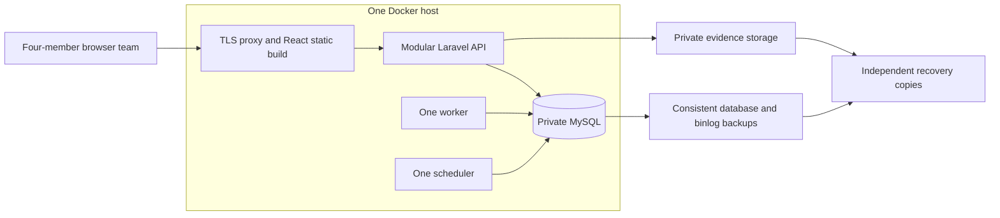

# YSP Chapter Operations — Technical Requirements Document

| Field | Value |
| --- | --- |
| Version | 2.0 |
| Date | 14 October 2026 |
| Status | Final standalone technical requirements — team handoff baseline |
| Requirements authority | Approved v2.0 operational workflow and agreed launch/commercial decisions; full requirements reproduced in this document |
| Launch | One YSP organization, Cebu pilot, four-member internal team |
| Stack | React/TypeScript frontend; modular Laravel API; MySQL; Docker Compose on AWS Lightsail |
| Funding | USD 100 total AWS credit; USD 35/month infrastructure planning target |
| Operations | Project owner is technical lead; one member trained as backup |
| Delivery state | Final requirements specification; implementation, deployment and acceptance evidence are separate deliverables |

## 1. Document authority and use

This is the official standalone technical requirements baseline for YSP Chapter Operations. It is written for the four-member delivery and operations team and can be shared as a single Markdown file. Architecture, operational behavior, terminology, cost assumptions, release gates and complete source-flowchart coverage are included below; no companion repository document is required to interpret a requirement.

The first deployment serves YSP Cebu within one organization. It uses a separate React/TypeScript frontend, one modular Laravel backend, private MySQL on the same Docker host and tested off-host backups. The full agreed operational workflow is required. Growth follows measured host, database and worker capacity; independent microservices are a later architectural option.

TR-01–TR-30 define technical requirements. Appendix A preserves all 179 functional/acceptance identifiers, including the original operational requirements, AC-01–AC-23 and the subsequent SUB-01–SUB-06 commercial extension. Appendix B defines domain terms. Appendix C contains the complete source-flowchart coverage and corrected branch behavior. Requirement IDs must remain stable in implementation tickets, tests, reports and future revisions.

Requirements expressed as must, shall or direct commands are mandatory. A planning target is an engineering/budget input to validate, not a claim of measured performance or a contractual cloud price. Chapter-specific values, named officers, account eligibility and permitted backup locations are approval/setup inputs listed in section 11; an unset required input blocks the affected operation. Final document status does not mean software exists, tests have passed or production is authorized to open.

For source ambiguities, the explicit resolutions in Appendix A.3 and Appendix C govern. Four people may cover several roles, but required independent actions still need distinct individuals. The approved recovery objectives remain four-hour restoration and no more than one hour of committed-record loss, including regional failure. Neither a small team nor a low cloud budget waives these controls.

### Contents

- [2. Architecture and module boundaries](#2-architecture-and-module-boundaries)
- [3. Data model and integrity](#3-data-model-and-integrity)
- [4. Transactions, concurrency and duplicate controls](#4-transactions-concurrency-and-duplicate-controls)
- [5. Security and account lifecycle](#5-security-and-account-lifecycle)
- [6. Deployment and release operation](#6-deployment-and-release-operation)
- [7. Backup, regional recovery and credit protection](#7-backup-regional-recovery-and-credit-protection)
- [8. Growth without premature service separation](#8-growth-without-premature-service-separation)
- [9. Verification and release evidence](#9-verification-and-release-evidence)
- [10. Commercial trial and simple administration](#10-commercial-trial-and-simple-administration)
- [11. Pre-live inputs and completion boundary](#11-pre-live-inputs-and-completion-boundary)
- [12. Deployment cost and funding plan](#12-deployment-cost-and-funding-plan)
- [13. Team handoff and document control](#13-team-handoff-and-document-control)
- [Appendix A: Functional requirements and acceptance](#appendix-a-functional-requirements-and-acceptance)
- [Appendix B: Domain glossary](#appendix-b-domain-glossary)
- [Appendix C: Source flowchart coverage](#appendix-c-source-flowchart-coverage)

## 2. Architecture and module boundaries

**TR-01 — Small initial deployment.** Deploy one 4 GB Linux Lightsail host as the initial deployment baseline. Docker Compose runs a TLS/static reverse proxy, Laravel API process, one queue-worker process, one scheduler and MySQL. API/worker/scheduler use the same versioned Laravel image. React is independently built/deployed and communicates through the API. Serve the frontend and `/api` through one browser origin; database and application internals are private network endpoints. Only HTTPS and tightly restricted administrative access are public.

The recovery target is a verified independent location, chosen before live use; the diagram does not imply an approved second region or free-account cross-region eligibility.

**TR-02 — Modular backend.** One Laravel application contains explicit modules with application operations enforcing their rules. Controllers validate transport inputs and call those operations; controllers, report jobs and scheduled tasks must not independently bypass stock/payment/approval rules.

| Module | Responsibility |
| --- | --- |
| Access and chapter administration | Identities, memberships, roles/alternates, approved configuration, chapter selection and commercial entitlements |
| Inventory and custody | Provenance, eligible balances, reservations, receipts, counts, booth custody, stock postings and stock treatment of ADJs |
| Requisitions and fulfillment | RF review/revision, shortages, signed issue, actual release quantities and closure |
| Sales and finance | SO/SI/OR, verified payments, allocations/funding, invoice adjustments, refunds, financial reconciliation and financial treatment of ADJs |
| Purchasing and receiving coordination | RepF net need, quotations, PO authority/commitments, supplier deliveries and discrepancy resolution; accepted stock posts through Inventory |
| Booth operations | Event setup, checkout references, immediate sale orchestration, manual entries, counts, returns and remittance closure |
| Documents and reporting | Evidence metadata, signatures, immutable issued forms, scoped alerts/reports/PDF/CSV through domain-authorized queries |

Critical operations may coordinate modules within one MySQL transaction. Module ownership is an application boundary, not a requirement for seven containers or seven databases. A shared inventory transaction operation owns all physical postings; a shared financial operation owns payment verification/allocation/reversal. Avoid direct writes around those interfaces.

**TR-03 — API contract.** Define versioned JSON endpoints and documented request/response schemas, including operation ID, record version, chapter, action result and blocking reason. Never accept client-supplied authority, computed balances, approval state or verified-payment flags as trusted values. Mutations receive idempotency keys. On a timeout, the UI retrieves the existing operation result before offering a retry. Typed React clients validate contract changes and preserve entered information on errors. Apply DOC-11 and UX-01–UX-04 in Appendix A.

**TR-04 — Background work.** Use MySQL-backed jobs initially; bound worker concurrency and PDF job memory/time. Scheduled expiry uses stored UTC deadlines and catches up after outages. Persist required follow-up intent in the same transaction as the initiating business change; a local outbox or durable task row is sufficient. Dispatch after commitment and make the job effect idempotent. A crash between commitment and enqueueing must leave discoverable work for replay. Failed jobs remain visible with responsible operator and retry evidence. No external broker, Redis cluster or service mesh is required at launch.

**TR-05 — Launch sizing.** Verify four simultaneously authenticated officers, including two concurrent commitments against the last stock/payment coverage. Initially launch one chapter; identities and chapter keys are not hard-coded to four accounts/Cebu. Measure actual daily/event throughput and attachment volume during pilot. A 100-account/five-chapter future growth profile is not a launch hardware prerequisite or a claim of validated capacity. Four people do not remove GOV-05–GOV-07 independence or any AC scenario.

## 3. Data model and integrity

**TR-06 — Relational ownership.** Use one MySQL database at launch. Every chapter-owned record includes `chapter_id`; parent/child references enforce chapter consistency through composite foreign keys or an equally strong database-enforced relationship. Global identity does not imply global operational access. Store immutable user identifiers alongside historical actor/role/chapter snapshots. Disable memberships/accounts without deleting attribution. Enforce unique document context/sequence and one posted opening baseline per chapter.

| Record group | Required relationships and information |
| --- | --- |
| Chapters, users, memberships and role assignments | Explicit membership; duty authority, alternate/effective dates, grant/revoke actors; provisioning distinct from operational membership |
| Configuration and approvals | Versioned effective policy; thresholds/templates; preparer, approvers, material version, reasons and approval time |
| Items, variants, units and stock locations | Chapter codes; unit precision; variant identity; location/custodian; approved price/ROP/target history |
| Sources and receipt lots | PO/DR, DA or IPC linked to accepted RM; source provenance, accepted condition, donor restrictions and valuation evidence |
| Inventory movements and balance rows | Immutable posted movement, source/line, actual quantity, from/to custody/condition, actor, evidence and reversal/ADJ links |
| RF/SO lines and reservations | Ordered/approved/outstanding/canceled quantities; reserved/consumed/released quantities; creation/expiry and protection history |
| Buyer acceptance and communications | Accepted terms/partial/backorder, actual acceptance time; notification channel/time/outcome |
| SI, payments, OR and allocations | Full-order SI; verified money/channel/account/reference; collector/verifier; funding designation versus release coverage; adjustments/refunds |
| IS/AR and customer DR | Actual handover batches, source quantities, identities, signature/evidence, coverage consumption and movement references |
| RepF, quotations, suppliers and PO | Trigger/demand links, net need components, offer comparison, approvals, quantities/terms and outstanding supply allocations |
| Receiving/discrepancy records | Delivery counts, inspection, accepted/rejected/missing quantities; later supplier resolution independent of PO closure |
| Booth events/sales/counts/remittances | RF checkout and custody; original manual OR ranges; actual/entry times; independent counts, cash float, variance, actual remittance |
| ADJ, claims and resolution | Original sale/issue/count evidence; cumulative limits, inspection/recount, separate approvals, stock/financial actions and supplier follow-up |
| Evidence, issued forms, operation results and audit | Authorized parent, content hash/version, retained form/template snapshot, idempotency outcome and actor/action history |
| Chapter subscriptions | Activation/trial/grace timestamps, provider payment evidence, paid-through date, entitlement changes and operator audit |

**TR-07 — Quantity, money and time.** Store PHP amounts as exact decimal values with two-place posted monetary precision; never floating-point money. Use exact decimal quantity storage with unit-specific permitted precision; pieces/kits require whole numbers. Finance reviews rounding and valuation settings before financial activation; allocation totals must match the approved invoice/adjustment totals. Preserve historical prices, discounts, valuation basis and policy versions. Store timestamps in UTC, display Asia/Manila, and distinguish actual occurrence, verification, entry and posting time. Forty-eight-hour clocks are elapsed time, not calendar days.

**TR-08 — Inventory authority and the 6 stock balance silos.** Movement history remains immutable throughout its approved retention period; balance rows are controlled transaction projections and can be reconciled/rebuilt from authorized movements. The system strictly isolates stock into six separate balance silos (INV-03):
1. **Usable Stockroom On-Hand:** Physical merchandise currently present in the chapter stockroom, available for allocation or active reservation.
2. **Available-to-Allocate:** Usable stockroom on-hand minus active reservations minus active holds. Represents uncommitted stock eligible for new reservation.
3. **Active Reservations:** Unfulfilled quantities committed to approved RFs or SOs, governed by 48-hour elapsed clocks. Reservations reduce availability without decrementing physical on-hand.
4. **Booth Custody Stock:** Merchandise physically and logically checked out into an event custodian's custody. **Core Invariant:** Booth sales decrement Booth Custody Stock only; stockroom balances are never touched during live selling.
5. **Quarantined / Damaged:** Units held unavailable for allocation due to delivery damage, customer defect return, or count discrepancy pending ADJ clearance.
6. **Inbound Open Purchase Orders:** Contractual quantities ordered from suppliers under approved POs. Strictly tracked as future commitments; never counted as on-hand or available.

Track item/variant, source lot, restriction, location/custodian and condition separately. Quarantine blocks eligibility without concealing quantity. Store structured restriction eligibility plus original donor evidence; an ordinary override cannot remove a restriction.

**TR-09 — Independent state axes.** Keep approval, stock readiness, payment, fulfillment and exceptions independently represented at line/batch level. Derive closure only when the functional requirements' record-specific conditions in Appendix A hold. Issuing a PO does not fulfill a shortage; posting an ADJ does not hide an unexecuted refund or supplier claim. Material revisions invalidate approvals for the prior material version and retain history; issued documents change through linked adjustments rather than replacement.

## 4. Transactions, concurrency and duplicate controls

**TR-10 — Commit-time authorization and locking.** Each critical action rechecks current identity/membership, independent approvals, effective policy, material record version, stock eligibility, remaining quantities, payment/funding and evidence within its transaction. Serialize affected authority/record/balance/payment rows in a consistent lock order. Use MySQL row locks, conditional updates and uniqueness constraints; a prior screen read or PHP availability check is insufficient. Retry deadlocks only with the same operation identity. Reject stale versions with current authorized state and no unsupported partial commit.

**TR-11 — Posting boundaries.** Commit the following related business writes atomically:

| Operation | Required atomic changes |
| --- | --- |
| RF/SO reservation | Eligible quantity check; reservation and availability changes; deadline/protection state; operation/audit |
| Available reservation expiry | Current protection/deadline check; release of unpaid quantity only; availability, history and follow-up intent |
| Backorder funding/lapse | Actual timely verification/acceptance; allocated cost gate; designated commitment or unfunded lapse; financial-resolution flag |
| Accepted RM receipt | Source/approval/cumulative quantity checks; accepted source lot/movement/balance; PO progress; allocation eligibility and follow-up |
| RF issue/customer release | Actual signed evidence; reservation/demand consumption; payment coverage where required; one physical movement; fulfillment/audit |
| Booth checkout/sale/return | Correct event custody and eligible quantity; actual movement; verified sale/payment/OR or independently verified return; operation/audit |
| Approved ADJ/refund recording | Source/cumulative limit and independence checks; authorized stock/financial entries; actual execution distinguished from approval |
| Opening baseline/cutover | Approved IPC/source counts and imports; exactly-once baseline/movements; carried obligations linked without duplicate receipts |

An actual cash receipt, GCash credit or physical handover is a real-world fact, not something a database rollback can erase. Pending evidence/uncertain outcomes remain visible for reconciliation. Printing a form or accepting a screenshot does not authorize a release.

**TR-12 — Durable idempotency.** Persist chapter/action/idempotency key, payload fingerprint and committed result with the business writes. A retry with the same payload returns the existing authorized outcome; a different payload under the same key is rejected. Enforce unique posting per source action/batch and original manual OR/payment reference. Reference uniqueness uses the appropriate document series and actual payment account; chapter filtering must not permit a reused channel reference to become new money. Duplicate detection must not expose another chapter's records. Worker retries use the same durable business operation identity, not only a queue message ID.

**TR-13 — Financial coverage.** Separate verified receipt, procurement-funding designation, release coverage allocation/consumption, invoice adjustment and actual refund. Designating a deposit to procurement neither creates another receipt nor charges the customer again. Serialize concurrent release/allocation/refund changes; cumulative release coverage cannot exceed applicable net verified payment. Verification/expiry races use authoritative deadlines, actual verification time and fresh eligibility; backdating cannot fabricate timely protection. Late payment uses RSV-09 rather than restoring an expired reservation blindly.

**TR-14 — Net need and allocation.** Serialize competing RepF/supply coverage claims for a demand/eligibility group. Preserve existing reservations/funded allocations, then use approved priority, required date and approval time. Reconfirm stock, outstanding demand and relevant committed inbound supply before procurement authorization. Record calculation components and authorized exceptions. Accepted partial receipts may allocate immediately; reports/ROP refresh must not repost movements or duplicate supply need.

**TR-15 — Evidence and publication (Dual-Mode Signatures).** Upload and validate evidence before a transaction references it as ready; bind its immutable hash/version and authorized record to the posting. Physical handovers requiring customer DR or IS/AR support dual-mode signatory evidence capture (DOC-08):
- **Method A (Interactive On-Device Canvas):** Real-time vector stroke capture via HTML5 Canvas with dynamic quadratic Bezier curve stroke smoothing, Clear/Redo controls, and export to base64 raster/vector image data.
- **Method B (Signed Paper Scan Upload):** Physical signed delivery receipt scan/photo upload with MIME validation and client-side staging preview.

Both methods compute a cryptographic SHA-256 digest (`evidence_objects.content_hash`) bound immutably via `evidence_bindings` prior to atomic inventory posting. Because MySQL and object storage are not one transaction, retain upload lifecycle states, clean up unattached staging objects under policy, and reconcile missing evidence. A successful upload alone makes no stock/payment movement. Generate issued forms from a committed immutable data/template snapshot; PDF regeneration or an external copy does not create a second SI/OR/movement. Number issuance is serialized with the corresponding issued record; voids/gaps retain their reason.

## 5. Security and account lifecycle

**TR-16 — Browser identity.** Individual accounts use secure HttpOnly session cookies, HTTPS and CSRF protection. Use a shared MySQL session store so later web replicas do not need sticky local sessions. Require authenticator-based MFA for approvers/administrators; protect recovery codes and audit resets. Revalidate account/membership status on privileged requests, posting and export; disabling access revokes active sessions and prevents queued protected output delivery. Recovery restores identity, never additional chapter authority.

**TR-17 — Chapter and duty authorization (Lightweight RBAC & Invariants).** Centralize server-side authorization policies for API routes, operations, queries, jobs, downloads, PDF/CSV and audit outputs using a three-tier Lightweight Role-Based Access Control (RBAC) model:
1. **Tenancy Layer:** Global user accounts belong to chapters via explicit `memberships`. Operational access is strictly chapter-isolated. Provisioning administrators operate on a separate administrative surface with zero chapter operational access (`GOV-03`).
2. **RBAC Role Layer:** The 15 standard TRD duties (Chapter Head, Finance/Treasury, Sales Reviewer, Sales Officer, Inventory Custodian, Purchasing Officer, Budget Approver, Receiving Officer, Dispatch Officer, Booth Custodian, Booth Cashier, Independent Counter, System Administrator, Requisition Approver, Buyer Representative) are defined as canonical roles in `roles`. Memberships receive roles via `duty_grants`. Roles map to permission sets, providing auditability and preventing permission bloat.
3. **Contextual Business Invariant Layer:** Role checks alone do not grant authority. Application operations enforce dynamic segregation-of-duties rules at runtime:
   - Requester $\ne$ Approver (`GOV-05`, `RF-03`).
   - Preparer $\ne$ Approver (`GOV-05`, `SO-03`, `PRC-04`).
   - Custodian $\ne$ Reconciler / Independent Counter (`GOV-07`, `BTH-07`, `ADJ-04`).
   - Dual Co-Approval for Count Variances: requires both Chapter Head and Finance Officer co-signatures (`GOV-06`). The count preparer is strictly blocked from signing as approver.

**Architectural Rationale:** Account-level permission toggles fail during volunteer officer turnover (e.g. an incoming treasurer incorrectly inherits ad-hoc checkboxes), while flat user-level permission enums (50+ toggles per user) create permission bloat and cannot enforce contextual invariants. Lightweight RBAC with runtime invariant checks guarantees accounting-grade segregation of duties while scaling seamlessly from a 4-person pilot to a full chapter organization.

**TR-18 — Evidence and secrets.** Private S3 or an equivalent off-host private store holds attachments, signatures and issued forms. Use scoped server authorization before any short-lived download; sensitive evidence must not be publicly cached. Validate type/content/size, handle untrusted files safely and quarantine suspect uploads. Keep application/database keys out of Git/images/React bundles/logs. Scope application and backup IAM duties, restrict secret-file access, and preserve encryption/recovery material independently from the failed host. Approve retention before deleting any posted evidence or audit history.

**TR-19 — Host controls.** MySQL is reachable only on the private Docker network; do not expose its port publicly. Use least-privilege application DB credentials, restricted administrative keys, bounded logs and security updates. Run containers with limited privileges and explicit memory/restart rules; separate persistent database volumes from replaceable application images. Alert on disk pressure, restart loops, failed logins, missing/failed backups and recovery lag. The human lead/backup own host and database maintenance.

## 6. Deployment and release operation

**TR-20 — Reproducible delivery.** Pin supported Laravel/PHP/MySQL/runtime dependencies and immutable container releases during implementation; retain lockfiles, release identity, migration version and built frontend artifacts. Develop/test locally. CI builds and validates the application and contracts before a planned deploy; no large always-on cloud staging stack is required. Provide one reviewed deployment manifest and configuration inventory sufficient to rebuild the host. Never use production evidence/credentials in ordinary development.

**TR-21 — Planned maintenance.** Short scheduled maintenance windows outside booth trading are permitted. Announce the window, block new commitments, finish active transactions, pause competing scheduler/worker actions safely, validate backups, run migrations once, deploy compatible frontend/backend releases and restart long-running workers gracefully. Check health, queues and representative balances before reopening. Return maintenance feedback rather than leaving a posting outcome ambiguous. A failed release keeps operations blocked until the prior compatible application or a reconciled restore is usable. Do not assume an old image can run after an incompatible schema migration.

**TR-22 — Schema and cutover safety.** Prefer additive/backward-compatible migrations; rehearse changes against realistic data, including constraints, locks and rollback/forward recovery. Large data changes run in bounded batches and must not silently rewrite posted stock/payments. Seed setup separately from accepted opening stock. Preserve source references for carried RF/SO/payments/POs/custody; ensure IPC quantities and old deliveries do not both become receipts. Each MIG gate has authorized evidence and an explicit activation record.

## 7. Backup, regional recovery and credit protection

**TR-23 — Recoverable committed state.** Maintain consistent MySQL full backups and frequent binary-log copies; a five-minute copy cadence is the initial engineering target, with destination acknowledgment and lag monitoring. VM snapshots support host rebuilding but do not alone meet the one-hour loss target. Copy evidence and the database's references, signatures, audit/idempotency state, issued sequences, release/configuration and keys to a verified independent recovery location. Backups must be encrypted, usable, access-controlled and protected from ordinary correction/deletion privileges.

**TR-24 — Recovery objectives.** Preserve SEC-05/SEC-06: restore usable service/evidence/history within four hours with no more than one hour of committed-record loss, including regional failure. Achieve this through tested backup/restore rather than an always-running standby. Account/region restrictions and an independently accessible backup location are pre-live requirements. A same-region-only copy is insufficient for regional failure. If independence/lag or restore targets cannot be demonstrated within the cost envelope, the live gate stays closed; changing the product target needs an explicit product decision.

The runbook must identify the failure/uncertain interval; stop/fence old writes; retrieve and verify independent backups and evidence; provision clean capacity; restore a consistent full backup/binlog point; reconcile object references and posted balances; rebuild/replay durable follow-up work without duplicate effects; reconcile physical custody, issued forms, money and manual outage sales; then authorize reopening. Missing/uncertain evidence never becomes verified by restoration. The lead and backup each rehearse recovery, including operation lookup after timeout and duplicate-safe manual entry.

**TR-25 — Funding lifecycle.** USD 100 is total credit. Target approximately USD 35/month, reserve USD 20 and monitor gross consumption plus remaining credit daily. Configure early alerts/available project controls without assuming delayed budgets are a universal hard cap. Account type, eligible services/region, remaining credit, expiration and any prior use must be checked before deployment. Single-host and bounded retention/usage are cost controls, not guaranteed billing limits. Subscription funding or a verified preservation/retirement plan must exist before credit exhaustion; read/export grace and storage also cost money. Lightsail continues bundle billing when merely stopped. No automated deletion of customer evidence is authorized by reaching a budget or trial date.

## 8. Growth without premature service separation

**TR-26 — Measured scale path.** Preserve stable chapter keys, domain interfaces, primary-DB commitments, off-host files, shared sessions, durable worker tasks and reproducible images from launch. Observe P95 response/commit latency, CPU/memory/disk pressure, database connections/locks, queue delay and backup lag. Initial review triggers are sustained memory above 80%, sustained CPU above 70% or ordinary interactive API P95 above two seconds under the measured workload; tune or resize after diagnosis. These are engineering review triggers, not guaranteed host throughput or automatic spending authorization.

| Stage | Trigger | Change and validation |
| --- | --- | --- |
| Small launch | One chapter/four-member team | One 4 GB host, MySQL and one bounded worker; full product controls and restore tests |
| Larger host | Memory/CPU/queue pressure after tuning | Create larger instance from snapshot/rebuild; consistent data cutover and static-IP reassignment during maintenance; no double schedulers/writers |
| Managed database | DB operations/capacity/availability justify cost | Move MySQL to private RDS; rehearse export/restore, constraints, sessions, keys, backups and single-writer cutover |
| Additional application/worker capacity | Larger usage still needs concurrency | Shared primary DB, object storage and session/job state; load balancing when justified; independent worker scaling and singleton scheduler/expiry coordination |
| Selected service extraction | Measured need for separate release, scale or ownership | ADR plus private data ownership, API/event contracts, idempotency and explicit cross-service commitment/recovery design before extraction |

Scaling is a planned migration with a new cost estimate. It is not unlimited autoscaling inside the USD 100 credit. A modular backend can continue to serve additional chapters without becoming microservices; extraction is not a mandatory growth milestone.

## 9. Verification and release evidence

**TR-27 — Operational correctness tests.** Use the intended MySQL engine for integration/concurrency tests; SQLite or mocked balances cannot certify row-lock semantics. Cover last-unit reservations, release-versus-refund/expiry races, duplicate retries, invoice/payment allocation limits, partial RM allocation, booth 100/30/70 custody, restrictions/quarantine, independent approvals, opening baseline/cutover, funded cancellation and cumulative return limits. Simulate crashes immediately before/after commitment and lost HTTP responses; recover the existing result without a second posting. Test signed-evidence readiness and missing-object failures, not just printable forms.

**TR-28 — Security and deployment tests.** Attempt cross-chapter reads/writes/parent links/downloads/exports, sole self-approval, provisioning-account financial access, disabled/stale sessions, MFA recovery misuse, tampered operation keys and malicious uploads/CSV formula content. Exercise phone/desktop forms, keyboard focus, pending/retry feedback and validation preservation. Run the four-user profile with realistic report/PDF/background load; check memory, disk and backup impact. Rehearse maintenance/migrations, failed release recovery, growth cutover and duplicate scheduler prevention.

**TR-29 — Acceptance gates.** All AC-01–AC-23 remain mandatory. Retain evidence for all 87 source nodes, 40 decision branches, seven connectors, loops, 35 narrative controls and 21 ambiguity resolutions in the complete coverage checklist in Appendix C. Technical tests add to this evidence; they do not mark unchecked source rows completed by documentation. AC-22 requires timed recovery of committed data plus usable evidence/history from an independent location. All MIG-01–MIG-08 gates, approved setup and four-person independence assignments must pass before complete release acceptance.

| Product requirements | Technical coverage |
| --- | --- |
| GOV-01–GOV-12; DOC-01–DOC-11 | TR-02, TR-06–TR-12, TR-15–TR-22 |
| INV-01–INV-14; RF-01–RF-08 | TR-06–TR-14, TR-22, TR-27–TR-29 |
| SO-01–SO-12; PAY-01–PAY-12; RSV-01–RSV-10 | TR-04, TR-06–TR-15, TR-27–TR-29 |
| PRC-01–PRC-09; RCV-01–RCV-13 | TR-06–TR-15, TR-22, TR-27–TR-29 |
| BTH-01–BTH-14; ADJ-01–ADJ-10 | TR-06–TR-15, TR-17, TR-22–TR-24, TR-27–TR-29 |
| RPT-01–RPT-07; SEC-01–SEC-06; UX-01–UX-04 | TR-03–TR-04, TR-15–TR-19, TR-23–TR-29 |
| MIG-01–MIG-08; AC-01–AC-23; all source coverage | TR-20–TR-29 plus Appendix C |
| SUB-01–SUB-06 commercial extension | TR-16–TR-18, TR-25, TR-30; activation/expiry/access and preservation tests |

## 10. Commercial trial and simple administration

**TR-30 — Chapter entitlements.** Apply SUB-01–SUB-06. Retain the agreed 30-day free trial and monthly per-chapter subscription. The Chapter Head explicitly activates live operations after applicable setup/opening/recovery readiness for the enabled rollout stage; record the activation once, and start 30 elapsed days then. Initial setup is not the trial start. On unpaid expiry, block new officer business postings and allow authorized read/export for 14 elapsed days. Keep original activation/expiry history; a new login or renamed chapter does not restart the trial. Subscription payments belong to provider administration, separately from buyer SO/SI/OR and the official chapter GCash account. Test exact trial/grace boundaries, chapter isolation, duplicate activation, audited extension/reactivation and queued-posting enforcement.

Use a small chapter subscription record and controlled provider administration; no separate billing service or recurring-payment integration is required at launch. Payment verification, paid-through extension and reactivation are audited operator actions under approved provider terms. Queued jobs recheck entitlements before business execution. Essential deadline/history, backup/security and reconciliation controls must not silently stop because a trial expired; user postings remain blocked. No funded order, payment, reservation or supplier obligation is automatically forfeited/canceled. Post-grace access, commercial retention/disposal, final rate and collection terms must be settled before offering the trial; budget exhaustion does not authorize deleting chapter records.

## 11. Pre-live inputs and completion boundary

| Input | Required before affected action |
| --- | --- |
| Named four accounts, role/alternate matrix and backup operator | Authorized provisioning; independence checks and operational coverage verified |
| Appendix A.4.1 policies/master data | Versioned applicable approval; missing input blocks its workflow |
| AWS account, eligible bundle/region, actual credit and renewal plan | Deployment/spending and funded trial/read-export operation |
| Approved independent recovery location, keys and retention | Demonstrated SEC-05/SEC-06 and AC-22; no inferred location permission |
| Upload/storage limits, unit precision, rounding and valuation | Reviewed technical limits and approved financial/unit settings; immutable historical snapshots |
| Provider price, collection verification, post-grace/retention terms | Commercial offer/activation; chapter buyer money remains separate |
| Release, operator and restore runbooks | Successful rehearsal and evidence; actual maintenance scheduling agreed |

These inputs do not remove any requirement. The initial architecture and trial/maintenance rules are settled; named chapter policies and operating values remain deliberate pre-live inputs. This final specification is the implementation baseline. Production acceptance requires executed evidence, demonstrated recovery, funded hosting and authorized activation; publication of this document alone does not satisfy those gates.

## 12. Deployment cost and funding plan

Use one Linux Lightsail bundle with public IPv4, 4 GB RAM, 2 vCPU and 80 GB SSD as the initial host. Its published bundle price is USD 24/month. Build the frontend/backend locally or in an appropriately funded CI workflow; begin cloud runtime when the pilot is ready. MySQL, one bounded worker and the scheduler run on the same host. [AWS Lightsail bundle specifications](https://docs.aws.amazon.com/lightsail/latest/userguide/amazon-lightsail-bundles.html).

| Monthly component | USD planning amount |
| --- | ---: |
| 4 GB Lightsail Linux host | 24.00 |
| Bounded off-host database/binlog backups, evidence storage and snapshots | 5.00 |
| DNS, bounded logs and essential monitoring | 3.00 |
| Brief restore-test or replacement overlap | 1.00 |
| Consumption reserve | 2.00 |
| **Monthly infrastructure planning target** | **35.00** |

The USD 5/3/1/2 lines are allowances, not AWS fixed-price packages. The bundle includes its SSD/public IP; do not add EC2 EBS or per-address fees to the same bundle. Snapshot storage is separately charged at USD 0.05/GB-month; bound retained blocks and measure evidence/log growth. Transfer allowance varies by region. The prices were researched on 14 October 2026 and must be verified against the eligible account before deployment. [Lightsail snapshot pricing](https://docs.aws.amazon.com/lightsail/latest/userguide/amazon-lightsail-faq-snapshots.html).

USD 35 is about PHP 2,100 at a **planning assumption** of PHP 60/USD; this is not a live exchange-rate quotation. The estimate excludes tax, development and operating labor, paid support, domain purchases and exceptional usage. The final customer subscription price is an approved commercial input, not inferred from this infrastructure amount.

The USD 100 AWS credit is total credit, not USD 100/month. Deduct prior account consumption, reserve USD 20 and keep planned aggregate use below USD 80 until renewal funding is arranged. Two modeled months cost USD 70; a third full month at USD 35 would exceed the original credit. A 30-day trial plus 14-day unpaid read/export grace corresponds to approximately USD 51.33 at an illustrative USD 35/30-day pace. Plan approximately USD 55 for that 44-day period and preserve the USD 20 safety reserve; actual hourly caps, backup storage and account history determine consumption.

Check account plan, remaining/expiring credit, covered services, available region and region restrictions before deployment. Some current AWS signup experiences restrict cross-region features. Do not silently activate advanced or paid features to obtain a backup region. Select and verify an independent recovery location compatible with approved data locations and the actual account. If the account/funding cannot support regional recovery or the read/export period, resolve that before live activation. [AWS account feature availability](https://docs.aws.amazon.com/accounts/latest/reference/supported-services-sign-up-new.html).

Monitor gross resource consumption and remaining credit daily. Configure early cost alerts and applicable account/project controls; a credit-netted zero invoice is not zero consumption, and delayed AWS Budgets alerts are not a universal hard cap. Stop adding capacity before the reserve is threatened, preserve verified independent exports/backups and obtain funded continuation or follow an authorized retirement procedure. Merely stopping a Lightsail instance continues bundle billing; backup/storage charges can continue after instance retirement. No financial threshold authorizes deletion of posted customer records. [AWS Budgets timing](https://docs.aws.amazon.com/cost-management/latest/userguide/budgets-managing-costs.html), [Lightsail billing](https://docs.aws.amazon.com/lightsail/latest/userguide/amazon-lightsail-frequently-asked-questions-faq-billing-and-account-management.html).

A 2 GB bundle is a possible later optimization only after representative memory/CPU/PDF/database tests demonstrate safe headroom. The approved implementation baseline remains 4 GB. Growth to a larger host, managed database or extra application/worker capacity requires an updated estimate and funded operating plan.

## 13. Team handoff and document control

### 13.1 Responsibility and readiness

| Responsibility | Required owner and deliverable |
| --- | --- |
| Technical delivery and cloud operation | Project owner as technical lead; source/build/deploy inventory, cost monitoring, host/database patching and incident response |
| Backup operation | One trained member; documented access, recovery-key custody, available coverage and independently executed restore drill |
| Chapter governance | Chapter Head; named memberships/roles/alternates, operational policies, authorized opening/live activation and release-gate approval |
| Financial governance | Authorized Finance officer; payment setup, financial policies/limits, templates/sequences, refunds and financial/count approvals |
| Independent checking | An authorized individual different from the person being checked for the applicable RF, purchase, ADJ, count or booth control |

These are responsibilities, not five mandatory hires. Four members may cover several duties if the distinct-person requirements in Appendix A are satisfied. Names and coverage must be entered in the pre-live checklist; no signatory or completed approval is invented by this specification.

### 13.2 Required implementation handoff artifacts

- React/TypeScript source and Laravel source with dependency locks, environment instructions and reproducible versioned builds.
- MySQL migrations/constraints and authorized setup/import tools; no raw production data or secrets in ordinary development artifacts.
- Versioned API contract, typed client integration and documented operation/idempotency behavior.
- Docker deployment/configuration inventory, persistent-volume layout, secret/key access procedure and maintenance/migration runbook.
- Backup/restore and incident/reconciliation runbooks, measured independent restore evidence and recovery-key inventory.
- Automated correctness/security/concurrency results plus officer-observable AC-01–AC-23 and Appendix C evidence.
- Named chapter/technical role matrix, approved policy values, commercial terms, cloud credit/funding record and staged activation records.

### 13.3 Completion and changes

Implement the complete scope in Appendix A and the controls in TR-01–TR-30. Complete release acceptance requires all staged MIG gates, all AC scenarios, all Appendix C coverage and demonstrated recovery. Partial software, unchecked coverage or an unavailable independent approver cannot be relabeled complete because the host is small.

This version is final as a requirements handoff. Later changes must record the version/date, changed IDs, rationale, affected workflow/test evidence and required Chapter Head/Finance review. Preserve existing IDs; add new IDs for additional requirements rather than silently renumbering. Changes to cloud size alone do not authorize weaker product controls.

| Version | Change |
| --- | --- |
| 1.0 | Confirmed small-launch architecture and technical requirements |
| 2.0 | Standalone final handoff: full functional baseline, glossary, flowchart coverage, cost/funding and team deliverables included |

Provenance: the approved YSP v2.0 workflow proposal dated 7 October 2026; product baseline version 1.1; the agreed chapter ownership, booth custody and modular Laravel decisions; and the confirmed technical/commercial interview decisions. These are historical sources, not files recipients must obtain to interpret this document.

## Appendix A: Functional requirements and acceptance

This appendix reproduces the complete agreed operational and commercial baseline, including all original requirement identifiers and all acceptance scenarios. Its original section numbers are prefixed with A for navigation. Within this appendix, an unqualified reference such as section 3 or section 5.1 means A.3 or A.5.1. Technical architecture and controls are in the main sections of this document. The complete source coverage checklist is in Appendix C.
### A.2. Scope, users, and outcomes

#### A.2.1 Required first-release scope

| Area | Included behavior |
| --- | --- |
| Internal requisition | RF preparation, approval, revision/cancellation, reservation, shortage procurement, partial issue, signed acknowledgment, closure |
| Track 1 sales | SO preparation/review, available/backordered quantities, full-order SI, payment allocation, expiry, funded backorders, partial release, signed customer DR |
| Track 2 sales | Approved booth stock checkout, custody balances, cash/GCash OR sales, manual outage records, returns/counts, variance approval, remittance, closure |
| Inventory | Item variants, locations/custodians, source restrictions, stock status, separate RF/SO reservations, availability, transaction history, ROP/target replenishment |
| Purchasing | Net need, RepF, budget approval, quotations, supplier comparison, approved PO, outstanding commitments and authorized changes |
| Receiving | Approved PO plus supplier DR, DA, or IPC; inspection, accepted RM quantities, discrepancies, partial receipts and allocation |
| Opening stock and donations | Independent opening count, signed IPC, one-time baseline, valuation evidence, restricted donation receiving |
| Exceptions | Returns, exchanges, defective replacements, refunds, count variances, quarantine and authorized resolution through linked evidence |
| Administration | Chapter selection and isolation, accounts/roles/alternates, independent controls, approved policies, numbering and audit history |
| Operational support | In-app alerts, recorded buyer communication, printable forms/PDF reports, CSV exports, archival and recovery requirements |

#### A.2.2 Users and authority

| User or role | Intended surface and authority |
| --- | --- |
| Committee requester | Prepare and track authorized committee RFs; revise returned requests; acknowledge authorized handovers |
| Department approver | Review RF necessity and completeness; approve or return with reasons within assigned authority |
| Sales/merchandise officer | Record buyer orders, prepare sales documents, record buyer acceptance/communication, coordinate fulfillment and claims |
| Sales reviewer | Authorize selling prices, discounts and terms; approve SOs and assigned return/exchange actions |
| Finance/Treasury | Verify payments, control financial templates/numbering/settings, approve cost estimates and financial adjustments, reconcile collections |
| Inventory custodian/reviewer | Track balances/reservations/custody, prepare issues and stock reports, allocate eligible goods, independently verify counts where authorized |
| Purchasing officer/committee | Review RepFs, obtain quotations, record supplier comparison, prepare approved POs and follow up commitments |
| Budget/purchase approver | Authorize budget and purchasing commitments within approved limits |
| Receiving officer | Inspect goods, document acceptance/discrepancies, prepare RM; include technical/requesting representatives where required |
| Dispatch/release officer | Verify release gates, record actual quantities and retain signed customer handover evidence |
| Booth custodian/in-charge | Request and acknowledge checkout, hold event stock, participate in counts and reconciliation |
| Authorized booth cashier | Record immediate sales, verify authorized payment, issue ORs and account for collections |
| Independent counter/reconciler | Verify opening counts, booth counts or recounts without being the sole custodian being checked |
| Chapter Head | Approve operational policies, officer roles/alternates, opening baseline and count variances as required |
| System administrator | Create chapters and appoint their initial Chapter Head; no automatic access to chapter transactions |
| Buyer/member | An external transaction participant, not a launch account holder; receives goods/documents and communicates through Sales |

Roles are chapter-assigned duties. An officer may hold more than one role if the required independent approval or reconciliation is supplied by another authorized person.

The current organization has four members. Plan the launch for a small internal team rather than a large hosted platform. Confirm the named account holders and chapter duties during setup. Four people may cover several duties, but GOV-05–GOV-07 still require different individuals for the relevant independent controls. An unavailable independent officer blocks the affected approval or reconciliation; the smaller team does not authorize self-approval.

#### A.2.3 Deferred capabilities

Customer self-service accounts/portal; cross-chapter stock transfers; organization-wide operational oversight; full offline synchronization; outbound email/SMS/messaging integrations; and automated payment-channel integration are outside the first release. Future chapter activation is supported through separate ownership and provisioning; it does not imply shared stock or unrestricted cross-chapter visibility.

#### A.2.4 Required outcomes

The pilot must demonstrate that two demands cannot reserve the same goods; every movement traces to source and approval; releases require payment or issuance evidence; booth stock and collections reconcile; and opening stock matches its approved physical count. Every process, decision branch, loop and connector in the four source flowchart sheets must also have implemented behavior and acceptance evidence.

#### A.2.5 Launch scale and growth

Launch serves one YSP organization through the Cebu pilot and its four-member team. Complete first-release workflow scope remains required. Future chapters and additional officers can be activated with explicit chapter ownership and memberships; adding capacity must preserve existing records, evidence and controls. Large-platform infrastructure is not a product requirement. The technical document defines a small initial deployment and measurable capacity-expansion gates.

A 100-account/five-chapter future growth profile is not a prerequisite to operating the four-member pilot or a claim of measured capacity. The initial pilot must still pass all product acceptance scenarios, including concurrent allocation, full workflow coverage and recovery readiness. SEC-05/SEC-06 recovery requirements remain unchanged.

#### A.2.6 Provider-hosted trial and subscription

The project owner subsequently confirmed provider-hosted/provider-funded AWS, a monthly per-chapter subscription, and the following commercial extension. Provider subscription collections are separate from chapter buyer transactions. Pricing, permitted provider collection methods and post-grace commercial retention terms must be approved before the trial offer is activated; they are not invented here.

1. **SUB-01 — Trial activation.** Chapter Head explicitly activates live operations after applicable setup/opening/recovery readiness for the enabled rollout stage. Record activation once and start a 30-elapsed-day free trial then. Creating accounts or preparing master data does not start the trial; renaming the chapter or signing in again does not restart it.
2. **SUB-02 — Paid extension.** A monthly chapter subscription extends access through its recorded paid-through time after authorized provider payment verification. Record amount/reference, verifier and entitlement history; no automated recurring-payment integration is required at launch.
3. **SUB-03 — Unpaid grace.** On unpaid trial expiry, block new officer business postings and retain authorized read/export access for 14 elapsed days. The same chapter/duty restrictions apply to exports. Final post-grace access and retention terms must be approved before activation.
4. **SUB-04 — Outstanding obligations.** Trial expiry does not automatically cancel or forfeit funded orders, payments, stock, reservations or supplier commitments. Essential deadline/history, security, backup and reconciliation controls remain supported while new officer business postings are blocked; outstanding resolution remains visible.
5. **SUB-05 — Provider separation.** Provider subscription money is not a chapter buyer payment, SO receipt or chapter sales revenue. Billing administration does not confer operational chapter membership or unrestricted financial/evidence access.
6. **SUB-06 — Funding and preservation.** Provider plans funding for the trial, read/export grace and retained records/evidence. Credit exhaustion or subscription lapse does not authorize deleting history. Before hosting can no longer continue, follow the approved notification, export/preservation and retention procedure; do not promise access from an unavailable hosting account.

### A.3. Explicit resolutions of source inconsistencies

| Source ambiguity | Required interpretation | Agreement |
| --- | --- | --- |
| Sheet 2 permits full-payment or downpayment OR before release | A deposit funds procurement. Release additionally requires payment covering the merchandise actually handed over. | Q7 |
| Any OR appears to stop the entire SO expiry clock | Protection applies only to fully paid available quantities or designated funded backorders; unrelated unpaid reservations expire. | Q13 |
| B4 invoices only reserved quantities while shortage deposits need SI linkage | One SI covers the approved SO, distinguishing available and backordered quantities; multiple payments link to it. | Q12 |
| Booth checkout and net sales both appear to deduct stockroom quantity | Checkout moves stock to booth custody; booth sales reduce booth custody only; verified returns restore stockroom stock. | Q9 |
| Booth sales have no customer DR, but ADJ evidence requires one | Booth purchase evidence is original OR; Track 1 evidence is original OR plus signed customer DR. | Q16 |
| Sheet 3 routes allocation after complete PO receipt | Accepted partial receipts can serve eligible demand immediately while the remaining PO stays open. | Q10 |
| Sheet 1 shortage branch obscures partial fulfillment | Available portions may fulfill RF/SO demand with acceptance and all relevant evidence/payment controls. | Q10 |
| Expiry says stock returns to usable stock | Expiry changes reservation and available-to-allocate quantities; it does not create a physical receipt or increase on-hand stock. | Q9, Q13; source §5.4 |
| Sheet 1 refers to booth reservations | A booth RF reserves stock before checkout; checkout creates booth custody. Completed booth sales require no per-sale SO reservation. | Q9; source B8–B10 |
| Count discrepancy appears to block all booth returns | Independently verified usable returns may post while unexplained custody remains open; no unexplained variance is written off without approval. | Q21 |

### A.4. Chapter governance and approved configuration

1. **GOV-01 — Chapter ownership.** Inventory, reservations, officers' role assignments, buyers, approvals, payments, policies and document sequences belong to a chapter. A role in one chapter grants no access to another chapter's records, attachments, reports or exports.
2. **GOV-02 — Chapter selection.** An officer with several authorized memberships selects a chapter before working. The active chapter is visibly identified. Switching chapters does not move or relabel existing transactions. An unfinished form cannot be posted into a different chapter without explicit review.
3. **GOV-03 — Provisioning.** A system administrator can create a chapter and appoint its initial Chapter Head. Operational access requires a separately authorized chapter membership; provisioning authority does not confer operational oversight.
4. **GOV-04 — Role administration.** Chapter Head authorizes role assignments and alternate approvers. Record who granted, changed, revoked or substituted authority and when. An unavailable approver does not permit automatic self-approval.
5. **GOV-05 — Independent controls.** Requesters cannot approve their own RF where a separate approver is required. Inventory cannot authorize its own purchase commitment. ADJ preparers cannot be sole approvers. Booth custodians cannot be sole close-out reconcilers. Opening counts include at least one person independent of the regular custodian.
6. **GOV-06 — Dual variance approval.** Count variances require Chapter Head and Finance co-approval. If one person holds both roles, an independent authorized officer must co-approve; one person's two role selections do not satisfy independence. The count preparer / custodian is strictly blocked from approving their own counts (`actor_id != preparer_id`). Provisioning administrators operate on a separate administrative surface with zero chapter operational access (`GOV-03`).
7. **GOV-07 — Overlapping duties.** Where sales preparation, collection and verification overlap due to staffing, retain each duty's actor and require an authorized independent officer's review of sales documents and cash/bank reconciliation under the source policy.
8. **GOV-08 — Configuration ownership.** Chapter Head approves operational settings; Finance approves financial settings. Changes carry effective dates, approval, reasons and history. New settings do not silently recalculate completed or issued transactions.
9. **GOV-09 — Missing settings.** Explain which required setting is absent or unapproved and block the affected action. Officers may still prepare drafts or correct setup; missing policy does not authorize an override.
10. **GOV-10 — Manual overrides.** Reservation/allocation overrides, supplier substitutions and quantity/price changes require the applicable authorized approval and reason. Preserve the previous state and evidence. An override cannot bypass independence, donor restrictions, verified payment, or required source records.
11. **GOV-11 — Emergency procurement.** Apply approved emergency rules with documented justification and required authorization. Emergency status does not bypass budget approval, purchasing approval or SO-shortage funding.
12. **GOV-12 — Currency.** Display and record launch prices, payments, cost estimates and adjustments in PHP, with explicit amounts and consistent monetary precision. Do not mix currencies in one transaction.

#### A.4.1 Required chapter inputs before their workflows activate

| Configuration | Required approval/control |
| --- | --- |
| Named officers, alternates, operational roles and monetary limits | Chapter Head; independence checks remain mandatory |
| Item codes, description, variants, units, locations and custodians | Authorized item/inventory setup review |
| Selling prices, discounts and price override authority | Authorized Sales/Finance approval |
| ROP, target levels and allocation priority categories | Approved inventory/operational policy |
| Quotation counts, procurement thresholds, supplier selection and emergency rules | Chapter purchasing/budget authority |
| Official GCash account/QR, authorized collectors and permitted channels | Finance approval |
| Invoice/receipt templates, chapter sequences and externally issued reference rules | Finance approval |
| Return windows, eligibility, refund/unequal-exchange rules and approvers | Chapter-approved Sales/Finance policy |
| Pickup dates, buyer acceptance and backorder cost estimates | Recorded order terms and applicable approval |
| Opening cutoff, count team and valuation basis | Chapter Head/Finance approval |
| DA signatories, donation valuation and restriction handling | Authorized chapter/Finance policy |
| Booth cashier/custodian, event price list, cash float and remittance schedule | Approved event setup and Finance policy |
| Physical-count/report-review frequency and escalation responsibility | Approved operational review policy |
| Document retention, archival and authorized disposal/resolution rules | Approved chapter policy |

Exact amounts, windows and schedules are chapter inputs intentionally left configurable. This specification requires their approval and enforcement; it does not invent unapproved business policy values.

### A.5. Records, approvals, evidence and history

1. **DOC-01 — References.** Assign unique references to RF, SO, SI, OR, IS/AR, supplier DR, customer DR, RepF, PO, RM, DA, IPC, ADJ and inventory transactions within their chapter/document context. Preserve external references and distinguish supplier DR from customer DR.
2. **DOC-02 — Parent links.** A record exposes its initiating and related records. Follow RF → reservation/RepF → IS/AR → movement; SO → SI → payment/OR → customer DR → movement; RepF → quotations → PO → supplier DR/RM; and DA/IPC → RM. Booth sales link OR to event checkout/custody.
3. **DOC-03 — Required fields.** Validate source-required identifying fields, items/variants, quantities, purposes, dates, parties, prices/terms where applicable, approval and evidence before advancing a record. Show specific correction messages without discarding entered information.
4. **DOC-04 — Preparation and approval.** Officers may save drafts, submit, review, approve, or return with reasons within their authority. Approval records the authenticated individual, role, chapter and time. Returned RF/SO records allow revision/resubmission or cancellation with retained reasons.
5. **DOC-05 — Reapproval.** Material changes to approved quantities, price, purpose, terms, source or supplier are reviewed under the relevant authority before further commitment. Retain previous versions; do not quietly change issued financial records or completed handovers.
6. **DOC-06 — Forms.** Generate operational forms and printable copies with reference, chapter, document type, status, items, totals where relevant, linked references and required signature/approval fields. Finance controls approved SI/OR templates and numbering.
7. **DOC-07 — External documents.** Record externally issued document references and attach evidence, subject to the same validation and linkage controls. A generated copy and an external copy of the same transaction must not cause a second payment or stock movement.
8. **DOC-08 — Recipient signatures.** Retain recipient identity, acknowledgment time and captured signature evidence for physical handovers requiring IS/AR or customer DR. Supports dual-mode capture: Method A interactive on-device HTML5 Canvas signature pad with dynamic quadratic Bezier curve stroke smoothing and Clear/Redo controls; Method B physical signed delivery receipt scan/photo upload with validation. Both methods compute a cryptographic SHA-256 evidence digest (`evidence_objects.content_hash`) bound immutably before release. Preparing or printing the handover form alone is insufficient evidence of completed release.
9. **DOC-09 — Historical integrity.** Keep rejected, canceled, voided, expired and disputed records with reference and reason. Changes to posted stock/payments require linked reversals or adjustments; never overwrite a balance to hide a discrepancy.
10. **DOC-10 — Traceability.** Record who prepared, reviewed, approved, posted, received, released, canceled or adjusted each action, with timestamps and material-change reasons. Original evidence remains accessible to authorized reviewers when officers leave.
11. **DOC-11 — Duplicates and stale actions.** Repeated submissions, retries or concurrent officers cannot post the same payment, receipt, handover, adjustment or custody movement twice. If another action has changed eligibility, show the current state and require review before commitment.

#### A.5.1 Source document fields

| Record | Minimum business content |
| --- | --- |
| RF | Requesting unit/person; item/variant and quantity; internal-use or booth purpose; need date; justification; approval |
| SO | Buyer/member details; item/variant and quantity; approved prices/discounts; terms; requested date; pickup/delivery arrangement; acceptance of partial/backordered quantities |
| SI | SO link; complete ordered quantities; available/backordered split; prices, discounts and total due; later linked adjustments |
| OR/payment | Verified amount and channel; payer; actual receipt time; collector/verifier; external transaction reference where applicable; SO/SI or booth/event link; allocations |
| IS/AR | Approved RF; actual issue quantities; stock source; authorized recipient/custodian; signatures; booth opening/closing references where applicable |
| Customer DR | SO/SI/OR links; actual handed-over items/quantities; pickup/delivery and recipient; signed acknowledgment |
| RepF | Trigger(s); demand links; stock, reservations and supply commitments; shortage/ROP quantity; priority/urgency; estimated cost/funding; SO-shortage OR allocation references |
| Quotations/comparison | Supplier offers; comparable specification; price/total cost; availability/lead time; quality/warranty; reliability; commercial terms; selection rationale |
| PO | Approved supplier/specifications/quantities; price/terms; location/date; approvals; linked RepF; supplier acknowledgment where available |
| Supplier DR/RM | Source reference; delivered/count quantities; inspection; accepted/rejected/missing quantities; condition; discrepancies and inspector |
| DA | Donor/sponsor; goods/variants/quantity; condition; declared/estimated value and basis; restrictions; authorized acknowledgment |
| IPC | Cutoff/count team; item/variant/unit; counted quantities; condition/location; valuation basis; independent count and Chapter Head/Finance signatures |
| ADJ | Type; original purchase/handover/count evidence; item/quantity; reason; present/proposed status; inspection/recount; preparer; approvals; resulting movement and replacement acknowledgment |
| Booth reconciliation | Event/checkouts; opening stock; sales/ORs; expected versus actual unsold counts; damage/variance; independent verifier; cash/GCash totals; remittance and resolution links |

### A.6. Inventory, reservations and replenishment quantities

1. **INV-01 — Item identity.** Track item code, description, size/variant, unit, approved prices, ROP and target level. Goods of different variants or incompatible units are not interchangeable without authorized correction.
2. **INV-02 — Eligibility.** Retain location/custodian, source, condition and donation restrictions. Purchased and donated goods may share an item code but must retain distinguishable eligibility and provenance.
3. **INV-03 — Balance views.** Show the 6 strictly separate balance silos: (1) usable stockroom on-hand, (2) available-to-allocate, (3) RF-reserved, (4) SO-reserved, (5) booth custody stock, and (6) quarantined/rejected and open/inbound PO quantities separately. **Core Invariant:** Booth sales decrement Booth Custody Stock only; stockroom balances are never touched during live selling. Inbound PO commitments and booth custody quantities are never represented as available stockroom stock.
4. **INV-04 — Availability.** Available-to-allocate equals eligible usable stockroom stock minus active reservations for that eligibility group. Reservations change availability, not physical on-hand. Expiry/cancellation releases commitments without creating receipts.
5. **INV-05 — Concurrent demands.** Confirm current eligible availability when committing a reservation or handover. Two demands cannot reserve the same units; no operational posting may create a negative eligible balance or exceed remaining demand.
6. **INV-06 — Reservation detail.** Each RF/SO reservation identifies its parent and line, item/source eligibility, quantity, creation time, status, fulfilled quantity, expiry where applicable and release/cancellation history. Keep RF and SO commitments separately visible.
7. **INV-07 — Posting evidence.** Receipts require approved PO plus supplier DR, DA or IPC, and accepted RM. Internal issues require approved RF and signed IS/AR. Track 1 releases require approved SO, SI, verified OR/payment coverage and signed customer DR. Booth movements/sales require their approved checkout, OR and reconciliation evidence. Corrections require approved ADJ.
8. **INV-08 — Actual movement.** Post only accepted/actually handed-over/approved-adjustment quantities. An SO, SI, reservation, draft RM or printed DR alone does not change physical stock. Booth movements follow section 12 and never double-deduct stockroom sales.
9. **INV-09 — Allocation order.** Preserve active commitments and designated funded-backorder allocation. Among remaining eligible demands, use approved priority, then required date, then approval time. Overrides require independent approval and reason; ineligible donor-restricted goods remain excluded.
10. **INV-10 — Low stock.** After receipts, internal issues, sales/custody changes and posted ADJs, compare usable stockroom on-hand with the approved ROP. A value less than or equal to ROP raises a visible low-stock condition. A demand shortage can exist even above ROP.
11. **INV-11 — Proposed replenishment.** Show the approved target, eligible stock, outstanding demand, existing reservations, confirmed relevant inbound quantities and replenishment already in progress. Propose the uncovered quantity needed for approved demand/target stock, avoiding overlap between shortage and ROP portions. Purchasing reviews the proposed amount before commitment.
12. **INV-12 — No duplicated supply need.** Existing RepFs, POs and confirmed inbound allocations covering the same need prevent another purchase request for that covered quantity. Identify supply that is late, disputed or ineligible separately; additional procurement requires a documented reason and approval.
13. **INV-13 — Physical counts.** Compare signed independent count evidence with recorded custody/stock quantities. Differences remain visible and unavailable for unsupported corrections until investigation and approved ADJ. No direct balance edit is permitted.
14. **INV-14 — Quarantine.** Damaged, rejected, defective or otherwise held goods are unavailable for allocation, issue or sale. Retain quantities and custody separately, with authorized clearance, replacement, return or disposal evidence. A pending damage review may block use immediately without silently changing its recorded quantity.

#### A.6.1 Quantity examples

| Event | Required result |
| --- | --- |
| Stockroom usable 10; RF reserves 4 and SO reserves 3 | On-hand remains 10; available becomes 3 |
| Unpaid SO reservation of 3 expires | On-hand remains 10; SO reserved decreases by 3; available increases by 3 |
| PO orders 100; RM accepts 40 | On-hand increases by 40; outstanding PO remains 60; accepted goods may allocate now |
| Unrestricted and distribution-only donations share a SKU | Sale availability excludes distribution-only quantities |
| Target stock 40; eligible usable stock 10; relevant uncommitted confirmed inbound 20; no other demand overlap | Proposed uncovered target replenishment is 10, subject to approval |

### A.7. Internal requisition

1. **RF-01 — Intake.** An authorized requester records the fields in section 5.1 and chooses internal use or event-booth checkout. Incomplete records may remain drafts but cannot proceed as approved demand.
2. **RF-02 — Review.** Department Head/designated approver reviews necessity, completeness, relevance and authority. Approval retains the RF reference and forwards the approved demand to Inventory.
3. **RF-03 — Return branch.** A nonapproved RF retains the reason. The requester either revises and resubmits for review or cancels with reason; cancellation does not erase the record.
4. **RF-04 — Sufficient stock.** Reserve eligible quantity against the approved RF. Prepare IS, verify actual quantities with the authorized recipient and retain signed AR/IS-AR before completing issue.
5. **RF-05 — Shortage branch.** Reserve eligible available quantities without double allocation, record the shortage and create the verified RepF pathway. RF shortages use chapter budget approval and do not require buyer deposits.
6. **RF-06 — Partial issue.** With recipient acceptance, issue available approved quantities while shortage remains open. Show cumulative issued, outstanding and formally canceled quantities; do not label a partial RF fully fulfilled.
7. **RF-07 — Replenished demand.** Allocate accepted eligible goods to the pending RF under INV-09, then repeat issuance and acknowledgment for each batch.
8. **RF-08 — Closure.** Close normal RF fulfillment only when all approved demand is issued or its remainder is formally canceled. For booth RFs, additionally apply custody/count/remittance closure in BTH-14.

### A.8. Track 1 sales and billing

1. **SO-01 — Staff-recorded orders.** Sales records buyer/member identity, order lines, prices/terms, requested date and pickup/delivery arrangement. Buyers do not need application accounts at launch.
2. **SO-02 — Review.** Authorized Sales/Finance reviewer checks approved prices, discounts, terms, completeness and sales conditions. Only an approved SO can reserve or proceed to billing/funding commitments.
3. **SO-03 — Correction branch.** Return nonapproved SOs with reason. Sales revises/resubmits or cancels with retained history. Price or quantity revisions follow applicable reapproval.
4. **SO-04 — Stock split.** Check current eligible availability per line. Reserve available quantities and separately show unmet quantities. Inform the buyer of shortages, lead time and approved minimum deposit.
5. **SO-05 — Buyer acceptance.** Retain acceptance of partial supply/backorder and its time. If declined, cancel the unaccepted portion and release reservations no longer needed; do not procure that declined demand.
6. **SO-06 — Full-order SI.** Issue one SI covering the approved SO promptly upon reservation/backorder acceptance so the buyer knows the amount due within the applicable payment window. Visibly separate available and backordered quantities, quantity, price, discount and total due. An SI is billing evidence, not proof of payment.
7. **SO-07 — Payment visibility.** Show verified payments/ORs, allocations, invoice adjustments, remaining balance, released quantities and remaining quantities. Clearly distinguish partially paid from fully paid.
8. **SO-08 — Release gate.** Each release needs verified payment covering the actual merchandise value being released, using approved prices/discounts and Finance allocations. A downpayment OR without that coverage cannot authorize release.
9. **SO-09 — Actual handover.** Prepare customer DR for actual quantities. Releasing officer and buyer/authorized recipient verify the goods and retain signed acknowledgment. Deduct only actual released quantity, refresh inventory and run ROP review.
10. **SO-10 — Partial fulfillment.** Maintain each batch's DR, payment coverage and remaining demand. An unpaid or canceled portion must not erase fulfilled, paid or funded portions.
11. **SO-11 — Pickup/delivery follow-up.** Record the agreed pickup/delivery arrangement and deadline. Flag overdue paid goods for officer follow-up; do not automatically free their stock or forfeit funds.
12. **SO-12 — Closure.** An SO is fully fulfilled only when all accepted quantities are released. Formal cancellation of a remainder retains history and resolves linked reservations, payments and procurement commitments under authorized policy.

### A.9. Payments, receipts and financial resolution

1. **PAY-01 — Launch channels.** Accept cash and the approved chapter GCash account/QR. Personal or unapproved channels do not qualify as verified chapter payment. Additional channels require approved setup.
2. **PAY-02 — Verification.** Authorized collectors confirm actual cash receipt. Finance/authorized booth cashiers confirm actual GCash credit in the designated official chapter account (e.g. Ref GC-771201). A screenshot or buyer assertion alone is insufficient. Sales Invoice (SI) is a billing notice only, never proof of payment. Physical customer handover is strictly locked until verified payment coverage is allocated.
3. **PAY-03 — Evidence.** Retain amount, payer, channel, actual receipt time, collector/verifier, relevant transaction reference and supporting evidence. Unverified evidence may be recorded as pending but cannot produce verified-payment release authority or an issued OR.
4. **PAY-04 — OR issue.** Issue/register OR only for verified payment, using Finance-approved numbering/templates. Track 1 references SO/SI; booth OR references the event and actual sold items. Record downpayments as downpayments, not full settlement.
5. **PAY-05 — Allocation.** Finance attributes verified payments to specified SO items/quantities, including backorder funding. Allocations and changes are traceable. Combined release coverage across batches cannot exceed the applicable net verified payment, and one payment cannot fund unrelated obligations twice.
6. **PAY-06 — Deposit credit.** A backorder deposit remains customer credit against its SO even when it enables supplier procurement. The procurement check does not create a second customer payment or charge the deposit again. For a PHP 1,000 order with PHP 400 deposit and PHP 600 later payment, total received is PHP 1,000.
7. **PAY-07 — Duplicate protection.** Detect repeated channel transaction references and duplicate OR/payment entries, including manual outage entries. Legitimate installment payments retain separate references; reuploading evidence does not create another payment.
8. **PAY-08 — Payment hold.** Unresolved payment prevents OR issuance and merchandise release. Show pending verification, expiry effects and required officer action; follow RSV rules for unpaid quantities. Require Sales to attempt notifying the buyer of the hold and record its time, channel and outcome.
9. **PAY-09 — Reconciliation.** Match SO/SI/OR/customer DR for Track 1 and OR/event sales/remittance for booths. Finance reviews receipt sequences, cash collections/deposits and GCash credits, with visible discrepancies and resolution history.
10. **PAY-10 — Refunds and unequal exchanges.** Require approved ADJ plus Finance approval and linked OR/payment reversal or adjustment. Record actual verified refund separately from an approved but unexecuted refund. Adjust available payment coverage without rewriting original payment history.
11. **PAY-11 — Funded exceptions.** Sales and Finance resolve funded cancellation, supplier failure, excess procurement cost and uncollected goods under approved policy. Check existing POs/commitments before changing demand; do not automatically forfeit money, cancel funded demand, or conceal committed costs.
12. **PAY-12 — Completion controls.** A transaction with unresolved money, procurement or stock discrepancies remains visibly pending resolution even if some quantities are fulfilled. Financial approval does not substitute for physical handover evidence.

### A.10. Reservation expiry and funded backorders

1. **RSV-01 — Available-stock clock.** Unpaid SO reservations expire 48 elapsed hours after recorded reservation creation. Each affected quantity retains its own creation/expiry history; weekends do not silently extend elapsed time.
2. **RSV-02 — Scope of protection.** Fully paid available quantities remain reserved. A verified accepted deposit meeting the approved shortage procurement cost protects the designated funded backorder commitment and eligible stock received for it. It does not protect unrelated unpaid quantities.
3. **RSV-03 — Expiry action.** At expiry, release only the unpaid/unprotected reservation, log SO/line/quantity/time/reason, restore available-to-allocate quantity and show payment hold–reservation expired for the affected portion. Require a Sales action to attempt notifying the buyer of the affected quantity and availability change, recording time, channel and outcome. Do not change physical on-hand or delete the SO.
4. **RSV-04 — Separate backorder clock.** The buyer's backorder acceptance time starts a separate 48-hour deadline for the required verified deposit. Record acceptance, deadline and shortage state independently of available-stock reservations.
5. **RSV-05 — Deposit gate.** Finance approves estimated shortage procurement cost before Sales requests the deposit. Do not forward an SO-shortage RepF to Purchasing until verified payments allocated to that shortage meet the approved cost and have OR evidence.
6. **RSV-06 — Cost exceeds sale amount.** Route a procurement estimate above the agreed selling amount to pricing/budget review. Do not silently increase buyer charges or commit chapter funds for an unpaid backorder; any revised terms need relevant approval and buyer acceptance.
7. **RSV-07 — Unfunded lapse.** If the required deposit is not verified within 48 hours of acceptance, lapse/cancel the unfunded backorder portion with reason. Preserve any separately paid/fulfilled/funded portion. A partial payment that fails the minimum is a financial resolution item and is not silently forfeited.
8. **RSV-08 — No automatic extension.** Neither pending screenshots nor staff delay automatically extend either clock. Record original event times and actual verification; backdated data entry cannot fabricate a timely OR or buyer acceptance.
9. **RSV-09 — Late payment.** Recheck eligible availability before any new reservation. If fully paid stock is available, record the new committed allocation and retain old expiry history; do not assign an unpaid deadline to already fully paid goods. If unavailable, obtain backorder acceptance or Finance-approved refund resolution.
10. **RSV-10 — Paid/funded follow-up.** Track agreed pickup deadlines and alert officers when overdue. Paid reservations/funded commitments end only through fulfillment or authorized resolution; passing another 48 hours does not automatically free them.

### A.11. Purchasing, receiving, opening stock and donations

#### A.11.1 Purchasing and replenishment

1. **PRC-01 — Valid triggers.** Approved RF shortages, funded/accepted SO shortages and ROP needs can initiate RepF. Tag each trigger and demand line. RF/ROP chapter-funded purchases follow budget approval; unpaid SO shortages cannot evade the funding gate by relabeling their demand.
2. **PRC-02 — Net need.** Reconfirm eligible usable stock, active allocations, relevant accepted receipts, open POs and replenishment in progress. Order only uncovered need unless a documented additional-purchase reason is approved.
3. **PRC-03 — RepF content.** Show linked triggers/demand, quantity calculation components, urgency/priority, estimate, funding source and SO-shortage OR allocations where applicable. Combining triggers cannot double-count their overlapping need.
4. **PRC-04 — Budget branch.** Authorized purchasing/budget reviewer checks need, funding, quantity and limits. Approval proceeds to quotations. Nonapproval holds, returns for revision or cancels the RepF with reasons and notification; demand stays pending unless separately canceled.
5. **PRC-05 — Quotations.** Enforce approved quotation counts/thresholds and emergency rules. Compare like-for-like goods, total cost, availability, lead time, quality/warranty, reliability and terms; retain supplier selection rationale.
6. **PRC-06 — PO approval.** Prepare PO for selected supplier, specifications, quantities, price, terms, location and expected date. Require applicable supplier-selection/purchase authority approval before issuance. Retain supplier acknowledgment where available.
7. **PRC-07 — Inbound commitments.** Show ordered, accepted, rejected/disputed and outstanding quantities. Goods on order do not increase on-hand availability. Notify Inventory and affected demand owners of planned supply.
8. **PRC-08 — Changes/cancellation.** Before changing or canceling RepF/PO, identify active demand, deposits and supplier commitments. Require approval/reason, preserve versions and notify affected officers/buyers through Sales.
9. **PRC-09 — Shortage completion.** A PO issuance alone does not resolve demand. Keep its shortage open until eligible quantities are accepted and allocated or the remainder is formally resolved.

#### A.11.2 Receiving and inspection

1. **RCV-01 — Three source triggers.** Purchased goods require approved PO plus supplier DR; donations require DA; opening stock requires IPC. Each accepted receipt needs RM. Goods with none of these valid sources remain held outside usable inventory pending documentation or authorized rejection/return.
2. **RCV-02 — Inspection.** Compare source specifications, descriptions/variants, quantities, packaging/condition and quality requirements with actual goods. Include technical/requesting representative where required. Record inspector, actual counts and discrepancy evidence.
3. **RCV-03 — Partial acceptance.** Post accepted RM quantities only. Missing, incorrect, damaged, expired or nonconforming quantities remain separately recorded and unavailable. A mixed acceptable/unacceptable delivery can produce accepted stock and an open discrepancy simultaneously.
4. **RCV-04 — Immediate allocation.** Once accepted quantities post, they may serve eligible approved demand under INV-09 even if the source PO remains incomplete. Do not hold all accepted goods merely because another PO quantity is outstanding.
5. **RCV-05 — Outstanding PO branch.** If accepted quantities leave a balance, keep PO open, track expected remaining delivery and follow up supplier. If quantity is complete/formally resolved, mark receiving complete while retaining any independently open return/discrepancy.
6. **RCV-06 — Rejected goods.** Record supplier correction/replacement/return or another authorized resolution. Donated goods may be declined/returned/disposed under approved policy. Quarantined goods never become usable merely because a PO or DA is closed.
7. **RCV-07 — No unauthorized substitutions.** Overdeliveries, changed variants/specifications or changed sources need valid approval/document amendment before becoming eligible accepted stock. Do not quietly receive them against an incompatible approved quantity.

#### A.11.3 Opening stock

1. **RCV-08 — Cutoff and count.** Record approved go-live cutoff and suspend informal movements during counting. Count every existing stock item/variant/location using at least two people, one independent of the regular custodian. Capture condition and valuation basis.
2. **RCV-09 — Opening authorization.** Chapter Head and Finance sign IPC; inspect quantities and post accepted RM quantities as the opening balance. Separate damaged units from usable stock and approve item ROP/target settings before live use. Uncounted undocumented goods are not saleable/issuable.
3. **RCV-10 — One baseline.** Lock the posted chapter opening baseline. Later-found goods and count corrections require ADJ and approval, not a second IPC or an overwritten opening balance. Repeated IPC/RM submission cannot duplicate opening stock.

#### A.11.4 In-kind donations

1. **RCV-11 — DA acknowledgment.** Retain donor/sponsor, goods/quantity/condition, declared or estimated value, approved valuation basis and restrictions. Authorized chapter officer acknowledges DA; inspect and post accepted RM quantity only.
2. **RCV-12 — Restricted use.** Preserve restrictions at allocation and handover. Distribution-only goods cannot be sold; other restrictions apply to both internal RFs and SOs. Changing a restriction needs documented authorized resolution of the donor condition, not an ordinary stock override.
3. **RCV-13 — Not cash.** DA acknowledges in-kind goods and does not create cash received, an OR or a customer payment.

### A.12. Track 2 booth custody and sales

1. **BTH-01 — Event setup.** Prepare booth RF identifying event/dates, items/quantities, approved prices, custodian and cashier. Obtain RF approval. Shortages follow chapter-funded Module D, not buyer-deposit procurement.
2. **BTH-02 — Checkout.** Prepare IS; custodian counts and signs AR/IS-AR. Move actual approved quantities out of usable stockroom balance and into that booth's custody balance. Record opening count/price list. Multiple events retain distinct custody balances.
3. **BTH-03 — Immediate sale.** Sell only eligible goods on hand in the booth at approved prices. Verify cash or actual official-account GCash credit, issue OR immediately and hand over the stated quantity. Completed on-the-spot sales require no SO, SI or customer DR.
4. **BTH-04 — Sale posting.** Each sale reduces the event's booth custody quantity once via responsive quantity steppers (`+`/`-`), direct numeric entry, and cart reset on S-15, supporting all merchandise catalog lines (`YSP-KIT-STD`). It does not reduce stockroom quantity again or create a per-sale reservation. OR records actual items, quantities, prices and payment.
5. **BTH-05 — No credit/unapproved discounts.** An unverified payment or unauthorized price does not authorize handover. Do not sell more than eligible booth stock. Out-of-stock/custom requests become Track 1 SOs rather than booth backorders.
6. **BTH-06 — Collections.** Record opening cash float (PHP 2,000) separately from sales receipts as an active custody liability, strictly excluded from sales revenue calculations. Count collections against OR totals and match GCash credits to ORs. Remit physical cash to Finance at event-day end or approved schedule following the exact remittance formula: $\text{Opening Float (PHP 2,000)} + \text{Cash Sales (PHP 4,500)} = \text{PHP 6,500 Physical Cash}$. Official GCash receipts (PHP 3,000) are credited directly to the chapter bank/wallet account and verified via statement matching without physical handover. Retain actual remittance and discrepancy evidence.
7. **BTH-07 — Expected closing stock.** Derive expected unsold quantity from signed checkout quantities less recorded sales and any other approved custody movements. Independently count actual usable, damaged and unexplained quantities per item/variant; preserve count-sheet and verifier identities.
8. **BTH-08 — Reconciled returns.** Independently verified usable returns move from booth custody back to stockroom usable stock with signed closing evidence. This return is not supplier receiving and does not create a new PO/DA/IPC receipt.
9. **BTH-09 — Open variance.** Keep unexplained quantities visible against the booth custodian; do not silently reduce them or adjust stockroom. Prepare linked count-variance ADJ requiring Chapter Head and Finance approval. Verified usable returns may post while the separate variance stays open.
10. **BTH-10 — Damaged goods.** Physically separate and block damaged units from sale/issue. Retain custody until the approved ADJ defines quarantine or other authorized treatment. Record quantity, condition and evidence; damage is not an unrecorded write-off.
11. **BTH-11 — Outage procedure.** During lost connectivity, use approved manual receipt/count controls and official-account payment verification. If actual GCash credit cannot be confirmed, do not treat it as paid. Internet loss does not authorize credit sales.
12. **BTH-12 — Later entry.** Enter manual sales with event, original receipt number, original actual sale time, actual entered time, officer and evidence. Apply the sale once to the correct booth, reconcile receipt ranges and flag duplicates/missing references. Do not issue a second OR for an already receipted sale.
13. **BTH-13 — Reconciliation consequences.** Posting returned stock or an approved ADJ refreshes balances/reports and ROP review. Remittance disagreement remains a financial discrepancy even where stock counts match.
14. **BTH-14 — Closure.** Close booth RF only when checkout/sales/returns reconcile, damages and variances have authorized resolutions, and all collections are remitted/reconciled. Retain RF, IS/AR, ORs, counts, ADJs and remittance links.

#### A.12.1 Required custody example

| Action | Stockroom change | Booth change |
| --- | --- | --- |
| Signed checkout of 100 units | −100 | +100 |
| Verified sales of 30 units | 0 | −30 |
| Independently verified return of 70 units | +70 | −70 |
| Total | −30 | 0 |

The chapter has sold 30 units. Reconciliation must not post another stockroom deduction of 30.

### A.13. Returns, exchanges, replacements and adjustments

1. **ADJ-01 — Initiation.** Record a buyer claim or count variance without immediately changing stock. Hold returned goods unavailable pending inspection. Link ADJ to Track 1 OR/signed DR, booth OR, or the applicable count/IPC/booth evidence.
2. **ADJ-02 — Eligibility.** Apply configured approved return window and eligibility, verify genuine source evidence and ensure cumulative returned/exchanged/refunded quantities do not exceed the original actual sale/issue. A prior resolved claim cannot be reused for another replacement.
3. **ADJ-03 — Inspection/recount.** Inventory inspects returns/defects and records current/proposed status before approval. A nondefective item is not automatically resalable; any unsalable returned unit stays unavailable pending authorized treatment. Count variances require a second-person recount. Missing or contradictory evidence leaves the ADJ pending correction/investigation.
4. **ADJ-04 — Approval branch.** Apply configured return/exchange authority. Preparer cannot be sole approver. Count variance requires Chapter Head and Finance co-approval with independent fallback under GOV-06. The custodian/count preparer (`USR-CEB-03`) is hard-blocked from approving own count variance (`actor_id != preparer_id`). Nonapproval retains rejection/correction reason and makes no stock change.
5. **ADJ-05 — Even exchange.** After approval, accepted resalable return enters usable stock and actual replacement leaves eligible stock. Record variant/value, quantities and buyer acknowledgment on ADJ or DR. No replacement exceeding available eligible stock is released.
6. **ADJ-06 — Defective replacement.** Confirm defect; returned unit goes to quarantine/rejected rather than usable stock. Deduct actual eligible replacement only after approval and retain signed buyer acknowledgment. Link supplier RM/PO and claim where relevant.
7. **ADJ-07 — Refund/unequal exchange.** Require Finance approval and linked financial adjustments in addition to ADJ. Show additional amount due/refundable and verify applicable payment before releasing a more expensive replacement. Preserve original receipt and stock history.
8. **ADJ-08 — Count variance.** Only fully approved ADJ posts the specified positive/negative correction to the affected location/custodian. Keep original count and prior movements; approval cannot be replaced by a direct balance overwrite.
9. **ADJ-09 — Resolution.** Link authorized quarantine clearance, supplier return/replacement or disposal evidence. Never count quarantined units as accepted saleable stock before authorized clearance and its supported movement.
10. **ADJ-10 — Completion.** Post approved quantities once, refresh inventory/report/ROP, record handover/refund execution where applicable, investigate variance causes and retain supplier-claim follow-up. An unresolved payment or supplier claim stays visible even if the stock adjustment is posted.

### A.14. State visibility and closure

Approval, stock readiness, payment, fulfillment and exception resolution can differ for the same transaction. Display them without erasing partially completed work; one unpaid line must not label a separately funded line canceled.

| Record | Required visible states or progress | Closure rule |
| --- | --- | --- |
| RF | Draft, submitted, returned for revision, approved, reserved/short, partially issued, fulfilled, canceled remainder; booth close-out where applicable | All demand issued/canceled; booth conditions additionally satisfied |
| SO/lines | Draft, pending review, returned, approved; available/backordered; awaiting deposit, funded procurement, payment verification hold, expired unpaid reservation; partly/fully paid; ready, partly/fully released; exception resolution | All accepted demand fulfilled/canceled and linked commitments/payments resolved |
| Reservation | Active unpaid, paid/funded protected, partially consumed, expired, released/canceled, fulfilled | No active outstanding committed quantity |
| RepF | Draft, awaiting funding where applicable, budget review, held/returned/rejected, approved, linked PO, revised/canceled | Need ordered/resolved with retained links; does not imply demand fulfilled |
| PO | Pending approval, issued, acknowledged where available, partially received, outstanding/disputed, receiving complete, authorized change/cancellation | Accepted quantity complete or remainder formally resolved; related discrepancies remain visible |
| Receipt/RM | Draft inspection, accepted partial/full, held/rejected quantities, posted acceptance | Accepted posting/evidence complete; discrepancies independently tracked |
| Booth | Approved setup, checked out, trading, manual outage records pending entry, counting, open variance/remittance, reconciled, closed | BTH-14 satisfied |
| ADJ | Prepared, inspection/recount, awaiting approvals, returned/rejected, approved, posted, pending financial/supplier follow-up, resolved | Authorized stock action and required related resolution recorded |
| Payment/refund | Pending evidence, verified/receipted, allocated, partly applied, adjusted/reversed; refund approved versus actually executed | Actual money movement reconciled with retained evidence |

### A.15. Alerts, reports and exports

1. **RPT-01 — Officer alerts.** Provide chapter-scoped in-app alerts for approval actions, expired reservations/deposit deadlines, shortages, ready orders, overdue pickup, receiving discrepancies, low stock and unresolved booth balances. Link each alert to the relevant record and responsible role.
2. **RPT-02 — Buyer communication.** Sales records buyer acceptance and notification attempts with time/channel/outcome. Backorder acceptance deadlines start from recorded acceptance, not merely from drafting a message. No launch customer portal or automatic external messaging is required.
3. **RPT-03 — Inventory reports.** Show balances by item/variant, location/custodian, eligibility/condition, RF/SO reservations, availability, receipts/issues/sales/ADJs, shortages, ROP/target and inbound/outstanding commitments.
4. **RPT-04 — Demand/procurement reports.** Show RF/SO fulfilled/outstanding/canceled quantities, expiry/funding state, priority/need date, RepF approvals, quotations/PO progress, accepted/rejected quantities and supplier discrepancies.
5. **RPT-05 — Finance/booth reports.** Show SI/OR links, payment allocation and remaining balance, collections/refunds/reversals, receipt-sequence exceptions, booth opening/sales/returns/variance, actual remittances and unresolved differences. Do not count cash float or custody transfers as sales revenue.
6. **RPT-06 — Control reports.** Include donation sources/restrictions, IPC/count history, ADJ approvals/resolution, overdue exceptions and actor/time/reason audit history. Apply configured report review/count schedules.
7. **RPT-07 — Outputs and filters.** Offer printable/PDF reports and CSV exports using relevant chapter, date, item, event and status filters. Label units/currency/stock categories and report time. Enforce role/chapter access in exports as well as screens; mixed historical/entry dates are distinguishable.

### A.16. Access, reliability and browser behavior

1. **SEC-01 — Individual identities.** Use individual accounts and chapter-role permissions. Shared officer credentials cannot substitute for individual approval attribution. Approvers and administrators use multifactor authentication.
2. **SEC-02 — Account lifecycle.** Authorized administration can disable an officer immediately and remove/reassign authority without deleting historical attribution. Disabled access cannot approve/post/export. Account recovery must not grant additional chapter authority.
3. **SEC-03 — Scoped information.** Restrict buyer details, financial evidence, signatures, attachments and audit exports to authorized duties. A chapter identifier or document link alone grants no access. System administrator provisioning remains distinct from operational membership.
4. **SEC-04 — Retention.** Apply approved retention/archival policy to records and evidence. Archival preserves required links and audit readability; officers cannot delete history merely to correct balances or hide canceled/voided transactions.
5. **SEC-05 — Recovery targets.** After a major failure, target service restoration within four hours and loss of no more than one hour of committed records. Recovery includes usable supporting evidence and history, not only displayed balances. Readiness must demonstrate recoverability against these targets.
6. **SEC-06 — Recovery reconciliation.** Before resuming affected operations, identify the uncertain interval and reconcile physical custody, issued documents, payments and manual outage records. Restoring service must not silently convert uncertain/missing financial or stock actions into verified ones.
7. **UX-01 — Responsive access.** Officers can complete authorized core tasks in a browser on phones and computers. Show chapter, document status, required next action and blocking reason clearly; do not require a native app.
8. **UX-02 — Input and feedback.** Mark required fields, preserve correct input on validation errors, identify pending versus successful posting and provide actionable error/retry guidance. Users must be able to determine whether a commitment succeeded before retrying.
9. **UX-03 — Online commitment.** Posting requires connectivity. On connection loss, show that commitment is unconfirmed/blocked and support review of current record state after reconnection. Follow approved booth manual controls rather than silently pretending to synchronize offline.
10. **UX-04 — Usable forms.** Support keyboard navigation, visible field labels/focus, readable status text and usable controls on small screens. Do not communicate payment/stock/approval status solely through color.

### A.17. Cutover and staged rollout

1. **MIG-01 — Readiness before live movement.** Approve required role/policy/master data, document controls, official payment setup, cutoff/count plan and recovery readiness. Establish signed IPC/RM opening stock and traceability before live issues or sales.
2. **MIG-02 — Existing commitments.** Reconcile any active external RF/SO, buyer payments/deposits, POs and custody obligations carried into launch. Retain their original references/evidence and authorized opening commitment review. Only genuine outstanding quantities/amounts enter active tracking.
3. **MIG-03 — No duplicated history.** A carried payment is recorded once and remains tied to its issued evidence; a carried PO is inbound, not on-hand. Stock physically included in IPC is not also received again merely because its old supplier delivery is attached. Reconcile existing booth custody separately from available stockroom stock.
4. **MIG-04 — Gate 1.** Approve setup and opening count. Demonstrate physical-to-record match, independent signatures, restriction/condition segregation and duplicate-posting prevention before live movement.
5. **MIG-05 — Gate 2.** Pilot internal requisition, reservations, shortage/ROP procurement and receiving, including rejection/revision, partial receipt/issue, open commitments and signed handovers.
6. **MIG-06 — Gate 3.** Pilot Track 1 sales, deposits, both expiry clocks, partial paid release, late-payment resolution, donations/restrictions and approved ADJ/refund paths.
7. **MIG-07 — Gate 4.** Pilot booth checkout, cash/GCash sales, manual outage entries, independent returns/counts, damages/variances and remittance closure.
8. **MIG-08 — Complete release.** Staging changes activation order, not required scope. Declare the release complete only after every required workflow/branch and the acceptance evidence below pass. A successful happy path alone is insufficient.

### A.18. Acceptance and source coverage

Each scenario requires observable results and its supporting records. These are product acceptance conditions; implementation-specific test design is separate.

#### A.18.1 Mandatory pilot scenarios

| ID | Scenario | Required evidence/result |
| --- | --- | --- |
| AC-01 | Two officers request the last eligible units concurrently | Combined reservations never exceed available stock; unsuccessful commitment shows current availability |
| AC-02 | Follow an internal issue and a customer sale end to end | Source, approvals, reservation, payment where relevant, signed handover, movement and report remain linked |
| AC-03 | Attempt release using SI alone, screenshot alone or insufficient deposit | Release blocked; authorized fully covered release succeeds with correct signed evidence |
| AC-04 | Count opening stock including damaged units | Usable opening balances match signed independent accepted counts; damage excluded; reposting does not duplicate |
| AC-05 | Checkout 100, sell 30, return 70 at booth | Stockroom net −30; booth zero; receipts/collections reconcile; no second stockroom sale deduction |
| AC-06 | Booth has good returns, damage and missing units | Verified usable returns post; damage unavailable; unresolved custody visible; variance requires dual/independent approval; closure blocked |
| AC-07 | Receive 40 accepted units on PO for 100, with rejected/missing evidence | Accepted stock allocates immediately; remaining PO/discrepancy stays open; rejected stock unavailable |
| AC-08 | SO has unpaid available item and funded backorder | Only unpaid available reservation expires; funded commitment remains; deposit cannot authorize unpaid release |
| AC-09 | No required backorder deposit within its acceptance deadline | Unfunded portion lapses; no RepF/PO for it; partial money and separate paid demand retained for resolution |
| AC-10 | Late payment after stock was allocated elsewhere | No over-allocation; fresh check leads to accepted backorder or approved refund resolution |
| AC-11 | Partial paid release over several batches | Payment coverage consumed only for actual released quantities; deposit remains valid SO credit; no reuse beyond verified amount |
| AC-12 | Restricted donation shares SKU with saleable goods | Sale uses only eligible goods; restricted quantity remains identifiable; permitted internal use succeeds |
| AC-13 | Booth purchaser requests eligible exchange; Track 1 purchaser claims defect | Booth OR accepted as evidence; Track 1 OR/DR linked; approved stock status/replacement and cumulative limits enforced |
| AC-14 | RF/SO approval rejected then revised or canceled | Both decision branches retain reasons/history; unused reservations released appropriately |
| AC-15 | Budget rejected, quotation policy unmet or emergency procurement attempted | No unauthorized PO; held/revised/canceled RepF and documented emergency authority visible |
| AC-16 | Low stock with an existing RepF/PO covering need | Alert remains accurate; no duplicate uncovered purchase quantity created |
| AC-17 | Officer prepares and attempts sole approval of own variance | Blocked; required Chapter Head/Finance and independent fallback demonstrated |
| AC-18 | Enter manual outage sale twice using same OR/payment reference | One sale/payment posts; original and entry times retained; missing ranges/discrepancies visible |
| AC-19 | Change chapter, disable officer, or use provisioning account to open financial record | Explicit membership and role checks enforced; history retained; no implicit administrator operational access |
| AC-20 | Cancel funded order with an open supplier commitment | No automatic stock release/payment forfeiture; authorized linked stock/fund/procurement resolution retained |
| AC-21 | Carry an existing payment/PO/physical stock into opening setup | No duplicate cash receipt, on-hand quantity or purchasing commitment |
| AC-22 | Demonstrate major-failure recovery | Service/evidence/history recover within four hours with at most one hour of committed-record loss; uncertain interval reconciled |
| AC-23 | Export reports as different roles/chapters | Correct balances/statuses/filters and printable/PDF/CSV output; access does not broaden through export |

#### A.18.2 Source traceability

The coverage checklist in Appendix C maps every source node, edge and connector to the numbered requirements and acceptance evidence. Every Yes/No branch, revision loop, rejection/hold path, actual stock update, ROP check and closure must appear. Rows marked with a correction use section 3's agreed interpretation rather than reproducing a source inconsistency.

See [complete flowchart coverage checklist](#appendix-c-source-flowchart-coverage).

## Appendix B: Domain glossary

Use the following terms consistently in implementation, screens, forms, tests and officer communication. Supplier DR and customer DR are distinct source/handover contexts. A chapter is an organizational unit; one person may have several operational roles without becoming several independent approvers.
The language used for YSP chapter requisitions, merchandise sales, inventory, purchasing, and receiving.

### Organization and people

**Chapter**:
A local YSP organizational unit, such as YSP Cebu or YSP Liloan.
_Avoid_: Branch, tenant

**Committee requester**:
An authorized chapter member who requests goods for a committee or department.
_Avoid_: Customer, buyer

**Buyer**:
A member or external customer purchasing YSP merchandise, event kits, or program goods.
_Avoid_: Committee requester

**Chapter Head**:
The chapter president or authorized chapter lead.

**Chapter membership**:
An officer's explicitly authorized association with a chapter and its assigned operational roles.
_Avoid_: Buyer record

### Stock and custody

**Stockroom stock**:
Goods held in a chapter's stockroom rather than entrusted to an event booth.
_Avoid_: Booth stock

**Booth custody stock**:
Goods entrusted to a named booth custodian for an event.
_Avoid_: Available stockroom stock, booth reservation

**Usable on-hand stock**:
Accepted stock held in the stockroom, including reserved goods, excluding goods in quarantine or booth custody.
_Avoid_: Available-to-allocate stock

**Reserved stock**:
Usable stock committed to an approved requisition or sales order and awaiting handover.

**Available-to-allocate stock**:
Usable on-hand stock that has no active reservation.
_Avoid_: Usable on-hand stock

**Quarantined stock**:
Goods held outside usable stock because of damage, rejection, a defect, or another unresolved condition.
_Avoid_: Saleable stock

**Custody movement**:
A handover of goods between a stockroom and a named booth custodian.
_Avoid_: Merchandise sale

### Demand and sales

**Requisition Form (RF)**:
A department or committee request for internal goods or an event booth's bulk stock checkout.

**Sales Order (SO)**:
A buyer's standard or preorder merchandise order recorded by Sales.

**Track 1 sale**:
A standard or preorder sale involving an SO and later pickup or delivery.

**Track 2 sale**:
A completed event-booth or counter sale of goods available for immediate handover.

**Sales Invoice (SI)**:
A billing record stating the merchandise and amount owed.
_Avoid_: Proof of payment

**Official Receipt (OR)**:
A record of verified payment, including a verified downpayment where applicable.
_Avoid_: Sales Invoice, payment screenshot

**Downpayment**:
A verified advance payment associated with a buyer's order, including funding for backorder procurement.
_Avoid_: Proof of full settlement

**Payment allocation**:
The portion of a verified buyer payment attributed to specified order items or quantities.
_Avoid_: New payment

**Funded backorder commitment**:
An accepted order shortage supported by a verified downpayment allocated to its approved procurement cost.
_Avoid_: Fully paid merchandise

**Partial fulfillment**:
Handover of part of an approved requisition or sales order while its remaining demand stays outstanding.

**Partial receipt**:
Acceptance of part of a purchase order's quantity while the rest remains outstanding or disputed.

### Receiving and replenishment

**Initial Physical Count Sheet (IPC)**:
The signed count of existing goods forming a chapter's opening-stock baseline.
_Avoid_: Routine recount

**Donation / Sponsorship Acknowledgment (DA)**:
A record of in-kind donated goods, their donor, valuation basis, and any conditions on use.
_Avoid_: Cash receipt

**Receiving Report (RM)**:
The record of accepted goods inspected against a PO, DA, or IPC.

**Restricted donation stock**:
Donated goods whose eligibility for sale or internal use is limited by donor conditions.
_Avoid_: Unrestricted merchandise

**Reorder point (ROP)**:
An approved item-level threshold marking low usable stockroom stock.

**Target stock level**:
The approved stock level used to determine a proposed replenishment quantity.
_Avoid_: Reorder point

**Stock Adjustment / Return Slip (ADJ)**:
The controlled record of a return, exchange, replacement, or physical-count variance.
_Avoid_: Direct balance edit

## Appendix C: Source flowchart coverage

This is the complete release evidence checklist for the approved workflow's four flowchart sheets. Stable source IDs S1-01–S4-16 refer to diagram elements; requirement IDs refer to Appendix A. All 87 nodes, 20 decisions with 40 outgoing branches, seven connectors, revision/re-entry loops, 35 narrative controls and 21 ambiguity resolutions are included. The corrected product interpretation governs each row.

Each unchecked row requires implementation and acceptance evidence before release completion. A decision row requires both listed branches. Record resulting documents, operation references, screenshots or equivalent observable evidence; one acceptance scenario may support several rows. Blank checkboxes preserve the current unimplemented/unverified delivery state. Reading or publishing this final document does not count as passing these checks.
### Sheet 1 — All 25 nodes and 16 decision branches

| Done | Source ID / element | Required product result and branch coverage | Requirements | Acceptance |
| --- | --- | --- | --- | --- |
| [ ] | S1-01 RF start | Authorized committee initiates internal-use or booth demand. | RF-01; BTH-01 | AC-02; AC-05 |
| [ ] | S1-02 RF | Prepare complete referenced RF; accept correction-loop resubmission. | RF-01; DOC-01; DOC-04 | AC-14 |
| [ ] | S1-03 RF approved? | YES: authorized approval enters inventory. NO: retain reason and return for correction/cancellation. | RF-02; RF-03; GOV-05 | AC-14; AC-17 |
| [ ] | S1-04 Return RF | Returned demand retains reference, reason and revision history. | RF-03; DOC-05 | AC-14 |
| [ ] | S1-05 RF Revise? | YES: revise RF and repeat approval. NO: cancel with retained reason. | RF-03; DOC-04; DOC-09 | AC-14 |
| [ ] | S1-06 RF cancel stop | Stop new demand commitments; retain history and release unused reservations appropriately. | RF-03; RF-08; DOC-09 | AC-14 |
| [ ] | S1-07 Buyer-order start | Sales records member/customer order without requiring buyer login. | SO-01 | AC-02 |
| [ ] | S1-08 SO | Record buyer, lines, prices, terms and fulfillment arrangement; support correction resubmission. | SO-01; DOC-03 | AC-02; AC-14 |
| [ ] | S1-09 SO/price/terms approved? | YES: approved SO enters inventory. NO: return for revision/cancellation with reason. | SO-02; SO-03 | AC-14 |
| [ ] | S1-10 Return SO | Preserve review reason and prior terms; no unapproved commitment. | SO-03; DOC-05 | AC-14 |
| [ ] | S1-11 SO Revise? | YES: revise and repeat review. NO: cancel with retained history. | SO-03; DOC-04; DOC-09 | AC-14 |
| [ ] | S1-12 SO cancel stop | Retain cancellation; resolve unused reservations and any existing financial/commitment obligations. | SO-12; PAY-11 | AC-14; AC-20 |
| [ ] | S1-13 Connector A input | Recheck inventory after expiry, accepted receipt or approved ADJ; no duplicate receipt/post. | INV-04; INV-09; DOC-11 | AC-07; AC-08; AC-16 |
| [ ] | S1-14 Central inventory | Check eligible stock and RF/SO reservations. Booth custody is separate, not a second reservation class. | INV-02–INV-06; BTH-02 | AC-01; AC-12 |
| [ ] | S1-15 Sufficient stock? | YES: reserve full eligible quantity. NO: reserve eligible available portion and track uncovered shortage; partial fulfillment remains possible. | RF-04–RF-06; SO-04–SO-05 | AC-01; AC-07; AC-11 |
| [ ] | S1-16 Full reservation | Record parent/line/quantity/time; unpaid SO quantities receive 48-hour expiry; paid/funded protection is scoped. | INV-06; RSV-01–RSV-03 | AC-08 |
| [ ] | S1-17 Approved SO? | YES: route Track 1 through D. NO (RF): route internal issue/booth checkout through E. | SO-06; RF-04; BTH-02 | AC-02; AC-05 |
| [ ] | S1-18 Connector D output | Retain approved SO/reservation linkage into billing and payment-gated release. | DOC-02; SO-06–SO-09 | AC-02; AC-03 |
| [ ] | S1-19 Connector E output | Retain approved RF linkage into signed issue or booth checkout. | DOC-02; RF-04; BTH-02 | AC-02; AC-05 |
| [ ] | S1-20 Available reserve/shortage | Preserve reserved portion, separate shortage, avoid duplicate net need and premature funded procurement. | INV-06; RF-05; SO-04; PRC-02 | AC-01; AC-08; AC-16 |
| [ ] | S1-21 SO shortage? | YES: enforce accepted funded-backorder gate. NO (RF): proceed under chapter budget authority without buyer deposit. | PRC-01; RF-05; RSV-05 | AC-09; AC-15 |
| [ ] | S1-22 Deposit verified/OR? | YES: required allocated deposit meets approved cost, OR linked to RepF. NO: no purchasing-forwarded RepF; awaiting funding. | RSV-04–RSV-07; PAY-04 | AC-08; AC-09 |
| [ ] | S1-23 Hold backorder | Notify/record buyer follow-up; separate acceptance deadline; lapse unfunded portion, retain partial money and funded demand. | SO-05; RSV-04; RSV-07; RPT-02 | AC-09 |
| [ ] | S1-24 RepF | Produce linked verified net-shortage RepF with funding/priority and approval pathway. | PRC-02–PRC-04; DOC-02 | AC-15; AC-16 |
| [ ] | S1-25 Connector B output | Forward eligible demand shortage to purchasing, preserving funding evidence and parent references. | PRC-01; PRC-03; RSV-05 | AC-09; AC-15 |

### Sheet 2 — All 23 nodes and 8 decision branches

| Done | Source ID / element | Required product result and branch coverage | Requirements | Acceptance |
| --- | --- | --- | --- | --- |
| [ ] | S2-01 Connector D input | Continue the referenced approved SO into Track 1. | DOC-02; SO-06 | AC-02 |
| [ ] | S2-02 SI | Invoice complete approved order, available/backordered split; SI is not payment proof. | SO-06; PAY-06 | AC-03; AC-11 |
| [ ] | S2-03 Payment verified? | YES: issue verified OR; release still requires quantity-specific coverage. NO: hold without OR/release and apply scoped expiry. | PAY-02–PAY-05; PAY-08; RSV-03 | AC-03; AC-08 |
| [ ] | S2-04 OR | Record actual verified amount/deposit, numbering and SO/SI allocation; deposit does not imply full settlement. | PAY-03–PAY-06; SO-08 | AC-03; AC-11 |
| [ ] | S2-05 Customer DR | Hand over covered actual quantities; retain buyer/authorized recipient signature. | SO-08–SO-10; DOC-08 | AC-02; AC-11 |
| [ ] | S2-06 Payment hold/expiry | Release only expired unpaid reservation; preserve on-hand, paid/funded portions and SO history. | PAY-08; RSV-01–RSV-03 | AC-08; AC-10 |
| [ ] | S2-07 Connector A output | Availability returns to central allocation without adding physical stock. | INV-04; RSV-03; RSV-09 | AC-08; AC-10 |
| [ ] | S2-08 After-sale claim start | Initiate claim against real original purchase/handover; booth OR exception supported. | ADJ-01–ADJ-02 | AC-13 |
| [ ] | S2-09 Connector F output | Route linked claim to inspection/ADJ, retaining original evidence. | DOC-02; ADJ-01 | AC-13 |
| [ ] | S2-10 Connector E input | Continue approved RF into signed issue/checkout. | RF-04; BTH-02 | AC-02; AC-05 |
| [ ] | S2-11 IS/AR | Record actual quantities, recipient verification and signed acknowledgment; checkout posts now. | RF-04; DOC-08; BTH-02 | AC-02; AC-05 |
| [ ] | S2-12 Event booth? | YES: move stock into event custody and proceed to booth sales. NO: complete normal internal issue. | RF-04; BTH-02–BTH-04 | AC-02; AC-05 |
| [ ] | S2-13 Booth OR/sale | Verify cash/official GCash, immediately receipt/handover, decrement booth only; no SO/SI/customer DR required. | BTH-03–BTH-05; PAY-02 | AC-05; AC-18 |
| [ ] | S2-14 Unsold count | Compare expected custody from checkouts/sales with independently counted usable/damaged/missing units. | BTH-06–BTH-07 | AC-05; AC-06 |
| [ ] | S2-15 Count reconciles? | YES: signed usable return and remittance reconciliation. NO: open linked variance; verified good returns may post separately. | BTH-08–BTH-10; BTH-14 | AC-05; AC-06 |
| [ ] | S2-16 Return unsold/net sold | Restore verified returns once; sales already reduced booth custody. Never perform second stockroom sales deduction. | BTH-04; BTH-08; BTH-13 | AC-05 |
| [ ] | S2-17 Connector G output | Link booth variance to ADJ and required dual/independent approval. | BTH-09; GOV-06; ADJ-08 | AC-06; AC-17 |
| [ ] | S2-18 Actual deduction/report | Actual internal/customer/booth movement posts once against correct custody; SI alone causes no stock change. | INV-07–INV-08; DOC-11; RPT-03 | AC-02; AC-03; AC-05 |
| [ ] | S2-19 Usable ≤ ROP? | YES: low-stock alert/check uncovered need. NO: no ROP-triggered purchase, but independent demand shortages remain. | INV-10–INV-12 | AC-16 |
| [ ] | S2-20 Low-stock RepF | Show target/net need and existing RepF/PO coverage before creating uncovered replenishment. | INV-11–INV-12; PRC-01–PRC-03 | AC-16 |
| [ ] | S2-21 Connector C output | Route uncovered ROP need into purchasing/budget approval. | PRC-01–PRC-04 | AC-15; AC-16 |
| [ ] | S2-22 Refresh report | Refresh category-correct balances, demand/supply state and exceptions. | RPT-03–RPT-06 | AC-23 |
| [ ] | S2-23 End | Apply actual RF/SO/booth closure conditions; partial demand/remittance/discrepancy cannot be hidden by generic End. | RF-08; SO-12; BTH-14; PAY-12 | AC-06; AC-11; AC-20 |

### Sheet 3 — All 23 nodes and 8 decision branches

| Done | Source ID / element | Required product result and branch coverage | Requirements | Acceptance |
| --- | --- | --- | --- | --- |
| [ ] | S3-01 Connector B input | Receive verified RF/funded SO shortage into purchasing with original references. | PRC-01; PRC-03; RSV-05 | AC-09; AC-15 |
| [ ] | S3-02 Connector C input | Receive net uncovered ROP replenishment; preserve trigger and duplicate checks. | INV-11–INV-12; PRC-01 | AC-16 |
| [ ] | S3-03 RepF | Reconfirm stock/reservation/inbound calculation, priority, estimate/funding and combined-trigger overlap. | PRC-02–PRC-03 | AC-15; AC-16 |
| [ ] | S3-04 Budget/purchase approved? | YES: quotation evaluation. NO: hold, revise or cancel with reasons; no PO; approved demand remains pending unless separately canceled. | PRC-04 | AC-15 |
| [ ] | S3-05 Quotation comparison | Enforce policy; compare commercial/quality criteria and retain selection rationale. | PRC-05; GOV-11 | AC-15 |
| [ ] | S3-06 Approved PO | Approval precedes issuance; specifications/price/date/supplier complete; inbound visible without on-hand increase. | PRC-06–PRC-07 | AC-07; AC-15 |
| [ ] | S3-07 Hold/revise/cancel RepF | Retain decision, notify affected parties; revision returns for approval, not immediate PO. | PRC-04; PRC-08; RPT-01–RPT-02 | AC-15 |
| [ ] | S3-08 No-PO stop | No unapproved purchase commitment; demand stays pending/resolved separately. | PRC-04; PRC-09 | AC-15 |
| [ ] | S3-09 Supplier delivery | Locate approved PO and supplier DR; preserve supplier subtype/reference. | RCV-01–RCV-02; DOC-01 | AC-07 |
| [ ] | S3-10 Donation start | Initiate non-PO in-kind receiving, not cash income. | RCV-11–RCV-13 | AC-12 |
| [ ] | S3-11 DA | Retain donor, value/basis, restrictions, authorized acknowledgment and inspection link. | RCV-11–RCV-13 | AC-12 |
| [ ] | S3-12 Opening-stock start | Approved cutoff and independent two-person count before live stock movements. | RCV-08; MIG-01; MIG-04 | AC-04 |
| [ ] | S3-13 IPC | Signed counted variants/conditions/locations/values; one posted baseline per chapter. | RCV-08–RCV-10 | AC-04; AC-21 |
| [ ] | S3-14 Valid source? | YES: approved PO/DR, DA or IPC proceeds to inspection. NO: hold unavailable, obtain valid evidence or reject; no usable receipt. | RCV-01; INV-07 | AC-04; AC-07; AC-12 |
| [ ] | S3-15 Missing-source hold | Keep exception visible; never invent IPC after its opening baseline is locked. | RCV-01; RCV-10; DOC-09 | AC-04; AC-07 |
| [ ] | S3-16 Inspect | Compare actual counts/specification/condition; separate acceptable and unacceptable portions. | RCV-02–RCV-03 | AC-07; AC-12 |
| [ ] | S3-17 Acceptable? | YES: RM accepted quantity. NO: discrepancy/quarantine/rejection and authorized correction. Mixed delivery can take both paths for different units. | RCV-03; RCV-06 | AC-07 |
| [ ] | S3-18 Discrepancy/quarantine | Retain missing/rejected evidence and supplier/donation resolution; no usable allocation of those units. | RCV-03; RCV-06; INV-14 | AC-07; AC-12 |
| [ ] | S3-19 RM | Post accepted quantity once against source, not entire delivered/ordered quantity. | RCV-03; INV-07; DOC-11 | AC-04; AC-07 |
| [ ] | S3-20 PO still outstanding? | YES: outstanding tracker/follow-up while accepted goods allocate now. NO: receiving complete/formally resolved, keeping discrepancies visible. DA/IPC have no PO comparison. | RCV-04–RCV-05 | AC-07 |
| [ ] | S3-21 PO follow-up/balance loop | Keep inbound unaccepted quantities outside on-hand; later delivery repeats valid-source inspection and acceptance. | PRC-07; RCV-01–RCV-05 | AC-07 |
| [ ] | S3-22 Accepted-stock allocation | Allocate eligible accepted goods by commitments/priority/date/time, preserving payment/acknowledgment gates. | INV-09; RCV-04; RF-07; SO-08 | AC-07; AC-11; AC-12 |
| [ ] | S3-23 Connector A output | Reenter central inventory with accepted posted quantity; refresh reports/ROP without duplicate receipt. | INV-09–INV-10; RPT-03 | AC-07; AC-16 |

### Sheet 4 — All 16 nodes and 8 decision branches

| Done | Source ID / element | Required product result and branch coverage | Requirements | Acceptance |
| --- | --- | --- | --- | --- |
| [ ] | S4-01 Connector F input | Start linked claim using Track 1 OR/DR or booth OR. | ADJ-01–ADJ-02 | AC-13 |
| [ ] | S4-02 Connector G input | Start linked booth count-variance ADJ; custody remains visible. | BTH-09; ADJ-01 | AC-06 |
| [ ] | S4-03 Physical-count start | Independently count/recount against recorded stock; no immediate balance correction. | INV-13; ADJ-01; ADJ-03 | AC-17 |
| [ ] | S4-04 ADJ | Retain evidence, type/item/quantity/reason/status/preparer; inspect/recount before approval. | ADJ-01–ADJ-03; DOC-03 | AC-06; AC-13; AC-17 |
| [ ] | S4-05 Claim or variance? | YES: configured claim/return approval route; refunds also need Finance. NO (variance): Chapter Head + Finance route. | ADJ-04; ADJ-07–ADJ-08 | AC-13; AC-17 |
| [ ] | S4-06 Claim ADJ approved? | YES: perform approved inspected stock/financial treatment. NO: decline/return with reason, no ledger change. | ADJ-03–ADJ-07; GOV-05 | AC-13; AC-17 |
| [ ] | S4-07 Returned item defective? | YES: quarantine, never resale. NO: only inspected resalable units become usable; nondefective does not automatically mean resalable. | ADJ-03; ADJ-05–ADJ-06; INV-14 | AC-13 |
| [ ] | S4-08 Resalable return | After inspection and approval, return the accepted resalable quantity once to usable stock. | ADJ-03–ADJ-05; DOC-11 | AC-13 |
| [ ] | S4-09 Defective quarantine | Keep defective returned goods unavailable and retain supplier claim where applicable. | ADJ-06; ADJ-09–ADJ-10 | AC-13 |
| [ ] | S4-10 Replacement/handover | Deduct actual eligible replacement once; retain buyer signature and original evidence; apply unequal-exchange payment gate. | ADJ-05–ADJ-07; DOC-08 | AC-13 |
| [ ] | S4-11 Declined-claim stop | Preserve rejection reason/evidence; make no stock movement. | ADJ-04; DOC-09 | AC-13; AC-17 |
| [ ] | S4-12 Dual variance approval? | YES: required Chapter Head/Finance and independent fallback permits approved quantity. NO: investigation/no ledger change. | GOV-06; ADJ-04; ADJ-08 | AC-06; AC-17 |
| [ ] | S4-13 Post variance | Post only approved quantity/location once as linked ADJ action. | ADJ-08; DOC-11 | AC-06; AC-17 |
| [ ] | S4-14 Investigate/no change | Keep ADJ, discrepancy and custodian balance visible; revise/review under authorized process. | ADJ-03–ADJ-04; BTH-09 | AC-06; AC-17 |
| [ ] | S4-15 Linked ADJ/report/ROP | Retain one stock posting, refresh report and check ROP; do not repost S4-13 variance. | ADJ-10; INV-10–INV-12; DOC-11 | AC-13; AC-16; AC-17 |
| [ ] | S4-16 Connector A output | Recheck eligible availability after approved adjustment without duplicating movement. | INV-04; INV-09; ADJ-10 | AC-13; AC-17 |

### All cross-sheet connectors

| Done | Connector / source occurrences | Required continuity | Requirements | Acceptance |
| --- | --- | --- | --- | --- |
| [ ] | A: S2-07/S3-23/S4-16 → S1-13 | Reservation release, accepted receipt or ADJ returns to eligible allocation; references/quantities preserved. | INV-04; INV-09; DOC-02; DOC-11 | AC-07; AC-08; AC-13 |
| [ ] | B: S1-25 → S3-01 | Approved RF shortage or funded SO shortage enters purchasing; funding gate retained. | PRC-01–PRC-03; RSV-05 | AC-09; AC-15 |
| [ ] | C: S2-21 → S3-02 | Uncovered ROP replenishment enters same controlled purchasing route. | INV-10–INV-12; PRC-01 | AC-16 |
| [ ] | D: S1-18 → S2-01 | Approved SO/reservation → SI/payment/release with additional payment-coverage gate. | SO-06–SO-09; PAY-05 | AC-02; AC-03 |
| [ ] | E: S1-19 → S2-10 | Approved RF/reservation → actual signed internal issue or booth checkout. | RF-04; BTH-02 | AC-02; AC-05 |
| [ ] | F: S2-09 → S4-01 | After-sale claim → source-linked inspection/ADJ, using booth OR exception where relevant. | ADJ-01–ADJ-04 | AC-13 |
| [ ] | G: S2-17 → S4-02 | Open booth variance → ADJ/dual approval; no premature RF closure. Periodic counts enter S4-03. | BTH-09; BTH-14; ADJ-04; GOV-06 | AC-06; AC-17 |

### Loops and terminal behavior

| Done | Path | Required behavior | Requirements | Acceptance |
| --- | --- | --- | --- | --- |
| [ ] | RF revise loop | S1-03 NO → S1-04 → S1-05 YES → S1-02; revised demand undergoes fresh approval. | RF-03; DOC-05 | AC-14 |
| [ ] | SO revise loop | S1-09 NO → S1-10 → S1-11 YES → S1-08; prior terms/history retained. | SO-03; DOC-05 | AC-14 |
| [ ] | Balance delivery loop | S3-21 → valid source S3-14 → inspection/RM; previous accepted receipt not duplicated. | RCV-01–RCV-05; DOC-11 | AC-07 |
| [ ] | A re-entry | Existing demand rechecked after availability changes; existing commitments preserved. | INV-09; RSV-09 | AC-07; AC-08; AC-10 |
| [ ] | Narrative retries/repeated fulfillment | RepF revisions, missing-source resolution, supplier correction, repeated booth sales and partial issue/release have valid follow-up despite missing drawn arrows. | PRC-04; RCV-01; RCV-06; BTH-03; RF-06; SO-10 | AC-07; AC-11; AC-15; AC-18 |
| [ ] | Stops/end | Canceled RF/SO, denied PO and declined claims stop unsupported new commitments; pending stock/finance obligations stay visible until actual resolution. | DOC-09; PRC-04; ADJ-04; PAY-12; BTH-14 | AC-06; AC-14; AC-15; AC-20 |

### Narrative controls T-01–T-35

These rows cover controls absent from, or compressed in, diagram symbols. T-01–T-35 identify the approved narrative controls summarized below.

| Done | Source control | Requirements | Acceptance |
| --- | --- | --- | --- |
| [ ] | T-01 RF content and linked handoffs | RF-01; DOC-01–DOC-03 | AC-02; AC-14 |
| [ ] | T-02 Eligible commitments/no double allocation | INV-02–INV-06 | AC-01; AC-12 |
| [ ] | T-03 Priority/need date, partial RF and repeated signatures | INV-09; RF-06–RF-08; DOC-08 | AC-02; AC-07 |
| [ ] | T-04 Buyer acceptance/lead time, decline and released reservations | SO-04–SO-05; RPT-02 | AC-08; AC-09 |
| [ ] | T-05 Acceptance-based backorder clock/lapse | RSV-04; RSV-07 | AC-09 |
| [ ] | T-06 Cost-covering deposit, OR on RepF, no unfunded purchase | RSV-05–RSV-06; PRC-03 | AC-08; AC-09 |
| [ ] | T-07 Prompt SI, amount/payer verification, screenshot insufficient | SO-06; PAY-02–PAY-04 | AC-03; AC-11 |
| [ ] | T-08 Expiry log/hold/notification and late recheck | RSV-03; RSV-09; RPT-01–RPT-02 | AC-08; AC-10 |
| [ ] | T-09 Signed partial DR/quantity/closure | SO-09–SO-12 | AC-02; AC-11 |
| [ ] | T-10 Event RF fields and chapter-funded shortage | BTH-01; RF-05; PRC-01 | AC-05; AC-15 |
| [ ] | T-11 Booth opening count/price list/custody | BTH-01–BTH-02 | AC-05 |
| [ ] | T-12 Immediate paid booth sale, no credit/extra docs, SO conversion | BTH-03–BTH-05 | AC-03; AC-05; AC-18 |
| [ ] | T-13 Collection/OR/remittance/GCash reconciliation | BTH-06; PAY-09 | AC-05; AC-06 |
| [ ] | T-14 Independent booth count, damage, open variance | BTH-07–BTH-10; GOV-06 | AC-06; AC-17 |
| [ ] | T-15 Booth stock AND remittance closure/evidence | BTH-14; DOC-02 | AC-06 |
| [ ] | T-16 Authorized movement evidence and quantity validation | INV-05; INV-07–INV-08; DOC-11 | AC-01; AC-02; AC-03 |
| [ ] | T-17 Opening cutoff/independent count/valuation/signatures/RM/ROP | RCV-08–RCV-09; MIG-01; MIG-04 | AC-04 |
| [ ] | T-18 One IPC; later finds via ADJ | RCV-10; ADJ-08 | AC-04; AC-17 |
| [ ] | T-19 Donor/value/restrictions/acknowledgment/RM/not cash | RCV-11–RCV-13; INV-02 | AC-12 |
| [ ] | T-20 Separate quantity classes/reservation log | INV-03–INV-06; RSV-03 | AC-01; AC-05; AC-08 |
| [ ] | T-21 ROP/open supply/duplicate need/independent shortage | INV-10–INV-12; PRC-02–PRC-03 | AC-16 |
| [ ] | T-22 RepF net demand/combined triggers/priority/estimate | PRC-01–PRC-03 | AC-15; AC-16 |
| [ ] | T-23 Budget/funding/authority; denial retains demand | PRC-04; GOV-09 | AC-15 |
| [ ] | T-24 Quotation criteria/selection/final approved PO | PRC-05–PRC-06 | AC-15 |
| [ ] | T-25 Supplier acknowledgment/inbound/notifications/shortage open | PRC-06–PRC-09; RPT-01–RPT-02 | AC-07; AC-16 |
| [ ] | T-26 Inspection/partial acceptance/discrepancy/donation disposal | RCV-02–RCV-03; RCV-06; INV-14 | AC-07; AC-12 |
| [ ] | T-27 PO-only outstanding check/open discrepancy | RCV-05 | AC-07 |
| [ ] | T-28 Accepted allocation/priority/release gates/report/evidence | RCV-04; INV-09–INV-10; DOC-10 | AC-07; AC-11; AC-12 |
| [ ] | T-29 Separation/independent receiving/count/finance controls | GOV-05–GOV-07; RCV-02; RCV-08 | AC-04; AC-06; AC-17 |
| [ ] | T-30 References/actors/reasons/access/retention/no silent edits | DOC-01–DOC-02; DOC-09–DOC-11; SEC-03–SEC-04 | AC-02; AC-19; AC-23 |
| [ ] | T-31 ADJ contents/inspection/genuine evidence/cumulative limits/recount | ADJ-01–ADJ-04 | AC-13; AC-17 |
| [ ] | T-32 ADJ preparer separation/dual variance/fallback | GOV-05–GOV-06; ADJ-04 | AC-17 |
| [ ] | T-33 Resalable/defective/replacement/signature/ROP/supplier claim | ADJ-05–ADJ-06; ADJ-09–ADJ-10 | AC-13; AC-16 |
| [ ] | T-34 Refund/uneven exchange approval/payment adjustment/window | ADJ-02; ADJ-07; PAY-10 | AC-13; AC-20 |
| [ ] | T-35 Pre-live approved roles/policies/settings | GOV-08–GOV-12; Appendix A.4.1; MIG-01 | AC-04; AC-15; AC-21 |

### Source ambiguity resolution A-01–A-21

These are specification resolutions, not requests to amend the original approved DOCX. The source remains unchanged.

| Source ambiguity | Explicit product interpretation | Requirement references |
| --- | --- | --- |
| A-01 Deposit followed by release | Additional merchandise-value payment coverage gate before handover. | SO-08; PAY-05–PAY-06 |
| A-02 Any OR protects whole SO | Quantity/commitment-specific protection; unrelated unpaid reservation expires. | RSV-02–RSV-03 |
| A-03 Billing unavailable shortage | Full-order SI distinguishes available/backordered quantities. | SO-06 |
| A-04 Double stockroom deduction | Booth sale changes booth only; return restores stockroom once. | BTH-02–BTH-04; BTH-08 |
| A-05 Delayed checkout posting | Signed actual checkout immediately moves custody, before booth sales. | BTH-02 |
| A-06 Allocation waits for PO complete | Accepted partial stock allocates immediately. | RCV-04 |
| A-07 DA/IPC enters PO comparison | Only purchased PO receipt has outstanding PO quantity; skip for DA/IPC. | RCV-01; RCV-05 |
| A-08 Partial demand missing arrow | Fulfill accepted available portion with normal release controls. | RF-06; SO-10 |
| A-09 Booth lacks DR for claim | Original booth OR suffices; Track 1 retains OR/signed DR. | ADJ-01 |
| A-10 Expiry creates usable stock | Change commitment/availability only; no physical receipt. | INV-04; RSV-03 |
| A-11 Booth reservation terminology | RF reserve before checkout; custody afterward; no per-sale reservation. | INV-06; BTH-02; BTH-04 |
| A-12 New timer after late verified payment | Fresh availability check and paid reservation; no new unpaid timer for settled quantity. | RSV-09–RSV-10 |
| A-13 ROP amount and allocation fairness | Approved target/net need; commitments first then priority/date/approval time. | INV-09–INV-12 |
| A-14 Refund/uneven exchange absent diagram | Explicit Finance and payment-adjustment path alongside approved ADJ. | ADJ-07; PAY-10 |
| A-15 Two variance posting boxes | One approved linked posting, followed by report/ROP refresh. | DOC-11; ADJ-08; ADJ-10 |
| A-16 Inspection after approval drawing | Inspect/evidence-check before approval, then execute approved treatment. | ADJ-03–ADJ-05 |
| A-17 Nondefective equals resalable | Only inspected resalable goods become usable; hold unsalable units unavailable. | INV-14; ADJ-03; ADJ-05 |
| A-18 Later missing-source IPC | Posted baseline locked; later-found stock requires approved ADJ. | RCV-10 |
| A-19 Booth damage without ADJ | Immediate availability hold; quantity/status treatment only with approved ADJ. | BTH-10; ADJ-04; ADJ-08–ADJ-09 |
| A-20 Missing retry/resolution arrows | Preserve holds, investigate/revise under authority; lapse only eligible unfunded demand. | RSV-07; RCV-01; RCV-06; ADJ-03–ADJ-04 |
| A-21 Generic End hides pending work | Apply transaction-specific fulfillment, financial, discrepancy and remittance closure. | RF-08; SO-12; PAY-12; BTH-14 |

### Release evidence gate

- [ ] All 87 source-node rows have evidence.
- [ ] All 20 decisions have evidence for both outgoing branches: 40 branches in total.
- [ ] All seven connector rows and all correction/re-entry loops are covered.
- [ ] All 35 narrative controls are covered, including behavior absent from diagrams.
- [ ] All 21 ambiguity resolutions match the agreed product behavior.
- [ ] All AC-01–AC-23 product acceptance scenarios pass.
- [ ] Required chapter settings are approved and recovery readiness demonstrated.
- [ ] Outstanding pilot discrepancies are resolved or explicitly prevent the affected release gate; no happy-path-only completion.
